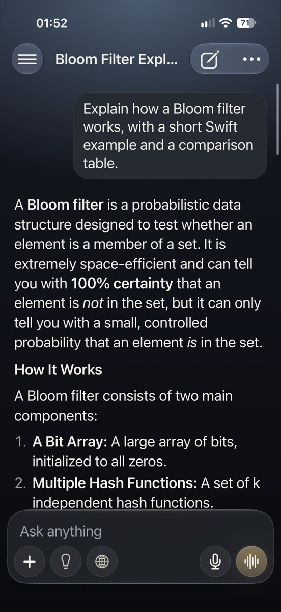
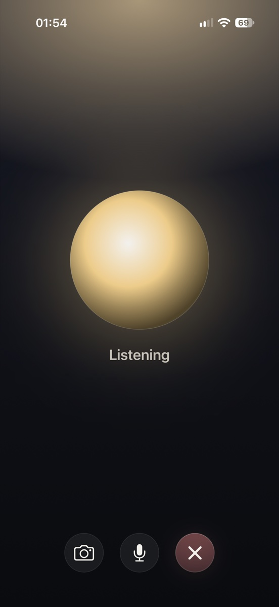
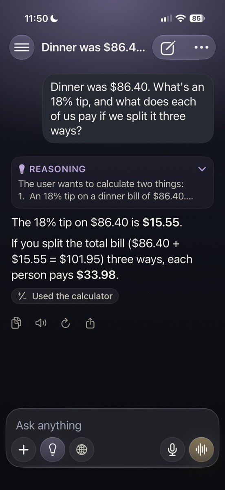
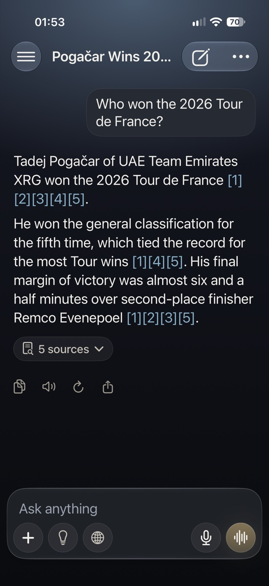
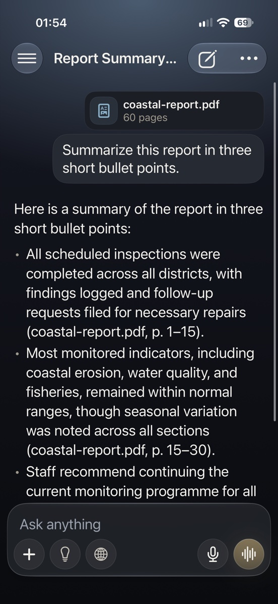
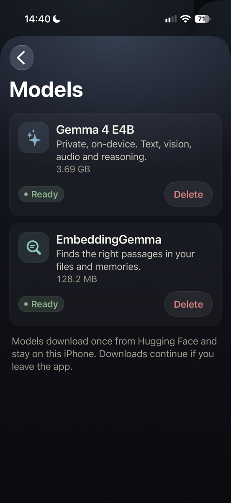
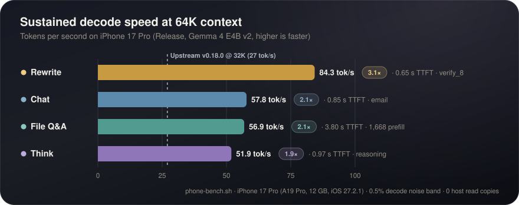

<div align="center">

<picture>
  <source media="(max-width: 700px)" srcset="docs/readme/hero-narrow.svg">
  
</picture>

<br>

**[What is Agello](#what-is-agello)** · **[What it does](#what-it-does)** · **[Engineering & performance](#engineering-and-performance)** · **[Build from source](#build-from-source)** · **[Credits](#credits-and-attribution)**

</div>

## What is Agello

Agello is a private AI assistant for your iPhone. Ask a question, attach a 60-page PDF, snap a photo, or start a hands-free spoken conversation, and Agello answers with Google's [Gemma 4](https://huggingface.co/google/gemma-4-E4B-it) running directly on your phone's own Apple Silicon.

There is no account, no subscription, no API key and no cloud. Your conversations, photos, documents, voice recordings and memories stay on your iPhone. Once the models download, Agello works completely offline — touching the network only when you ask it to search the web.

<table>
<tr>
<td width="50%" align="center"></td>
<td width="50%" align="center"></td>
</tr>
</table>

## What it does

<picture>
  <source media="(max-width: 700px)" srcset="docs/readme/modes-narrow.svg">
  
</picture>

- **Chat.** Streamed answers with headings, tables, task lists, syntax-highlighted code with a Copy button, and typeset math. Edit or regenerate any turn and switch between branches with `‹ 2/3 ›`.
- **Think.** Step-by-step reasoning in a collapsible card above the answer, calling built-in tools automatically from natural prompts in 13+ languages — calculator, unit conversion, document page reader, CSV/TSV/JSON table queries, and past-chat search.
- **Search.** One tap lets Agello look things up only when your question needs fresh facts: it searches open, key-free sources (Wikipedia, Wikidata, Wikivoyage, Apple Weather and Maps, European Central Bank rates, Crossref and PubMed), reads the top pages, and cites every claim with `[1]`-style links.
- **Voice & vision.** Share photos or scan paper with the camera, dictate live in your language, send voice messages Gemma hears directly, or open **Voice Mode** for a hands-free spoken conversation with live captions, optional camera, and instant barge-in when you speak over it.

<picture>
  <source media="(max-width: 700px)" srcset="docs/readme/features-narrow.svg">
  
</picture>

Group related work into **Projects** with shared instructions and reference files, search your history by words or by meaning (*"Japan vacation"* finds *"Kyoto itinerary"*), and opt in to **Personal tools** (Calendar, Reminders, Contacts and Apple Maps) that always show an explicit in-chat confirmation card before creating an event or reminder. Agello integrates across iOS 27 with Siri and Shortcuts, the Action Button, Spotlight, Home and Lock Screen widgets, Control Center, Live Activities for long multi-document synthesis, and the Share Sheet. → [User guide](docs/USER_GUIDE.md) · [Privacy policy](https://powerbeef.github.io/Agello/privacy)

<table>
<tr>
<td width="50%" align="center"></td>
<td width="50%" align="center"></td>
</tr>
<tr>
<td width="50%" align="center"></td>
<td width="50%" align="center"></td>
</tr>
</table>

> [!NOTE]
> Agello isn't on the App Store yet. You can [build it from source](#build-from-source) for any 12 GB iPhone running iOS 27 (iPhone 17 Pro, iPhone 17 Pro Max, iPhone Air, or newer).

## Engineering and performance

<picture>
  <source media="(max-width: 700px)" srcset="docs/readme/performance-narrow.svg">
  
</picture>

Agello ships our own hard-forked Metal 4 / MSL 4.1 runtime ([`agello-one-20261124`](https://github.com/PowerBeef/agello-litert-lm/releases/tag/agello-one-20261124)), a graph-patched **64K** Gemma 4 E4B model, and a 4-bucket asymmetric INT4 **Core AI Neural Engine** `EmbeddingGemma 2` bundle. With the models warm in unified memory, everyday chats peak at **1.5–1.7 GB**, first tokens arrive in **0.65–0.97 s**, and sustained decode runs **2× to 3.1× faster** than Google's stock v0.18.0 runtime — at **double** its maximum 32K context window.

<picture>
  <source media="(max-width: 700px)" srcset="docs/readme/decode-by-mode-narrow.svg">
  
</picture>

<details>
<summary><b>Every measurement and the October 2026 upstream baseline</b></summary>

<br>

Measured in Release builds via [`scripts/phone-bench.sh`](docs/HARNESS.md) (case-alternating thermal rest, **24/24 launches `nominal`**, **95.8% undisturbed**, **0.5% median decode noise band**, **0 host read copies**) and on-hardware suites on an **iPhone 17 Pro** (`iPhone18,1`, Apple A19 Pro, 12 GB, iOS 27.2.1):

| Workload (Agello Metal 4 + v2 64K + Core AI ANE) | Measured on iPhone 17 Pro |
| --- | --- |
| Long-file prefill (`file-report`, 6,249 tok, 64K) | **1,654 med / 1,668 peak tok/s** (`3.80 s` TTFT) |
| Rewrite decode (`typo-fix`, `verify_8` 7-draft rounds) | **83.4 med / 84.3 peak tok/s** (`0.65 s` TTFT) |
| Chat decode (`email`, 64K) | **57.3–57.8 tok/s** (`0.85 s` TTFT, `1,599 tok/s` prefill) |
| File Q&A decode (`file-report`, 6.2K PDF) | **56.5–56.9 tok/s** (`1.70 GB` kernel peak) |
| Think decode (`explain`, ~1,380 reasoning tok) | **50.6–51.9 tok/s** (`0.97 s` TTFT, up from `37.3`) |
| Full 64K (`65,536` tok) fidelity & peak footprint | **12/12 bit-exact** to pos `65,534`, **90/90** needles (`3.18–3.45 GB`) |
| 200-turn pool soak (`test38_PoolSoak`) | **+4.95 MB** median growth (`465 MB` final / `5.98 GB` free) |
| Warm model load (`MTLBinaryArchive`) | **0.7–1.1 s** (`0.90 s` GPU Vision init, `1.1 s` 64K load) |
| 40-page PDF index & query (16-Core ANE) | **0.86 s** index (`2.2×` faster than GPU), **8–11 ms** query |
| Concurrent chat index while Gemma 4 streams | **46 ms** on ANE (`0%` GPU contention, `0.9995` FP32 cosine) |
| Live dictation & voice follow-up | **32 ms** captions (`SpeechAnalyzer`), **0.89 s** first spoken sentence |
| Lazy Conformer audio load / unload | **3.2–4.3 ms** load / **0.9–1.1 ms** unload (`USER_INTERACTIVE`) |

For comparison, on Google's stock LiteRT-LM v0.18.0 binary (October 2026, before our Metal 4 fork), decode on the same iPhone 17 Pro dropped across `43 / 38 / 34 / 27 tok/s` at `4K / 8K / 16K / 32K` (with no 64K support), TTFT on an 8.6K prompt took `18.9 s`, warm load took `1–3 s`, and GPU PDF indexing took `1.7–1.9 s`. Google's E4B model card (2026-10-15) reports `1,189 tok/s` prefill and `25.1 tok/s` non-speculative decode on A19 Pro.

</details>

### Under the hood

Agello treats the A19 Pro+ as a heterogeneous computer rather than a single GPU queue: Swift 6 strict concurrency, one actor owning our custom C++/Metal 4 engine in-process, retrieval and live transcription offloaded to the 16-core Neural Engine, and zero Python or server layers anywhere at runtime.

<picture>
  <source media="(max-width: 700px)" srcset="docs/readme/architecture-narrow.svg">
  
</picture>

Every turn — typed, edited, regenerated, spoken, or shared — enters one pipeline in `AppState`, fits cleanly inside the KV budget before touching native memory, streams into a branching SwiftData tree, and snapshots its sparse KV state in zero-blit Metal 4 virtual mappings when background helper tasks extract titles or memories. → [Architecture](docs/ARCHITECTURE.md) · [Runtime audit](docs/RUNTIME-AUDIT-2026-11-21.md)

<picture>
  <source media="(max-width: 700px)" srcset="docs/readme/numbers-narrow.svg">
  
</picture>

<table>
<tr>
<td width="56" valign="top"></td>
<td><b>An owned Metal 4 / MSL 4.1 runtime on GPU Neural Accelerators.</b> Our fork (<a href="https://github.com/PowerBeef/agello-litert-lm"><code>PowerBeef/agello-litert-lm</code></a>, build <code>8a7e34594612</code>) compiles LiteRT-LM, LiteRT and ML Drift together for Apple10+ GPUs: cooperative-tensor <code>matmul2d</code> FlashAttention (<code>D=256/512</code>, eliminating materialized score buffers), Apple10 INT8/FP16 <code>ConvAppleMPP</code> across both LLM prefill and Vision (all <code>112</code> ViT linears and <code>32</code> attention matmuls, <b>4.5× faster</b>), FP32-promoted softmax/PV attention and KV quantization, <code>verify_8</code> 7-draft speculative rounds sharing <code>100%</code> of their intermediate pool with <code>verify</code>/<code>decode</code>, zero-copy ARM64 NEON greedy sampling directly on shared Metal buffers (<code>0</code> host read copies, down from <code>&gt;2 GB</code> per long reply), and persistent <code>MTLBinaryArchive</code> PSO deduplication. → <a href="docs/BACKEND.md">The backend</a> · <a href="Vendor/README.md">Vendored package</a></td>
</tr>
<tr>
<td valign="top"></td>
<td><b>Zero-contention retrieval and speech on the 16-Core Neural Engine.</b> <code>CoreAIEmbedder</code> runs a 4-bucket (<code>128–1024</code>) asymmetric INT4 <code>EmbeddingGemma 2</code> bundle exclusively on the Neural Engine (<code>0%</code> GPU activity, <code>0.9995</code> average cosine parity vs FP32, zero-dependency UTF-8 SentencePiece tokenizer, and self-healing recovery from stale iOS 27 <code>AIModelCache</code> entries) — indexing a 40-page PDF in <b>0.86 s</b> and indexing chats in <b>46 ms</b> <i>while Gemma 4 streams on the GPU</i>. Live dictation and voice turn detection run on ANE via iOS 27 <code>SpeechAnalyzer</code> in <b>32 ms</b>.</td>
</tr>
<tr>
<td valign="top"></td>
<td><b>64K context without float16 drift (<a href="https://github.com/google-ai-edge/LiteRT-LM/issues/3913">LiteRT-LM #3913</a>).</b> With 16-bit GPU activations, Gemma 4 repeated digits past 2,048 tokens because binary16 cannot represent every integer position. Our graph-patched <code>v2</code> artifact pairs shared Dual-<code>GATHER</code> 128K rotary tables (<code>&lt;0.001 rad</code> phase error, unchanged weights), 1,536-slot local KV rings, sparse Metal global KV buffers mapped on demand and trimmed on rewind, and Metal 4 <code>copyBufferMappingsFromBuffer:</code> zero-blit helper snapshots — verified <b>12/12 bit-exact</b> on 48-digit copies up to position <code>65,534</code> within <code>3.2–3.5 GB</code>. → <a href="docs/ENGINEERING.md#long-context-digits-on-the-gpu-litert-lm-3913">The #3913 deep dive</a></td>
</tr>
<tr>
<td valign="top"></td>
<td><b>Unbreakable context budget, LL(1) tool grammar and prompt-injection defense.</b> Every prompt is rendered identically to the runtime and counted with the model's tokenizer before dispatch; evicted turns are recalled semantically and overflowing inputs explain why instead of corrupting the native heap. Tool calling pairs a self-contained recursive-descent LL(1) parser (native <code>&lt;|"|&gt;</code> and RFC 8259 JSON), <code>llguidance</code> <code>TokTrie</code> multi-word JSON enums under MTP, live <code>&lt;thought&gt;</code> continuity across tool steps, and parallel read-only dispatch. External content is spotlighted inside random-nonced <code>&lt;untrusted_data&gt;</code> blocks, quarantined from memory, fetched over DNS-verified public IPs, and gated by fail-closed confirmation cards (<b>0%</b> breach across 6 adversarial vectors).</td>
</tr>
<tr>
<td valign="top"></td>
<td><b>Branching SwiftData history, isolated UI and safe background GPU drain.</b> Conversations form a versioned SwiftData tree (<code>V3</code>) where edit and regenerate move <code>activeLeafID</code> without cross-branch or cancelled-helper KV bleed. <code>ComposerBridge</code> isolates keystrokes from message-list diffing; Conformer audio loads lazily on P-cores in <b>3 ms</b> (<code>1 ms</code> unload); and synchronous <code>GPUGate</code> + <code>BGContinuedProcessingTask</code> guards drain Metal work cleanly before suspension.</td>
</tr>
<tr>
<td valign="top"></td>
<td><b>Benchmarked and verified on real silicon.</b> All <b>573 automated tests</b> (456 unit, 89 real-model hardware scenarios and probes, 28 real-tap UI and accessibility tests) and every speed/memory number run on real Apple silicon across a 25-second M6 <code>SIM_GPU=Apple_A19_Pro</code> CLI workbench, a 200-turn memory soak (<code>+4.95 MB</code>), jetsam ballast envelopes on a 12 GB phone, and physical iPhone 17 Pro gates. Our XCFramework ships no simulator slice; for fast UI, iOS-feature, and in-app output-quality iteration, the unshipped <code>AgelloSim</code> target proxies real Metal 4 + ANE inference from host <code>agello serve</code> into the iOS Simulator while executing all 16 Swift tools natively. → <a href="docs/TESTING.md">Testing</a> · <a href="docs/HARNESS.md">Autonomous harness</a></td>
</tr>
</table>

### Build from source

| Target | Requirements | Models (downloaded once in-app) |
| --- | --- | --- |
| iPhone app | iPhone 17 Pro / Pro Max, iPhone Air or newer (12 GB RAM), iOS 27.0+, ~7 GB free | Gemma 4 E4B v2 (`3.69 GB`) + EmbeddingGemma 2 ANE (`128 MB`) |
| Build & CLI | Apple Silicon Mac with Xcode 27; Apple Developer account with Extended Virtual Addressing, Increased Memory Limit, Background GPU Access, App Groups, WeatherKit | Shared local `~/Models/agello` cache for the unshipped `agello` Mac CLI |

1. Clone the repository and open `Agello.xcodeproj` (SwiftPM resolves `swift-markdown` and `SwiftMath`; our Metal 4 `LiteRT-LM` package and checksummed XCFramework are vendored in `Vendor/LiteRT-LM`).
2. Under **Signing & Capabilities**, switch team `FK2D8X36G2` and the `com.patricedery.agello` bundle IDs (`.widgets`, `.share`, App Group `group.com.patricedery.agello`) to your account.
3. Select the `Agello` scheme and your physical iPhone, and run (**Release** configuration for representative speed, or add `--mock-engine` in scheme launch arguments to explore the UI without downloading models).

```sh
scripts/sim-launch.sh                  # iOS Simulator UI, tools & live quality bridge (AgelloSim + agello serve)
scripts/cli-test.sh unit               # fast Mac CLI unit suite (~25 s, no phone)
scripts/cli-test.sh security           # 6-vector adversarial prompt-injection gate (~25 s)
scripts/device-harness.sh gate         # single-build physical iPhone hardware + UI gate
python3 scripts/generate_readme_art.py --check
```

→ [Architecture](docs/ARCHITECTURE.md) · [Engineering notes](docs/ENGINEERING.md) · [LiteRT-LM reference](docs/LITERT-LM.md) · [Mac CLI](docs/CLI.md) · [Performance ledger](docs/PERFORMANCE.md) · [Roadmap](docs/ROADMAP.md)

## Credits and attribution

Agello is licensed under the [Apache License 2.0](LICENSE). Full third-party notices and model terms live in [NOTICE](NOTICE) and in the app under **Settings → About → Licenses**.

- **Models & runtime.** Built on [Gemma 4 E4B](https://huggingface.co/google/gemma-4-E4B-it), [LiteRT](https://github.com/google-ai-edge/litert), and [LiteRT-LM](https://github.com/google-ai-edge/LiteRT-LM) by Google, and the [`litert-community` Gemma 4 E4B](https://huggingface.co/litert-community/gemma-4-E4B-it-litert-lm) and [EmbeddingGemma 2](https://huggingface.co/litert-community/embeddinggemma-2-text-270m-litert-lm) builds — shipped through our Metal 4 fork ([`PowerBeef/agello-litert-lm`](https://github.com/PowerBeef/agello-litert-lm)), [v2 float16-RoPE 128K model](https://huggingface.co/PowerBeef02/gemma-4-E4B-it-litert-lm-fp16-rope), and [Core AI ANE EmbeddingGemma 2 bundle](https://huggingface.co/PowerBeef02/embeddinggemma-2-text-270m-coreai-ane).
- **Long-context GPU research ([LiteRT-LM #3913](https://github.com/google-ai-edge/LiteRT-LM/issues/3913)).** Special thanks to [@john-rocky](https://github.com/john-rocky) (copy-fidelity suite, M4 Max & Android GPU verification, and [litert-torch#1343](https://github.com/google-ai-edge/litert-torch/issues/1343)), [@picitujeromanov](https://github.com/picitujeromanov) (M1-class precision analysis behind the 512-token block layout), and Google's LiteRT-LM team.
- **Open-source Swift packages.** [swift-markdown](https://github.com/swiftlang/swift-markdown) (Apache 2.0 / BSD 2-Clause) by the Swift project, and [SwiftMath](https://github.com/mgriebling/SwiftMath) (MIT) by Computer Inspirations.

<br>

<div align="center">

<br>
<sub>Agello · your own AI assistant, on your iPhone</sub>
</div>
