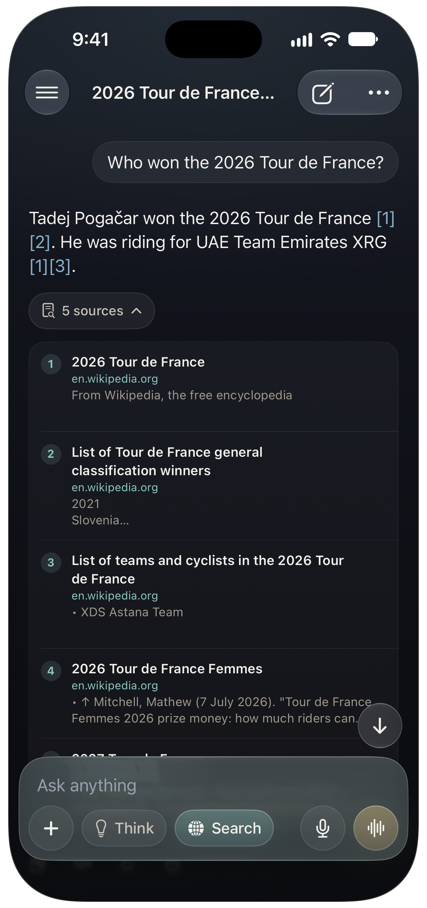
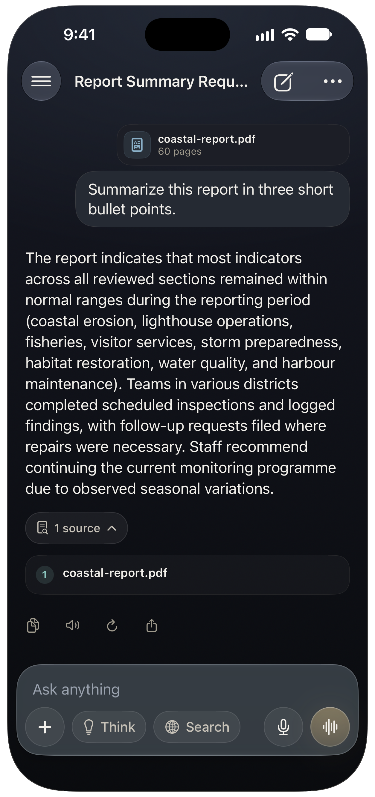
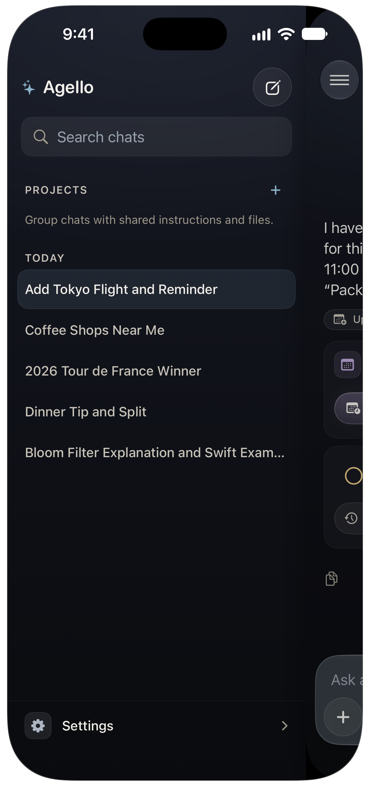
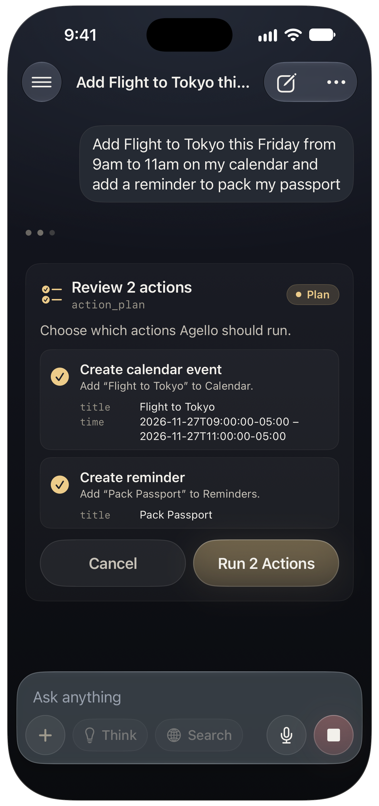
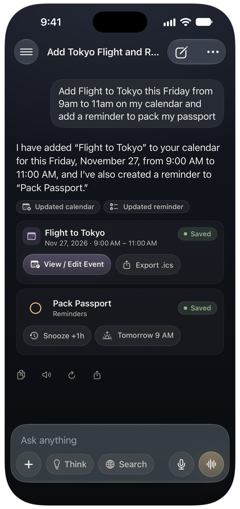
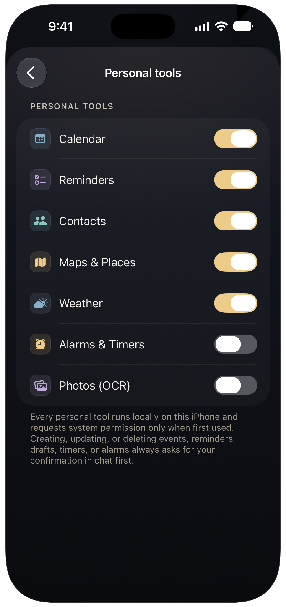
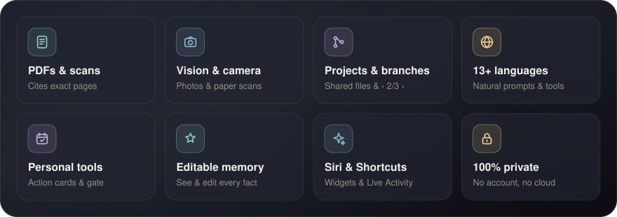
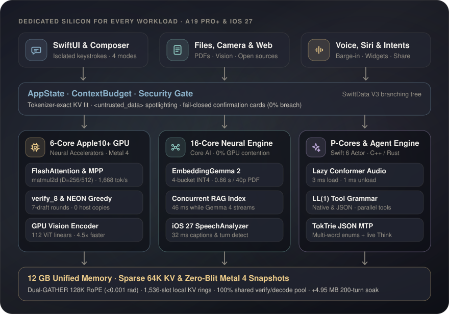
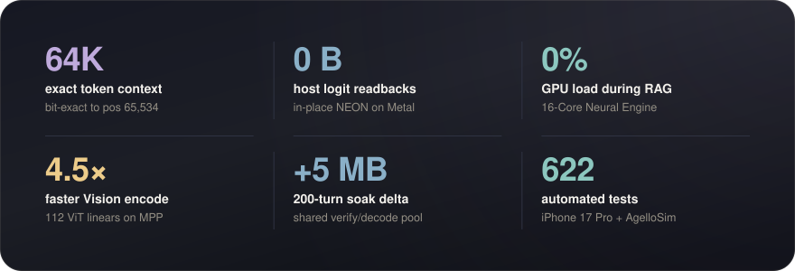

<div align="center">

<picture>
  <source media="(max-width: 700px)" srcset="docs/readme/hero-narrow.svg">
  
</picture>

<br>

**[What is it?](#what-is-it)** &nbsp;·&nbsp; **[What it does](#what-it-does)** &nbsp;·&nbsp; **[Engineering &amp; benchmarks](#engineering-and-benchmarks)** &nbsp;·&nbsp; **[Attributions &amp; licenses](#attributions-and-licenses)**

</div>

---

## What is it?

Agello is a private AI assistant that runs locally on your iPhone, powered by Google's [Gemma 4](https://huggingface.co/google/gemma-4-E4B-it) directly on Apple Silicon. You can write and debug code, talk through a problem out loud, drop in a 60-page PDF, or snap a photo of paperwork and get an answer in seconds.

There is no sign-up, no monthly subscription, and no API key. Your conversations, files, photos, voice clips, and saved memories stay on your device. Once the models finish downloading inside the app, Agello works offline anywhere, including on a plane. It only touches the internet when you turn on web search, check live weather or maps, or run a Shortcut that goes online.

<p align="center">
  
  
</p>
<p align="center"><sub><b>Chat with typeset math and Swift code</b> &nbsp;·&nbsp; <b>Hands-free Voice Mode</b></sub></p>

> [!NOTE]
> Agello is not on the App Store yet. You can [build it from source](#build-from-source) for any iPhone with 12 GB of memory running iOS 27 (iPhone 17 Pro, iPhone 17 Pro Max, iPhone Air, or newer).

---

## What it does

<picture>
  <source media="(max-width: 700px)" srcset="docs/readme/modes-narrow.svg">
  
</picture>

### Think problems through, or look up live facts

Turn on **Think** when a question needs careful work. Agello shows its step-by-step reasoning in a collapsible card above the reply and calls built-in tools like the calculator, unit converter, or table query engine on its own, in 13+ languages.

Tap **Search** when you need current information. Agello queries open, key-free sources (Wikipedia, Wikidata, Wikivoyage, Apple Weather and Maps, European Central Bank rates, Crossref, and PubMed), reads the top pages, and backs every factual claim with numbered `[1]` links you can open and check.

<p align="center">
  
  
</p>
<p align="center"><sub><b>Think mode with the built-in calculator</b> &nbsp;·&nbsp; <b>Web search with numbered source cards</b></sub></p>

### Work across long documents and Projects

Attach PDFs, spreadsheets, photos, or scanned pages from the camera and ask follow-up questions that cite the exact pages they came from. Group ongoing work into **Projects** with shared instructions, reference files, and linked folders. Past conversations are indexed by meaning as well as keywords, so searching *"Japan vacation"* still finds your *"Kyoto itinerary"*. You can also edit or regenerate any message and switch between alternate reply branches with `‹ 2/3 ›`.

<p align="center">
  
  
</p>
<p align="center"><sub><b>60-page PDF summary with cited pages</b> &nbsp;·&nbsp; <b>Slide-over drawer with search and Projects</b></sub></p>

### Act on your iPhone, only with your permission

Personal tools are off by default. You choose which ones Agello can access: **Calendar, Reminders, Contacts, Apple Maps, Weather, Alarms &amp; Timers, and Photos**, along with an allowlist for your own Apple Shortcuts and saved Recipes.

Replies include interactive cards you can use right inside the chat: dark-mode Apple Maps views with directions and Look Around, calendar events ready to edit or export, reminders with one-tap snooze, live timer countdowns, and pre-filled message drafts. Before Agello creates, changes, or deletes anything, it pauses and shows a clear checklist for you to review and approve.

<p align="center">
  
  
</p>
<p align="center"><sub><b>Apple Maps card with Look Around and directions</b> &nbsp;·&nbsp; <b>Approval checklist before any action runs</b></sub></p>

<p align="center">
  
  
</p>
<p align="center"><sub><b>Calendar and Reminder cards after approval</b> &nbsp;·&nbsp; <b>Settings for models, memory, and tools</b></sub></p>

<details>
<summary><b>See Personal Tools and Shortcuts settings</b></summary>

<br>

<p align="center">
  
  
</p>
<p align="center"><sub><b>Per-domain Personal Tools switches</b> &nbsp;·&nbsp; <b>Allowed Shortcuts and starter templates</b></sub></p>

</details>

### Built into iOS

<picture>
  <source media="(max-width: 700px)" srcset="docs/readme/features-narrow.svg">
  
</picture>

Start a request from Siri, composable Apple Shortcuts, Focus Filters, the Action Button, Spotlight, Home and Lock Screen widgets, Control Center, Live Activities, or the Share Sheet. Learn more in the [User guide](docs/USER_GUIDE.md) and [Privacy policy](https://powerbeef.github.io/Agello/privacy).

---

## Engineering and benchmarks

Most on-device AI apps wrap an off-the-shelf inference library and stop there. Agello runs on our own hard-forked **Metal 4 / MSL 4.1 runtime** ([`agello-one-20261124`](https://github.com/PowerBeef/agello-litert-lm/releases/tag/agello-one-20261124)), a graph-patched **64K Gemma 4 E4B** model, and a dedicated **16-Core Neural Engine** retrieval and speech pipeline. On an iPhone 17 Pro, everyday chats peak at **1.5 to 1.7 GB** of memory, first tokens arrive in **0.65 to 0.97 s**, and sustained generation runs **2× to 3.1× faster** than Google's stock LiteRT-LM v0.18.0 runtime at **twice** its maximum 32K context window.

<picture>
  <source media="(max-width: 700px)" srcset="docs/readme/performance-narrow.svg">
  
</picture>

<picture>
  <source media="(max-width: 700px)" srcset="docs/readme/decode-by-mode-narrow.svg">
  
</picture>

<picture>
  <source media="(max-width: 700px)" srcset="docs/readme/silicon-benchmarks-narrow.svg">
  
</picture>

<details>
<summary><b>Full iPhone 17 Pro benchmark ledger and methodology</b></summary>

<br>

Measured in Release builds via [`scripts/phone-bench.sh`](docs/HARNESS.md) (case-alternating thermal rest, **24/24 launches `nominal`**, **95.8% undisturbed**, **0.5% median decode noise band**, **0 host read copies**) and on-hardware device suites on an **iPhone 17 Pro** (`iPhone18,1`, Apple A19 Pro, 12 GB, iOS 27.2.1):

| Workload (Agello Metal 4 + v2 64K + Core AI ANE) | Measured on iPhone 17 Pro |
| --- | --- |
| Long-file prefill (`file-report`, 6,249 tok, 64K) | **1,654 med / 1,668 peak tok/s** (`3.80 s` TTFT) |
| Rewrite decode (`typo-fix`, `verify_8` 7-draft rounds) | **83.4 med / 84.3 peak tok/s** (`0.65 s` TTFT) |
| Chat decode (`email`, 64K) | **57.3–57.8 tok/s** (`0.85 s` TTFT, `1,599 tok/s` prefill) |
| File Q&A decode (`file-report`, 6.2K PDF) | **56.5–56.9 tok/s** (`1.70 GB` kernel peak) |
| Think decode (`explain`, ~1,380 reasoning tok) | **50.6–51.9 tok/s** (`0.97 s` TTFT, up from `37.3`) |
| Full 64K (`65,536` tok) fidelity and peak footprint | **12/12 bit-exact** to pos `65,534`, **90/90** needles (`3.18–3.45 GB`) |
| 200-turn pool soak (`test38_PoolSoak`) | **+4.95 MB** median growth (`465 MB` final / `5.98 GB` free) |
| Warm model load (`MTLBinaryArchive`) | **0.7–1.1 s** (`0.90 s` GPU Vision init, `1.1 s` 64K load) |
| 40-page PDF index and query (16-Core ANE) | **0.86 s** index (`2.2×` faster than GPU), **8–11 ms** query |
| Concurrent chat index while Gemma 4 streams | **46 ms** on ANE (`0%` GPU contention, `0.9995` FP32 cosine) |
| Live dictation and voice follow-up | **32 ms** captions (`SpeechAnalyzer`), **0.89 s** first spoken sentence |
| Lazy Conformer audio load and unload | **3.2–4.3 ms** load / **0.9–1.1 ms** unload (`USER_INTERACTIVE`) |

For comparison, on Google's stock LiteRT-LM v0.18.0 binary (October 2026, before our Metal 4 fork), decode on the same iPhone 17 Pro fell across `43 / 38 / 34 / 27 tok/s` at `4K / 8K / 16K / 32K` (with no 64K support and float16 RoPE digit corruption past 2,048 tokens), TTFT on an 8.6K prompt took `18.9 s`, warm load took `1–3 s`, and GPU PDF indexing took `1.7–1.9 s`. Google's E4B model card (2026-10-15) reports `1,189 tok/s` prefill and `25.1 tok/s` non-speculative decode on A19 Pro.

</details>

### Heterogeneous silicon architecture

Rather than queuing every workload onto the GPU, Agello splits execution across all three compute units on the A19 Pro+ over 12 GB of unified memory. One Swift 6 actor owns the C++/Metal 4 language and vision engine on the GPU, document and chat embeddings run concurrently on the 16-Core Neural Engine with zero GPU contention, and P-cores handle ARM64 NEON sampling, grammar masks, and lazy audio encoding. There is no Python and no local server in the shipping app.

<picture>
  <source media="(max-width: 700px)" srcset="docs/readme/architecture-narrow.svg">
  
</picture>

<picture>
  <source media="(max-width: 700px)" srcset="docs/readme/numbers-narrow.svg">
  
</picture>

### Six hard systems problems we solved

####  &nbsp;Custom Metal 4 / MSL 4.1 runtime on GPU Neural Accelerators

Our fork ([`PowerBeef/agello-litert-lm`](https://github.com/PowerBeef/agello-litert-lm), build `8a7e34594612`) consolidates LiteRT-LM, LiteRT, and ML Drift into a single Apple-silicon codebase. Prefill and Vision target Apple10+ per-core matrix engines directly through cooperative-tensor `matmul2d` FlashAttention (`D=256/512`, removing materialized score buffers) and `ConvAppleMPP` across all `112` ViT linears and `32` attention matmuls (**4.5× faster** Vision encode). Seven-draft `verify_8` speculative rounds share **100%** of their intermediate Metal buffer pool with `verify` and `decode`, ARM64 NEON greedy sampling reads shared Metal buffers in place (**0** host read copies, down from `>2 GB` per long reply), and persistent `MTLBinaryArchive` caches bring 64K warm loads down to **1.1 s**. See [The backend](docs/BACKEND.md) and [Vendored package](Vendor/README.md).

####  &nbsp;64K context without float16 drift ([LiteRT-LM #3913](https://github.com/google-ai-edge/LiteRT-LM/issues/3913))

With 16-bit GPU activations, Gemma 4 duplicated digits past token `2,048` because binary16's 11-bit significand rounds odd positions above 2,048 to even numbers. Our reproducible `v2` model patches the computation graph (leaving weights untouched) to look up precomputed Dual-`GATHER` 128K rotary tables (`<0.001 rad` phase error), cap local sliding-window layers at 1,536-slot KV rings, and back global KV caches with Metal 4 sparse buffers (`MTLBufferSparseTier1`) that unmap unused pages immediately on rewind. Background title and memory helpers detach and restore sparse KV mappings in zero blits via `MTL4CommandQueue.copyBufferMappingsFromBuffer:`, delivering **12/12 bit-exact** 48-digit copies up to position `65,534` and **90/90** needle recall inside **3.18 to 3.45 GB**. Read the [#3913 deep dive](docs/ENGINEERING.md#long-context-digits-on-the-gpu-litert-lm-3913).

####  &nbsp;Zero-contention retrieval and speech on the 16-Core Neural Engine

`CoreAIEmbedder` runs a 4-bucket (`128` to `1024` tokens) asymmetric INT4 `EmbeddingGemma 2` bundle exclusively on the Neural Engine with `0%` GPU activity and `0.9995` average cosine parity against FP32, backed by a zero-dependency UTF-8 SentencePiece tokenizer, `SIMD8<Float16>` LUT dequantization, and automatic recovery from stale iOS 27 `AIModelCache` entries. On an iPhone 17 Pro, indexing a 40-page PDF takes **0.86 s** (`2.2×` faster than on the GPU), background chat indexing finishes in **46 ms** while Gemma 4 is actively streaming on the GPU, and iOS 27 `SpeechAnalyzer` streams live dictation captions and turn detection in **32 ms**.

####  &nbsp;Exact token budgeting, LL(1) tool grammar, and prompt-injection defense

Every prompt is rendered in the runtime's exact template and counted with the model's tokenizer before dispatch; older turns are trimmed to fit with semantic recall, and oversized inputs fail cleanly with an explanation instead of overflowing native KV memory. Tool calls run through a handwritten recursive-descent LL(1) Rust parser (accepting both native `<|"|>` delimiters and RFC 8259 JSON), `llguidance` `TokTrie` multi-word JSON enums under speculative decoding, live `<thought>` preservation across tool steps, and parallel read-only execution. Untrusted inputs from files, web pages, shares, and tool results are isolated inside random-nonced `<untrusted_data>` blocks, excluded from long-term memory, fetched only from DNS-verified public IPs, and gated by fail-closed `.standard`, `.destructive`, and `.external` confirmation cards plus 256-bit CSPRNG Shortcut callback nonces (**0% breach** across all 12 adversarial vectors `V1–V12`).

####  &nbsp;120 Hz Liquid Glass UI, branching SwiftData history, and safe background GPU drain

Conversations persist in a versioned SwiftData turn tree (`V3`) where editing or regenerating moves `activeLeafID` without leaking abandoned branches or cancelled helper tasks into KV state. `ComposerBridge` and fine-grained `@Observable` state boundaries keep typing and recording timers isolated from message-list layout, while native iOS 27 `.safeAreaBar` Liquid Glass chrome pairs with WCAG AA contrast and custom VoiceOver rotors. Conformer audio loads lazily on P-cores in **3 ms** (`1 ms` unload), and synchronous `GPUGate` assertions plus `BGContinuedProcessingTask` handlers drain in-flight Metal work cleanly before iOS suspends the app. See [Architecture](docs/ARCHITECTURE.md).

####  &nbsp;Verified on real silicon (622 automated tests)

Performance, memory, and security gates are enforced by **622 automated tests** (**493** unit tests, **90** real-model hardware scenarios and runtime probes, and **39** real-tap UI and accessibility tests), alongside a 200-turn pool soak (`+4.95 MB` median growth), jetsam memory-ballast suites (`6.0` down to `3.5 GB`), a 25-second M6 `SIM_GPU=Apple_A19_Pro` CLI workbench, and physical iPhone 17 Pro Release runs. Because `CLiteRTLM.xcframework` ships no simulator binary, an unshipped `AgelloSim` target streams real Metal 4 and ANE inference from `agello serve` on the host Mac into the iOS Simulator while running all 21 Swift tools natively. See [Testing](docs/TESTING.md) and [Autonomous harness](docs/HARNESS.md).

---

### Build from source

| Target | Requirements | Models (downloaded once in-app) |
| --- | --- | --- |
| **iPhone app** | iPhone 17 Pro / Pro Max, iPhone Air or newer (12 GB RAM), iOS 27.0+, ~7 GB free | Gemma 4 E4B v2 (`3.69 GB`) + EmbeddingGemma 2 ANE (`128 MB`) |
| **Build &amp; Mac CLI** | Apple Silicon Mac with Xcode 27; Apple Developer account (Extended Virtual Addressing, Increased Memory Limit, Background GPU Access, App Groups, WeatherKit) | Shared local `~/Models/agello` cache for the unshipped `agello` Mac CLI |

1. Clone the repository and open `Agello.xcodeproj` (SwiftPM resolves `swift-markdown` and `SwiftMath`; our Metal 4 `LiteRT-LM` package and checksummed XCFramework are vendored in `Vendor/LiteRT-LM`).
2. Under **Signing &amp; Capabilities**, switch team `FK2D8X36G2` and the `com.patricedery.agello` bundle IDs (`.widgets`, `.share`, App Group `group.com.patricedery.agello`) to your Apple Developer account.
3. Select the `Agello` scheme and your physical iPhone, then run (**Release** configuration for representative speed, or pass `--mock-engine` in scheme launch arguments to explore the UI without downloading models).

```sh
scripts/sim-launch.sh                  # iOS Simulator UI, tools & live quality bridge (AgelloSim + agello serve)
scripts/cli-test.sh unit               # fast Mac CLI unit suite (~25 s, no phone)
scripts/cli-test.sh security           # 12-vector (V1–V12) adversarial prompt-injection gate (~25 s)
scripts/device-harness.sh gate         # single-build physical iPhone hardware + UI gate
python3 scripts/generate_readme_art.py --check
```

Documentation: [Architecture](docs/ARCHITECTURE.md) · [Engineering notes](docs/ENGINEERING.md) · [The backend](docs/BACKEND.md) · [Backend knowledge base](docs/BACKEND_KNOWLEDGE_BASE.md) · [LiteRT-LM reference](docs/LITERT-LM.md) · [Mac CLI](docs/CLI.md) · [Roadmap](docs/ROADMAP.md)

---

## Attributions and licenses

Agello is licensed under the **[Apache License 2.0](LICENSE)**. Complete third-party notices and model terms are in [NOTICE](NOTICE) and in the app under **Settings → About → Licenses**.

- **Models &amp; runtime.** Built on [Gemma 4 E4B](https://huggingface.co/google/gemma-4-E4B-it), [LiteRT](https://github.com/google-ai-edge/litert), and [LiteRT-LM](https://github.com/google-ai-edge/LiteRT-LM) by Google, and the [`litert-community` Gemma 4 E4B](https://huggingface.co/litert-community/gemma-4-E4B-it-litert-lm) and [EmbeddingGemma 2](https://huggingface.co/litert-community/embeddinggemma-2-text-270m-litert-lm) builds, shipped through our Metal 4 fork ([`PowerBeef/agello-litert-lm`](https://github.com/PowerBeef/agello-litert-lm)), [v2 float16-RoPE 128K model](https://huggingface.co/PowerBeef02/gemma-4-E4B-it-litert-lm-fp16-rope), and [Core AI ANE EmbeddingGemma 2 bundle](https://huggingface.co/PowerBeef02/embeddinggemma-2-text-270m-coreai-ane).
- **Long-context GPU research ([LiteRT-LM #3913](https://github.com/google-ai-edge/LiteRT-LM/issues/3913)).** Special thanks to [@john-rocky](https://github.com/john-rocky) (copy-fidelity suite, M4 Max &amp; Android GPU verification, and [litert-torch#1343](https://github.com/google-ai-edge/litert-torch/issues/1343)), [@picitujeromanov](https://github.com/picitujeromanov) (M1-class precision analysis behind the 512-token block layout), and Google's LiteRT-LM team.
- **Open-source Swift packages.** [swift-markdown](https://github.com/swiftlang/swift-markdown) (Apache 2.0 / BSD 2-Clause) by the Swift project, and [SwiftMath](https://github.com/mgriebling/SwiftMath) (MIT) by Computer Inspirations.

<br>

<div align="center">

<br>
<sub>Agello · your own AI assistant, on your iPhone</sub>
</div>
