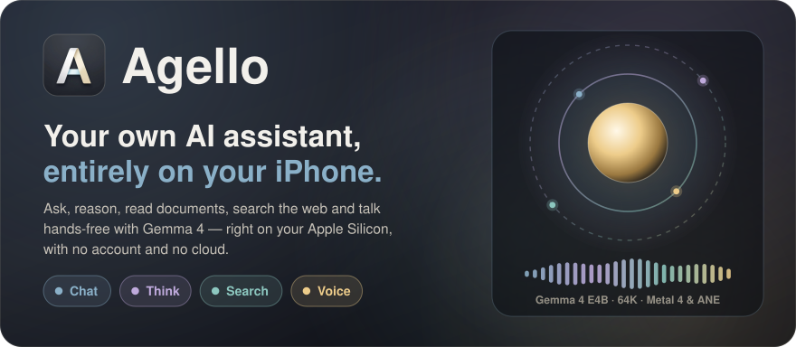
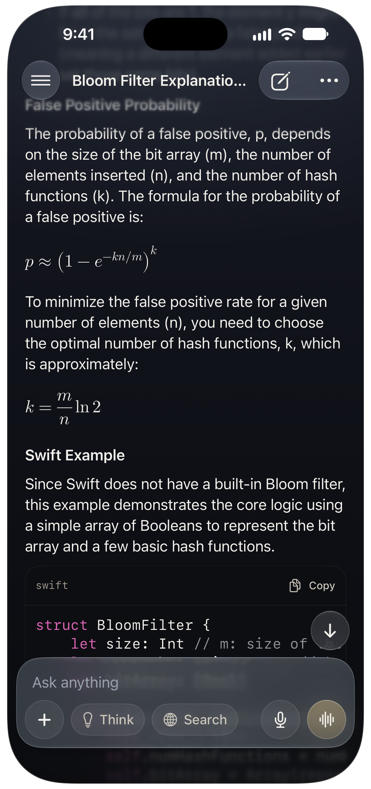
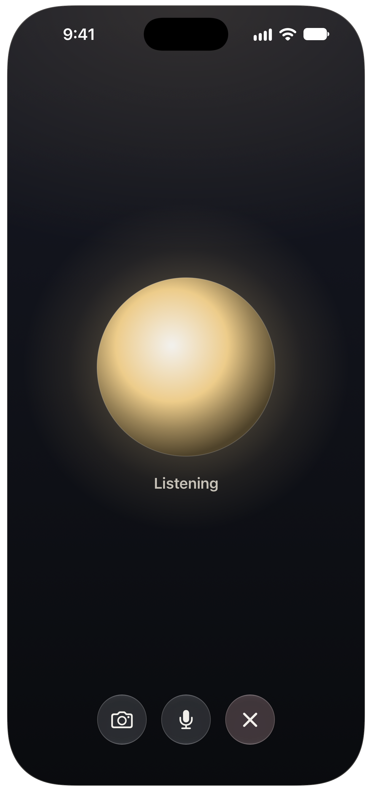
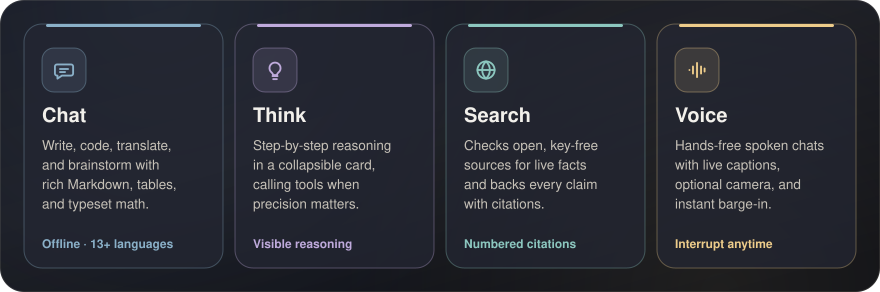
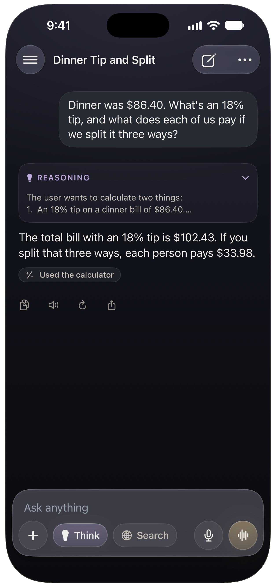
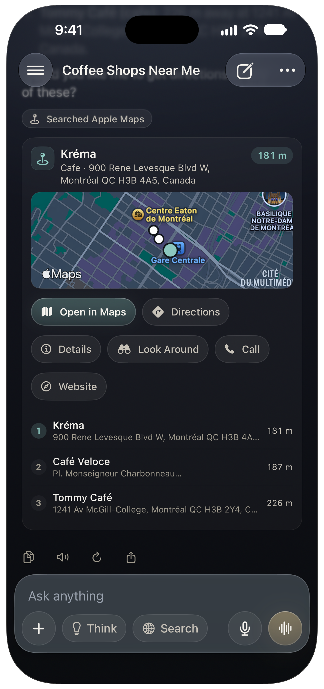
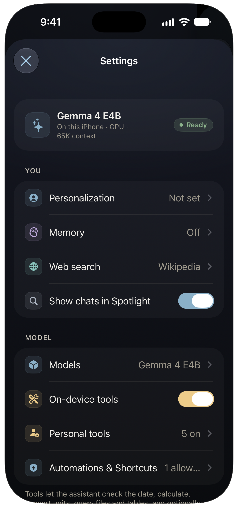
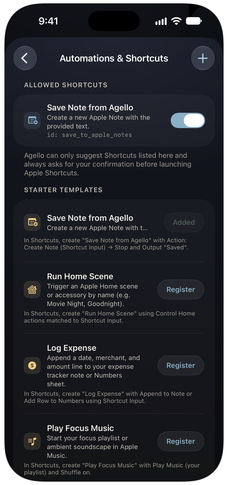
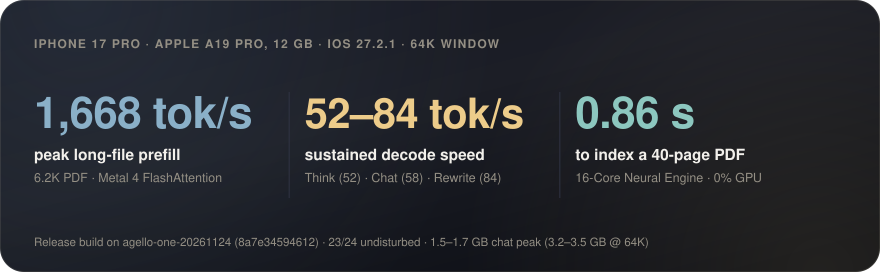
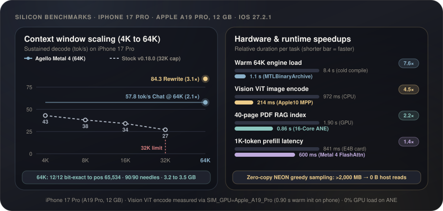

<div align="center">

<picture>
  <source media="(max-width: 700px)" srcset="docs/readme/hero-narrow.svg">
  
</picture>

<br>

**[What is it?](#what-is-it)** &nbsp;·&nbsp; **[What it does](#what-it-does)** &nbsp;·&nbsp; **[Engineering &amp; benchmarks](#engineering-and-benchmarks)** &nbsp;·&nbsp; **[Attributions &amp; licenses](#attributions-and-licenses)**

</div>

---

## What is it?

Agello is a personal AI assistant that lives completely on your iPhone. Ask a question, drop in a 60-page PDF, snap a photo, or have a hands-free spoken conversation — powered by Google's [Gemma 4](https://huggingface.co/google/gemma-4-E4B-it) running directly on your phone's own Apple Silicon.

There is no account to create, no monthly subscription, no API key, and no cloud server reading your prompts. Your chats, photos, documents, voice clips, and saved memories never leave your iPhone. Once the models download inside the app, Agello works completely offline — even on a flight — touching the network only when you ask it to search the web, look up live weather or places, or run a Shortcut you explicitly allow.

<p align="center">
  
  
</p>
<p align="center"><sub><b>Formatted answers, typeset math &amp; syntax-highlighted code</b> &nbsp;·&nbsp; <b>Hands-free Voice Mode with camera &amp; instant barge-in</b></sub></p>

> [!NOTE]
> Agello isn't on the App Store yet. You can [build it from source](#build-from-source) for any 12 GB iPhone running iOS 27 (iPhone 17 Pro, iPhone 17 Pro Max, iPhone Air, or newer).

---

## What it does

<picture>
  <source media="(max-width: 700px)" srcset="docs/readme/modes-narrow.svg">
  
</picture>

### Reason step by step, or check the live web

Turn on **Think** when a question takes real reasoning. Agello shows its thought process in a collapsible card above the answer and reaches for built-in tools like the calculator, unit converter, or table query engine automatically — from natural prompts in 13+ languages.

When you need fresh facts, tap **Search**. Agello checks open, key-free sources (Wikipedia, Wikidata, Wikivoyage, Apple Weather and Maps, European Central Bank rates, Crossref, and PubMed), reads the best pages, and backs every claim with numbered `[1]` links you can tap to verify.

<p align="center">
  
  
</p>
<p align="center"><sub><b>Think mode with automatic calculator tool</b> &nbsp;·&nbsp; <b>Live web search with expandable citations</b></sub></p>

### Read whole documents and organize work in Projects

Attach PDFs, spreadsheets, photos, or scanned pages and ask follow-up questions that cite the exact pages they came from. Group ongoing work into **Projects** with shared instructions, reference files, and linked folders — and search past chats by meaning rather than exact keywords (*"Japan vacation"* finds your *"Kyoto itinerary"*). You can also edit or regenerate any message and flip between alternate reply branches with `‹ 2/3 ›`.

<p align="center">
  
  
</p>
<p align="center"><sub><b>60-page PDF summarized locally with cited sources</b> &nbsp;·&nbsp; <b>Slide-over drawer with instant search &amp; Projects</b></sub></p>

### Take action on your iPhone — always with your approval

Every personal integration is off until you turn it on. Enable only the domains you want — **Calendar, Reminders, Contacts, Apple Maps, Weather, Alarms & Timers, and Photos** — plus an optional allowlist for your own Apple Shortcuts and saved Recipes.

Replies come back with interactive cards you can act on directly: dark-mode Apple Maps snapshots with directions and Look Around, calendar events ready to edit or export, reminders you can snooze in one tap, live timer countdowns, and pre-filled message drafts. Whenever Agello wants to change your data or run a multi-step plan, it pauses and shows a clear checklist first — nothing runs until you tap approve.

<p align="center">
  
  
</p>
<p align="center"><sub><b>Interactive Apple Maps card with Look Around &amp; directions</b> &nbsp;·&nbsp; <b>Multi-step approval checklist before anything runs</b></sub></p>

<p align="center">
  
  
</p>
<p align="center"><sub><b>Live Calendar &amp; Reminder cards after approval</b> &nbsp;·&nbsp; <b>Local model status, memory &amp; granular tool controls</b></sub></p>

<details>
<summary><b>Peek inside Personal Tools &amp; Shortcuts allowlist settings</b></summary>

<br>

<p align="center">
  
  
</p>
<p align="center"><sub><b>Per-domain Personal Tools switches</b> &nbsp;·&nbsp; <b>Allowlisted Shortcuts &amp; starter templates</b></sub></p>

</details>

### Deep iOS integration, zero cloud

<picture>
  <source media="(max-width: 700px)" srcset="docs/readme/features-narrow.svg">
  
</picture>

Reach Agello from anywhere on your iPhone — Siri, composable Apple Shortcuts, Focus Filters, the Action Button, Spotlight, Lock Screen and Home Screen widgets, Control Center, Live Activities, and the Share Sheet. → [User guide](docs/USER_GUIDE.md) · [Privacy policy](https://powerbeef.github.io/Agello/privacy)

---

## Engineering and benchmarks

Most local-AI apps drop in a stock inference wrapper and stop there. Agello ships our own hard-forked **Metal 4 / MSL 4.1 runtime** ([`agello-one-20261124`](https://github.com/PowerBeef/agello-litert-lm/releases/tag/agello-one-20261124)), a graph-patched **64K Gemma 4 E4B** model, and a dedicated **16-Core Neural Engine** retrieval and speech stack — turning Apple's A19 Pro+ into a balanced heterogeneous computer with **2× to 3.1× faster** sustained decode than upstream LiteRT-LM v0.18.0 at **double** its maximum context window.

<picture>
  <source media="(max-width: 700px)" srcset="docs/readme/performance-narrow.svg">
  
</picture>

<picture>
  <source media="(max-width: 700px)" srcset="docs/readme/decode-by-mode-narrow.svg">
  
</picture>

<picture>
  <source media="(max-width: 700px)" srcset="docs/readme/silicon-benchmarks-narrow.svg">
  
</picture>

<details>
<summary><b>Full iPhone 17 Pro benchmark ledger &amp; methodology</b></summary>

<br>

Measured in Release builds via [`scripts/phone-bench.sh`](docs/HARNESS.md) (case-alternating thermal rest, **24/24 launches `nominal`**, **95.8% undisturbed**, **0.5% median decode noise band**, **0 host read copies**) and on-hardware device suites on an **iPhone 17 Pro** (`iPhone18,1`, Apple A19 Pro, 12 GB, iOS 27.2.1):

| Workload (Agello Metal 4 + v2 64K + Core AI ANE) | Measured on iPhone 17 Pro |
| --- | --- |
| Long-file prefill (`file-report`, 6,249 tok, 64K) | **1,654 med / 1,668 peak tok/s** (`3.80 s` TTFT) |
| Rewrite decode (`typo-fix`, `verify_8` 7-draft rounds) | **83.4 med / 84.3 peak tok/s** (`0.65 s` TTFT) |
| Chat decode (`email`, 64K) | **57.3–57.8 tok/s** (`0.85 s` TTFT, `1,599 tok/s` prefill) |
| File Q&A decode (`file-report`, 6.2K PDF) | **56.5–56.9 tok/s** (`1.70 GB` kernel peak) |
| Think decode (`explain`, ~1,380 reasoning tok) | **50.6–51.9 tok/s** (`0.97 s` TTFT, up from `37.3`) |
| Full 64K (`65,536` tok) fidelity & peak footprint | **12/12 bit-exact** to pos `65,534`, **90/90** needles (`3.18–3.45 GB`) |
| 200-turn pool soak (`test38_PoolSoak`) | **+4.95 MB** median growth (`465 MB` final / `5.98 GB` free) |
| Warm model load (`MTLBinaryArchive`) | **0.7–1.1 s** (`0.90 s` GPU Vision init, `1.1 s` 64K load) |
| 40-page PDF index & query (16-Core ANE) | **0.86 s** index (`2.2×` faster than GPU), **8–11 ms** query |
| Concurrent chat index while Gemma 4 streams | **46 ms** on ANE (`0%` GPU contention, `0.9995` FP32 cosine) |
| Live dictation & voice follow-up | **32 ms** captions (`SpeechAnalyzer`), **0.89 s** first spoken sentence |
| Lazy Conformer audio load / unload | **3.2–4.3 ms** load / **0.9–1.1 ms** unload (`USER_INTERACTIVE`) |

For comparison, on Google's stock LiteRT-LM v0.18.0 binary (October 2026, before our Metal 4 fork), decode on the same iPhone 17 Pro fell across `43 / 38 / 34 / 27 tok/s` at `4K / 8K / 16K / 32K` (with no 64K support and float16 RoPE digit corruption past 2,048 tokens), TTFT on an 8.6K prompt took `18.9 s`, warm load took `1–3 s`, and GPU PDF indexing took `1.7–1.9 s`. Google's E4B model card (2026-10-15) reports `1,189 tok/s` prefill and `25.1 tok/s` non-speculative decode on A19 Pro.

</details>

### Heterogeneous silicon architecture

Agello treats the A19 Pro+ as three parallel compute engines over 12 GB unified memory rather than one contended GPU queue: Swift 6 strict concurrency, one actor owning our custom C++/Metal 4 engine in-process, embeddings and live speech pinned to the 16-Core Neural Engine, and zero Python or local servers anywhere in the shipping app.

<picture>
  <source media="(max-width: 700px)" srcset="docs/readme/architecture-narrow.svg">
  
</picture>

<picture>
  <source media="(max-width: 700px)" srcset="docs/readme/numbers-narrow.svg">
  
</picture>

### Six hard systems problems solved

####  &nbsp;Custom Metal 4 / MSL 4.1 runtime on GPU Neural Accelerators

Our hard fork ([`PowerBeef/agello-litert-lm`](https://github.com/PowerBeef/agello-litert-lm), build `8a7e34594612`) merges LiteRT-LM, LiteRT, and ML Drift into one Apple-silicon-only codebase. Prefill and Vision execute directly on Apple10+ per-core matrix engines via cooperative-tensor `matmul2d` FlashAttention (`D=256/512`, eliminating materialized score buffers) and `ConvAppleMPP` across all `112` ViT linears and `32` attention matmuls (**4.5× faster** Vision encode). Speculative `verify_8` (7-draft) rounds share **100%** of their intermediate Metal buffer pool with `verify` and `decode`, ARM64 NEON greedy sampling reads shared Metal buffers in place (**0** host read copies, down from `>2 GB` per long reply), and persistent `MTLBinaryArchive` caches cut 64K warm loads to **1.1 s**. → [The backend](docs/BACKEND.md) · [Vendored package](Vendor/README.md)

####  &nbsp;64K context without float16 drift ([LiteRT-LM #3913](https://github.com/google-ai-edge/LiteRT-LM/issues/3913))

Under 16-bit GPU activations, Gemma 4 duplicated digits past token `2,048` because binary16's 11-bit significand rounds odd positions past 2,048 to even numbers. Our reproducible graph-only `v2` model replaces scalar RoPE with shared Dual-`GATHER` 128K rotary tables (`<0.001 rad` phase error, weights byte-identical), bounds local sliding layers to 1,536-slot KV rings, maps global KV caches on demand with Metal 4 sparse buffers (`MTLBufferSparseTier1`) trimmed immediately on rewind, and snapshots helpers with zero-blit `MTL4CommandQueue.copyBufferMappingsFromBuffer:`. Result on iPhone 17 Pro: **12/12 bit-exact** 48-digit copies up to position `65,534` and **90/90** needle recall within **3.18–3.45 GB**. → [The #3913 deep dive](docs/ENGINEERING.md#long-context-digits-on-the-gpu-litert-lm-3913)

####  &nbsp;Zero-contention RAG &amp; live speech on the 16-Core Neural Engine

`CoreAIEmbedder` runs a 4-bucket (`128–1024`) asymmetric INT4 `EmbeddingGemma 2` bundle exclusively on the ANE (`0%` GPU activity, `0.9995` average cosine parity vs FP32, zero-dependency UTF-8 SentencePiece tokenizer, `SIMD8<Float16>` LUT dequantization, and self-healing recovery from stale iOS 27 `AIModelCache` entries). A 40-page PDF indexes in **0.86 s** (`2.2×` faster than GPU), chats index in **46 ms** *while Gemma 4 streams on the GPU*, and iOS 27 `SpeechAnalyzer` delivers live dictation captions and turn detection in **32 ms**.

####  &nbsp;Exact token budgeting, LL(1) tool grammar &amp; prompt-injection defense

Every prompt is rendered identically to the runtime and counted with the model's tokenizer before dispatch — evicted turns are recalled semantically and overflowing inputs explain why rather than corrupting native memory. Tool calling pairs a self-contained recursive-descent LL(1) Rust parser (native `<|"|>` and RFC 8259 JSON), `llguidance` `TokTrie` multi-word JSON enums under MTP, live `<thought>` continuity across tool rounds, and parallel read-only dispatch. Untrusted content (files, web pages, shared text, external tool outputs) is spotlighted inside random-nonced `<untrusted_data>` blocks, quarantined from persistent memory, fetched over DNS-verified public IPs, tracked for taint provenance, and gated by fail-closed `.standard` / `.destructive` / `.external` confirmation cards, multi-step `PlanConfirmationCard`s, and 256-bit CSPRNG Shortcut callback nonces — **0% breach** across 12 adversarial vectors (`V1–V12`).

####  &nbsp;120 Hz Liquid Glass UI, branching SwiftData tree &amp; safe background GPU drain

Conversations are stored as a versioned SwiftData tree (`V3`) where edit and regenerate move `activeLeafID` without cross-branch or cancelled-helper KV bleed. `ComposerBridge` and fine-grained `@Observable` boundaries isolate keystrokes and timers from message-list diffing; native iOS 27 Liquid Glass `.safeAreaBar` chrome pairs with WCAG AA contrast and VoiceOver rotors; Conformer audio loads lazily on P-cores in **3 ms** (`1 ms` unload); and synchronous `GPUGate` + `BGContinuedProcessingTask` guards drain Metal work cleanly before suspension (and park active Shortcut handoffs safely). → [Architecture](docs/ARCHITECTURE.md)

####  &nbsp;Verified on real silicon — 622 automated tests

Every speed, memory, and safety claim is backed by **622 automated tests** (**493** unit, **90** real-model hardware scenarios and probes, **39** real-tap UI and accessibility tests), a 200-turn pool soak (`+4.95 MB` median delta), jetsam ballast envelopes (`6.0 → 3.5 GB`), a 25-second M6 `SIM_GPU=Apple_A19_Pro` CLI workbench, and physical iPhone 17 Pro gates. Because `CLiteRTLM.xcframework` ships no simulator slice, the unshipped `AgelloSim` target proxies real host Metal 4 + ANE inference from `agello serve` into the iOS Simulator while executing all 21 shipping Swift tools natively for rapid UI and quality iteration. → [Testing](docs/TESTING.md) · [Autonomous harness](docs/HARNESS.md)

---

### Build from source

| Target | Requirements | Models (downloaded once in-app) |
| --- | --- | --- |
| **iPhone app** | iPhone 17 Pro / Pro Max, iPhone Air or newer (12 GB RAM), iOS 27.0+, ~7 GB free | Gemma 4 E4B v2 (`3.69 GB`) + EmbeddingGemma 2 ANE (`128 MB`) |
| **Build &amp; Mac CLI** | Apple Silicon Mac with Xcode 27; Apple Developer account (Extended Virtual Addressing, Increased Memory Limit, Background GPU Access, App Groups, WeatherKit) | Shared local `~/Models/agello` cache for the unshipped `agello` Mac CLI |

1. Clone the repository and open `Agello.xcodeproj` (SwiftPM resolves `swift-markdown` and `SwiftMath`; our Metal 4 `LiteRT-LM` package and checksummed XCFramework are vendored in `Vendor/LiteRT-LM`).
2. Under **Signing &amp; Capabilities**, switch team `FK2D8X36G2` and the `com.patricedery.agello` bundle IDs (`.widgets`, `.share`, App Group `group.com.patricedery.agello`) to your Apple Developer account.
3. Select the `Agello` scheme and your physical iPhone, then run (**Release** configuration for representative speed, or pass `--mock-engine` in scheme launch arguments to explore the UI without downloading models).

```sh
scripts/sim-launch.sh                  # iOS Simulator UI, tools & live quality bridge (AgelloSim + agello serve)
scripts/cli-test.sh unit               # fast Mac CLI unit suite (~25 s, no phone)
scripts/cli-test.sh security           # 12-vector (V1–V12) adversarial prompt-injection gate (~25 s)
scripts/device-harness.sh gate         # single-build physical iPhone hardware + UI gate
python3 scripts/generate_readme_art.py --check
```

→ [Architecture](docs/ARCHITECTURE.md) · [Engineering notes](docs/ENGINEERING.md) · [The backend](docs/BACKEND.md) · [LiteRT-LM reference](docs/LITERT-LM.md) · [Mac CLI](docs/CLI.md) · [Roadmap](docs/ROADMAP.md)

---

## Attributions and licenses

Agello is licensed under the **[Apache License 2.0](LICENSE)**. Complete third-party notices and model terms are in [NOTICE](NOTICE) and in the app under **Settings → About → Licenses**.

- **Models &amp; runtime.** Built on [Gemma 4 E4B](https://huggingface.co/google/gemma-4-E4B-it), [LiteRT](https://github.com/google-ai-edge/litert), and [LiteRT-LM](https://github.com/google-ai-edge/LiteRT-LM) by Google, and the [`litert-community` Gemma 4 E4B](https://huggingface.co/litert-community/gemma-4-E4B-it-litert-lm) and [EmbeddingGemma 2](https://huggingface.co/litert-community/embeddinggemma-2-text-270m-litert-lm) builds — shipped through our Metal 4 fork ([`PowerBeef/agello-litert-lm`](https://github.com/PowerBeef/agello-litert-lm)), [v2 float16-RoPE 128K model](https://huggingface.co/PowerBeef02/gemma-4-E4B-it-litert-lm-fp16-rope), and [Core AI ANE EmbeddingGemma 2 bundle](https://huggingface.co/PowerBeef02/embeddinggemma-2-text-270m-coreai-ane).
- **Long-context GPU research ([LiteRT-LM #3913](https://github.com/google-ai-edge/LiteRT-LM/issues/3913)).** Special thanks to [@john-rocky](https://github.com/john-rocky) (copy-fidelity suite, M4 Max &amp; Android GPU verification, and [litert-torch#1343](https://github.com/google-ai-edge/litert-torch/issues/1343)), [@picitujeromanov](https://github.com/picitujeromanov) (M1-class precision analysis behind the 512-token block layout), and Google's LiteRT-LM team.
- **Open-source Swift packages.** [swift-markdown](https://github.com/swiftlang/swift-markdown) (Apache 2.0 / BSD 2-Clause) by the Swift project, and [SwiftMath](https://github.com/mgriebling/SwiftMath) (MIT) by Computer Inspirations.

<br>

<div align="center">

<br>
<sub>Agello · your own AI assistant, on your iPhone</sub>
</div>
