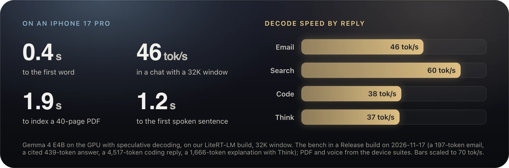
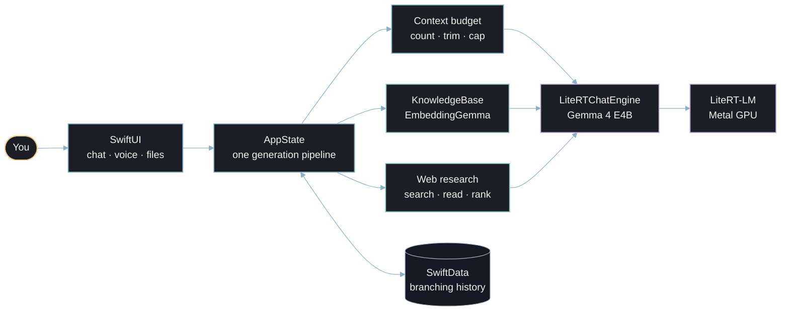
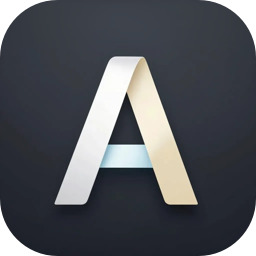

<div align="center">


<br>

[](#get-started)
[](#get-started)
[](docs/USER_GUIDE.md#the-models)
[](#vendored-litert-lm)
[](#meet-agello)
[](docs/TESTING.md)
[](LICENSE)

**[Meet Agello](#meet-agello)** · **[Four modes](#four-modes)** · **[Performance](#performance)** · **[For developers](#for-developers)** · **[Docs](#documentation)**

</div>

<br>

## Meet Agello

Agello is a full AI assistant that lives on your iPhone. It runs Google's **Gemma 4** on the phone's own GPU, so it reads, sees, listens and talks without sending your conversations anywhere. There's no account and no subscription. Once the model is downloaded, Agello works without a connection, except for the web searches you ask for.

<table>
<tr>
<td width="33%" valign="top">


**Private by design**<br>
Chats, photos, files, recordings, and opt-in personal tools (Calendar, Reminders, Contacts) stay on the phone. The network is used only to download the models and for the web searches or Apple Maps place lookups you ask for: the sources receive the search terms (Apple Weather a place's coordinates, Apple Maps your area for "near me" questions), and Agello downloads the pages it found to read them. [Privacy policy](https://powerbeef.github.io/Agello/privacy)

</td>
<td width="33%" valign="top">


**Fast**<br>
On an iPhone 17 Pro: under a second to the first word (**0.6–0.85 s**), **51 to 58 tokens a second** in Think and normal chat (**83+ tok/s** on edits/rewrites), **1,650+ tok/s** prefill on long files, and a full **64K context window** at **3.2–3.5 GB** peak RAM (`1.5–1.7 GB` kernel peak in normal and file chats). A 40-page PDF is indexed in under a second (`0.86 s`) on the Neural Engine.

</td>
<td width="33%" valign="top">


**Complete**<br>
Text, vision and audio in one model: reasoning, offline and opt-in personal tools with in-chat confirmation, documents with page citations, web search with sources, memory, hands-free voice, Siri, widgets and the share sheet.

</td>
</tr>
</table>

## Four modes

Agello's color follows what you're doing. Each mode has its own accent, and it lights the glow behind the chat, the composer's pills and the send button: **glacier** for chat, **lavender** for Think, **teal** for Search, **gold** for Voice.


## What it does


- **Conversations.** A side drawer with chats grouped by date, pinned chats, and projects that share instructions and files. Search finds chats by words and by meaning ("Japan vacation" finds "Kyoto itinerary"). Edit or regenerate any message, and switch between versions with ‹ 2/3 ›.
- **Rich answers & on-device tools.** Live streaming with headings, tables, task lists, highlighted code with a Copy button, and typeset math. **Think** shows step-by-step reasoning in a card you can open. Built-in offline tools check the date, calculate, convert units, search attached files and past chats, inspect specific document pages, and query CSV/TSV/JSON tables — triggered from natural language across languages, plus opt-in Calendar, Reminders, Contacts, and Apple Maps tools gated by explicit in-chat confirmation before creating events or reminders.
- **Documents.** Attach PDFs, text, Markdown, code, CSV, JSON or RTF, or scan paper with the camera. Answers cite their pages, like *(report.pdf, p. 23)*. "Summarize this" reads a long document section by section, and keeps going in the background on iPhones that support it.
- **Web search with sources.** One tap lets Agello look things up when your message needs it: for a question or something to build, it searches, reads the top pages, picks the relevant parts and answers with `[1]`-style citations; a greeting or a translation is answered right away. It picks the sources by what you ask (Wikipedia and Wikidata, Wikivoyage, Wiktionary, Wikiquote, Apple Weather and Apple Maps, the European Central Bank's rates, Crossref and PubMed, Wikipedia's Current events): only sources whose terms allow it, and no API keys.
- **Voice and vision.** Show it a photo (encoded on the GPU Neural Accelerators), dictate live in your language with iOS 27 `SpeechAnalyzer` on the Neural Engine, send voice messages Gemma listens to directly, or start **voice mode**: a hands-free conversation with live captions, neural turn detection, and an optional camera. Talk over it to interrupt.
- **Personal.** Tell Agello about yourself and how to answer. Opt-in memory keeps lasting facts ("Lives in Montreal"), and you can see and edit every one.
- **At home on iOS.** Liquid Glass, VoiceOver and Dynamic Type; Siri and Shortcuts ("Ask Agello", "Talk to Agello", "Snap & Ask Agello", "Voice with Camera"), `IndexedEntity` Spotlight search across chats, projects, and documents, the Action Button, Home and Lock Screen widgets, Control Center controls, the share sheet and `agello://` links. Model downloads and long multi-document/research Live Activities continue in the background where supported.

→ The [user guide](docs/USER_GUIDE.md) covers every screen and setting.

> [!NOTE]
> Agello isn't on the App Store yet. You can [build it from source](#get-started) for an iPhone with 12 GB of memory (iPhone 17 Pro or later).

## Performance



<details>
<summary><b>Every measurement</b></summary>

<br>

The image above shows our runtime on an iPhone 17 Pro on 2026-11-17, with the 32K window:
- **The bench, in a Release build:** an email (197 tokens) started after 0.42 s and decoded at 46.4 tok/s. A cited Search answer (439 tokens) decoded at 60.1, a 4,517-token coding reply with Think at 37.6, and a 1,666-token explanation with Think at 37.3.
- **The device suites, in Debug builds:** a 40-page PDF indexed in 1.9 s (EmbeddingGemma 2 at 768 dimensions), and a voice turn spoke its first sentence after 1.2 s.
- **The build:** the runs used the fork's `main`, which decodes within 1 % of the release on the phone.

The table below is Google's runtime in October 2026. Since 2026-10-28 the app runs our own build of the runtime (`agello-next-20261024`, `agello-one-20261115`, `agello-one-20261122`, `agello-one-20261122-2`, and now `agello-one-20261122-3`, build `4712b414941a`: MSL 4.1 FlashAttention, zero-copy NEON greedy sampling, Metal 4 `copyBufferMappingsFromBuffer:` helper snapshots, `verify_8` speculative rounds, Apple10-tuned prefill, GPU Vision MPP kernels, lazy `AudioExecutor` + `USER_INTERACTIVE` QoS, multi-word JSON enums under MTP, Think + tool continuity, parallel read-only tool dispatch, and a recursive-descent FC parser — `+9.2%` `file-report` prefill / `−9.3%` TTFT and `0` host read copies over `agello-one-20261115` on iPhone 17 Pro). Since 2026-11-22, the app ships the v2 128K/ring-KV/`verify_8` model (`gemma-4-E4B-it-agello-v2.litertlm`), giving 12 GB iPhones a full **64K (65,536-token)** context window (`3.18–3.45 GB` peak footprint at 64K on iPhone 17 Pro), alongside the 4-bucket INT4 Core AI ANE `EmbeddingGemma 2` bundle (`0.86 s` 40-page PDF index with 0% GPU contention). On an iPhone 17 Pro with the first build:

- On 2026-11-10, in a Release build with the 32K window, a 4,517-token reply decoded at 43.3 tok/s with the phone's thermal state at "fair". A hand run on a cool phone the day before gave about 49 ([harness notes](docs/HARNESS.md#h3-done-on-2026-11-10)).
- The calibration of 2026-11-02 (a Debug build, thermal state nominal throughout) decoded a one-sentence reply at 39 / 42 / 42 tok/s with 8K / 16K / 32K windows, so the window hardly changes the speed any more. A 32K engine peaks at about 3.5 GB ([roadmap](docs/ROADMAP.md#next)).
- In the bench of 2026-11-10 (Think on, the UI driver attached), plain replies started after 0.6 s ([harness notes](docs/HARNESS.md#h4-done-on-2026-11-10)).
- The table's other rows haven't been measured again on this build.

**History: Google's LiteRT-LM v0.18.0, October 2026.** Gemma 4 E4B on an iPhone 17 Pro (12 GB, iOS 27), GPU, with speculative decoding (MTP), on Google's LiteRT-LM v0.18.0 runtime (the one the app used until 2026-10-28), with the 8K window that was then the default. Decode speed drops as the phone warms: a cooled calibration on 2026-10-15 measured 37 / 39 / 31 / 20 tok/s.

| | |
| --- | --- |
| Time to first token, short message | **~0.4 s** |
| Decode speed, chat at 4K / 8K / 16K / 32K context | **43 / 38 / 34 / 27 tok/s** |
| Time to first token, 2.3K / 4.4K / 8.6K-token input | 2.1 s / 6.0 s / 18.9 s |
| Model load, first / warm | ~9 s / ~1–3 s |
| Index a 40-page PDF / search it | 1.7 s / 15 ms |
| "Summarize this report" (40 pages), first time / again | 37 s / 7.5 s |
| Cited follow-up question on the same report | 5 s |
| Web search answer (search, read 5 pages, rank, answer) | ~25 s |
| Voice mode, first spoken sentence after you stop talking | ~1.2–1.5 s |
| Dictation of a spoken sentence | ~1 s (word error rate 0–0.13, English and French) |
| App memory footprint (8K context, vision and audio) | ~1.2–2.8 GB |

For reference, Google reports 1,189 prefill and 25.1 decode tokens per second for E4B on the same GPU, without speculative decoding (model card, as of 2026-10-15).

</details>

<br>

---

## For developers

Agello is a working reference for shipping a multimodal LLM inside a native iOS app: SwiftUI and Swift 6 concurrency, one actor that owns the runtime, a context budget that can't overflow, on-device retrieval, and a test harness that runs on the phone. The engineering notes explain each decision and the bug behind it.

### How it works



Every message takes one path through `AppState`. Pending settings are applied, then file context and web results are gathered. The native conversation is bound to the chat, and the context is fitted to the KV cache. The reply then streams into SwiftData, and memories and the title follow. A single actor owns the LiteRT-LM engine, and every engine operation runs through a serialized queue. → [Architecture](docs/ARCHITECTURE.md)

### Engineering highlights

<table>
<tr>
<td width="50%" valign="top">


**Long chats on the GPU ([LiteRT-LM #3913](https://github.com/google-ai-edge/LiteRT-LM/issues/3913))**<br>
With 16-bit activations on the GPU, Gemma 4 started repeating digits in long chats ("2026" became "202026"). The model computes rotary angles from a float copy of each token's position, and float16 can't hold every integer past 2,048. Agello ships a graph-patched v2 model (`gemma-4-E4B-it-agello-v2.litertlm`: shared Dual-`GATHER` 128K rotary tables with <0.001 rad error, 1,536-slot local KV rings, and `verify_8`), exact through the full 64K window on iPhone 17 Pro at float16 speed with unchanged weights (the standard 32K 512-block file stays on the same repo for stock LiteRT-LM users).

The workaround came out of the discussion on the issue:
- [@john-rocky](https://github.com/john-rocky): the copy-fidelity suite that first showed the errors growing with prompt length, checks of the patched files on an M4 Max and an Android GPU, and the finding that a Gemma 4 E2B file exported with litert-torch's RoPE composite avoids the problem at the source ([litert-torch#1343](https://github.com/google-ai-edge/litert-torch/issues/1343)).
- [@picitujeromanov](https://github.com/picitujeromanov): a second precision loss on M1-class GPUs, which is why the blocks are 512 tokens.
- Google's LiteRT-LM team reproduced the issue.

[Notes](docs/ENGINEERING.md#long-context-digits-on-the-gpu-litert-lm-3913) · [model](https://huggingface.co/PowerBeef02/gemma-4-E4B-it-litert-lm-fp16-rope)

</td>
<td width="50%" valign="top">


**A context window that never overflows**<br>
Overflowing LiteRT-LM's KV cache corrupts its native heap, so every message is budgeted first:
- each turn is rendered the way the runtime will see it, and counted with the model's own tokenizer;
- older turns are trimmed by token budget with semantic/keyword recall of evicted turns, and replies are capped;
- tool results get their own budgets, and tool rounds are bounded.

A message that can't fit is explained, never crashed on.

</td>
</tr>
<tr>
<td valign="top">


**Conversations as a tree**<br>
Chat history is a versioned SwiftData schema whose turns form a tree. Edit, regenerate and the version switcher are just moves of the active leaf. The model's context is always rebuilt from the right branch, so abandoned versions never leak into an answer.

</td>
<td valign="top">


**On-device RAG with citations**<br>
Files are read with PDFKit and Vision OCR, split into page-aware, token-sized passages, and embedded on the 16-core Apple Neural Engine via Core AI (`EmbeddingGemma 2`, `0.86 s` for a 40-page PDF on iPhone 17 Pro with zero GPU contention). Search ranks float16 vectors with one matrix product, and falls back to keywords for any file that can't be embedded. The model reads whole files, cited excerpts, a cached summary, or inspects specific pages and CSV/JSON tables with tools, and answers cite pages.

</td>
</tr>
<tr>
<td valign="top">


**Hands-free voice with barge-in**<br>
Hybrid acoustic + neural turn detection (`SpeechAnalyzer` on ANE) and one audio engine for echo-cancelled capture and sentence-by-sentence speech. Live dictation partials stream in ~32 ms, follow-up spoken replies start in ~0.9 s on iPhone 17 Pro, and you can interrupt at any time.

</td>
<td valign="top">


**Over 550 tests, run on a real iPhone**<br>
Unit tests, scenarios and runtime probes with the real models in-process, and real-tap UI flows, including an accessibility audit. They run through a device harness that also simulates memory pressure on a 12 GB phone. No simulator: the failures that matter only happen on hardware. [Testing](docs/TESTING.md) has the counts.

</td>
</tr>
</table>

→ [Engineering notes](docs/ENGINEERING.md) · [Testing](docs/TESTING.md) · [LiteRT-LM](docs/LITERT-LM.md)

### Get started

**You'll need** an iPhone with 12 GB of memory (iPhone 17 Pro and Pro Max, iPhone Air, or later) on iOS 27 with about 7 GB free, and a Mac with Xcode 27. The Apple Developer account needs the **Extended Virtual Addressing**, **Increased Memory Limit**, **Background GPU Access**, **App Groups** and **WeatherKit** capabilities. Agello runs on a physical iPhone only: the runtime's XCFramework has only iOS and macOS slices for arm64, so the app doesn't build for the simulator, and the failures that matter only show on hardware.

1. Open `Agello.xcodeproj`. Swift Package Manager resolves `swift-markdown` and `SwiftMath`; LiteRT-LM is vendored.
2. The project is set up for team `FK2D8X36G2` and bundle IDs `com.patricedery.agello` (plus `.widgets` and `.share`), sharing the App Group `group.com.patricedery.agello`. On another account, change the team and bundle IDs under **Signing & Capabilities**.
3. Select the `Agello` scheme and your iPhone, and run. Use the **Release** configuration for representative speed.
4. On the welcome screen, download **Gemma 4 E4B** (3.7 GB), and start chatting.

> [!TIP]
> To explore the interface without downloading a model, run with the `--mock-engine` launch argument (**Product → Scheme → Edit Scheme → Run → Arguments**): a scripted engine drives streaming, reasoning, titles, regenerate and edit.

> [!NOTE]
> If signing fails with *"PLA Update available"*, accept the latest Program License Agreement at [developer.apple.com/account](https://developer.apple.com/account).

Run the tests with the device harness, on the iPhone or on an Apple silicon Mac running the iPhone app:

```sh
scripts/device-harness.sh unit                      # unit tests, scripted engine, ~3 min
scripts/device-harness.sh inference                 # the real model on the iPhone
scripts/device-harness.sh security                  # 6-vector adversarial prompt-injection gate
PLATFORM=mac scripts/device-harness.sh inference    # the same on this Mac
```

### Project layout

```text
Agello/            the app: AppState, Inference/, Knowledge/, Markdown/, ModelHub/,
                   Persistence/, System/, Voice/, Views/, Support/ (Theme/: the design system)
AgelloiOS/         the app's entry, the drawer shell, camera and scanner, Info.plist, Platform/
AgelloWidgets/     widgets and Control Center controls
AgelloShare/       share extension ("Ask Agello")
AgelloTests/       unit tests
AgelloDeviceTests/ on-device scenarios and runtime probes with the real models
AgelloUITests/     real-tap UI flows and the accessibility audit
scripts/           device test harness, device tools, README art
Vendor/LiteRT-LM/  LiteRT-LM Swift package, pinned to our runtime release
docs/              user guide, architecture, engineering notes, testing, the harness, LiteRT-LM,
                   roadmap, privacy policy
```

### Design system

Agello has one dark palette, warm neutrals on a navy canvas, and four mode accents. Liquid Glass stays on chrome (the composer and banners) and falls back to solid surfaces under Reduce Transparency; content sits on cards; motion uses one ease-out curve and turns off under Reduce Motion. Every token lives in `Agello/Support/Theme/`.

| Token | Color | Use |
| --- | --- | --- |
| Glacier |  | Chat, links, selection |
| Lavender |  | Think |
| Teal |  | Search |
| Gold |  | Voice, read aloud |
| Silver |  | Chrome with no mode: settings, sheets |
| Canvas |  | The background, fading to `#0A0B0E` |
| Text |  | Warm off-white, never pure white |

The README art comes from the same tokens: `scripts/readme-art/render.sh` redraws it from the screenshots in `docs/images/`.

### Documentation

| | |
| --- | --- |
| [User guide](docs/USER_GUIDE.md) | Every screen and setting, Siri and widgets, the models, troubleshooting, known limitations |
| [Architecture](docs/ARCHITECTURE.md) | Components, the life of a message, the data model, concurrency |
| [Engineering notes](docs/ENGINEERING.md) | The #3913 workaround in full, and every reliability safeguard |
| [Testing](docs/TESTING.md) | The suites, the device harness, and how to run them |
| [The autonomous harness](docs/HARNESS.md) | The bench that drives the app's own screens on the iPhone, and what each milestone found |
| [The Mac command line](docs/CLI.md) | `agello`: the app's engine from a command line on a Mac, for work on the runtime |
| [The backend](docs/BACKEND.md) | The plan for our own runtime: a hard fork for Apple GPUs and iOS 27 |
| [LiteRT-LM](docs/LITERT-LM.md) | The LiteRT-LM the app ships, what it sets, and a map of the fork's verified runtime and model reference |
| [Privacy policy](https://powerbeef.github.io/Agello/privacy) | What stays on the iPhone, and what the network is used for |
| [Runtime audit (2026-11-21)](docs/RUNTIME-AUDIT-2026-11-21.md) | Deep-dive runtime, numerical accuracy, and A19 Pro+ Metal 4 / ANE audit |
| [Roadmap](docs/ROADMAP.md) | Current status, A19 Pro+ GPU/ANE plan, and tracked work-item ledger |

### Vendored LiteRT-LM

`Vendor/LiteRT-LM` holds the Swift package surface of [LiteRT-LM](https://github.com/google-ai-edge/LiteRT-LM) from our fork's [`main` branch](https://github.com/PowerBeef/agello-litert-lm/tree/main), and the app runs our own build of the runtime, release [`agello-one-20261122-3`](https://github.com/PowerBeef/agello-litert-lm/releases/tag/agello-one-20261122-3) (build `4712b414941a`): LiteRT-LM with LiteRT and ML Drift in the same repository, on Metal 4 / MSL 4.1 on the iPhone and the Mac. Over Google's v0.18.0 binary, speculative decoding stays within the cache (with `verify_8` 7-draft rounds), each message ends with one final event, greedy sampling runs zero-copy on ARM64 NEON directly from shared Metal buffers, prefill uses cooperative-tensor FlashAttention, vision encoding runs on Apple10 GPU Neural Accelerators, audio encoding loads lazily on P-cores (`USER_INTERACTIVE` QoS), `llguidance` `TokTrie` constraints work with multi-word JSON enums under MTP, `<thought>` stays live across intermediate tool calls, read-only tools execute in parallel, the FC parser uses a self-contained recursive-descent LL(1) grammar supporting both native `<|"|>` delimiters and JSON double-quoted strings, a chat's sampler settings apply, and reply stats come from the runtime's telemetry instead of its benchmark mode. The global KV caches are Metal sparse buffers mapped as the chat fills them (trimmed on reset/rewind, with Metal 4 `copyBufferMappingsFromBuffer:` zero-blit helper snapshots), paired with the v2 128K/ring-KV model (`gemma-4-E4B-it-agello-v2.litertlm`) so 12 GB iPhones run at a full 65,536-token window, while semantic search runs on the 16-core Apple Neural Engine via Core AI (`PowerBeef02/embeddinggemma-2-text-270m-coreai-ane`, `0.86 s` 40-page PDF index on iPhone 17 Pro with 0% GPU contention). The Swift wrapper has five patches:

1. A tool call that fails is answered with an error the model can read, instead of ending the reply.
2. A stream holds its conversation weakly, which fixed a 10-minute engine stall when a conversation was dropped while its stream was finishing.
3. Streams live in a table keyed by ID, so a rejected tool call reported up to three times ends the stream once instead of freeing it each time; Stop also works between tool rounds, and tool rounds are bounded.
4. `Engine.tokenize` and `countTokens`, an embedding option that truncates long inputs instead of failing the batch, and the embedding engine's activation type.
5. Swift 6 language mode, with the experimental flags behind a lock.

Upstream stores prebuilt binaries in Git LFS, which intermittently breaks Swift Package Manager resolution; the build uses only the checksummed XCFramework attached to our release. [Vendor/README.md](Vendor/README.md) has the details and the update steps.

### Contributing

Work happens directly on `main`. Keep the unit tests and the on-device harness green, build UI from the design system's tokens, and record any new dependency's license in [NOTICE](NOTICE).

### Roadmap

What has shipped, where the work stands and what's next are in [the roadmap](docs/ROADMAP.md).

## License

Agello is licensed under the [Apache License 2.0](LICENSE). [NOTICE](NOTICE) covers the third-party components it uses and downloads, and the app shows it in Settings → About → Licenses.

| Component | Distribution | License |
| --- | --- | --- |
| LiteRT-LM | Vendored in `Vendor/LiteRT-LM` | Apache 2.0 |
| swift-markdown, swift-cmark | Swift packages | Apache 2.0, BSD 2-Clause |
| SwiftMath | Swift package | MIT |
| Gemma 4 E4B (litert-community build, v2 graph-patched), EmbeddingGemma 2 (litert-community build, Core AI ANE conversion) | Downloaded at runtime | Apache 2.0 |

## Acknowledgements

- [LiteRT](https://github.com/google-ai-edge/litert) and [LiteRT-LM](https://github.com/google-ai-edge/LiteRT-LM) by Google, with the [Swift guide](https://developers.google.com/edge/litert-lm/swift) and [Gemma 4 on LiteRT-LM](https://developers.google.com/edge/litert-lm/models/gemma-4)
- [Gemma 4 E4B](https://huggingface.co/google/gemma-4-E4B-it) by Google, with the [LiteRT-LM build](https://huggingface.co/litert-community/gemma-4-E4B-it-litert-lm) by `litert-community`; Agello downloads [a copy with its rotary positions patched for float16 GPUs](https://huggingface.co/PowerBeef02/gemma-4-E4B-it-litert-lm-fp16-rope)
- The developers on [LiteRT-LM #3913](https://github.com/google-ai-edge/LiteRT-LM/issues/3913), [@john-rocky](https://github.com/john-rocky) and [@picitujeromanov](https://github.com/picitujeromanov), and Google's LiteRT-LM team, whose reproductions, tests and findings shaped that patched model
- [swift-markdown](https://github.com/swiftlang/swift-markdown) by the Swift project, and [SwiftMath](https://github.com/mgriebling/SwiftMath) by Computer Inspirations

<br>

<div align="center">

<br>
<sub>Agello · your own AI assistant, on your iPhone</sub>
</div>
