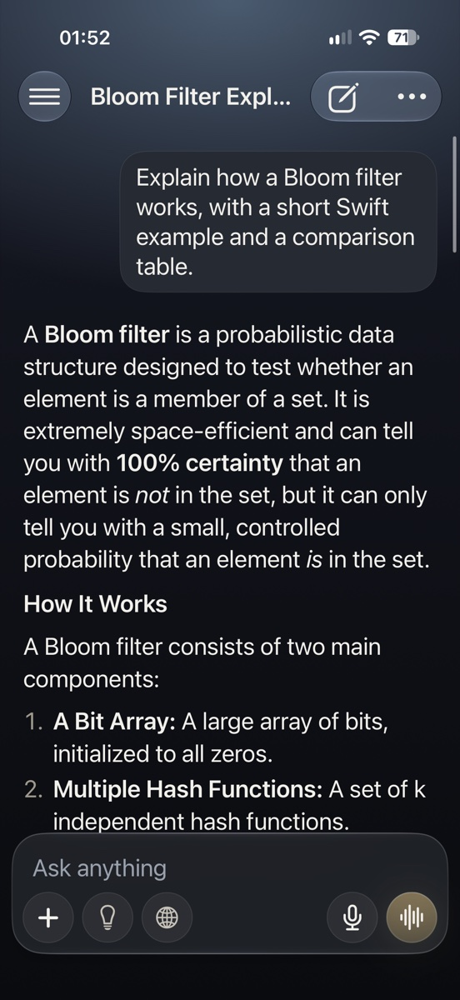
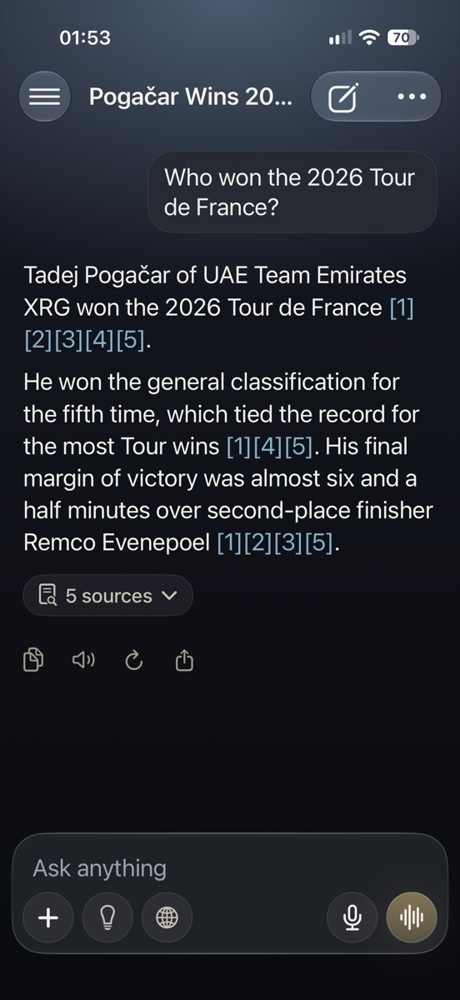
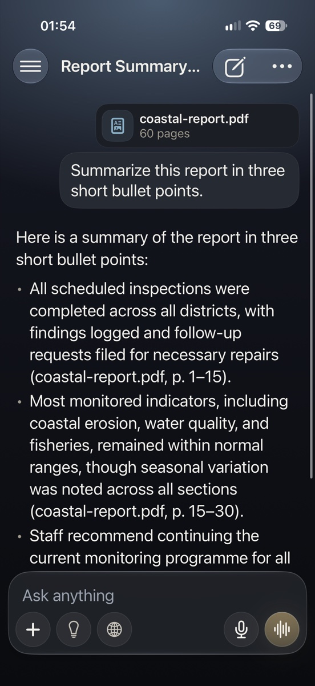
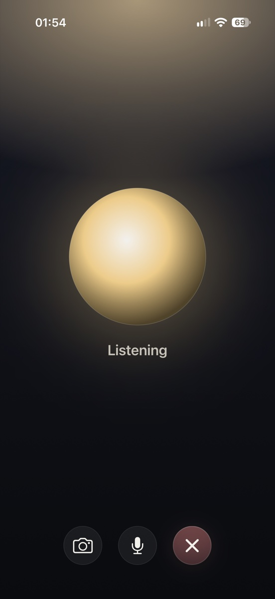
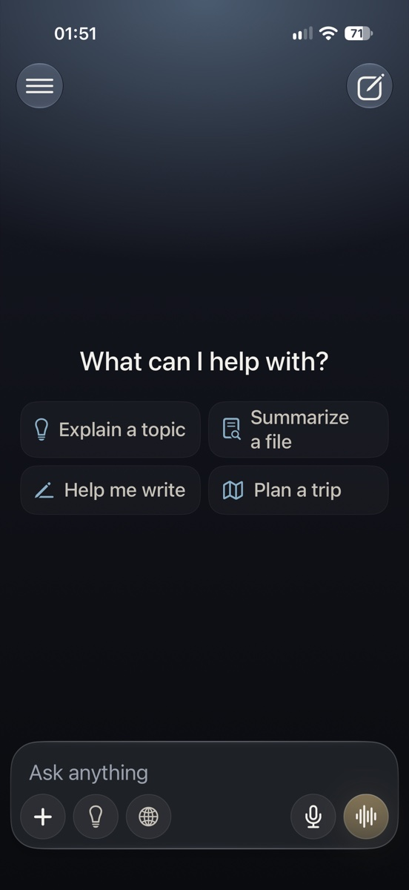
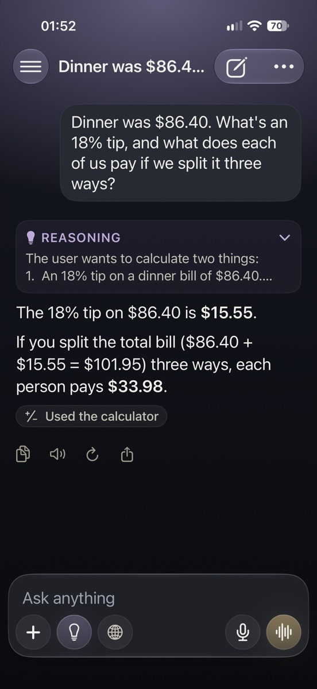
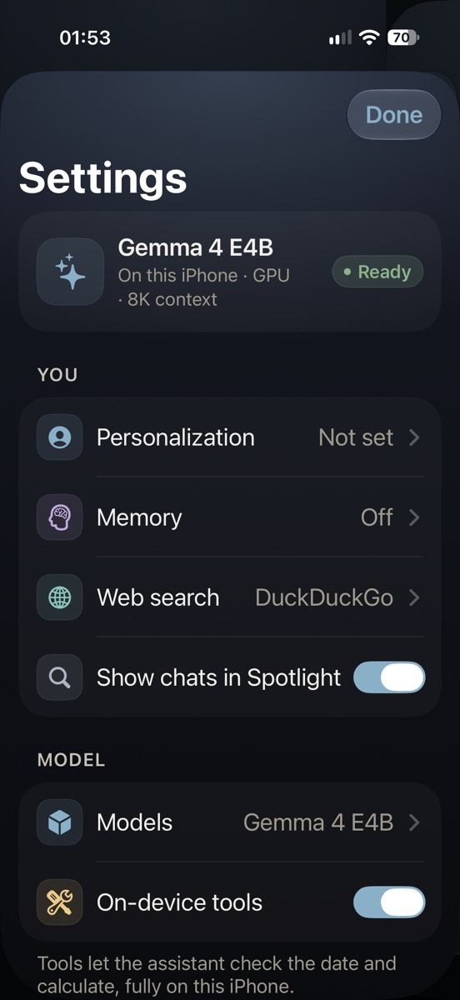
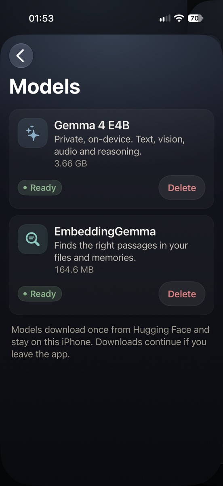
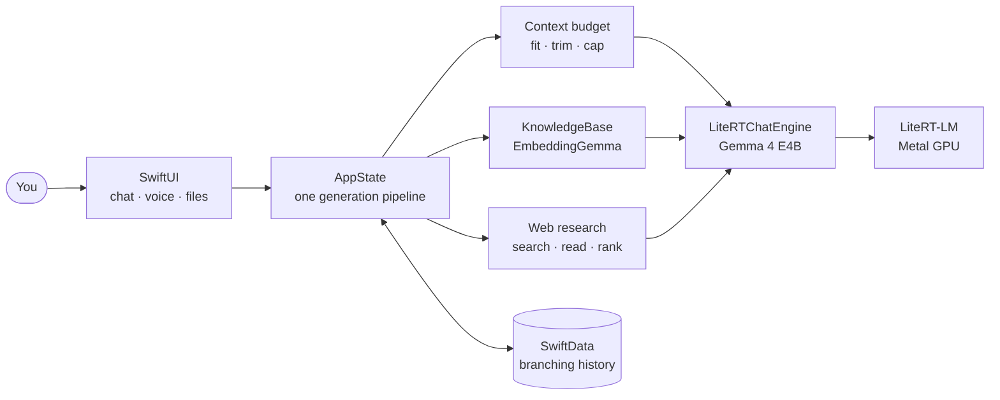

<div align="center">

# iRTChat

### Your own AI assistant, running entirely on your iPhone.

Gemma 4 on the iPhone's GPU: chat, vision, voice, documents and web search.<br>
No account, no API key, no cloud. After a one-time download, every conversation stays on your phone.

[](#get-started)
[](#get-started)
[](#vendored-litert-lm)
[](docs/USER_GUIDE.md#the-models)
[](#why-irtchat)
[](docs/TESTING.md)
[](LICENSE)

<br>

&nbsp;
&nbsp;
&nbsp;


**[Features](#features)** · **[Performance](#performance)** · **[How it works](#how-it-works)** · **[Engineering](#engineering-highlights)** · **[Get started](#get-started)** · **[Docs](#documentation)**

</div>

---

## Why iRTChat

<table>
<tr>
<td width="33%" valign="top">

### 🔒 Private by design
Gemma 4 E4B runs on the iPhone's GPU. Chats, photos, documents and voice never leave the phone. The network is only used to download the models once, and for web searches you ask for, which send only the query.

</td>
<td width="33%" valign="top">

### ⚡ Fast
About **0.4 s** to the first word and **~40 tokens/s** in chat on an iPhone 17 Pro, with speculative decoding. A 40-page PDF is indexed in under 2 seconds.

</td>
<td width="33%" valign="top">

### 🧠 Complete
Text, vision and audio in one model, with reasoning, tools, document Q&A with page citations, web search with sources, memory, hands-free voice, Siri, widgets and the share sheet.

</td>
</tr>
</table>

## Features

**Conversations.** A ChatGPT-style chat with a side drawer: chats grouped by date, pinned chats, projects with shared instructions and files, and model-written titles. Search finds chats by words and by meaning ("Japan vacation" finds "Kyoto itinerary"). Edit or regenerate any message, and switch between versions with ‹ 2/3 ›.

**Rich answers.** Live streaming with headings, tables, task lists, syntax-highlighted code with a Copy button, and typeset math. Turn on **Think** for step-by-step reasoning in a collapsible card. Built-in tools check the date and do arithmetic.

**Documents.** Attach PDFs, text, Markdown, code, CSV, JSON or RTF, or scan paper with the camera. Long files are searched by meaning and answers cite their pages, like *(report.pdf, p. 23)*. "Summarize this" reads a long document section by section, and keeps going in the background on iPhones that support it.

**Web search with sources.** One tap to look something up: iRTChat searches, reads the top pages, picks the relevant parts, and answers with `[1]`-style citations. DuckDuckGo by default, or your own SearXNG, Brave or Tavily.

**Voice and vision.** Take or pick a photo; dictate into the composer in your language; send voice messages Gemma listens to directly; or start **voice mode**, a hands-free conversation with a live orb, captions and an optional camera feed. Talk over it to interrupt.

**Personal.** Tell iRTChat about yourself and how to respond. Opt-in memory remembers lasting facts ("Lives in Montreal"), and every memory is visible and editable.

**Built for iOS.** SwiftUI with Liquid Glass chrome on a warm dark design whose accent follows what you're doing: glacier for chat, lavender for Think, teal for search, gold for voice. Siri and Shortcuts ("Ask iRTChat", "Talk to iRTChat"), the Action Button, Home and Lock Screen widgets, Control Center, Spotlight, the share sheet, and `irtchat://` links. Model downloads continue in the background.

<p align="center">
&nbsp;
&nbsp;
&nbsp;
&nbsp;

</p>

→ The [user guide](docs/USER_GUIDE.md) covers every screen and setting.

## Performance

Gemma 4 E4B on an iPhone 17 Pro (12 GB, iOS 27), GPU, with speculative decoding (MTP).

| | |
| --- | --- |
| Time to first token, short message | **~0.4 s** |
| Decode speed, chat at 4K / 8K / 16K / 32K context | **43 / 38 / 34 / 27 tok/s** |
| Time to first token, 2.3K / 4.4K / 8.6K-token input | 2.1 s / 6.0 s / 18.9 s |
| Model load, first / warm | ~9 s / ~1–3 s |
| Index a 40-page PDF / search it | 1.7 s / 15 ms |
| "Summarize this report" (40 pages), first time / again | 37 s / 7.5 s |
| Cited follow-up question on the same report | 5 s |
| Web search answer (search, read 5 pages, rank, answer) | ~25 s |
| Voice mode, first spoken sentence after you stop talking | ~1.2–1.5 s |
| Dictation of a spoken sentence | ~1 s (word error rate 0–0.13, English and French) |
| App memory footprint (8K context, vision and audio) | ~1.4–2.5 GB |

For reference, Google reports 1,189 prefill and 25 decode tokens per second for E4B on the same GPU without speculative decoding.

## How it works



Every message takes one path through `AppState`. Pending settings are applied, then file context and web results are gathered. The native conversation is bound to the chat, and the context is fitted to the KV cache. The reply then streams into SwiftData, and memories and the title follow. A single actor owns the LiteRT-LM engine, and every engine operation runs through a serialized queue. → [Architecture](docs/ARCHITECTURE.md)

## Engineering highlights

<table>
<tr>
<td width="50%" valign="top">

#### 🔬 Fixing Gemma's long-context math on the GPU
On the iPhone GPU, Gemma 4 duplicated digits once a chat passed ~2K tokens ("2026" became "202026"). Device probes traced it to **position 2,048**: the model computes rotary angles from a float16 copy of the position, which can't hold integers past 2,048. iRTChat ships a model whose graph splits every position as `2048·h + l`, so every float stays exact to 32,767. The result: **14/14 exact** copies up to 30K tokens, **1.7–2.1× faster prefill** than the float32 workaround, and **0.7 GB less memory**. [Analysis](https://github.com/google-ai-edge/LiteRT-LM/issues/3913#issuecomment-6157362598) · [fix](https://github.com/google-ai-edge/LiteRT-LM/issues/3913#issuecomment-6159684389) · [model](https://huggingface.co/PowerBeef02/gemma-4-E4B-it-litert-lm-fp16-rope)

</td>
<td width="50%" valign="top">

#### 🧮 A context window that never overflows
Overflowing LiteRT-LM's KV cache corrupts its native heap. So every message is budgeted first:
- cached tokens are measured, and new text is estimated conservatively and calibrated against the runtime;
- older turns are trimmed, and replies are capped;
- tool results get their own budgets.

A message that can't fit is explained, never crashed on.

</td>
</tr>
<tr>
<td valign="top">

#### 🌳 Conversations as a tree
Chat history is a versioned SwiftData schema whose turns form a tree. Edit, regenerate and the version switcher are just moves of the active leaf. The model's context is always rebuilt from the right branch, so abandoned versions never leak into an answer.

</td>
<td valign="top">

#### 📚 On-device RAG with citations
Files are read with PDFKit and Vision OCR, split into page-aware passages, and embedded in the background with EmbeddingGemma. The model reads whole files, cited excerpts or a cached summary, whichever fits half the context window, and answers cite pages.

</td>
</tr>
<tr>
<td valign="top">

#### 🎙️ Hands-free voice with barge-in
Voice-activity turn detection, and one audio engine for echo-cancelled capture and sentence-by-sentence speech. The first spoken sentence arrives ~1.3 s after you stop talking, and you can interrupt at any time.

</td>
<td valign="top">

#### ✅ 277 tests on a real iPhone
209 unit tests, 45 scenarios with the real models in-process, and 23 real-tap UI flows. They run through a device harness that also simulates 8 GB iPhones and probes the runtime directly. No simulator: the failures that matter only happen on hardware.

</td>
</tr>
</table>

→ [Engineering notes](docs/ENGINEERING.md) · [Testing](docs/TESTING.md)

## Get started

**You'll need** an iPhone 15 Pro or later (8 GB of memory) on iOS 27 with about 4.4 GB free, and a Mac with Xcode 27. The Apple Developer account needs the **Extended Virtual Addressing**, **Increased Memory Limit**, **Background GPU Access** and **App Groups** capabilities. iRTChat runs on a physical iPhone only: the simulator has no Metal path for LiteRT-LM.

1. Open `iRTChat.xcodeproj`. Swift Package Manager resolves `swift-markdown` and `SwiftMath`; LiteRT-LM is vendored.
2. The project is set up for team `FK2D8X36G2` and bundle IDs `com.patricedery.irtchat` (plus `.widgets` and `.share`), sharing the App Group `group.com.patricedery.irtchat`. On another account, change the team and bundle IDs under **Signing & Capabilities**.
3. Select the `iRTChat` scheme and your iPhone, and run. Use the **Release** configuration for representative speed.
4. On the welcome screen, download **Gemma 4 E4B** (3.7 GB), and start chatting.

> [!TIP]
> To explore the interface without downloading a model, run with the `--mock-engine` launch argument (**Product → Scheme → Edit Scheme → Run → Arguments**): a scripted engine drives streaming, reasoning, titles, regenerate and edit.

> [!NOTE]
> If signing fails with *"PLA Update available"*, accept the latest Program License Agreement at [developer.apple.com/account](https://developer.apple.com/account).

## Project layout

```text
iRTChat/            the app: AppState, Inference/, Knowledge/, Markdown/, ModelHub/,
                    Persistence/, System/, Voice/, Views/, Support/
iRTChatWidgets/     widgets and Control Center controls
iRTChatShare/       share extension ("Ask iRTChat")
iRTChatTests/       unit tests
iRTChatDeviceTests/ on-device scenarios with the real models
iRTChatUITests/     real-tap UI flows
scripts/            device test harness and device tools
Vendor/LiteRT-LM/   LiteRT-LM v0.18.0 Swift package
docs/               architecture, engineering notes, testing, user guide
```

## Roadmap

Phases 0–5 have shipped: foundations, the core chat experience, files, projects and memory, web search and dictation, voice mode with the camera, and system integration.

**Next: the first release.** That means an app icon, App Store metadata, an accessibility pass, and performance and battery budgets, then TestFlight.

## Documentation

| | |
| --- | --- |
| [User guide](docs/USER_GUIDE.md) | Every screen and setting, Siri and widgets, the models, troubleshooting, known limitations |
| [Architecture](docs/ARCHITECTURE.md) | Components, the life of a message, the data model, concurrency |
| [Engineering notes](docs/ENGINEERING.md) | The #3913 fix in full, and every reliability safeguard |
| [Testing](docs/TESTING.md) | The suites, the device harness, and how to run them |

## Vendored LiteRT-LM

`Vendor/LiteRT-LM` holds the Swift package surface of [LiteRT-LM](https://github.com/google-ai-edge/LiteRT-LM) at v0.18.0. Upstream stores prebuilt binaries in Git LFS, which intermittently breaks Swift Package Manager resolution. The iOS build uses only the checksummed release XCFramework, so vendoring changes no behavior. To update, run `TAG=v0.19.0 ./Vendor/refresh-litert-lm.sh`, then update the tag in `Vendor/README.md` and run the test suites.

## Contributing

Work happens directly on `main`. Keep the unit tests and the on-device harness green, keep the interface native, and record any new dependency's license in [NOTICE](NOTICE).

## License

iRTChat is licensed under the [Apache License 2.0](LICENSE). [NOTICE](NOTICE) covers the third-party components it uses and downloads:

| Component | Distribution | License |
| --- | --- | --- |
| LiteRT-LM | Vendored in `Vendor/LiteRT-LM` | Apache 2.0 |
| swift-markdown, swift-cmark | Swift packages | Apache 2.0, BSD 2-Clause |
| SwiftMath | Swift package | MIT |
| Gemma 4 E4B (litert-community build, rotary positions patched), EmbeddingGemma 2 | Downloaded at runtime | Apache 2.0 |

## Acknowledgements

- [LiteRT](https://github.com/google-ai-edge/litert) and [LiteRT-LM](https://github.com/google-ai-edge/LiteRT-LM) by Google, with the [Swift guide](https://developers.google.com/edge/litert-lm/swift) and [Gemma 4 on LiteRT-LM](https://developers.google.com/edge/litert-lm/models/gemma-4)
- [Gemma 4 E4B](https://huggingface.co/google/gemma-4-E4B-it) by Google, with the [LiteRT-LM build](https://huggingface.co/litert-community/gemma-4-E4B-it-litert-lm) by `litert-community`; iRTChat downloads [a copy with float16-exact rotary positions](https://huggingface.co/PowerBeef02/gemma-4-E4B-it-litert-lm-fp16-rope)
- [swift-markdown](https://github.com/swiftlang/swift-markdown) by the Swift project, and [SwiftMath](https://github.com/mgriebling/SwiftMath) by Computer Inspirations
