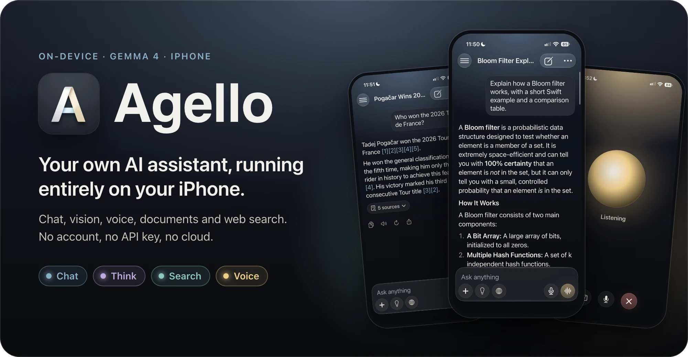
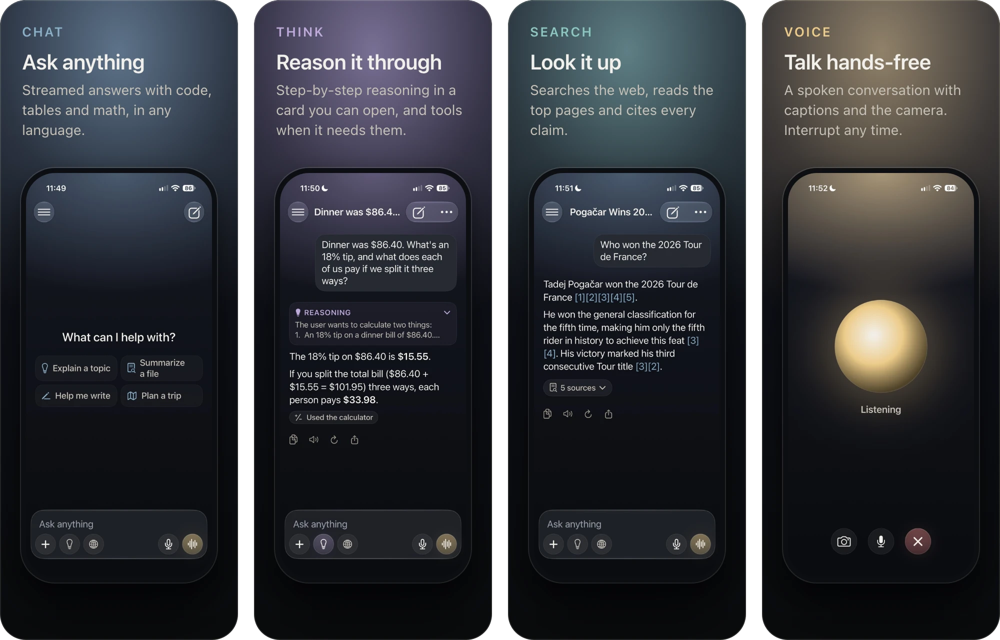
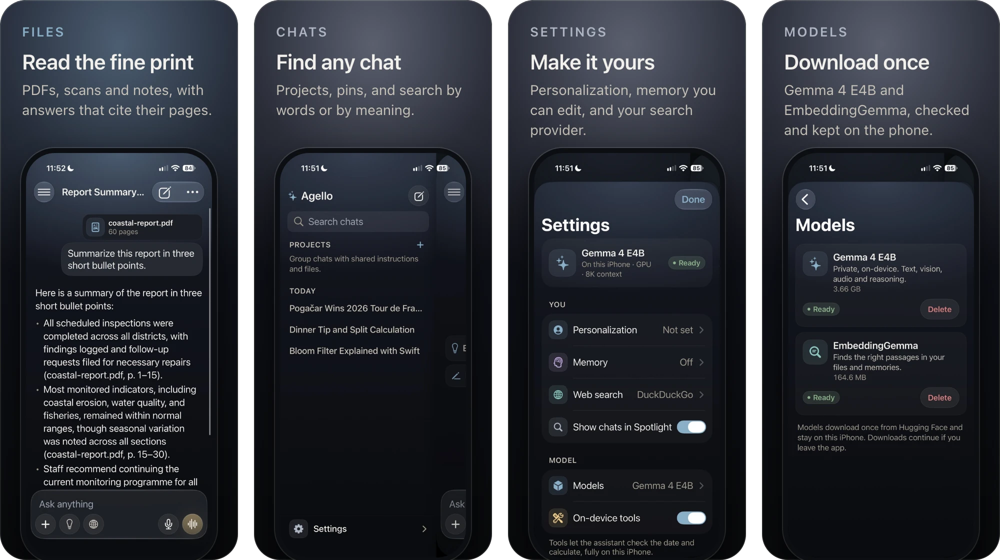
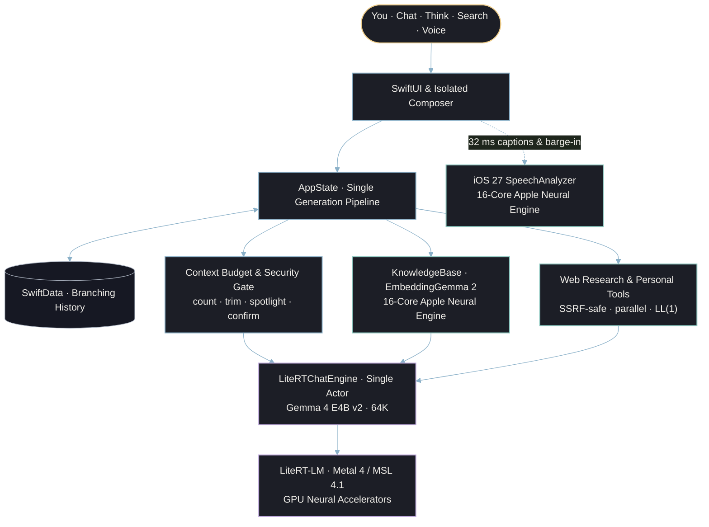

<div align="center">



<br>

[](#get-started)
[](#get-started)
[](docs/USER_GUIDE.md#the-models)
[](#engineered-for-apple-silicon)
[](#engineered-for-apple-silicon)
[](#meet-agello)
[](docs/TESTING.md)
[](LICENSE)

**[Meet Agello](#meet-agello)** · **[Apple Silicon](#engineered-for-apple-silicon)** · **[Four modes](#four-modes)** · **[Performance](#performance)** · **[For developers](#for-developers)** · **[Docs](#documentation)**

</div>

<br>

## Meet Agello

Agello is a full AI assistant that lives on your iPhone. Purpose-built for **A19 Pro and newer Apple silicon**, it runs Google's **Gemma 4 E4B** across your GPU's per-core **Neural Accelerators** while document indexing and live speech run in parallel on the **16-core Apple Neural Engine** — no account, no subscription, and no cloud required. Once the models are downloaded, everything works offline except the web searches you ask for.

<table>
<tr>
<td width="60" align="center" valign="top"></td>
<td valign="top">

**Private by design**<br>
Chats, photos, files, recordings, and opt-in personal tools (Calendar, Reminders, Contacts) stay on the phone. The network is used only to download models and for the web searches or Apple Maps place lookups you ask for: sources receive the search terms (Apple Weather a place's coordinates, Apple Maps your area for "near me" questions), and Agello fetches the pages it found to read them. [Privacy policy](https://powerbeef.github.io/Agello/privacy)

</td>
</tr>
<tr>
<td width="60" align="center" valign="top"></td>
<td valign="top">

**Built for A19 Pro+ speed**<br>
On an iPhone 17 Pro: up to **1,668 tok/s** long-file prefill, **52–58 tok/s** sustained Think and chat decode (**84 tok/s** on edits/rewrites), a full **64K context window** at **3.2–3.5 GB** peak RAM (`1.5–1.7 GB` kernel peak in everyday chat), **0.86 s** to index a 40-page PDF on the Neural Engine, and **32 ms** live voice captions.

</td>
</tr>
<tr>
<td width="60" align="center" valign="top"></td>
<td valign="top">

**Complete**<br>
Text, vision, and audio in one model: step-by-step reasoning, multilingual offline & opt-in personal tools with in-chat confirmation cards, PDFs and tables with page citations, web search with numbered sources, memory, hands-free voice with barge-in, Siri, widgets, Spotlight, and the share sheet.

</td>
</tr>
</table>

## Engineered for Apple Silicon

Agello ships our own Metal 4 / MSL 4.1 fork of LiteRT-LM ([`agello-one-20261124`](https://github.com/PowerBeef/agello-litert-lm/releases/tag/agello-one-20261124)) paired with a graph-patched 64K Gemma 4 E4B model and a 4-bucket Core AI ANE `EmbeddingGemma 2` bundle. Every workload is pinned to the compute unit built for it:


<br>

- **GPU Neural Accelerators (Metal 4 / MSL 4.1).** Cooperative-tensor `matmul2d` FlashAttention (`D=256/512`), Apple10 INT8/FP16 `ConvAppleMPP` prefill, GPU Vision (`112` ViT linears + `32` attention matmuls, **4.5× faster**), `verify_8` 7-draft speculative rounds, fused FP32 `RMSNorm`, and zero-copy ARM64 NEON greedy sampling (`0` host read copies).
- **16-Core Apple Neural Engine (0% GPU contention).** 4-bucket asymmetric INT4 Core AI `EmbeddingGemma 2` (`0.9995` average cosine parity vs FP32) indexes a 40-page PDF in **0.86 s** and indexes chats in **46 ms** *while Gemma 4 streams on the GPU*, backed by a self-healing `AIModelCache`. iOS 27 `SpeechAnalyzer` drives **32 ms** live captions and neural turn detection on ANE.
- **Zero-Copy Unified Memory & Sparse 64K KV.** Sparse global Metal KV buffers + 1,536-slot local KV rings + Metal 4 `copyBufferMappingsFromBuffer:` zero-blit helper snapshots keep everyday chats at **1.5–1.7 GB**, full **65,536-token** context at **3.2–3.5 GB**, and 200-turn soak growth to **+4.95 MB**.
- **P-Cores & Hardened Agent Runtime.** Lazy Conformer audio loads on demand at `USER_INTERACTIVE` QoS in **3 ms** (unloads in **1 ms**). Tool calling pairs a recursive-descent LL(1) FC parser, `llguidance` JSON MTP, parallel read-only dispatch, `<untrusted_data>` spotlighting, and fail-closed in-chat confirmation cards (**0%** breach across 6 adversarial vectors).

## Four modes

Agello's color follows what you're doing. Each mode has its own accent, lighting the glow behind the chat, the composer's pills, and the send button: **glacier** for Chat, **lavender** for Think, **teal** for Search, **gold** for Voice.



## What it does



- **Conversations.** A side drawer with chats grouped by date, pinned chats, and projects that share instructions and files. Search finds chats by words and by meaning ("Japan vacation" finds "Kyoto itinerary"). Edit or regenerate any message and switch branches with ‹ 2/3 ›.
- **Rich answers & on-device tools.** Live streaming with headings, tables, task lists, highlighted code with a Copy button, and typeset math. **Think** shows step-by-step reasoning in a collapsible card. Built-in offline tools check the date, calculate, convert units, search attached files and past chats, inspect specific document pages, and query CSV/TSV/JSON tables from natural language across 13 languages — plus opt-in Calendar, Reminders, Contacts, and Apple Maps tools gated by explicit in-chat confirmation before creating events or reminders.
- **Documents.** Attach PDFs, text, Markdown, code, CSV, JSON, or RTF, or scan paper with the camera. Answers cite pages like *(report.pdf, p. 23)*. Long document synthesis runs section by section and continues in the background with Live Activity progress.
- **Web search with sources.** One tap lets Agello decide when your message needs live sources: it searches, reads the top pages, ranks the relevant passages, and answers with `[1]`-style citations — while greetings and translations answer immediately offline. Only terms-permitted, key-free sources (Wikipedia, Wikidata, Wikivoyage, Wiktionary, Wikiquote, Apple Weather & Maps, ECB rates, Crossref, PubMed).
- **Voice and vision.** Share photos (encoded on the GPU Neural Accelerators), dictate live in your language with iOS 27 `SpeechAnalyzer` on the Neural Engine, send voice messages Gemma listens to directly, or start **voice mode** — hands-free with live captions, neural turn detection, optional camera, and instant barge-in.
- **Personal.** Tell Agello about yourself and how to answer. Opt-in memory keeps lasting facts ("Lives in Montreal") that you can inspect and edit anytime, quarantined from untrusted external inputs.
- **At home on iOS 27.** Liquid Glass chrome, VoiceOver and Dynamic Type; Siri and Shortcuts ("Ask Agello", "Talk to Agello", "Snap & Ask Agello", "Voice with Camera"), `IndexedEntity` Spotlight search across chats, projects, and documents, Action Button, Home and Lock Screen widgets, Control Center controls, Share Sheet, and `agello://` deep links.

→ The [user guide](docs/USER_GUIDE.md) covers every screen and setting.

> [!NOTE]
> Agello isn't on the App Store yet. You can [build it from source](#get-started) for an iPhone with 12 GB of memory (iPhone 17 Pro, iPhone 17 Pro Max, iPhone Air, or later).

## Performance


<details>
<summary><b>Every measurement (iPhone 17 Pro, Release 64K &amp; baseline history)</b></summary>

<br>

### Our Metal 4 runtime + v2 64K + Core AI ANE (iPhone 17 Pro, 12 GB, iOS 27.2.1)

Measured in Release builds (`phone-bench.sh`, alternating thermal rest, **24/24 launches `nominal`**, **95.8% undisturbed**, **0.5% decode noise band**, **0 host read copies**) and hardware device suites on `agello-one-20261124` (`Build id: 8a7e34594612`):

| Workload | Measured on iPhone 17 Pro |
| --- | --- |
| Long-file prefill (`file-report`, 6.2K tok, 64K) | **1,654 med / 1,668 peak tok/s** (`3.80 s` TTFT) |
| Rewrite decode (`typo-fix`, `verify_8`) | **83.4 med / 84.3 peak tok/s** (`0.65 s` TTFT) |
| Chat decode (`email`, 64K) | **57.3–57.8 tok/s** (`0.85 s` TTFT, `1,599 tok/s` prefill) |
| File Q&A decode (`file-report`, 6.2K PDF) | **56.5–56.9 tok/s** (`1.70 GB` kernel peak) |
| Think decode (`explain`, ~1,380 tok) | **50.6–51.9 tok/s** (`0.97 s` TTFT, up from `37.3`) |
| Full 64K (`65,536` tok) fidelity & peak RAM | **12/12 bit-exact** to pos `65,534`, **90/90** needles (`3.18–3.45 GB`) |
| 200-turn pool soak (`test38_PoolSoak`) | **+4.95 MB** median growth (`465 MB` final / `5.98 GB` free) |
| Warm model load (`MTLBinaryArchive`) | **0.7–1.1 s** (`0.90 s` GPU Vision init, `1.1 s` 64K load) |
| 40-page PDF index & search (16-Core ANE) | **0.86 s** index (`2.2×` faster than GPU), **8–11 ms** query |
| Concurrent chat index while E4B streams | **46 ms** on ANE (`0%` GPU contention, `0.9995` FP32 cosine) |
| Live dictation & voice follow-up | **32 ms** partials (`SpeechAnalyzer`), **0.89 s** first spoken sentence |
| Lazy Conformer audio load / unload | **3.2–4.3 ms** load / **0.9–1.1 ms** unload (`USER_INTERACTIVE`) |

### Reference: Google's LiteRT-LM v0.18.0 (October 2026, 8K default)

Historical baseline on the same iPhone 17 Pro before switching to our Metal 4 fork on 2026-10-28:

| Metric (v0.18.0 baseline) | Value |
| --- | --- |
| Decode at 4K / 8K / 16K / 32K context | **43 / 38 / 34 / 27 tok/s** (no 64K) |
| TTFT at 2.3K / 4.4K / 8.6K tokens | `2.1 s` / `6.0 s` / `18.9 s` |
| 40-page PDF index (GPU) | `1.7–1.9 s` |
| Voice first spoken sentence | `1.2–1.5 s` |
| Cold / warm load | `~9 s` / `~1–3 s` |

For reference, Google's model card (2026-10-15) reports `1,189 tok/s` prefill and `25.1 tok/s` decode for E4B on A19 Pro without speculative decoding.

</details>

<br>

---

## For developers

Agello is a working reference for shipping a multimodal, multi-accelerator LLM inside a native iOS 27 app: SwiftUI and Swift 6 concurrency, one actor owning the Metal 4 runtime, zero-contention ANE retrieval and speech, an unbreakable context budget, and an on-hardware test harness.

### How it works



Every message — typed, edited, regenerated, spoken, or shared — takes one path through `AppState`. Pending settings apply, file context and web sources are gathered and spotlighted, the native conversation binds to the active branch, and tokens are budgeted to fit the KV cache. The reply streams into SwiftData while memories and titles follow via Metal 4 zero-blit helper snapshots. A single actor owns `LiteRTChatEngine`, serializing every GPU operation safely across foreground and background transitions. → [Architecture](docs/ARCHITECTURE.md)

### Engineering highlights

<table>
<tr>
<td width="60" align="center" valign="top"></td>
<td valign="top">

**Metal 4 / MSL 4.1 & GPU Neural Accelerators**<br>
Custom ML Drift kernels engineered for Apple10+ GPUs: cooperative-tensor `matmul2d` FlashAttention (`D=256/512`), Apple10 INT8/FP16 `ConvAppleMPP` across both LLM prefill and Vision (`112` ViT linears + `32` attention matmuls, **4.5× faster**), `verify_8` 7-draft speculative rounds with `100%` shared intermediate pool reuse, fused FP32 `RMSNorm`, zero-copy ARM64 NEON greedy sampling (`0` host read copies), sparse 64K KV buffers with Metal 4 `copyBufferMappingsFromBuffer:` zero-blit helper snapshots, and persistent `MTLBinaryArchive` pipeline caching.

</td>
</tr>
<tr>
<td width="60" align="center" valign="top"></td>
<td valign="top">

**Zero-contention 16-Core Apple Neural Engine**<br>
`CoreAIEmbedder` runs a 4-bucket (`128–1024`) asymmetric INT4 `EmbeddingGemma 2` bundle (`128 MB` `.aar`) exclusively on the 16-core ANE (`0%` GPU activity, `0.9995` avg cosine vs FP32, `0.86 s` for a 40-page PDF, `46 ms` concurrent chat indexing while E4B streams), complete with a zero-dependency Swift SentencePiece tokenizer and automatic recovery from stale iOS 27 `AIModelCache` entries. Live dictation and voice turn detection run on ANE via iOS 27 `SpeechAnalyzer`.

</td>
</tr>
<tr>
<td width="60" align="center" valign="top"></td>
<td valign="top">

**Exact 64K context on float16 GPUs ([LiteRT-LM #3913](https://github.com/google-ai-edge/LiteRT-LM/issues/3913))**<br>
With 16-bit GPU activations, Gemma 4 repeated digits in long chats because float16 loses integer precision past 2,048. Agello ships a graph-patched v2 model (`gemma-4-E4B-it-agello-v2.litertlm`: shared Dual-`GATHER` 128K rotary tables with `<0.001 rad` error, 1,536-slot local KV rings, and `verify_8`), passing **12/12 bit-exact** 48-digit copies up to position `65,534` and **90/90** needle recall on iPhone 17 Pro with unchanged weights. Shaped by [@john-rocky](https://github.com/john-rocky) ([litert-torch#1343](https://github.com/google-ai-edge/litert-torch/issues/1343)), [@picitujeromanov](https://github.com/picitujeromanov), and Google's LiteRT-LM team. [Notes](docs/ENGINEERING.md#long-context-digits-on-the-gpu-litert-lm-3913) · [Model](https://huggingface.co/PowerBeef02/gemma-4-E4B-it-litert-lm-fp16-rope)

</td>
</tr>
<tr>
<td width="60" align="center" valign="top"></td>
<td valign="top">

**Unbreakable context budget & prompt-injection defense**<br>
Every message is rendered identically to the runtime and counted with the model's tokenizer before dispatch; evicted turns are recalled semantically, tool rounds are bounded, and overflowing prompts explain why instead of crashing the native heap. All external content (files, web pages, shared items, tool outputs) is spotlighted inside `<untrusted_data>`, quarantined from persistent memory, and mutating personal tools require fail-closed, request-ID-matched in-chat confirmation (**0%** breach across 6 adversarial vectors).

</td>
</tr>
<tr>
<td width="60" align="center" valign="top"></td>
<td valign="top">

**Conversations as a tree**<br>
Chat history lives in a versioned SwiftData schema (`V3`) whose turns form a tree. Edit, regenerate, and the version switcher simply move `activeLeafID`, and KV context is always rebuilt cleanly from the active branch so abandoned edits and cancelled helpers never bleed into an answer.

</td>
</tr>
<tr>
<td width="60" align="center" valign="top"></td>
<td valign="top">

**On-device RAG & parallel LL(1) tools**<br>
PDFKit and Vision OCR split attachments into page-aware passages embedded on ANE and ranked with one float16 matrix product (BM25 fallback). A self-contained recursive-descent LL(1) FC parser handles both native Gemma 4 and JSON tool calls with `llguidance` multi-word JSON MTP, live `<thought>` continuity across intermediate tool steps, and parallel read-only tool execution across 13 languages.

</td>
</tr>
<tr>
<td width="60" align="center" valign="top"></td>
<td valign="top">

**Hands-free voice with instant barge-in**<br>
Hybrid acoustic + neural turn detection (`SpeechAnalyzer` on ANE) paired with echo-cancelled iOS 27 `AVFAudio`, **3 ms** on-demand Conformer audio loading (`1 ms` unload), **32 ms** live captions, and **0.89 s** follow-up spoken replies — interrupt at any moment.

</td>
</tr>
<tr>
<td width="60" align="center" valign="top"></td>
<td valign="top">

**573 tests, verified on real silicon**<br>
456 unit tests, 89 real-model hardware scenarios & probes (including 200-turn pool soak, 64K needle/copy sweeps, memory-envelope jetsam simulation, and 6-vector adversarial security), and 28 UI & accessibility tests. Fast Mac CLI workbench (`SIM_GPU=Apple_A19_Pro`) for 20-second iteration + single-build physical iPhone `gate`. No simulator. → [Testing](docs/TESTING.md)

</td>
</tr>
</table>

→ [Engineering notes](docs/ENGINEERING.md) · [Runtime audit](docs/RUNTIME-AUDIT-2026-11-21.md) · [LiteRT-LM](docs/LITERT-LM.md)

### Get started

**You'll need** an iPhone with 12 GB of memory (iPhone 17 Pro, iPhone 17 Pro Max, iPhone Air, or later) on iOS 27 with about 7 GB free, and an Apple silicon Mac with Xcode 27. Your Apple Developer account needs **Extended Virtual Addressing**, **Increased Memory Limit**, **Background GPU Access**, **App Groups**, and **WeatherKit**. Agello runs on real Apple silicon only (no simulator build).

1. Open `Agello.xcodeproj`. Swift Package Manager resolves `swift-markdown` and `SwiftMath`; our Metal 4 `LiteRT-LM` package is vendored.
2. Under **Signing & Capabilities**, switch team `FK2D8X36G2` and bundle IDs (`com.patricedery.agello`, `.widgets`, `.share`, App Group `group.com.patricedery.agello`) to your own account.
3. Select the `Agello` scheme and your iPhone, and run (**Release** configuration for representative speed).
4. On the welcome screen, download **Gemma 4 E4B v2** (3.7 GB) and **EmbeddingGemma 2 ANE** (128 MB), and start chatting.

> [!TIP]
> To explore the UI without downloading a model, add `--mock-engine` under **Product → Scheme → Edit Scheme → Run → Arguments** to drive streaming, reasoning, titles, edit, and regenerate with a scripted engine.

> [!NOTE]
> If signing fails with *"PLA Update available"*, accept the latest Program License Agreement at [developer.apple.com/account](https://developer.apple.com/account).

Fast inner-loop testing on an Apple silicon Mac (emulating A19 Pro kernel paths) and single-build hardware gate on your iPhone:

```sh
# Fast Mac CLI unit tests (~25 s, no phone)
scripts/cli-test.sh unit

# All 456 unit tests in the signed iOS binary on Mac (~1 min)
PLATFORM=mac scripts/device-harness.sh unit

# 6-vector adversarial prompt-injection gate on Mac (~25 s)
scripts/cli-test.sh security

# Single-build physical iPhone hardware gate (~8–10 min)
scripts/device-harness.sh gate
```

### Project layout

| Path | Contents |
| --- | --- |
| `Agello/` | App core: `AppState`, `Inference/`, `Knowledge/`, `Markdown/`, `ModelHub/`, `Persistence/`, `System/`, `Voice/`, `Views/`, `Support/Theme/` |
| `AgelloiOS/` | Entry point, drawer shell, camera/scanner, `Info.plist`, UIKit `Platform/` seams |
| `AgelloCLI/` | Unshipped SwiftPM Mac CLI (`agello`) for fast runtime & quality iteration |
| `AgelloWidgets/` | Home Screen, Lock Screen, and Control Center widgets |
| `AgelloShare/` | Share extension ("Ask Agello") |
| `AgelloTests/` | 456 unit tests on the scripted engine |
| `AgelloDeviceTests/` | 89 real-model hardware scenarios, ANE RAG, security, memory, and probes |
| `AgelloUITests/` | 28 real-tap UI flows, accessibility audit, and autonomous bench driver |
| `scripts/` | Device harness, Mac CLI test/bench runners, README art pipeline |
| `Vendor/LiteRT-LM/` | Vendored Swift wrapper pinned to our checksummed Metal 4 XCFramework |
| `docs/` | User guide, architecture, engineering, audit, testing, CLI, backend, roadmap |

### Design system

Agello uses one dark palette — warm neutrals on a deep navy canvas — and four mode accents. Liquid Glass stays strictly on chrome (composer and banners) with solid fallbacks under Reduce Transparency; content lives on cards; motion uses one ease-out curve and respects Reduce Motion. Every token lives in `Agello/Support/Theme/`.

| Token | Color | Use |
| --- | --- | --- |
| Glacier |  | Chat, links, GPU & Metal |
| Lavender |  | Think, reasoning, agent runtime |
| Teal |  | Search, 16-Core Neural Engine |
| Gold |  | Voice, TensorOps & Neural Accelerators |
| Silver |  | Neutral chrome: settings, sheets |
| Canvas |  | Deep navy background (`→ #0A0B0E`) |
| Text |  | Warm off-white, never pure white |

All README art (`hero`, `silicon`, `modes`, `screens`, `performance`) is rendered at 2× Retina from the same design tokens via `scripts/readme-art/render.sh`.

### Documentation

| Document | Summary |
| --- | --- |
| [User guide](docs/USER_GUIDE.md) | Every screen, setting, Siri shortcut, widget, model, and troubleshooting |
| [Architecture](docs/ARCHITECTURE.md) | Components, generation pipeline, SwiftData tree, Swift 6 concurrency |
| [Engineering notes](docs/ENGINEERING.md) | The #3913 RoPE fix in full and every reliability safeguard |
| [Runtime audit](docs/RUNTIME-AUDIT-2026-11-21.md) | Deep-dive runtime, numerical accuracy, and A19 Pro+ Metal 4 / ANE audit |
| [Testing](docs/TESTING.md) | All 573 tests, the device harness, and fast Mac workbench flows |
| [Autonomous harness](docs/HARNESS.md) | UI-driven on-device bench and milestone measurements |
| [Mac CLI](docs/CLI.md) | `agello`: the app's engine from the Mac command line for runtime work |
| [The backend](docs/BACKEND.md) | Our hard-fork Metal 4 runtime architecture for Apple GPUs and iOS 27 |
| [LiteRT-LM](docs/LITERT-LM.md) | What Agello ships, runtime flags, and reference map |
| [Roadmap](docs/ROADMAP.md) | Current status, completed silicon milestones, and work-item ledger |
| [Privacy policy](https://powerbeef.github.io/Agello/privacy) | What stays on the iPhone and what the network is used for |

### Vendored LiteRT-LM

`Vendor/LiteRT-LM` carries the Swift package surface of [LiteRT-LM](https://github.com/google-ai-edge/LiteRT-LM) from our fork's [`main` branch](https://github.com/PowerBeef/agello-litert-lm/tree/main), pinned to release [`agello-one-20261124`](https://github.com/PowerBeef/agello-litert-lm/releases/tag/agello-one-20261124) (`Build id: 8a7e34594612`) — LiteRT-LM, LiteRT, and ML Drift built together for Metal 4 / MSL 4.1 (`ios-arm64` + `macos-arm64`).

Key additions over upstream v0.18.0:

- **Metal 4 / MSL 4.1 & Neural Accelerators:** cooperative-tensor `matmul2d` FlashAttention (`D=256/512`), Apple10 `ConvAppleMPP` for LLM prefill and GPU Vision, FP32-promoted softmax/PV attention & KV quantization, `verify_8` 7-draft speculative rounds with `100%` shared pool reuse, zero-copy ARM64 NEON greedy sampling, persistent `MTLBinaryArchive` PSO deduplication, and locked `MTLResidencySet`.
- **Sparse 64K KV & memory safety:** sparse Metal global KV buffers trimmed on reset/rewind, Metal 4 `copyBufferMappingsFromBuffer:` zero-blit helper snapshots, OOM tile rollback, clean background GPU drain, and lazy `USER_INTERACTIVE` audio loading.
- **Hardened agent runtime:** recursive-descent LL(1) FC parser supporting native `<|"|>` and RFC 8259 JSON, UTF-8 FFI boundary validation, `llguidance` `TokTrie` multi-word JSON enums under MTP, live `<thought>` continuity across intermediate tool rounds, parallel read-only tool dispatch, and runtime telemetry.
- **Five Swift wrapper patches:** tool-error feedback to the model, weak conversation references in streams (fixing a 10-minute stall), ID-keyed stream table with generation-tagged tool rounds & `sendGateLock` cancellation, `Engine.tokenize`/`countTokens` + embedding truncation, and Swift 6 concurrency.

Upstream stores prebuilt binaries in Git LFS, which intermittently breaks SwiftPM resolution; Agello pulls only the checksummed XCFramework attached to our release. See [Vendor/README.md](Vendor/README.md) for update steps.

### Contributing

Work happens directly on `main`. Keep the unit tests and hardware checks green, build UI from `Agello/Support/Theme/` tokens, and record any new dependency's license in [NOTICE](NOTICE).

### Roadmap

Completed silicon milestones, current status, and upcoming work live in [docs/ROADMAP.md](docs/ROADMAP.md).

## License

Agello is licensed under the [Apache License 2.0](LICENSE). [NOTICE](NOTICE) covers third-party components used and downloaded, also shown in Settings → About → Licenses.

| Component | Distribution | License |
| --- | --- | --- |
| LiteRT-LM | Vendored in `Vendor/LiteRT-LM` | Apache 2.0 |
| swift-markdown, swift-cmark | Swift packages | Apache 2.0, BSD 2-Clause |
| SwiftMath | Swift package | MIT |
| Gemma 4 E4B (v2 graph-patched), EmbeddingGemma 2 (Core AI ANE) | Downloaded at runtime | Apache 2.0 |

## Acknowledgements

- [LiteRT](https://github.com/google-ai-edge/litert) and [LiteRT-LM](https://github.com/google-ai-edge/LiteRT-LM) by Google, with the [Swift guide](https://developers.google.com/edge/litert-lm/swift) and [Gemma 4 on LiteRT-LM](https://developers.google.com/edge/litert-lm/models/gemma-4)
- [Gemma 4 E4B](https://huggingface.co/google/gemma-4-E4B-it) by Google, with the [`litert-community` Gemma 4 E4B](https://huggingface.co/litert-community/gemma-4-E4B-it-litert-lm) and [EmbeddingGemma 2](https://huggingface.co/litert-community/embeddinggemma-2-text-270m-litert-lm) builds; Agello downloads our [v2 float16-RoPE 128K copy](https://huggingface.co/PowerBeef02/gemma-4-E4B-it-litert-lm-fp16-rope) and [Core AI ANE EmbeddingGemma 2 bundle](https://huggingface.co/PowerBeef02/embeddinggemma-2-text-270m-coreai-ane)
- The developers on [LiteRT-LM #3913](https://github.com/google-ai-edge/LiteRT-LM/issues/3913), [@john-rocky](https://github.com/john-rocky) and [@picitujeromanov](https://github.com/picitujeromanov), and Google's LiteRT-LM team, whose reproductions, tests, and findings shaped the patched model
- [swift-markdown](https://github.com/swiftlang/swift-markdown) by the Swift project, and [SwiftMath](https://github.com/mgriebling/SwiftMath) by Computer Inspirations

<br>

<div align="center">

<br>
<sub>Agello · your own AI assistant, on your iPhone</sub>
</div>
