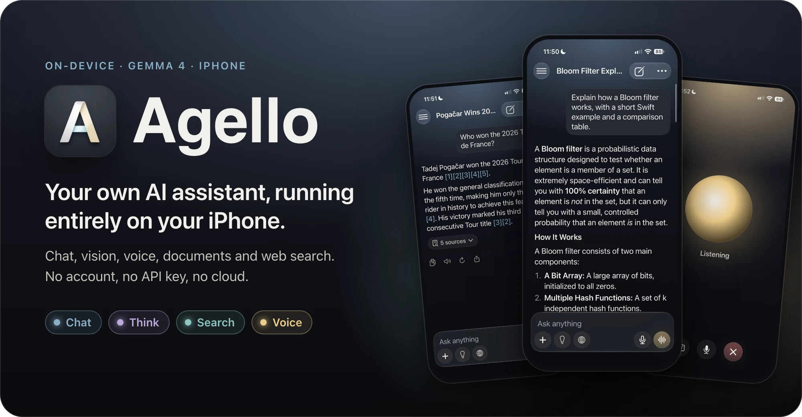
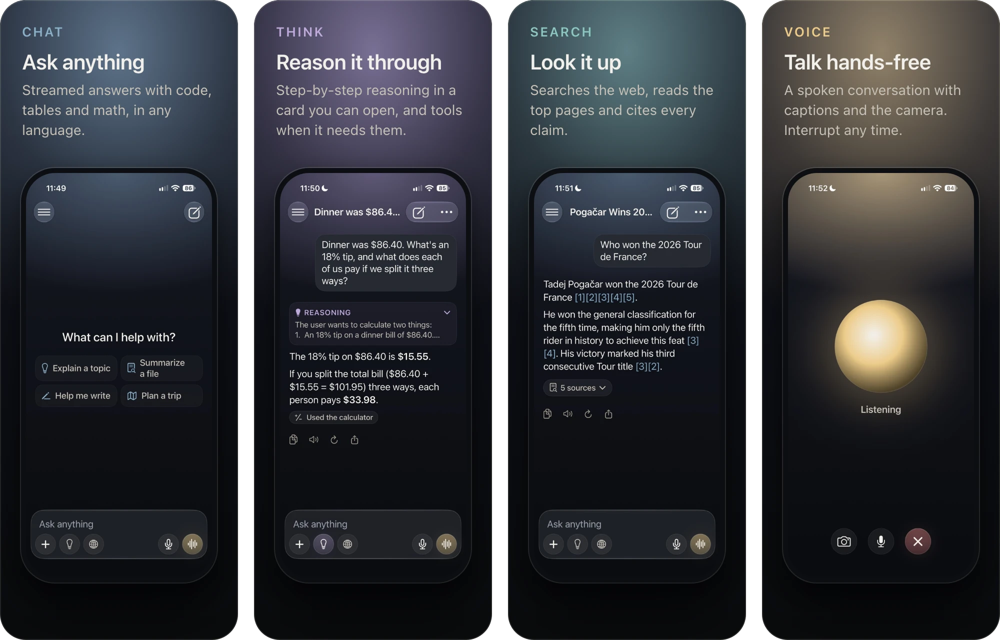
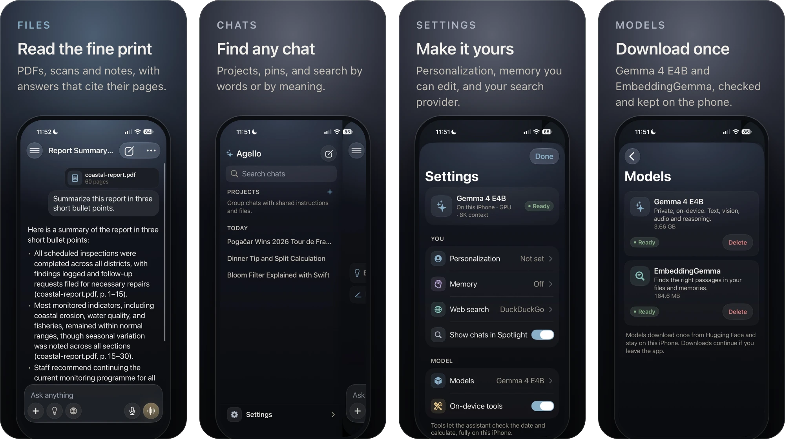
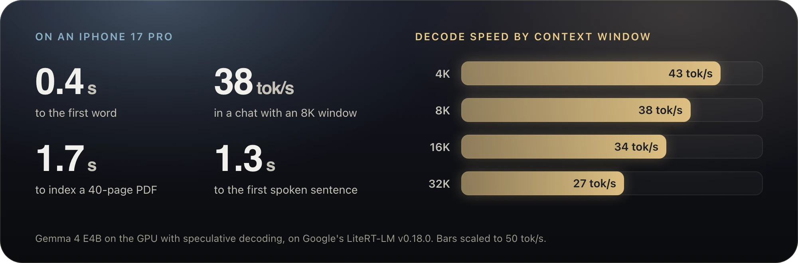
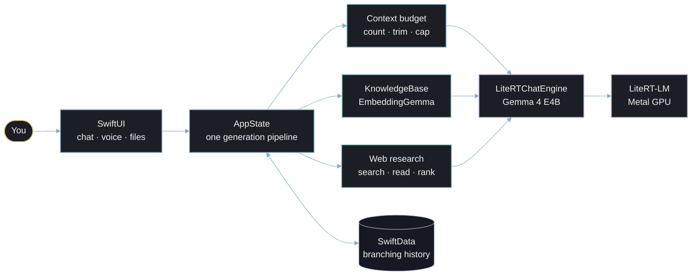
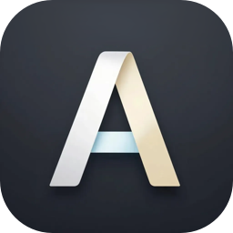

<div align="center">



<br>

[](#get-started)
[](#get-started)
[](docs/USER_GUIDE.md#the-models)
[](#vendored-litert-lm)
[](#meet-agello)
[](docs/TESTING.md)
[](LICENSE)

**[Meet Agello](#meet-agello)** · **[Four modes](#four-modes)** · **[Performance](#performance)** · **[For developers](#for-developers)** · **[Docs](#documentation)**

</div>

<br>

## Meet Agello

Agello is a full AI assistant that lives on your iPhone. It runs Google's **Gemma 4** on the phone's own GPU, so it reads, sees, listens and talks without sending your conversations anywhere. There's no account and no subscription. Once the model is downloaded, Agello works without a connection, except for the web searches you ask for.

<table>
<tr>
<td width="33%" valign="top">


**Private by design**<br>
Chats, photos, files and recordings stay on the phone. The network is used only to download the models and for the web searches you ask for, which send only the search terms. [Privacy policy](https://powerbeef.github.io/Agello/privacy)

</td>
<td width="33%" valign="top">


**Fast**<br>
About **0.4 s** to the first word and **~40 tokens a second** as it writes, on an iPhone 17 Pro. A 40-page PDF is indexed in under 2 seconds.

</td>
<td width="33%" valign="top">


**Complete**<br>
Text, vision and audio in one model: reasoning, tools, documents with page citations, web search with sources, memory, hands-free voice, Siri, widgets and the share sheet.

</td>
</tr>
</table>

## Four modes

Agello's color follows what you're doing. Each mode has its own accent, and it lights the glow behind the chat, the composer's pills and the send button: **glacier** for chat, **lavender** for Think, **teal** for Search, **gold** for Voice.



## What it does



- **Conversations.** A side drawer with chats grouped by date, pinned chats, and projects that share instructions and files. Search finds chats by words and by meaning ("Japan vacation" finds "Kyoto itinerary"). Edit or regenerate any message, and switch between versions with ‹ 2/3 ›.
- **Rich answers.** Live streaming with headings, tables, task lists, highlighted code with a Copy button, and typeset math. **Think** shows step-by-step reasoning in a card you can open, and built-in tools check the date and do arithmetic.
- **Documents.** Attach PDFs, text, Markdown, code, CSV, JSON or RTF, or scan paper with the camera. Answers cite their pages, like *(report.pdf, p. 23)*. "Summarize this" reads a long document section by section, and keeps going in the background on iPhones that support it.
- **Web search with sources.** One tap to look something up: Agello searches, reads the top pages, picks the relevant parts and answers with `[1]`-style citations. DuckDuckGo by default, or Brave, Tavily or your own SearXNG.
- **Voice and vision.** Show it a photo, dictate in your language, send voice messages Gemma listens to directly, or start **voice mode**: a hands-free conversation with captions and an optional camera. Talk over it to interrupt.
- **Personal.** Tell Agello about yourself and how to answer. Opt-in memory keeps lasting facts ("Lives in Montreal"), and you can see and edit every one.
- **At home on iOS.** Liquid Glass, VoiceOver and Dynamic Type; Siri and Shortcuts ("Ask Agello", "Talk to Agello"), the Action Button, Home and Lock Screen widgets, Control Center, Spotlight, the share sheet and `agello://` links. Model downloads continue in the background and are checked when they finish.

→ The [user guide](docs/USER_GUIDE.md) covers every screen and setting.

> [!NOTE]
> Agello isn't on the App Store yet. You can [build it from source](#get-started) for an iPhone 15 Pro or later.

## Performance



<details>
<summary><b>Every measurement</b></summary>

<br>

Gemma 4 E4B on an iPhone 17 Pro (12 GB, iOS 27), GPU, with speculative decoding (MTP), on Google's LiteRT-LM v0.18.0 runtime (the one the app ships), measured before 2026-10-14. Decode speed drops as the phone warms: a cooled calibration on 2026-10-15 measured 37 / 39 / 31 / 20 tok/s.

| | |
| --- | --- |
| Time to first token, short message | **~0.4 s** |
| Decode speed, chat at 4K / 8K / 16K / 32K context | **43 / 38 / 34 / 27 tok/s** |
| Time to first token, 2.3K / 4.4K / 8.6K-token input | 2.1 s / 6.0 s / 18.9 s |
| Model load, first / warm | ~9 s / ~1–3 s |
| Index a 40-page PDF / search it | 1.7 s / 15 ms |
| "Summarize this report" (40 pages), first time / again | 37 s / 7.5 s |
| Cited follow-up question on the same report | 5 s |
| Web search answer (search, read 5 pages, rank, answer) | ~25 s |
| Voice mode, first spoken sentence after you stop talking | ~1.2–1.5 s |
| Dictation of a spoken sentence | ~1 s (word error rate 0–0.13, English and French) |
| App memory footprint (8K context, vision and audio) | ~1.2–2.8 GB |

For reference, Google reports 1,189 prefill and 25.1 decode tokens per second for E4B on the same GPU, without speculative decoding (model card, as of 2026-10-15).

</details>

<br>

---

## For developers

Agello is a working reference for shipping a multimodal LLM inside a native iOS app: SwiftUI and Swift 6 concurrency, one actor that owns the runtime, a context budget that can't overflow, on-device retrieval, and a test harness that runs on the phone. The engineering notes explain each decision and the bug behind it.

### How it works



Every message takes one path through `AppState`. Pending settings are applied, then file context and web results are gathered. The native conversation is bound to the chat, and the context is fitted to the KV cache. The reply then streams into SwiftData, and memories and the title follow. A single actor owns the LiteRT-LM engine, and every engine operation runs through a serialized queue. → [Architecture](docs/ARCHITECTURE.md)

### Engineering highlights

<table>
<tr>
<td width="50%" valign="top">


**Fixing Gemma's long-context math on the GPU**<br>
On the iPhone GPU, Gemma 4 duplicated digits once a chat passed ~2K tokens ("2026" became "202026"). Device probes traced it to **position 2,048**: the model computes rotary angles from a float16 copy of the position, which can't hold integers past 2,048. Agello ships a model whose graph splits every position as `512·h + l`, so the rotary math stays exact to 32,767 on every GPU tested, M1-class Macs included. The result: **14/14 exact** copies up to 30K tokens, **1.7–2.1× faster prefill** than the float32 workaround, and **0.7 GB less memory**.<br>
[Analysis](https://github.com/google-ai-edge/LiteRT-LM/issues/3913#issuecomment-6157362598) · [fix](https://github.com/google-ai-edge/LiteRT-LM/issues/3913#issuecomment-6159684389) · [model](https://huggingface.co/PowerBeef02/gemma-4-E4B-it-litert-lm-fp16-rope)

</td>
<td width="50%" valign="top">


**A context window that never overflows**<br>
Overflowing LiteRT-LM's KV cache corrupts its native heap, so every message is budgeted first:
- each turn is rendered the way the runtime will see it, and counted with the model's own tokenizer;
- older turns are trimmed, and replies are capped;
- tool results get their own budgets, and tool rounds are bounded.

A message that can't fit is explained, never crashed on.

</td>
</tr>
<tr>
<td valign="top">


**Conversations as a tree**<br>
Chat history is a versioned SwiftData schema whose turns form a tree. Edit, regenerate and the version switcher are just moves of the active leaf. The model's context is always rebuilt from the right branch, so abandoned versions never leak into an answer.

</td>
<td valign="top">


**On-device RAG with citations**<br>
Files are read with PDFKit and Vision OCR, split into page-aware, token-sized passages, and embedded in the background with EmbeddingGemma. Search ranks float16 vectors with one matrix product, and falls back to keywords for any file that can't be embedded. The model reads whole files, cited excerpts or a cached summary, whichever fits, and answers cite pages.

</td>
</tr>
<tr>
<td valign="top">


**Hands-free voice with barge-in**<br>
Voice-activity turn detection, and one audio engine for echo-cancelled capture and sentence-by-sentence speech. The first spoken sentence arrives ~1.3 s after you stop talking, and you can interrupt at any time.

</td>
<td valign="top">


**376 tests, run on a real iPhone**<br>
296 unit tests, 56 scenarios and runtime probes with the real models in-process, and 24 real-tap UI flows, including an accessibility audit. They run through a device harness that also simulates 8 GB iPhones. No simulator: the failures that matter only happen on hardware.

</td>
</tr>
</table>

→ [Engineering notes](docs/ENGINEERING.md) · [Testing](docs/TESTING.md) · [LiteRT-LM](docs/LITERT-LM.md)

### Get started

**You'll need** an iPhone 15 Pro or later (8 GB of memory) on iOS 27 with about 4.4 GB free, and a Mac with Xcode 27. The Apple Developer account needs the **Extended Virtual Addressing**, **Increased Memory Limit**, **Background GPU Access** and **App Groups** capabilities. Agello runs on a physical iPhone only: its LiteRT-LM path is untested in the simulator, and the failures that matter only show on hardware.

1. Open `Agello.xcodeproj`. Swift Package Manager resolves `swift-markdown` and `SwiftMath`; LiteRT-LM is vendored.
2. The project is set up for team `FK2D8X36G2` and bundle IDs `com.patricedery.agello` (plus `.widgets` and `.share`), sharing the App Group `group.com.patricedery.agello`. On another account, change the team and bundle IDs under **Signing & Capabilities**.
3. Select the `Agello` scheme and your iPhone, and run. Use the **Release** configuration for representative speed.
4. On the welcome screen, download **Gemma 4 E4B** (3.7 GB), and start chatting.

> [!TIP]
> To explore the interface without downloading a model, run with the `--mock-engine` launch argument (**Product → Scheme → Edit Scheme → Run → Arguments**): a scripted engine drives streaming, reasoning, titles, regenerate and edit.

> [!NOTE]
> If signing fails with *"PLA Update available"*, accept the latest Program License Agreement at [developer.apple.com/account](https://developer.apple.com/account).

Run the tests with the device harness, on the iPhone or on an Apple silicon Mac running the iPhone app:

```sh
scripts/device-harness.sh unit                      # 296 unit tests, scripted engine, ~3 min
scripts/device-harness.sh inference                 # the real model on the iPhone
PLATFORM=mac scripts/device-harness.sh inference    # the same on this Mac
```

### Project layout

```text
Agello/            the app: AppState, Inference/, Knowledge/, Markdown/, ModelHub/,
                   Persistence/, System/, Voice/, Views/, Support/ (Theme/: the design system)
AgelloWidgets/     widgets and Control Center controls
AgelloShare/       share extension ("Ask Agello")
AgelloTests/       unit tests
AgelloDeviceTests/ on-device scenarios and runtime probes with the real models
AgelloUITests/     real-tap UI flows and the accessibility audit
scripts/           device test harness, device tools, README art
Vendor/LiteRT-LM/  LiteRT-LM v0.18.0 Swift package
docs/              user guide, architecture, engineering notes, testing, privacy policy
```

### Design system

Agello has one dark palette, warm neutrals on a navy canvas, and four mode accents. Liquid Glass stays on chrome (the composer and banners) and falls back to solid surfaces under Reduce Transparency; content sits on cards; motion uses one ease-out curve and turns off under Reduce Motion. Every token lives in `Agello/Support/Theme/`.

| Token | Color | Use |
| --- | --- | --- |
| Glacier |  | Chat, links, selection |
| Lavender |  | Think |
| Teal |  | Search |
| Gold |  | Voice, read aloud |
| Silver |  | Chrome with no mode: settings, sheets |
| Canvas |  | The background, fading to `#0A0B0E` |
| Text |  | Warm off-white, never pure white |

The README art comes from the same tokens: `scripts/readme-art/render.sh` redraws it from the screenshots in `docs/images/`.

### Documentation

| | |
| --- | --- |
| [User guide](docs/USER_GUIDE.md) | Every screen and setting, Siri and widgets, the models, troubleshooting, known limitations |
| [Architecture](docs/ARCHITECTURE.md) | Components, the life of a message, the data model, concurrency |
| [Engineering notes](docs/ENGINEERING.md) | The #3913 fix in full, and every reliability safeguard |
| [Testing](docs/TESTING.md) | The suites, the device harness, and how to run them |
| [LiteRT-LM](docs/LITERT-LM.md) | The LiteRT-LM the app ships, what it sets, and a map of the fork's verified runtime and model reference |
| [Privacy policy](https://powerbeef.github.io/Agello/privacy) | What stays on the iPhone, and what the network is used for |
| [Roadmap](docs/ROADMAP.md) | What has shipped, what's next, and the plan for [Agello for Mac](docs/MAC.md) |

### Vendored LiteRT-LM

`Vendor/LiteRT-LM` holds the Swift package surface of [LiteRT-LM](https://github.com/google-ai-edge/LiteRT-LM) v0.18.0, from our fork's [`agello` branch](https://github.com/PowerBeef/agello-litert-lm/tree/agello), with four patches to the Swift wrapper:

1. A tool call that fails is answered with an error the model can read, instead of ending the reply.
2. A stream holds its conversation weakly, which fixed a 10-minute engine stall when a conversation was dropped while its stream was finishing.
3. Streams live in a table keyed by ID, so a rejected tool call reported three times ends the stream once instead of freeing it three times; Stop also works between tool rounds, and tool rounds are bounded.
4. `Engine.tokenize` and `countTokens`, and an embedding option that truncates long inputs instead of failing the batch.

Upstream stores prebuilt binaries in Git LFS, which intermittently breaks Swift Package Manager resolution; the iOS build uses only Google's checksummed release XCFramework. [Vendor/README.md](Vendor/README.md) has the details and the refresh steps.

### Contributing

Work happens directly on `main`. Keep the unit tests and the on-device harness green, build UI from the design system's tokens, and record any new dependency's license in [NOTICE](NOTICE).

### Roadmap

- **Shipped:** the chat, files, projects and memory, web search and dictation, voice mode with the camera, and system integration. Then a reliability pass: crash fixes in the runtime wrapper, exact token counting, retrieval for CJK and number-heavy files, sampling that matches Settings, VoiceOver and the accessibility audit, MetricKit diagnostics, and a privacy policy.
- **Next:** a LiteRT-LM build of our own: in the cooled calibration it decoded 37–45 tok/s at a 32K window, against 20 for Google's binary the same night. Then **Agello for Mac**, a native Mac app that shares the iPhone app's code ([plan](docs/MAC.md)).

→ [The full roadmap](docs/ROADMAP.md)

## License

Agello is licensed under the [Apache License 2.0](LICENSE). [NOTICE](NOTICE) covers the third-party components it uses and downloads, and the app shows it in Settings → About → Licenses.

| Component | Distribution | License |
| --- | --- | --- |
| LiteRT-LM | Vendored in `Vendor/LiteRT-LM` | Apache 2.0 |
| swift-markdown, swift-cmark | Swift packages | Apache 2.0, BSD 2-Clause |
| SwiftMath | Swift package | MIT |
| Gemma 4 E4B (litert-community build, rotary positions patched), EmbeddingGemma 2 | Downloaded at runtime | Apache 2.0 |

## Acknowledgements

- [LiteRT](https://github.com/google-ai-edge/litert) and [LiteRT-LM](https://github.com/google-ai-edge/LiteRT-LM) by Google, with the [Swift guide](https://developers.google.com/edge/litert-lm/swift) and [Gemma 4 on LiteRT-LM](https://developers.google.com/edge/litert-lm/models/gemma-4)
- [Gemma 4 E4B](https://huggingface.co/google/gemma-4-E4B-it) by Google, with the [LiteRT-LM build](https://huggingface.co/litert-community/gemma-4-E4B-it-litert-lm) by `litert-community`; Agello downloads [a copy with float16-exact rotary positions](https://huggingface.co/PowerBeef02/gemma-4-E4B-it-litert-lm-fp16-rope)
- [swift-markdown](https://github.com/swiftlang/swift-markdown) by the Swift project, and [SwiftMath](https://github.com/mgriebling/SwiftMath) by Computer Inspirations

<br>

<div align="center">

<br>
<sub>Agello · your own AI assistant, on your iPhone</sub>
</div>
