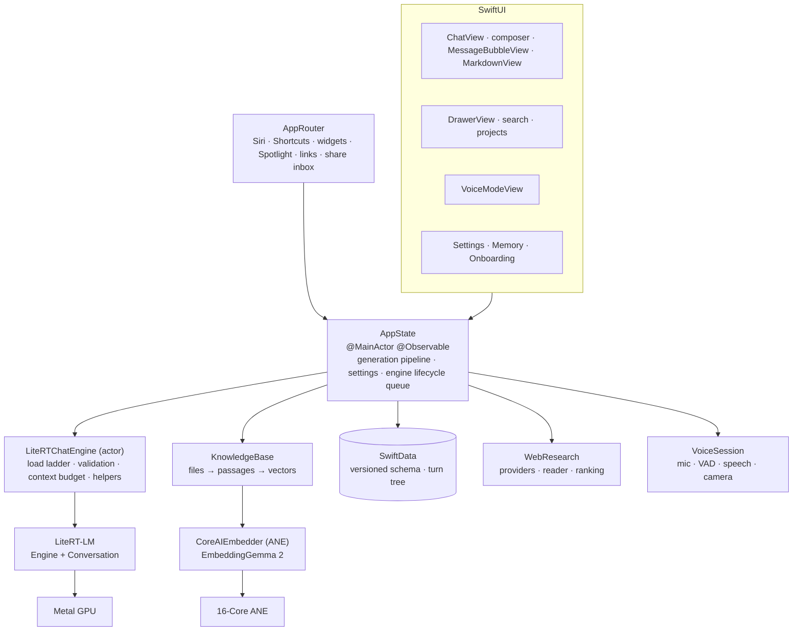

# Architecture

Agello is one SwiftUI iPhone app target (`Agello`) organized in folders plus two small extensions (`AgelloWidgets`, `AgelloShare`), backed by two unshipped developer targets sharing the same `Agello/` sources: `AgelloSim` (iOS Simulator loopback bridge) and `AgelloCLI` (macOS SwiftPM developer CLI). Everything that touches the model runs in the app (or in `agello serve` when driving `AgelloSim`).



## Components

| Component | Responsibility |
| --- | --- |
| `AppState` | The hub (`+Reply`, `+Tools`, `+Web`, `+Chats`, `+Benchmark`). Runs every engine operation (load, settings change, benchmark, delete, helpers) one at a time; binds the native conversation to the open chat; drives send, regenerate and edit through one generation path; streams replies into SwiftData with adaptive `ThermalPolicy` throttling (`100 / 200 / 250 ms`); parks active Shortcut handoffs safely across backgrounding; manages single-step and multi-step tool confirmations; and persists settings. |
| `ChatEngineProtocol` & engines | `LiteRTChatEngine` is the single owner of LiteRT-LM `Engine` and `Conversation` (GPU multimodal → text-only load ladder, validation, KV budgeting, MTP JSON-constrained helpers). `RemoteChatEngine` (`AgelloSim/`) implements the same protocol for iOS Simulator UI, feature, and output-quality testing by streaming from host `agello serve` (`127.0.0.1:8091`) while running all **21 Swift tools** natively in the Simulator (`RemoteEmbedder` proxies ANE `/v1/embeddings`). `MockChatEngine` implements it with a script for unit tests and `--mock-engine`. Platform `EngineFactory.swift` seams (`AgelloiOS/Platform/`, `AgelloCLI/Sources/Platform/`, `AgelloSim/Platform/`) pick the live engine and embedder with zero `#if targetEnvironment(simulator)` in `Agello/`. |
| `InferencePlanner`, `ContextBudget` | Pure, tested resolution of options and device memory into KV-cache size, sampler, thinking and visual-token budgets, and speculative decoding; token estimates (including exact serialized tool-schema accounting via `estimateToolSchemaTokens`), token-budgeted history trimming, evicted-turn recall formatting, and reply caps. Decides when a settings change needs an engine rebuild. |
| `ToolBudget`, tools & security | **21 shipping Swift tools** (`16` read-only + `5` mutating/confirm-gated: `manage_calendar_event`, `manage_reminder`, `prepare_message`, `manage_alarm`, `run_shortcut`): 4 always-on offline (`get_current_date_time`, `calculate`, `convert_units`, `search_past_chats`), 3 document-gated workspace (`search_files`, `read_document_pages`, `query_table_or_json`), 12 opt-in Personal Tools across **7 `PersonalToolsSettings` toggles** (Calendar: `read_calendar`, `manage_calendar_event`; Reminders: `list_reminders`, `manage_reminder`; Contacts: `search_contacts`, `prepare_message`; Maps: `search_places`, `estimate_travel_time`; Weather: `get_weather`; Alarms & Timers: `list_alarms`, `manage_alarm`; Photos OCR: `search_photos`), 1 opt-in `run_shortcut` (allowlisted outbound Apple Shortcuts), and 1 opt-in `web_search`. `ToolBudget.plan` scales across 3 tiers (`2` calls `<16K`, `4` calls `16–32K`, `5` calls `>=32K`) with parallel read-only dispatch (`Tool.isReadOnly`) and post-tool Think clamping (`followUpThinkingBudget`). Security layers combine `<untrusted_data>` spotlighting & memory quarantine (`UntrustedContext.wrapFitted`), per-turn `TurnSecurityContext` taint provenance banners, `TurnContactRoster` recipient verification, 3 confirmation risk tiers (`.standard`, `.destructive` with authoritative EventKit/AlarmKit lookups, `.external`), multi-step `PlanConfirmationCard` (`BatchConfirmationPlanner` + `ToolManager.BatchConfirmHandler` + single-use `grantBatchStep` + strict 1-to-1 `skipped_by_user` parity), and fail-closed `ToolConfirmationGate` / `ToolConfirmationCard` in both `ChatView` and `VoiceModeView`. |
| `ActionCards` & native handoffs | **9 typed `ActionCards`** payloads (`PlacesCard`, `RouteCard`, `CalendarEventCard`, `ReminderCard`, `ContactCard`, `MessageDraftCard`, `WeatherCard`, `AlarmCard`, `AutomationHandoffCard`) persisted via `LossyArray` inside `MessageParts.actionCards` (zero `SchemaV4` migration), captured by `ToolCardRecorder` (`Mutex` ring buffer across `LiteRTChatEngine`, `RemoteChatEngine`, and `WebResearch`), rendered by `ActionCardsView` and `LiveActionCardsView` (live EventKit Complete/Snooze, `AlarmKit` Pause/Resume/Cancel, `WeatherAttributionMark`), and bridged to public iOS sheets/exports via `NativeActionURLs.swift` and `NativeActions.swift` (`MKMapSnapshotter` on `.utility` QoS, `.mapItemDetailSheet`, `.lookAroundViewer`, `EKEventEditViewController`, `CNContactViewController`, `MFMessageComposeViewController`/`MFMailComposeViewController`, `.ics`/vCard `Transferable` export). |
| `LanguageSupport` | Pure, zero-latency multilingual normalization across 13 languages (EN/FR/ES/DE/IT/PT/NL/PL/RU/AR/JA/ZH/KO) for current-location detection, European + CJK proximity place splitting, weather/store-hours noise stripping, MapKit transport modes, US + European localized numbers, and comparative follow-ups. |
| Chat history | A SwiftData `VersionedSchema` (V1 → V3) with a migration plan: threads, turns (storing rich `MessageParts` including `actionCards` via `LossyArray`), projects, documents and their passages, memories. |
| `MarkdownDocument`, `MarkdownView` | Pure, tested parsing (swift-markdown) into typed blocks, with display math split out and inline LaTeX converted to Unicode; rendering with syntax-highlighted code and SwiftMath typesetting. |
| `KnowledgeBase` | Stores attached files as page-aware passages, embeds them (and chats) on the 16-core ANE with `CoreAIEmbedder` (`EmbeddingGemma 2` with `INT4EmbeddingTable` `MADV_RANDOM` + cached `padRow` + `SIMD8<Float16>` LUT row dequantization, zero Metal GPU contention; `LiteRTEmbedder` fallback) on `Task.detached(priority: .utility)` gated by `ThermalPolicy`, and finds relevant passages, related chats, and evicted-turn recall snippets. |
| `DocumentIngestor`, `Chunker`, `FileContext` | Pure, tested file reading (PDFKit, Vision text recognition, text formats), splitting into ~400-token passages with page numbers, and the choice of what the model reads within half the context window (with a targeted `query_table_or_json` hint only for `.csv`/`.tsv`/`.json` files). |
| `SystemPrompt` | Composes the base prompt (D8), personalization, memories, project instructions, voice mode, `<untrusted_data>` data-boundary rules, and conditional `allowedShortcuts` allowlist (`≤ 10` top-K entries); any change rebuilds the conversation before the next message. |
| `WebResearch` | Sources chosen by the planner's topic (`SearchTopic`): Wikipedia, Wikidata, Wikivoyage, Wiktionary, Wikiquote and Current events (`ReferenceSources.swift`), Apple Weather and Apple Maps (`AppleSources.swift`), the ECB's rates, Crossref, PubMed; a structured answer pinned first, pages read in parallel with a random-nonce bounded readable-text extractor, resolved-IP SSRF checks (`getaddrinfo`) plus `PublicRedirects` & `maxPageBytes` on every `WebClient` request, passages ranked on ANE with EmbeddingGemma 2, numbered sources. Only sources whose terms permit the app, no API keys (2026-11-12). `WebSearchTool` exposes it to the model in automatic mode. |
| `Dictation`, `LiveSpeechTranscriber`, `VoiceSession` | Instant ANE streaming dictation via iOS 27 `SpeechAnalyzer` (falling back to Gemma's audio input), and hands-free conversation with hybrid acoustic+neural end-of-utterance detection, echo-cancelled capture and sentence-by-sentence speech, barge-in (paused during tool confirmation cards, shrinking the orb to `80 pt` with a compact action-card tray), and a camera frame per utterance. |
| `ChatView`, `ChatComposerView` | `ChatView` renders banners (including the non-blocking *"Waiting for Shortcut… [Continue]"* banner), message list (`MessageBubbleView`, `ActionCardsView`/`LiveActionCardsView`, `ScrollViewReader` streaming), and voice-mode sheets while `ChatComposerView` (`ComposerView.swift`) isolates all draft, attachment, picker, explicit `PasteButton`, dictation, recording, and focus state behind a lightweight one-way `ComposerBridge`, so typing never triggers layout or diffing in the message list. |
| `AppRouter`, App Intents, `AppEntities` & Automations | 5 launch intents ("Ask Agello", "New Chat", "Talk to Agello", "Snap & Ask Agello", "Voice with Camera"), 3 `IndexedEntity` + `OpenIntent` types (`ChatEntity`, `ProjectEntity`, `DocumentEntity`), 4 composable Shortcuts intents (`SearchKnowledgeBaseIntent` `.background` ANE/BM25 zero-GPU, `AskAgelloForTextIntent`, `SummarizeDocumentIntent`, `ExtractStructuredDataIntent`), `AgelloFocusFilter: SetFocusFilterIntent`, and `RunAgelloRecipeIntent` (`RecipeEntity`) — all gated by `IntentAuthenticationPolicy.requiresAuthentication`. `AutomationRegistry` stores allowlisted Shortcuts, starter templates, and built-in/custom Recipes; `ShortcutCallbackBroker` guards outbound `x-callback-url` runs with a 256-bit CSPRNG hex nonce, constant-time compare, 120 s TTL, and single-use invalidation on `agello://shortcut-result`; `FolderBookmarks` persists per-project security-scoped folder bookmarks; `AppRouter` dispatches `agello://` links (including `agello://recipe/<id>`), widgets, Control Center, Spotlight, and the share inbox. |
| `ShareInbox`, `SpotlightIndex` | Items shared from other apps wait in an App Group inbox for the app to answer; chats, projects, and documents are indexed in CoreSpotlight and AppIntents `IndexedEntity` storage (`EntityIndexing` platform seam). |
| `BackgroundWork`, `BackgroundWorkPlan` & Live Activities | Continued processing Live Activity (`.gpu` + `.inference` entitlements) covering multi-document synthesis, web research, and multi-step Think tool chains with granular step progress (`onSubmissionFailure` closes `GPUGate` and drains immediately if backgrounded), while plain chat stops cleanly in the background. `AgelloAlarmLiveActivity` (`AgelloWidgets.swift`, `AgelloAlarmMetadata.swift`) renders live `AlarmKit` countdowns with `LiveActivityIntent` Pause/Resume/Cancel controls. |
| `MetricsReporter`, `MemoryProbe`, `ThermalPolicy` | Live kernel `phys_footprint` / `ledger_phys_footprint_peak` / Metal GPU / ANE ledger snapshots and deltas (`Diagnostics.swift`), iOS 27 `MetricKit.MetricManager` async streams (`MetricKitStream.swift`, including `.memoryException` diagnostics and `MetricReport`s), summarized in diagnostics exports and `DeveloperSettingsView`. `ThermalPolicy` (`Support/ThermalPolicy.swift`) monitors `ProcessInfo.thermalStateDidChangeNotification` and Low Power Mode to adapt stream flush cadence (`100 / 200 / 250 ms`), helper delays, and background ANE indexing. |
| `ModelStore`, `ModelCatalog` | Pinned model downloads in a background `URLSession`, exact byte-size and SHA-256 verification, atomic `.aar` archive unpacking (`AppleArchive`), storage, and cleanup of retired files. |
| `DeviceProfile` | Device memory policy: the 12 GB floor, the context window chosen at each load from the memory left, the low-memory stop threshold. |

## One message, end to end

`send`, `regenerate` and `edit` share one `generate` path in `AppState` (voice turns and shared items go through `send`):

1. Apply any setting changed since the last message (the **Think** toggle applies to *this* message).
2. Build file context: whole files, cited passages, or a cached summary.
3. Run a web search, if asked.
4. Bind the native conversation to this chat, reseeding it from history if another chat or a cancellation used it last, or a helper that didn't keep it (on exclusive helper switches, the runtime detaches sparse global KV mappings via Metal 4 `copyBufferMappingsFromBuffer:` when memory allows).
5. Fit the context: count the message, trim older turns by token budget if needed (recalling relevant evicted-turn snippets via `KnowledgeBase` and re-verifying fit), or reject a message that can never fit.
6. Save the user turn and a placeholder reply, then stream tokens into it.
7. Afterwards: learn memories, write a title after the first exchange, update Spotlight.

## Data model

Turns form a tree through `parentID`. Each thread stores its active leaf, and the visible conversation is the path from that leaf to the root. Editing or regenerating adds a sibling version, and the ‹ 2/3 › switcher moves the active leaf. Regenerate and edit rebuild the model's context from the turns before the changed one, so abandoned branches never reach the model.

## Multilingual design

Users write naturally in their own language with no special syntax or tool names required, while English — E4B's strongest reasoning and tool-calling tier — stays completely unaffected in quality and speed:

1. **User-facing conversation stays in the user's language.** Gemma 4 E4B (140+ languages) and ANE `EmbeddingGemma 2` (100+ languages) handle replies and semantic retrieval natively; `NLLanguageRecognizer` routes Wikipedia and sister projects to the message's language with English fallback.
2. **Machine-to-code boundaries stay structured or canonical.** Tools accept structured parameters (such as `SearchPlacesTool.near`), and `WebContext.queryPrompt` keeps encyclopedia queries in the user's language while guiding structured API topics (`place`, `weather`, `currency`) toward canonical formats with local place names intact.
3. **Deterministic defense-in-depth in Swift (`LanguageSupport.swift`).** Whenever localized terms still appear (even inside English prompts mentioning non-English landmarks like `"Place des Arts"`), `LanguageSupport`, `ExchangeRates`, `UnitConverter`, `StructuredDataQuery`, `FileContext`, and `HelperTasks` parse them cleanly in Swift at zero token cost.

## Concurrency

- UI state lives in `@MainActor @Observable` classes; engines and embedders are actors, and only `Sendable` values cross the boundary.
- Engine work goes through a single serialized queue in `AppState`, because the engine actor is reentrant across its long awaits.
- Blocking native calls (engine initialization) run detached, off the caller's executor.
- Swift 6 language mode with complete concurrency checking.

## Code map

```text
Agello/
├── AppState.swift      the hub: generation pipeline, settings, engine lifecycle
├── App/                launch: the store, AppState and the shell's model (AppBootstrap)
├── Inference/          engine actor, planner, context budget, device policy, tools, helpers
├── Knowledge/          file reading, chunking, embeddings, vector index, web research
├── Markdown/           parsing, code highlighting, rendering
├── ModelHub/           model catalog and background downloads
├── Persistence/        versioned SwiftData schema (V1–V3), ActionCards, branching, store loading
├── System/             App Intents, AppEntities, Focus Filter, AutomationRegistry, ShortcutCallbackBroker, FolderBookmarks, AgelloAlarmMetadata, NativeActionURLs, deep links, Spotlight, share inbox
├── Voice/              voice mode: capture, speech, turn detection, camera
├── Views/              chat, drawer, composer, ActionCardsView, LiveActionCardsView, ToolConfirmationCard, AutomationGalleryView, PersonalToolsSettingsView, settings, projects, onboarding; Shell/: the shell's model and routing
└── Support/            the design system (Theme/), ThermalPolicy, MetricsReporter, image preparation, diagnostics
AgelloiOS/             the shipped iPhone app: app entry, the drawer shell, camera and scanner, background work, Info.plist; Platform/, one file per seam (incl. NativeActions, PersonalContextService, MetricKitStream)
AgelloSim/             unshipped iOS Simulator target (`SKIP_INSTALL = YES`): RemoteChatEngine/Client/Embedder loopback bridge to host `agello serve` + Simulator `EngineFactory`
AgelloCLI/             unshipped macOS SwiftPM developer CLI (`agello ask`, `bench`, `serve`) + macOS `Platform/` seams
AgelloWidgets/         Home/Lock Screen widgets, Control Center controls, and `AgelloAlarmLiveActivity`
AgelloShare/           share extension: "Ask Agello"
Vendor/LiteRT-LM/       LiteRT-LM Swift package (`LiteRTLM` + pure-Swift `LiteRTLMTools`; our runtime release, iPhone and Mac)
```
