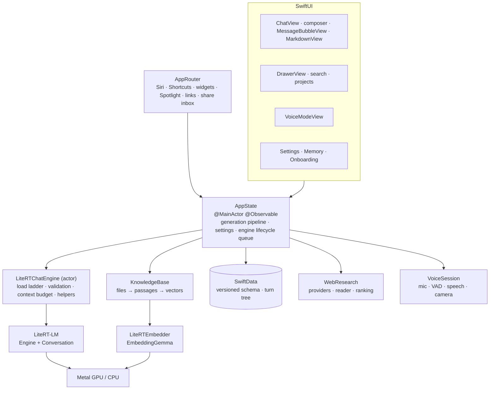

# Architecture

iRTChat is one SwiftUI app target organized in folders, plus two small extensions. Everything that touches the model runs in the app.



## Components

| Component | Responsibility |
| --- | --- |
| `AppState` | The hub. Runs every engine operation (load, settings change, benchmark, delete, helpers) one at a time; binds the native conversation to the open chat; drives send, regenerate and edit through one generation path; streams replies into SwiftData about ten times a second; persists settings. |
| `LiteRTChatEngine` | The single owner of a LiteRT-LM `Engine` and `Conversation`. Loads through a GPU → CPU, multimodal → text-only ladder, validates each engine, keeps every request inside the KV cache, and runs JSON-constrained helper prompts. `MockChatEngine` implements the same `ChatEngineProtocol` with a script, for tests and `--mock-engine`. |
| `InferencePlanner`, `ContextBudget` | Pure, tested resolution of options and device memory into backend, KV-cache size, sampler, thinking and visual-token budgets, and speculative decoding; token estimates, history trimming and reply caps. Decides when a settings change needs an engine rebuild. |
| `ToolBudget`, tools | Date/time, calculator and web search tools, each generation round's share of the remaining context, and the live tool status. |
| Chat history | A SwiftData `VersionedSchema` (V1 → V3) with a migration plan: threads, turns, projects, documents and their passages, memories. |
| `MarkdownDocument`, `MarkdownView` | Pure, tested parsing (swift-markdown) into typed blocks, with display math split out and inline LaTeX converted to Unicode; rendering with syntax-highlighted code and SwiftMath typesetting. |
| `KnowledgeBase` | Stores attached files as page-aware passages, embeds them (and chats) with EmbeddingGemma in the background, and finds relevant passages and related chats. |
| `DocumentIngestor`, `Chunker`, `FileContext` | Pure, tested file reading (PDFKit, Vision text recognition, text formats), splitting into ~400-token passages with page numbers, and the choice of what the model reads within half the context window. |
| `SystemPrompt` | Composes the base prompt, personalization, memories, project instructions and voice mode; any change rebuilds the conversation before the next message. |
| `WebResearch` | Provider chain with fallback, parallel page reading with a built-in readable-text extractor, passage ranking with EmbeddingGemma, numbered sources. `WebSearchTool` exposes it to the model in automatic mode. |
| `Dictation`, `VoiceSession` | Transcription through Gemma's audio input; hands-free conversation with voice-activity turn detection, one audio engine for echo-cancelled capture and sentence-by-sentence speech, barge-in, and a camera frame per utterance. |
| `AppRouter`, App Intents | "Ask iRTChat", "New Chat", "Talk to iRTChat", widgets, Control Center, Spotlight and `irtchat://` links all hand off to the app, which does the work in the foreground. |
| `ShareInbox`, `SpotlightIndex` | Items shared from other apps wait in an App Group inbox for the app to answer; chats are indexed for system search. |
| `BackgroundWork` | A continued processing task (background GPU) around long document summaries, with system progress UI that can cancel it. |
| `ModelStore`, `ModelCatalog` | Pinned model downloads in a background `URLSession`, size verification, storage, and cleanup of retired files. |
| `DeviceProfile` | Device memory policy: default context size, the low-memory stop threshold, the largest context the Settings slider offers. |

## One message, end to end

`send`, `regenerate` and `edit` share one `generate` path in `AppState` (voice turns and shared items go through `send`):

1. Apply any setting changed since the last message (the **Think** toggle applies to *this* message).
2. Build file context: whole files, cited passages, or a cached summary.
3. Run a web search, if asked.
4. Bind the native conversation to this chat, reseeding it from history if another chat, a helper, or a cancellation used it last.
5. Fit the context: estimate the message, trim older turns if needed, or reject a message that can never fit.
6. Save the user turn and a placeholder reply, then stream tokens into it.
7. Afterwards: learn memories, write a title after the first exchange, update Spotlight.

## Data model

Turns form a tree through `parentID`. Each thread stores its active leaf, and the visible conversation is the path from that leaf to the root. Editing or regenerating adds a sibling version, and the ‹ 2/3 › switcher moves the active leaf. Regenerate and edit rebuild the model's context from the turns before the changed one, so abandoned branches never reach the model.

## Concurrency

- UI state lives in `@MainActor @Observable` classes; engines and embedders are actors, and only `Sendable` values cross the boundary.
- Engine work goes through a single serialized queue in `AppState`, because the engine actor is reentrant across its long awaits.
- Blocking native calls (engine initialization) run detached, off the caller's executor.
- Swift 6 language mode with complete concurrency checking.

## Code map

```text
iRTChat/
├── AppState.swift      the hub: generation pipeline, settings, engine lifecycle
├── Inference/          engine actor, planner, context budget, device policy, tools, helpers
├── Knowledge/          file reading, chunking, embeddings, vector index, web research
├── Markdown/           parsing, code highlighting, rendering
├── ModelHub/           model catalog and background downloads
├── Persistence/        versioned SwiftData schema, branching, store loading
├── System/             App Intents, deep links, Spotlight, share inbox, background work
├── Voice/              voice mode: capture, speech, turn detection, camera
├── Views/              chat, drawer, composer, settings, projects, onboarding
└── Support/            the design system (Theme/), haptics, image preparation, diagnostics
iRTChatWidgets/         Home/Lock Screen widgets and Control Center controls
iRTChatShare/           share extension: "Ask iRTChat"
Vendor/LiteRT-LM/       LiteRT-LM v0.18.0 Swift package (prebuilt runtime)
```
