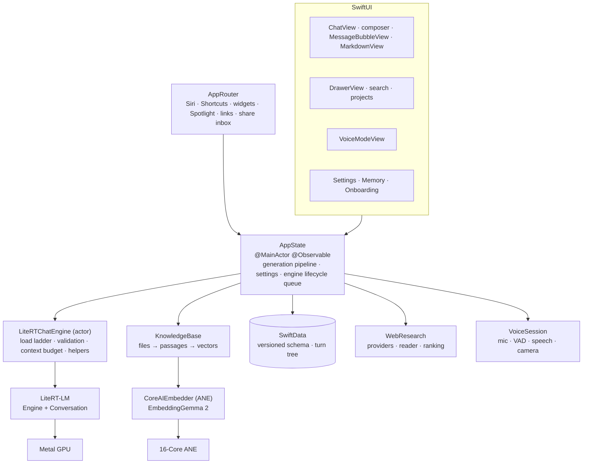

# Architecture

Agello is one SwiftUI app target organized in folders, plus two small extensions. Everything that touches the model runs in the app.



## Components

| Component | Responsibility |
| --- | --- |
| `AppState` | The hub (`+Reply`, `+Tools`, `+Web`, `+Chats`, `+Benchmark`). Runs every engine operation (load, settings change, benchmark, delete, helpers) one at a time; binds the native conversation to the open chat; drives send, regenerate and edit through one generation path; streams replies into SwiftData about ten times a second; manages inline tool confirmations and persists settings. |
| `LiteRTChatEngine` | The single owner of a LiteRT-LM `Engine` and `Conversation`. Loads on the GPU through a multimodal → text-only ladder, validates each engine, keeps every request inside the KV cache, and runs JSON-constrained helper prompts (with MTP on by default). `MockChatEngine` implements the same `ChatEngineProtocol` with a script, for tests and `--mock-engine`. |
| `InferencePlanner`, `ContextBudget` | Pure, tested resolution of options and device memory into KV-cache size, sampler, thinking and visual-token budgets, and speculative decoding; token estimates, token-budgeted history trimming, evicted-turn recall formatting, and reply caps. Decides when a settings change needs an engine rebuild. |
| `ToolBudget`, tools & security | Offline tools (date/time, calculator, `convert_units`, `search_files`, `read_document_pages`, `search_past_chats`, `query_table_or_json`), automatic `web_search`, and opt-in native iOS personal tools (`EventKit` Calendar & Reminders, `Contacts`, `MapKit` Places & ETA). Parallel read-only tool dispatch (`Tool.isReadOnly`), post-tool Think budgets (`ToolBudget.Plan.followUpThinkingBudget` clamped inside `followUpCap`), `<untrusted_data>` spotlighting & memory quarantine (`UntrustedContext.wrapFitted`), and fail-closed, request-ID-matched confirmation cards (`ToolConfirmationGate`, `ToolConfirmationCard` in both `ChatView` and `VoiceModeView`) for every mutating tool. |
| `LanguageSupport` | Pure, zero-latency multilingual normalization across 13 languages (EN/FR/ES/DE/IT/PT/NL/PL/RU/AR/JA/ZH/KO) for current-location detection, European + CJK proximity place splitting, weather/store-hours noise stripping, MapKit transport modes, US + European localized numbers, and comparative follow-ups. |
| Chat history | A SwiftData `VersionedSchema` (V1 → V3) with a migration plan: threads, turns, projects, documents and their passages, memories. |
| `MarkdownDocument`, `MarkdownView` | Pure, tested parsing (swift-markdown) into typed blocks, with display math split out and inline LaTeX converted to Unicode; rendering with syntax-highlighted code and SwiftMath typesetting. |
| `KnowledgeBase` | Stores attached files as page-aware passages, embeds them (and chats) on the 16-core ANE with `CoreAIEmbedder` (`EmbeddingGemma 2`, zero Metal GPU contention; `LiteRTEmbedder` fallback), and finds relevant passages, related chats, and evicted-turn recall snippets. |
| `DocumentIngestor`, `Chunker`, `FileContext` | Pure, tested file reading (PDFKit, Vision text recognition, text formats), splitting into ~400-token passages with page numbers, and the choice of what the model reads within half the context window (with a targeted `query_table_or_json` hint only for `.csv`/`.tsv`/`.json` files). |
| `SystemPrompt` | Composes the base prompt, personalization, memories, project instructions, voice mode, and `<untrusted_data>` data-boundary rules; any change rebuilds the conversation before the next message. |
| `WebResearch` | Sources chosen by the planner's topic (`SearchTopic`): Wikipedia, Wikidata, Wikivoyage, Wiktionary, Wikiquote and Current events (`ReferenceSources.swift`), Apple Weather and Apple Maps (`AppleSources.swift`), the ECB's rates, Crossref, PubMed; a structured answer pinned first, pages read in parallel with a random-nonce bounded readable-text extractor, resolved-IP SSRF checks (`getaddrinfo`) plus `PublicRedirects` & `maxPageBytes` on every `WebClient` request, passages ranked on ANE with EmbeddingGemma 2, numbered sources. Only sources whose terms permit the app, no API keys (2026-11-12). `WebSearchTool` exposes it to the model in automatic mode. |
| `Dictation`, `LiveSpeechTranscriber`, `VoiceSession` | Instant ANE streaming dictation via iOS 27 `SpeechAnalyzer` (falling back to Gemma's audio input), and hands-free conversation with hybrid acoustic+neural end-of-utterance detection, echo-cancelled capture and sentence-by-sentence speech, barge-in, and a camera frame per utterance. |
| `ChatView`, `ChatComposerView` | `ChatView` renders banners, message list (`MessageBubbleView`, scroll-anchor streaming), and voice-mode sheets while `ChatComposerView` (`ComposerView.swift`) isolates all draft, attachment, picker, dictation, recording, and focus state behind a lightweight one-way `ComposerBridge`, so typing never triggers layout or diffing in the message list. |
| `AppRouter`, App Intents & `AppEntities` | "Ask Agello", "New Chat", "Talk to Agello", "Snap & Ask Agello", "Voice with Camera", plus `ChatEntity`, `ProjectEntity`, and `DocumentEntity` (`IndexedEntity` + `EntityStringQuery` / `IndexedEntityQuery` + `OpenIntent`s, all gated by `IntentAuthenticationPolicy.requiresAuthentication`), widgets, Control Center, Spotlight, and `agello://` links hand off to the app in the foreground. |
| `ShareInbox`, `SpotlightIndex` | Items shared from other apps wait in an App Group inbox for the app to answer; chats, projects, and documents are indexed in CoreSpotlight and AppIntents `IndexedEntity` storage (`EntityIndexing` platform seam). |
| `BackgroundWork`, `BackgroundWorkPlan` | Continued processing Live Activity (`.gpu` + `.inference` entitlements) covering multi-document synthesis, web research, and multi-step Think tool chains with granular step progress (`onSubmissionFailure` closes `GPUGate` and drains immediately if backgrounded), while plain chat stops cleanly in the background. |
| `MetricsReporter`, `MemoryProbe` | Live kernel `phys_footprint` / `ledger_phys_footprint_peak` / Metal GPU / ANE ledger snapshots and deltas (`Diagnostics.swift`), iOS 27 `MetricKit.MetricManager` async streams (`MetricKitStream.swift`, including `.memoryException` diagnostics and `MetricReport`s), summarized in diagnostics exports and `DeveloperSettingsView`. |
| `ModelStore`, `ModelCatalog` | Pinned model downloads in a background `URLSession`, exact byte-size and SHA-256 verification, atomic `.aar` archive unpacking (`AppleArchive`), storage, and cleanup of retired files. |
| `DeviceProfile` | Device memory policy: the 12 GB floor, the context window chosen at each load from the memory left, the low-memory stop threshold. |

## One message, end to end

`send`, `regenerate` and `edit` share one `generate` path in `AppState` (voice turns and shared items go through `send`):

1. Apply any setting changed since the last message (the **Think** toggle applies to *this* message).
2. Build file context: whole files, cited passages, or a cached summary.
3. Run a web search, if asked.
4. Bind the native conversation to this chat, reseeding it from history if another chat or a cancellation used it last, or a helper that didn't keep it (on exclusive helper switches, the runtime detaches sparse global KV mappings via Metal 4 `copyBufferMappingsFromBuffer:` when memory allows).
5. Fit the context: count the message, trim older turns by token budget if needed (recalling relevant evicted-turn snippets via `KnowledgeBase` and re-verifying fit), or reject a message that can never fit.
6. Save the user turn and a placeholder reply, then stream tokens into it.
7. Afterwards: learn memories, write a title after the first exchange, update Spotlight.

## Data model

Turns form a tree through `parentID`. Each thread stores its active leaf, and the visible conversation is the path from that leaf to the root. Editing or regenerating adds a sibling version, and the ‹ 2/3 › switcher moves the active leaf. Regenerate and edit rebuild the model's context from the turns before the changed one, so abandoned branches never reach the model.

## Multilingual design

Users write naturally in their own language with no special syntax or tool names required, while English — E4B's strongest reasoning and tool-calling tier — stays completely unaffected in quality and speed:

1. **User-facing conversation stays in the user's language.** Gemma 4 E4B (140+ languages) and ANE `EmbeddingGemma 2` (100+ languages) handle replies and semantic retrieval natively; `NLLanguageRecognizer` routes Wikipedia and sister projects to the message's language with English fallback.
2. **Machine-to-code boundaries stay structured or canonical.** Tools accept structured parameters (such as `SearchPlacesTool.near`), and `WebContext.queryPrompt` keeps encyclopedia queries in the user's language while guiding structured API topics (`place`, `weather`, `currency`) toward canonical formats with local place names intact.
3. **Deterministic defense-in-depth in Swift (`LanguageSupport.swift`).** Whenever localized terms still appear (even inside English prompts mentioning non-English landmarks like `"Place des Arts"`), `LanguageSupport`, `ExchangeRates`, `UnitConverter`, `StructuredDataQuery`, `FileContext`, and `HelperTasks` parse them cleanly in Swift at zero token cost.

## Concurrency

- UI state lives in `@MainActor @Observable` classes; engines and embedders are actors, and only `Sendable` values cross the boundary.
- Engine work goes through a single serialized queue in `AppState`, because the engine actor is reentrant across its long awaits.
- Blocking native calls (engine initialization) run detached, off the caller's executor.
- Swift 6 language mode with complete concurrency checking.

## Code map

```text
Agello/
├── AppState.swift      the hub: generation pipeline, settings, engine lifecycle
├── App/                launch: the store, AppState and the shell's model (AppBootstrap)
├── Inference/          engine actor, planner, context budget, device policy, tools, helpers
├── Knowledge/          file reading, chunking, embeddings, vector index, web research
├── Markdown/           parsing, code highlighting, rendering
├── ModelHub/           model catalog and background downloads
├── Persistence/        versioned SwiftData schema, branching, store loading
├── System/             App Intents, deep links, Spotlight, share inbox
├── Voice/              voice mode: capture, speech, turn detection, camera
├── Views/              chat, drawer, composer, settings, projects, onboarding; Shell/: the shell's model and routing
└── Support/            the design system (Theme/), image preparation, diagnostics
AgelloiOS/             the iPhone app only: app entry, the drawer shell, camera and scanner, background work, Info.plist; Platform/, one file per seam
AgelloWidgets/         Home/Lock Screen widgets and Control Center controls
AgelloShare/           share extension: "Ask Agello"
Vendor/LiteRT-LM/       LiteRT-LM Swift package (our runtime release, iPhone and Mac)
```
