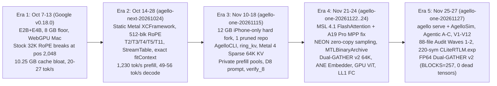

# Agello Backend & Runtime Engineering Knowledge Base

> **Scope & Coverage:** Authoritative living engineering record of every shipped optimization, diagnostic hardware probe, architectural pivot, model-surgery pass, Metal 4 / MSL 4.1 kernel change, Core AI ANE encoder offload, speculative-decoding experiment, Swift/C++/Rust runtime fix, prompt/RAG/security iteration, silicon divergence, regression, revert, and abandoned direction from commit #1 (**2026-10-07**) through **2026-11-27**:
> - **App & Harness Repository (`iRT` / `PowerBeef/Agello`):** **430+ commits** (`f63e552` → `3a67a36`)
> - **Hard-Forked Runtime Repository (`../LiteRT-LM` / `PowerBeef/agello-litert-lm`):** **172 fork commits** (`agello-base-20261013` / `df6df5b8` → `3af6200d`, plus 43 tags incl. `research/3913`)
> - **Active Baseline (2026-11-27):** Runtime release **`agello-one-20261127`** (`3af6200d`, Build **`8931ed8d5a23`**, SwiftPM SHA-256 `7ee6b8716c8388f6e367189252ecde8d7acce98f9ae470b0113fcaa7a423087d`) · Chat model **`gemma-4-E4B-it-agello-v2.litertlm`** (`PowerBeef02/gemma-4-E4B-it-litert-lm-fp16-rope@c2758a36`, `3,685,449,728` B, SHA-256 `d6e644ce5c468fc0694c9587f78f722548bbe7f4fc12353f4937f573670ee3bc`) · Embedding model **`embeddinggemma-2-text-270m-ane.aar`** (`PowerBeef02/embeddinggemma-2-text-270m-coreai-ane@41026d1c`, `128,245,086` B, SHA-256 `122c2d86657c20aa567fb778801a46e3aec786eec7bbabff618f1c4a531b2ece`).
>
> **Reference Hardware & OS Provenance:**
> - **Shipping target:** Physical **iPhone 17 Pro** (`iPhone18,1`, Apple A19 Pro, 6-core `Apple10` GPU with per-core Neural Accelerators, 16-core ANE, Metal 4 / MSL 4.1, 12 GB unified RAM, `6.44 GB` `os_proc_available_memory() + phys_footprint` jetsam ceiling on iOS 27.2.1 despite `8.59 GB` `MTLDevice.recommendedMaxWorkingSetSize`; early iOS 27.0.1–27.1 runs transiently reported `6.44–8.59 GB`).
> - **Workbench:** **Mac mini M6** (`Mac18,5`, Apple M6, OS Metal family `Apple11` / ML Drift `AppleInfo::Family::kApple10` at `gpu_info.cc:766-768`, 16-core ANE, 16 GB unified RAM, macOS 27.0.1+; `gpu_info.cc:979` models `kM6` as `12` compute units while hardware/commit notes cite `10` physical GPU cores — both cross `softmax.cc`'s `< 256 rows/CU` switch between 32K and 64K slices). Frequently run with `SIM_GPU=Apple_A19_Pro` (`kA19Pro = 6` CUs) or `Apple_A17_Pro` (`Apple9`) to match iPhone kernel codegen and cache keys.
>
> **Living Document Mandate:** Consult **Part 4 (`§4.1` M6-vs-iPhone Silicon Divergence Matrix & Revisit Triggers)** and **Part 6 ("Do Not Repeat" Graveyard)** *before* designing or implementing any model-surgery, Metal/ANE kernel, executor, speculative-decode, KV/memory, or prompt/RAG experiment. Record every measured outcome — including flat/negative runs, uncommitted trials, reverts, and M6-vs-iPhone divergences — in the **same commit** following [Part 7 — How to Maintain This Living Document](#part-7--how-to-maintain-this-living-document).

---

## Outcome Category Taxonomy (Cat A – Cat E)

Every tracked attempt across all five engineering domains (`MS-*`, `GPU-*`, `RT-*`, `APP-*`, `INF-*`) belongs to **exactly one** outcome category corresponding 1-to-1 with **Parts 2–6**:

| Category | Full Designation | Operational Definition & Document Location |
| --- | --- | --- |
| **`Cat A`** | **Successful Implementation (Shipped in Active Baseline)** | Verified on physical hardware and automated suites, retained in the active `main` baseline (`Part 2`). |
| **`Cat B`** | **Successful Research & Diagnostic Study (Empirical Proof / Refutation)** | Hardware probe, ceiling study, root-cause dissection, or adversarial audit refutation that proved an invariant or prevented a dead-end detour (`Part 3`). |
| **`Cat C`** | **Worth Revisiting Later (M6 Win vs. iPhone Loss / Validated Prototype / High-ROI Deferred Track / Wave 3)** | Empirically promising or audited work deferred behind a concrete hardware, bundle (`v3.litertlm`), or Wave 3 trigger — including optimizations that won on M6 (`Apple11`) but regressed on 6-core A19 Pro (`Apple10`) (`Part 4`). |
| **`Cat D`** | **Superseded Stepping Stone (Worked in Era, Cleanly Replaced)** | Shipped or validated in an earlier project era and subsequently replaced by a strictly superior architecture (`Part 5`). |
| **`Cat E`** | **Failed, Reverted & Rejected ("Do Not Repeat")** | Measured slower, memory-explosive, numerically unsafe, crash-prone under Swift 6 `-O`, or non-compliant, and permanently rejected or rolled back (`Part 6`). |

---

## Table of Contents

- [Executive Summary, End-to-End Hardware Progression & Master Scorecard](#executive-summary-end-to-end-hardware-progression--master-scorecard)
  - [Architecture Evolution (First Release → 2026-11-27)](#architecture-evolution-first-release--2026-11-27)
  - [Headline Progression — Physical iPhone 17 Pro (iPhone18,1, A19 Pro, 6-Core Apple10 GPU, 12 GB)](#headline-progression--physical-iphone-17-pro-iphone181-a19-pro-6-core-apple10-gpu-12-gb)
  - [Headline Progression — Mac mini M6 (Mac18,5, Apple11 / ML Drift Apple10, 16 GB)](#headline-progression--mac-mini-m6-mac185-apple11--ml-drift-apple10-16-gb)
  - [Aggregate Scorecard](#aggregate-scorecard)
  - [Master Attempt Ledger (191 Unique Tracked Attempts)](#master-attempt-ledger-191-unique-tracked-attempts)
- [Part 1 — Release, Model & Architecture Chronology + Complete 40-Probe Index (Probe 1–39)](#part-1--release-model--architecture-chronology--complete-40-probe-index-probe-139)
  - [1.1 Runtime Binary & Fork Release Chronology](#11-runtime-binary--fork-release-chronology)
  - [1.2 Model Catalog Pin Ledger (ModelCatalog.swift)](#12-model-catalog-pin-ledger-modelcatalogswift)
  - [1.3 Complete 40-Probe Historical Ledger (Probe 1 – Probe 39 + Silicon Scenario Probes)](#13-complete-40-probe-historical-ledger-probe-1--probe-39--silicon-scenario-probes)
  - [1.4 Era-by-Era Architecture Milestones & Retired Fork Topology](#14-era-by-era-architecture-milestones--retired-fork-topology)
- [Part 2 — Category A: Successful Implementations (Shipped in Active Baseline)](#part-2--category-a-successful-implementations-shipped-in-active-baseline)
  - [2.1 Model Surgery, Encoders & Core AI ANE Embeddings](#21-model-surgery-encoders--core-ai-ane-embeddings)
  - [2.2 Metal 4 / ML Drift GPU Kernels, Caches & Placement Sparse KV](#22-metal-4--ml-drift-gpu-kernels-caches--placement-sparse-kv)
  - [2.3 LiteRT-LM Executor, Speculative Decode (verify_8 / ContextDrafts), Zero-Copy Sampling, Constrained Decoding & FFI](#23-litert-lm-executor-speculative-decode-verify_8--contextdrafts-zero-copy-sampling-constrained-decoding--ffi)
  - [2.4 Swift SDK, App Backend Lifecycle, Voice/RAG/Web/Security (V1–V12) & ModelHub](#24-swift-sdk-app-backend-lifecycle-voiceragwebsecurity-v1v12--modelhub)
  - [2.5 Build, Harness, Simulator Proxy (AgelloSim / agello serve) & Benchmarking Infrastructure](#25-build-harness-simulator-proxy-agellosim--agello-serve--benchmarking-infrastructure)
- [Part 3 — Category B: Successful Research, Diagnostic Studies & Audit Refutations](#part-3--category-b-successful-research-diagnostic-studies--audit-refutations)
  - [3.1 Model Surgery, RoPE Isolation, Long-Context Capability & External Benchmark Studies](#31-model-surgery-rope-isolation-long-context-capability--external-benchmark-studies)
  - [3.2 Metal Kernel Ceilings, Pool/Residency Proofs & Adversarial Audit Refutations](#32-metal-kernel-ceilings-poolresidency-proofs--adversarial-audit-refutations)
  - [3.3 Executor, Speculative Replay Ceiling, Host/Heap Breakdowns & Soak Studies](#33-executor-speculative-replay-ceiling-hostheap-breakdowns--soak-studies)
  - [3.4 App Streaming, System Prompt Mechanics, Thermal/Harness & iOS Memory Studies](#34-app-streaming-system-prompt-mechanics-thermalharness--ios-memory-studies)
- [Part 4 — Category C: Worth Revisiting Later (Silicon Divergences, Prototypes & Queued Tracks)](#part-4--category-c-worth-revisiting-later-silicon-divergences-prototypes--queued-tracks)
  - [4.1 M6 Mac mini (Apple11, 10/12 CU, 16 GB) vs. iPhone 17 Pro (A19 Pro, Apple10, 6 CU, 12 GB) Silicon Divergence Matrix & Revisit Items](#41-m6-mac-mini-apple11-1012-cu-16-gb-vs-iphone-17-pro-a19-pro-apple10-6-cu-12-gb-silicon-divergence-matrix--revisit-items)
  - [4.2 Validated Prototypes Waiting on Model v3 or Bundle Surgery](#42-validated-prototypes-waiting-on-model-v3-or-bundle-surgery)
  - [4.3 High-ROI Unimplemented Runtime & Kernel Tracks](#43-high-roi-unimplemented-runtime--kernel-tracks)
  - [4.4 Queued Audit Wave 3 (P2/P3) Hardening & Upstream Trackers](#44-queued-audit-wave-3-p2p3-hardening--upstream-trackers)
- [Part 5 — Category D: Superseded Stepping Stones](#part-5--category-d-superseded-stepping-stones)
  - [5.1 Superseded RoPE, Window & Embedder Generations](#51-superseded-rope-window--embedder-generations)
  - [5.2 Superseded Metal Kernel, Pool, Wait & Snapshot Generations](#52-superseded-metal-kernel-pool-wait--snapshot-generations)
  - [5.3 Superseded App Lineup, Context Stepping, Cache Recovery & Eval Harnesses](#53-superseded-app-lineup-context-stepping-cache-recovery--eval-harnesses)
- [Part 6 — Category E: Failed, Reverted & Rejected Attempts ("Do Not Repeat" Graveyard)](#part-6--category-e-failed-reverted--rejected-attempts-do-not-repeat-graveyard)
  - [6.1 Silicon, Kernel & Bandwidth Regressions](#61-silicon-kernel--bandwidth-regressions)
  - [6.2 Memory, Pool & Jetsam Blowups](#62-memory-pool--jetsam-blowups)
  - [6.3 Speculative-Decode & Drafter Net Losses](#63-speculative-decode--drafter-net-losses)
  - [6.4 Numerical, Precision & Re-Export Traps](#64-numerical-precision--re-export-traps)
  - [6.5 Prompt, RAG, Web Classifier & Embedder Failures](#65-prompt-rag-web-classifier--embedder-failures)
  - [6.6 Concurrency, Coercion & Swift 6 -O Compiler Traps](#66-concurrency-coercion--swift-6--o-compiler-traps)
  - [6.7 Build, Packaging, Premature-Cache Traps & Retired Product Paths](#67-build-packaging-premature-cache-traps--retired-product-paths)
- [Part 7 — How to Maintain This Living Document](#part-7--how-to-maintain-this-living-document)
  - [7.1 Mandatory Pre-Check & Same-Commit Logging Protocol](#71-mandatory-pre-check--same-commit-logging-protocol)
  - [7.2 Append-Only Domain-Prefixed ID Convention](#72-append-only-domain-prefixed-id-convention)
  - [7.3 Required Evidence Schema for Every Entry](#73-required-evidence-schema-for-every-entry)
  - [7.4 Category Transitions & Pre-Commit Programmatic Self-Check](#74-category-transitions--pre-commit-programmatic-self-check)

---

## Executive Summary, End-to-End Hardware Progression & Master Scorecard

Over seven weeks of empirical iteration on physical iPhone 17 Pro silicon (`Apple A19 Pro`, 12 GB), Agello evolved from a thin wrapper around Google's closed LiteRT-LM `v0.18.0` binary (broken past position `2,048`, capped at `32K`, `20–27 tok/s` at 32K, `10.25 GB` weight-cache bloat, `~3.86–5.93 GB` peak memory) into a single-repo, Apple10+/Metal 4/MSL 4.1/Core AI ANE heterogeneous stack sustaining **`1,654–1,668 tok/s`** long-file prefill, **`57.3–57.8 tok/s`** chat / **`50.6–51.9 tok/s`** Think / **`83.4–84.3 tok/s`** rewrite decode (`195.3–218.5 tok/s` on M6 with `verify_8`), **`0.70 s`** warm model load, **`0.86 s`** 40-page PDF ANE indexing (`0%` GPU load), **`0.98–1.70 GB`** everyday footprint (**`3.18 GB`** at full `65,536` positions with `3.26 GB` free), **`90/90`** 64K needle recall, **`12/12`** exact 48-digit copies to position `65,534`, **`0`** host logit read copies, **`220`** strict `_litert_lm_*` exports (`22.7 MiB` iOS binary + `.dSYM`s), and **`12/12` (`0%` breach)** adversarial prompt-injection immunity.

### Architecture Evolution (First Release → 2026-11-27)

### Headline Progression — Physical iPhone 17 Pro (iPhone18,1, A19 Pro, 6-Core Apple10 GPU, 12 GB)

| Milestone / Release (Date) | Model & Window | Prefill (`file-report` / `email` / calibrate) | Chat / File / Think Decode (tok/s) | Copy / Edit (`typo-fix`) | TTFT (`email` / `file-report` / 8.6K) | Warm Load (`engine.init`) | Memory Footprint (Steady / Peak) | Max Exact Context & Quality Gate | Clean / Undisturbed |
| --- | --- | --- | --- | --- | --- | --- | --- | --- | --- |
| **Google `v0.18.0` Metal** (`2026-10-14`–`15`, cooled `calibrate`) | Stock / v1 32K (`32,000`) | 4K–32K: `850 / 1,135 / 779 / 467 tok/s`; Probe 12: `512 / 385 / 288` (2K/8K/30K) | 4K–32K MTP: `43 / 38 / 34 / 27` (cooled 10-15: `37.2 / 38.5 / 30.8 / 20.3`); Probe 12 no-MTP: `22.2 / 16.1 / 11.2` | *(not in bench)* | 4K–32K: `1.51 / 2.03 / 5.64 / 18.41–18.9 s` (8.6K) | `0.8 s` 1-size; `7.4–7.8 s` size switch (`10.25 GB` bloat) | `1.33 / 1.25 / 1.98 / 3.86 GB` (4K–32K); `2.76 GB` FP32 switch | Stock: **2,048** (`0/3` > 2K); v1 512-blk: **32,000** (`14/14`) | *(thermal drops 25–43% at `nominal`)* |
| **Early Fork `2e54fbdb` / `fc71d704`** (`2026-10-15`, T4+T5+T3+T11) | v1 32K (`32,000`) | 4K–32K cooled: `1,059–1,365 / 1,561–1,603 / 1,363–1,455 / 1,120–1,247 tok/s` | 4K–32K MTP: `38.7–40.1 / 39.7–42.2 / 39.4–46.8 / 37.3–44.6` (follow-up: `79.8..65.4`) | *(not in bench)* | 4K–32K: `0.94–1.21 / 1.44–1.47 / 3.02–3.23 / 6.90–7.68 s` | `7.2 s` cold → `1.0–1.7 s` warm (1 folder `2.47 GB`) | `1.31 / 1.26 / 1.99 / 3.85 GB` (idle host, 4K–32K) | **32,000** (`a1693e22`: `14/14` + `6/6` MTP) | *(run 2 fell 29–40% at `nominal`)* |
| **`agello-next-20261024`** (`99b8f5f6ea49`, `phone-bench` Nov 12–14) | v1 32K (`32,000`) | `file-report` (4.9K): `1,223–1,232`; `email` (266): `608–623`; `explain` (1.2K): `1,007–1,034` | `email`: `48.6–53.7`; `file-report`: `50.4–56.2`; `explain`: `46.2–50.6` (`9.5 ms` host) | *(added Nov 17)* | `email`: `0.53 s`; `explain`: `0.55 s`; `file-report`: `4.08 s` | `7.2–9.6 s` cold / `1.1–1.3 s` warm | `2.88 GB` load; `3.35 GB` 8.4K; `+1.48 GB` image; `5.68 GB` peak w/ helper | **32,000** | `67–80%` (`1/3` clean on `explain`) |
| **`agello-one-20261115`** (`0c749789100a`, Nov 15 & Nov 22 release arm) | v1 32K (`32,000`); sparse KV + private pools | `file-report` (4.9–5.2K): `1,308–1,321` (`+7.8%`); `email`: `795–881` (`+25.1%`); `explain` cool: `1,130` | `email`: `53.1–54.3`; `file-report`: `56.2–57.1`; `explain` cool: `49.8–50.2` (`2.53–3.5 ms` host w/ `A1`) | `81.1 tok/s` (v1 `verify_4`, Nov 22 arm) | `email`: `0.38–0.68 s`; `explain`: `0.43–0.82 s`; `file-report`: `3.77–3.94 s` | `~1.2–3 s` warm | `1.23 GB` load; `1.26 GB` w/ image; lab 128K@64K 45K+helper+img: `2.49 GB` | **32,000** shipped (lab 64K: `12/12` copies, `89/90` needles on `8f24e412`) | `60%` (`12/20`; `1/5` clean on `explain`) |
| **`agello-one-20261122`** (`47b132c0cbd6`, `20261122-063143` + v2 gate) | v1 32K (`phone-bench`) & v2 64K (`9935a811`) | `file-report` (5,155 tok): `1,442.8` med / `1,466.0` peak (`+9.2% / +10.5%`); `email`: `929.8`; `typo-fix`: `1,333.9` | `email`: `54.2`; `file-report`: `56.4–57.2`; `explain`: `48.5–49.2` (**`0`** host copies vs `2,381`) | **`83.4` med / `84.3` peak** (v1, `+2.9% / +3.7%`) | `email`: `0.64 s`; `typo-fix`: `0.65 s`; `file-report`: `3.58 s` (`-9.3%`) | **`~0.70 s`** (`MTLBinaryArchive`) | v1 32K: `0.93 GB` net peak; v2 full **65,536**: **`3.18–3.45 GB`** (`2.99–3.26 GB` free) | **65,536** (`test28` **12/12 exact** to `65,534`, `test27` **90/90**, `<0.001 rad`) | **`85%`** (`17/20`) |
| **`agello-one-20261122-3` / `20261124`** (`4712b414` / `8a7e3459`, `20261122-152247` `P6.2`) | v2 64K (`9935a811`) + ANE `EmbeddingGemma 2` | **`file-report` (6,249 tok): `1,653.7` med / `1,668.2` peak**; `email` (1,278): `1,555.5–1,598.5`; `explain` (1,915): `1,285.4–1,323.1` | **`email`: `57.3–57.8`**; **`file-report`: `56.5–56.9`**; **`explain`: `50.6–51.9`** | `83.4–84.3` (v1 ref; `verify_8` active on v2) | `email` (1.3K): `0.85–0.88 s`; `explain` (1.9K): `0.97–0.98 s`; `file-report` (6.2K): `3.80–3.84 s` | `0.7–1.1 s` (`0.90 s` GPU ViT init; `3.2–4.3 ms` Conformer) | `file-report`: **`0.98 GB`** steady / **`1.70 GB`** kernel peak (`0.35` GPU / `0.14` ANE); 40-p PDF ANE: **`0.86 s`**; 200-turn soak **`+4.95 MB`** | **65,536** (`90/90` needles, `12/12` exact, `security` 100%, `web` 9/9, `inference` 25/25, `files` 8/8, `memory` 4/4) | **`95.8%`** (`23/24` clean, **`24/24` nominal**, `0.5%` decode noise) |
| **`agello-one-20261127` + rebuilt v2** (`8931ed8d5a23`, 2026-11-27 sign-off) | Rebuilt v2 64K (`c2758a36`, `BLOCKS=257`, `0` dead tensors) + ANE `41026d1c` | Parity w/ `20261124` (M6 `cli-bench` flat `-0.7%`; next iPhone `phone-bench` refresh queued) | Parity w/ `20261124` | Parity w/ `20261124` | Parity w/ `20261124` | Parity (`22.7 MiB` iOS binary, 220 exports + `.dSYM`) | 200-turn `soak`: **`0.319 GB` flat graphics**, `470 MB` steady; `memory` 4/4 | **65,536** (`test27` **90/90**, `test28` **12/12 exact**, `ui` 37/37, `unit` 508/508, `security` 12/12 `V1–V12`, `inference` 25/25, `files` 8/8, `thinking` 3/3, `probes` 18/18) | Full physical iPhone 17 Pro sign-off PASS |

### Headline Progression — Mac mini M6 (Mac18,5, Apple11 / ML Drift Apple10, 16 GB)

| Milestone / Build (Date) | Config / GPU Profile | Prefill (tok/s) | Decode (tok/s) | Copy / Edit (`typo-fix` / `comment-module`) | TTFT | Warm Load | Peak Footprint |
| --- | --- | --- | --- | --- | --- | --- | --- |
| **Google `v0.18.0` WebGPU (Dawn)** (`2026-10-14`) | Native macOS WebGPU, 1,024p/256d & 32K | `959–961` (bench); `443–606` (32K) | `48.2` (no MTP); `41.2` (0.7K) → `24.7` (30K) | `111–124` (copy tasks, MTP) | — | — | — |
| **Google `v0.18.0` / `0.19.0` iOS Metal** (`2026-10-14`) | `PLATFORM=mac`, `calibrate` MTP 4K–32K | `2,047 / 2,162 / 1,619 / 1,092` (bench: `3,211`) | `73.6 / 69.0 / 73.9 / 61.9` (bench no-MTP: `49.8`) | — | `0.63 / 1.06 / 2.72 / 7.88 s` | — | `2.50 / 2.79 / 3.77 / 5.61 GB` |
| **Source Metal after P2–P7** (`c5460a02`, `2026-10-15`) | `PLATFORM=mac`, `calibrate` MTP 4K–32K | `2,467 / 3,030 / 2,843 / 2,581` (`+21%..+136%`) | `87.6 / 79.0 / 80.9 / 82.1` (`+9%..+33%`) | — | `0.52 / 0.76 / 1.55 / 3.34 s` | `0.8–1.8 s` (`T11`) | `2.46 / 2.84 / 3.66 / 5.47 GB` |
| **`agello-next-20261024` CLI (`B4`)** (`99b8f5f6`, Nov 11) | Native M6 `cli-bench.sh`, 32K MTP | `explain`: `1,947`; `email`: `1,065`; `file-report`: `2,531` | `explain`: `91.8`; `email`: `97.1`; `file-report`: `105.7` | — | `0.30 / 0.30 / 2.0 s` | `10 s` cold / `1.2 s` warm | `3,329–4,098 MB` |
| **Phases 1–2 (`P1.3 → P2.3`, `e206f964`, Nov 22)** | `SIM_GPU=Apple_A19_Pro`, 32K v1 | `file-report`: `2,859.5` (cold `2,984.0`); `explain`: `1,980.6`; `email`: `1,692.3` (`+361.2%` vs `release` sim) | `file-report`: `99.8` (peak `100.5`); `explain`: `88.0`; `email`: `86.2` (`+51.3%`) | — | `1.84 / 0.42 / 0.35 s` (`-75.1%`) | **`1.38 s`** (`-33.7%`) | **`1,679 MB`** (`email`/`explain`, `-745 MB`) / `2,072 MB` (`file-report`) |
| **Phase 3 (`P3.3` + v2 64K, `2ef011cd`, Nov 22)** | `SIM_GPU=Apple_A19_Pro`, v2 **64K** (`verify_8`) | **`+373.7%`** geomean vs `release` (32K) | **`+60.7%`** geomean vs `release` | **`typo-fix`: `195.3` (`+115.0%`)**; native M6 `b7b856a0`: `comment-module` `207.9`, `typo-fix` **`218.5`** | **`-76.7%`** vs `release` | `1.38 s` | **`1,582.3 MB` (`-46.7%` vs `2,966.1 MB`)** |
| **Phase 4–Audit (`9d2e15ab..3af6200d`, Nov 22–27)** | `SIM_GPU=Apple_A19_Pro`, v2 64K + ANE | `vision_280`: **`972 → 214 ms` (`4.54×`)**; image TTFT **`1.68 → 0.83 s`**; ANE buckets: `4.08 / 7.89 / 15.94 / 37.01 ms` | `cli-bench` on `3af6200d` flat (`-0.7%` decode vs `20261124`) | Parity | Image TTFT `0.83 s`; `SpeechAnalyzer` partials `30.8–33.7 ms` | ANE cached `3.7 ms` | Vision RSS `-499..-591 MB`; `gbench` `mrcr` `60,549` tok in `37.3 s` |

### Aggregate Scorecard

| Domain | ID Range | Total | `Cat A` (Shipped) | `Cat B` (Research) | `Cat C` (Revisit) | `Cat D` (Superseded) | `Cat E` (Failed / Do Not Repeat) |
| --- | --- | ---: | ---: | ---: | ---: | ---: | ---: |
| **Model Surgery, RoPE, Encoders & Embeddings** | `MS-01`–`MS-37` | **37** | 14 | 4 | 6 | 6 | 7 |
| **Metal Kernels, Apple10 MPP, Caches & Memory** | `GPU-01`–`GPU-47` | **47** | 21 | 3 | 6 | 2 | 15 |
| **Executor, Speculative Decode, Constraints & FFI** | `RT-01`–`RT-41` | **41** | 19 | 3 | 8 | 2 | 9 |
| **Swift SDK, App Backend, Voice/RAG/Web/Security & ModelHub** | `APP-01`–`APP-48` | **48** | 28 | 2 | 3 | 4 | 11 |
| **Build, Harness, Simulator Proxy & Benchmarking Infra** | `INF-01`–`INF-18` | **18** | 11 | 3 | 2 | 1 | 1 |
| **Total Unique Tracked Attempts** | **191 IDs** | **191** | **93** | **15** | **25** | **15** | **43** |

### Master Attempt Ledger (191 Unique Tracked Attempts)

| ID | Title | Era / Commits | Primary Metric | Category |
| --- | --- | --- | --- | :---: |
| **`MS-01`** | `#3913` Constant `±2048` Rotary Position-Shift Interventions (`Probe 11`) | 2026-10-13 · `iRT@0555852`, `LRT@8cba7c6f` | `-2048` INT32 shift fixed `0/25 → 25/25` (`65/65` == FP32); superseded by `MS-03`/`MS-09` | `Cat D` |
| **`MS-02`** | App-Side GPU FP32 Activation Hysteresis Switch (`highPrecision`, `Probe 7`) | 2026-10-10–13 · `iRT@5a272bd`, `74372ea → 3c00d19` | Fixed digits (`9/9`), but `2.01×` slower (`8.0 → 16.1 s`) & `+0.44–0.72 GB` RAM | `Cat D` |
| **`MS-03`** | `patch_rope.py --split` v1a (`BLOCK=2048`, 16 Blocks, `Probe 12`, HF `13d5aa4c`) | 2026-10-13–15 · `LRT@16ac57f1`, `iRT@3c00d19` | iPhone `14/14` + `6/6` MTP exact to 30K (`2.03×` vs FP32); failed Apple7 M1 Max `> 1,650 rad` | `Cat D` |
| **`MS-04`** | Standalone WebGPU Delegate Op-Bug Claims (`webgpu-op-check`) | 2026-10-13–14 · `LRT@7cebaa0c` (`research/3913`) | All 4 standalone single-op `.tflite` models bit-exact on WebGPU; retracted `#6160403434` | `Cat E` |
| **`MS-05`** | `patch_rope.py --split --block 512` v1b (64 Blocks, Apple7 Fix, HF `a1693e22`) | 2026-10-14–16 · `LRT@f2e7afa0`, `iRT@93122b6` | `88/88` M6, `70/70` Apple9, `14/14` iPhone & M1 Max exact, `0%` overhead; v2 base | `Cat D` |
| **`MS-06`** | Community PyTorch `odml.rope` Composite Re-Exports (`Probe 20`: `8.21 GB` INT8 E4B & 32K E2B) | 2026-10-18–11-03 · `iRT@6b11a40..37ef294` | `118/118` exact, but `2.6×` slower (`7.8 vs 20.4 tok/s`), `6.65 vs 3.59 GB`, E2B 32K OOM @ `703` tok | `Cat E` |
| **`MS-07`** | `window_128k.py` v1 (`32003 → 131101`, Single-`GATHER` 256-Block + Shifted `+2` FP16 Low) | 2026-11-13–17 · `LRT@72b715e3`, `iRT@85e1f19` | iPhone 64K `12/12` copies & `89/90` needles, but `0.239 rad` FP16 low error & `BLOCKS=256` OOB | `Cat D` |
| **`MS-08`** | Full 128K Product Default & Adaptive `32K → 64K` Mid-Chat Reload Growth | 2026-11-13–14 · `iRT@d850618 → c380cb2` | 91K recall collapsed to `2/6` (`3/6` in FP32); sparse fixed 64K (`858 MB`) killed reload same day | `Cat E` |
| **`MS-09`** | `window_128k.py` v2 Unshifted Dual-`GATHER` FP64→FP32 RoPE (`BLOCKS=257`, `0` Dead Tensors, HF `c2758a36`) | 2026-11-22–27 · `LRT@bf9b55cc`, `c819aecb`, `3af6200d`; `iRT@770ec3c` | `< 0.001 rad` binary16 error (`~240–300×`), `105,061×` tighter FP64 `inv_freq`, `-1.02 MB`, iPhone `90/90` & `12/12` | `Cat A` |
| **`MS-10`** | `ring_kv.py` 1,536-Slot Sliding-Window Local KV Rings + 3 Runtime Fixes + Lazy `31.5 MB` Think Rewind | 2026-11-13–27 · `LRT@290a1eec`, `a44d5f25`, `6cfd1a28`, `c819aecb`, `3af6200d` | KV `-71%` @ 32K (`917 → 294 MB`), `-75%` @ 64K (`568 MB`), `-1.45 GB` M6 peak; fixed `98%` Think overwrite | `Cat A` |
| **`MS-11`** | `verify_n.py` (`verify_8`) 8-Position Speculative Verify Surgery + Decomposition & Strictness Fixes | 2026-11-17–27 · `LRT@0a32b7cf`, `7e825ebb`, `c819aecb`, `3af6200d` | Bit-exact vs chained `verify` (`+21 MB` shared-weight graph); unlocked `+37.1%`–`+115%` copy decode | `Cat A` |
| **`MS-12`** | `build_v2.sh` Deterministic 3-Stage Surgical Builder (`ring_kv → window_128k → verify_n`) | 2026-11-22–27 · `LRT@bf9b55cc`, `c819aecb`, `3af6200d` | Byte-deterministic `3,685,449,728` B (`d6e644ce…ee3bc`), `2,197,937,696` B weights untouched | `Cat A` |
| **`MS-13`** | `embedder_tables.py` INT2/PLE Offset Map & `MTLMathModeSafe` GPU Gather / `agello_argmax_f16` | 2026-11-16 · `LRT@ffc639ef` | Bit-exact across `262,144` IDs (`2–9 µs` GPU); `agello_argmax_f16` `96/96` tie-exact (powers `verify_8`) | `Cat A` |
| **`MS-14`** | Vision Token Budget Clamping (`vision_70/140/280` vs Trained `560/1,120`) | 2026-10-16–11-11 · `iRT@323052b`, `e30dfa6` | Eliminated `InvalidArgument` on `560` (`max_num_patches=2520` → `280` max via `3×3` pool) | `Cat A` |
| **`MS-15`** | `E1` Lazy `VisionExecutor` Creation & RAII Post-Encode Release (`2.4×` Larger Saving on iPhone) | 2026-11-13–24 · `LRT@cd9775ed`, `c819aecb` | M6 `-515..-610 MB` vs iPhone `-1.21..-1.48 GB` (`3.60 → 1.26 GB` w/ sparse KV) | `Cat A` |
| **`MS-16`** | `P4.2` Metal GPU Vision Encoder (`ConvAppleMPP` INT8+FP16, `VisionAdapter`, `OneHot` & Shadow-Lock Fix) | 2026-11-22–24 · `LRT@9d2e15ab`, `c819aecb`; `iRT@8382f04` | `vision_280` `972 → 214 ms` (`4.54×`), TTFT `1.68 → 0.83 s`, RSS `-499..-591 MB`, `74/74` exact | `Cat A` |
| **`MS-17`** | Gemma 4 Canonical Image-Before-Text Multimodal Turn Ordering | 2026-11-22–25 · `iRT@8382f04`, `9073552` | `6/6` iPhone multimodal scenarios + `gbench` `golden-v2` `15/16 → 16/16` (`audio_transcription_smoketest`) | `Cat A` |
| **`MS-18`** | `P4.2` Lazy Static `AudioExecutor`, Bounds-Checked `EncodeInternal` & `USER_INTERACTIVE` XNNPACK Conformer | 2026-11-22–24 · `LRT@9d2e15ab`, `c819aecb` | iPhone warm reload `3.2–4.3 ms`, unload `0.9–1.1 ms`, `0%` WER EN+FR, `0.89–0.90 s` voice turn @ `0.44 GB` | `Cat A` |
| **`MS-19`** | Core AI ANE `W8A16` Gemma 4 ViT (`147.1 MB`, `64.2 ms`) & Conformer (`283.1 MB`, `9.8 ms`) Offload Prototypes | 2026-11-22 · `iRT@bd4dc29`, `8382f04` | ViT `3.33×` faster than GPU (`64.2 vs 214 ms`), Conformer `10×` faster than CPU (`9.8 ms`), `0%` GPU | `Cat C` |
| **`MS-20`** | Initial GPU `LiteRTEmbedder` (`Probe 3`: `157 MB` Cache-Dup Fix, 256→768d, `.truncate`, `generation` Guard) | 2026-10-09–11-16 · `iRT@c8a69b2`, `556d967..5479c40` | iPhone `1.9 s` 40-p PDF (`57.4 ms`/400-tok, `+0.21 GB` GPU); superseded by ANE `MS-24`, kept as fallback | `Cat D` |
| **`MS-21`** | Switching `LiteRTEmbedder` GPU Fallback to FP32 Activations (`Probe 32`) | 2026-11-16 · `LRT@1a90cdb4`, `iRT@b5c5072` | GPU FP16 had `0` non-finite, `0.9982` mean cosine (`10/10` top-1) at `2×` FP32 speed; FP32 switch rejected | `Cat E` |
| **`MS-22`** | Matryoshka `256 → 768` Dimensions & `Probe 33` Related-Chat Margin Recalibration (`0.08 → 0.07`) | 2026-11-16 · `iRT@2707f88`, `b5c5072`, `86ab9c9` | `+0.95` MTEB Multilingual, `+2.50` Code; true chat matches `+0.094..+0.152` vs unrelated `<= +0.044` | `Cat A` |
| **`MS-23`** | Semantic Memory Cosine Deduplication, `.code` Task Prefix & `388 MB` LiteRT Vision Embedder (`Probe 39`) | 2026-11-17 · `iRT@fd4649a` | Distinct facts (`dog/cat Max`, `peanuts`) hit `0.94–0.960` cosine; `.code` tied `.search` (`0.958`); `388 MB` rejected | `Cat E` |
| **`MS-24`** | `P4.1` Core AI ANE 4-Bucket INT4 `EmbeddingGemma 2` (`unfused_softmax`, Raw-`Data` CJK SentencePiece, `MADV_RANDOM`, `SIMD8` LUT) | 2026-11-22–25 · `iRT@5c89b0c`, `c46b424`, `7ab1a63`, `6fdf12d` | `0.999997` cosine vs GPU (`0.99949` vs FP32), iPhone 40-p PDF `1.9 → 0.86 s` (`2.2×`), `45.9 ms` concurrent, `0%` GPU | `Cat A` |
| **`MS-25`** | Google `-gpu.litertlm` Artisan Variants & Weight Re-Quantization (`INT2` / `FP8` / Persistent `INT8`) | 2026-10-15–11-14 · `gemma4-e2b.md`, `performance-b5-2026-11.md` | Clean `mmap` weights cost `0 MB` iOS jetsam; 2-bit loses `~3.4` MMLU; persistent INT8 `+1.95 GB`; Artisan lacks vision/audio/MTP | `Cat E` |
| **`MS-26`** | CPU Quantization & PLE Scale Memory Hygiene (`E7` Single Zero-Point & XNNPACK `5.56 GB` Fix) | 2026-10-15–11-13 · `LRT@51f099fb → b8f807ec`, `4780b5c5` | XNNPACK CPU E4B `6.49 → 0.94 GB` (iPhone `Probe 6` `6.3 GB` OOM → `3.67 GB` PASS); `E7` `-41 MB` heap | `Cat A` |
| **`MS-27`** | `ModelCatalog.swift` SHA-256 Pinning, `ALIGN=16384` Buffer Packing & Byte-Identical Weight Invariant | 2026-10-07–11-27 · `iRT@f63e552..770ec3c` | 8-row / 15-commit (`--follow`) ledger; 40-char HF SHA + LFS SHA-256 + `force_align: 16` + `2,197,937,696` B invariant | `Cat A` |
| **`MS-28`** | `#3913` Empirical Root-Cause Isolation Suite (`Probes 4, 5, 6 & 10`: Falsifying MTP/Stream/Tools & Proving `pos >= 2,048` `Float16` Loss) | 2026-10-09–13 · `iRT@c8a69b2`, `5a272bd`, `38fcffb` | `16/16` MTP A/B, `8/8` raw engine arms, `15/15 < 2,048` vs `0/12 > 2,048` (first bad digit at `2,052`) | `Cat B` |
| **`MS-29`** | `research/3913` Delegate/CPU RoPE Prototypes, `91K` 32-Bit Attention Diagnostic (`F3`) & Transposed `T/4` V-Cache Ring Mechanics | 2026-10-13–11-14 · `LRT@8cba7c6f..7cebaa0c`, `6cfd1a28` | Delegate/CPU RoPE exact (`0.0 rad`) but brittle/slow; 91K FP32 sums `3/6 vs 2/6`; ring vs dense diverges ~tok 30 | `Cat B` |
| **`MS-30`** | 64K Long-Context Capability Proofs (`Probes 27, 28 & 29`) & Turn-62 Greedy Repetition Isolation (`B5-07`) | 2026-11-14–27 · `iRT@89ead1c`, `ac429c0`, `770ec3c` | `test27` `90/90` (`21K–59K`), `test28` `12/12` to slot `65,534`, `test29` `10/10` @ `51.9K`; turn-62 loop == dense KV | `Cat B` |
| **`MS-31`** | `gbench` External Eval Dissection (`ifeval` `90%`, `gsm8k` `10%` Strict vs `85%` Bold-Markdown Trap) & Exported `prefill_*` Layers `0..23` Discovery | 2026-11-14 & 11-25 · `iRT@9073552`, `E4B-GRAPH.md` | `ifeval` `90.0% / 92.86%`; `gsm8k` `85.0%` solved (`10.0%` strict due to `**42**`); `prefill_*` already skips layers `24..41` | `Cat B` |
| **`MS-32`** | Pre-Packed GPU Weights in `.litertlm` (`-2.47 GB` User Disk) & `< 30 MB` SHA-256 Surgical Graph Delta Patching | 2026-11-14 · `performance-b5-2026-11.md`, `BACKEND.md` | Reclaims `~2.47–2.56 GB` iPhone flash & avoids `3.68 GB` re-downloads on surgical graph upgrades | `Cat C` |
| **`MS-33`** | `MOD-E4B-044` `mtp_drafter` K-Cache Scale Sync (`+0.10%`/`-0.03%`) & `MOD-E4B-043` 2-Stage Clustered Centroid Drafter Head (`33.55 MB` = 35% Drafter BW) | 2026-10-16–11-17 · `reference/models/gemma4-e4b.md` | Syncs drafter K-cache 22/23 scales; centroid top-K head targets `-3..4 ms/rd` (`+8–10%` decode) | `Cat C` |
| **`MS-34`** | Adaptive High-Res Vision Budget (`560`/`1,120` Surgical Signatures) or Vision-ANE OCR Hybrid for Dense Charts (`gbench` `chartqa`: `70%` Augmented vs `20%` Human) | 2026-11-25 · `build/gbench/results/chartqa-v1` | `vision_280` (`thinking: false`) hits `70.0%` augmented (`7/10`) vs `20.0%` dense human charts (`2/10`) | `Cat C` |
| **`MS-35`** | `32K–64K` Multi-Distractor Open-Ended Synthesis (`gbench` `mrcr`: `60,549`-Token Zero-Crash Proof vs `0–0.82%` Non-Thinking Essay Reproduction) | 2026-11-25 · `build/gbench/results/mrcr-v1` | `12/12` zero-crash to `60,549` tok (`37.3 s`, `37.5 tok/s`); `45–67%` @ `8K–32K` → `0–0.82%` @ `32K–64K` (`thinking: false`) | `Cat C` |
| **`MS-36`** | Post-1.0 INT4 Core AI ANE Multimodal `EmbeddingGemma 2` (`440M`/`740M`) & `MOD-EMB-045` 512-Window Band Mask on `514..1,024` Fallback Inputs | 2026-10-09 & 11-17 · `agello-overhaul.md`, `embeddinggemma.md` | Opt-in ANE visual-similarity index (`< 200 MB` INT4 est.); `MOD-EMB-045` fixes `> 513`-tok `LiteRTEmbedder` fallback mask | `Cat C` |
| **`MS-37`** | Running Gemma 4 E4B Decoder on Core AI / ANE (`15.7 tok/s` + iOS 27 ANE Jetsam Law) & Reserved LoRA Hooks (`RT-P2-20` Weight-Zeroing Bug) | 2026-10-09–11-27 · `performance-b5-2026-11.md`, `custom_runtime_audit_report.md` | ANE E4B ran `15.7 vs 57.8 tok/s` GPU (`3.7×` slower) + bills jetsam; upstream LoRA zeros shared weights via `memset` | `Cat E` |
| **`GPU-01`** | Static ML Drift Metal Accelerator Linked from Source (`--config=agello`, Retiring macOS WebGPU) | 2026-10-14 · `LRT@43f0f5c3`, `3b2327cf`, `e309971f` | M6 prefill `960 → 3,363–3,433 tok/s` (`3.5×`); slice `59/138 MB → 36 MB` (`22.7 MiB` in `APP-10`) | `Cat A` |
| **`GPU-02`** | Single-Repo Monorepo Consolidation (`B2`) & Apple-Only Pruning (`B3`) | 2026-11-11–12 · `LRT@e3c93749..edb2c7db` | `10,348 → 3,548` files; `6 s` / `26`-action incremental kernel rebuilds; iPhone `+0.1%/+0.2%` parity | `Cat A` |
| **`GPU-03`** | `AGELLO_SIMULATE_APPLE_GPU` Cross-Family Kernel & Program-Cache Simulation | 2026-10-15–11-17 · `LRT@4fe216bf`, `12a0a818`, `e5e4c6eb` | Mirrors `Apple10` (`6` CU) / `Apple9` codegen, reduction trees & cache keys on M6 (`70/70` exact) | `Cat A` |
| **`GPU-04`** | Unknown Apple Chip `supportsFamily:` Fallback (`G1`) & M4 Ultra / M6 Pro–Ultra Longest-Prefix Order (`P1.3`) | 2026-11-17–21 · `LRT@e5e4c6eb`, `e99882fb` | Prevented `-75%` prefill / `-34%` decode `Apple1` fallback on future A20/A21+ (`+4% / -7%` simulated A21 Pro) | `Cat A` |
| **`GPU-05`** | `D1` Step 1: In-Place INT4 Nibble Expansion (`^0x8888`) in `ConvAppleMPP` for Short Prefill (`M <= 128`) | 2026-11-13 · `LRT@80c07920` | 128-tok run `79.9 → 56.2 ms`; `email` prefill `+22.8%` M6 / `+22.0%` iPhone (`-25.1%` TTFT), `4/4` identical | `Cat A` |
| **`GPU-06`** | `D1` Step 1 In-Place INT4 Nibble Expansion Extended to `M = 1,024` Prefill | 2026-11-13 · build `feef06bc0f20` (uncommitted trial) | Matmuls slowed `180.8 → 248.6 ms` (`+67.8 ms`) to save `30 ms` convert (`+37.8 ms` net loss) | `Cat E` |
| **`GPU-07`** | Native `int8 × int4` / MSL 4.1 `int4b_format` MPP TensorOps on `M > 128` (`M = 1,024` Prefill) | 2026-11-13 & 11-22 · `LRT@32123c8f`, `e206f964` | `int4_direct` `1.95–2.27 ms` vs `int8` `1.47–1.80 ms`; MSL 4.1 `int4b_format` `+236 ms` (`~25%`) slower/chunk | `Cat E` |
| **`GPU-08`** | `B5` Phase 2 `verify_8` Convolution Fallback (`1.62×`) & 32-Row Single-Thread `FullyConnected` Trial | 2026-11-17 · `LRT@7e825ebb` | Conv fallback `1.62×` @ 13.6K (`+6.8 ms` KV convert); 32-row-in-1-thread `1.45×` (`4.2×` attention spill) | `Cat E` |
| **`GPU-09`** | `B5` Phase 2 Kernel Fix: `FullyConnected::ConvParams::row_tile = 16` Workgroup Tiling | 2026-11-17 · `LRT@13def71b` | `verify_8` `1.62× → 1.23×` @ 13.6K (`1.11×` short); `366/368` & `20/20` agreement (`AGELLO_VERIFY8_PROBE=2`) | `Cat A` |
| **`GPU-10`** | `P2.1`: `FullyConnected` `simd_sum`, `GetLocalBatchSize` (`1 → 8`), `sp_id - first` Fix & `{32,1,1}` Workgroups | 2026-11-21 · `LRT@17a935c8` | L4 kernels `-15.4%..-34.2%`; M6 `+9.6%` decode (`97.3 tok/s`); iPhone `typo-fix` `81.1 → 83.4–84.3 tok/s` | `Cat A` |
| **`GPU-11`** | `P2.1`: Dedicated Float-Only Fused `RMSNorm + gamma/beta` in FP32 (`-302` Dispatches/Step) | 2026-11-21 · `LRT@17a935c8` | Removed `302` standalone `Mul` dispatches (~35% of decode graph); FP32 `gamma` boosted MTP `+2..+9.6%` `tok/rd` | `Cat A` |
| **`GPU-12`** | `P2.1` Decode INT4 Weight-Unpacking Micro-Ablations (`uchar4` Bit-Mask & `0x6400` FP16 Mantissa Inject) | 2026-11-21 · `LRT@17a935c8` (ablated, uncommitted) | `uchar4` `+0.3–0.5 ms/rd` slower; `0x6400` `+0.2–0.6 ms/rd` slower + `MTLMathModeFast` subnormal drift | `Cat E` |
| **`GPU-13`** | `P2.2`: `ConvAppleMPP` Built-In INT8→FP16 Dequant (`c_tile.store` + Linear Walk), `12 KiB` PV Epilogue & Apple10 QK Skip | 2026-11-22 · `LRT@05505e7f`, `17f74284` | Swung A19 Pro prefill `+12.7 pp` (`file-report` `1,321 → 1,443` / `1,668` @ 64K, TTFT `-9.3%`), PV TG `20 → 12 KiB` | `Cat A` |
| **`GPU-14`** | `P2.2` M6 `ConvAppleMPP` Prefill Ablation: 4 Dropped Arms (`coarse_k_sync`, Vertical Morton, `kUint8`, `static_slice`) | 2026-11-22 · `LRT@05505e7f` (ablated, uncommitted) | `coarse_k_sync=512` `+11%`, vertical Morton `+31%`, in-place `kUint8` `-2.9 ms`, `static_slice` `+81 ms` spill | `Cat E` |
| **`GPU-15`** | `ConvAppleMPP` 2-Pass Scalar `STRIP_M=32` INT8 Dequant (`+93 ms`) & 4×4 Horizontal Morton Walk (`+68 ms`) | 2026-11-22 · `LRT@05505e7f → 17f74284` (`DIV-01`, `DIV-02`) | **M6 WIN `+13.9%`** (`file-report/2`) vs **Physical A19 Pro LOSS `-9.1%`** (`+102 ms/chunk`, TTFT `+9.6%`) | `Cat C` |
| **`GPU-16`** | Global `CalculationsPrecision::kF32F16` Precision Mode | 2026-11-22 · `conv_apple_mpp.cc:103` | Disables `ConvAppleMPP` & `ConvWaveMatrix`, falling back to `ConvGeneric`; replaced by targeted FP32 | `Cat E` |
| **`GPU-17`** | `T4` Steps 1–2: `FuseBoundedAttentionSoftmax` + Local 512-Token `RuntimeWindowStartSlice` | 2026-10-14–15 · LiteRT `ede28c64`, `31386317`; MLD `15fa9e2` | M6 `+140%` 32K prefill, `+30%` 30K decode (`+35.8%` Apple9); iPhone 32K `467 → 1,247` / `20.3 → 44.6 tok/s` | `Cat A` |
| **`GPU-18`** | `D2` Step 1: Prefill Attention Query-Row Slicing (`<= 256 MB` Score Cap, `>= 256` Row Floor) | 2026-11-13–14 · `LRT@cc84dc50`, `0d7e359c` | Cut M6 21K@32K peak `3,625 → 2,799 MB` (`1,928` ring) & 44K TTFT `24.1 → 19.1 s`; superseded by `GPU-25` | `Cat D` |
| **`GPU-19`** | `D2` Sweep: `32 MB`/`8 MB`/`128`-Row Score Slices, `f16 × int8` Attention & `AGELLO_PV_TILE=16x512`/`32x256` | 2026-11-14 & 11-27 · `LRT@0d7e359c`, `RT-P2-17` | `32/8 MB` `+9–12%` slower; `128`-row altered greedy replies; `f16×int8` `8–17 vs 17–20 TFLOPS`; PV tiles `33–34 KiB > 32 KiB` | `Cat E` |
| **`GPU-20`** | `D2` Shelved Row-Mask Trial Patch (`GraphFloat32::IsGraphOutput` Zero-Reader Bug) | 2026-11-13 · `iRT@f5f01dc` (shelved) | Raised peak RAM `+0.3–0.6 GB` because zero-reader orphaned nodes were treated as live graph outputs | `Cat E` |
| **`GPU-21`** | Engine Review Step 4/4b & `P2.2`: `MaskBoundsOp` (256-Thread Parallel) & `BoundsFlag` (`>= 64` Rows) | 2026-11-14–22 · `LRT@95b1bc88`, `3a0ea85a`, `6da75396`, `05505e7f` | M6 44K@64K peak `2,920 → 2,212 MB` (`-128 MB` cast chain), TTFT `19.6 → 17.7 s`; parallel scan `-64..-93%` | `Cat A` |
| **`GPU-22`** | `MaskBoundsOp` Applied Unconditionally to `decode` & `verify` Graphs (`14576c317c88` RC1) | 2026-11-14–15 · `LRT@95b1bc88 → 6da75396` (`DIV-09`) | Regressed physical iPhone decode `-2.8%` (`-2.4..-3.0%`) & M6 decode `-4.7%` (`105.2 → 95.4 tok/s`, `+92 MB`) | `Cat E` |
| **`GPU-23`** | Engine Review Step 4c: Sharing KV `WeightsConversion` Across Cloned Attention Row Slices | 2026-11-14 · `iRT@338648c` (reverted) | Distinct per-slice INT8 scale constant nodes missed cache keys (`<= 1–2%` max ceiling); moot after `GPU-25` | `Cat E` |
| **`GPU-24`** | `P2.3`: MSL 4.1 (`MTLLanguageVersion4_1`), Bitwise SWAR `WeightsConverter` & `int2b_format` (`M > 16`) | 2026-11-22 · `LRT@e206f964` | Unlocked MSL 4.1 sub-byte TensorOps on `168 MB` INT2 LM head + fast integer SWAR INT4→INT8 conversion | `Cat A` |
| **`GPU-25`** | `P2.3`: MSL 4.1 Cooperative-Tensor `agello_flash_attention` (`D=256/512`, In-Tile INT8 KV Dequant) | 2026-11-22 · `LRT@e206f964` | `-35.9%` prefill attn, `-164..196 MB` RAM, `-35.6 ms` @ 542 tok; iPhone 6.2K@64K `1,654–1,668 tok/s` | `Cat A` |
| **`GPU-26`** | Window-Invariant Sliced `Softmax` Reduction Order (`whole_rows` / `decision_rows`, `Probes 30 & 31`) | 2026-11-16 · `LRT@581cb758`, `iRT@ac429c0` (`DIV-06`) | M6 32K vs 64K prose `2/4 → 4/4` bit-identical; protects future 7-CU `kA20Pro` at 128K (`146.3 < 256`) | `Cat A` |
| **`GPU-27`** | `P3.2` & Audit Wave 2 (`A2-01..04`) Metal Numerical, Bounds & `MTLBinaryArchive` Descriptor Hardening | 2026-11-22–24 · `LRT@b69748ce`, `c819aecb` | Eliminated `±1` INT8 KV jitter & 64K FP16 `src_exp` underflow; lifted iPhone 64K `test27` `89/90 → 90/90` | `Cat A` |
| **`GPU-28`** | Custom Runtime Audit (`A3`) Metal P0/P1 Hardening (`quantize_and_dequantize` `ml-drift#32`, Dynamic-K Stride, D=512 `ctR`, Vision Unpin & Aliased `kReadWrite`) | 2026-11-27 · `LRT@5e60ce70` (`agello-one-20261127`) | Fixed 210 E4B+ViT projections (`ml-drift#32`), D=512 BOS-sink drift, Vision buffer leak & OOM/CB error handling | `Cat A` |
| **`GPU-29`** | Passive Metal Waits (`kPassive`) + 256-Kernel Chunked Commits (`LiteRT 77ed9cab`), Exact `MTLResourceUsage` & `thread_local` Deferral | 2026-10-14–11-27 · `LRT@645aaf65`, `LiteRT 77ed9cab`, `LRT@834e0dba`, `17a935c8`, `5e60ce70` | Host CPU `-94%` (`29.5 → 1.9 ms/tok` raw, `8.1 → 0.7 ms/tok` app) at `-0.3%` decode; fixed stale concurrent `EmbeddingGemma` | `Cat A` |
| **`GPU-30`** | `T5` Direct Linear Shared `MTLBuffer` Copies + 32×32 Tiled Transpose & `E6` Packed `LocksInPlace` | 2026-10-14–11-13 · LiteRT `e17213ea`, `584f3461`; `LRT@89137792` | `+13.6%` M6 MTP decode (`21–29×` logits, `3.4×` transpose); `631 MB → 0` unlock copies, shadows `30 → 8` (`-99 MB`) | `Cat A` |
| **`GPU-31`** | `T11` Quant-Aware Content Weight Cache (`APFS clonefile` CoW), `P1.3` PSO Dedup + `MTLBinaryArchive` & `16 KB`/`64 KiB` Alignment | 2026-10-15–11-27 · LiteRT `97e06d36`; `LRT@e99882fb`, `c819aecb`, `5e60ce70` | Disk `10.25 → 2.47 GB` (`10×` size switch); PSOs `~6,910 → ~250`; iPhone warm load `~0.70 s`; crash-safe atomic commits | `Cat A` |
| **`GPU-32`** | Engine Review Step 2: Caching Per-`Invoke` GPU Delegate Options Parse | 2026-11-14 · `LRT@1e2bc133` | Telemetry (`kRunOptionParses`) measured only `4` parses across `468` runs — caching abandoned (`0.0 ms` ROI) | `Cat E` |
| **`GPU-33`** | `E5` Marking Shared Intermediate Pool Buffers `MTLPurgeableStateEmpty` (Tried Twice) | 2026-11-13 · `iRT@607d5a2` (2 uncommitted trials) | Freed `0 MB` (`3,625 → 3,625 MB` try 1; `3,811 → 3,812 MB` try 2) — shared bindings kept `2.47/2.87 GB` wired | `Cat E` |
| **`GPU-34`** | 6-Stage Intermediate Pool Hardening (Lending Cap → Private Prefill Pools → `Converter` `640 MB` Unbind → `verify_8`-First `100%` Reuse → Transactional OOM) | 2026-11-13–27 · `LRT@1f6e7f85..5e60ce70` | Short 64K chat `1,637 → 858 MB`; `Converter` unbind `-640 MB`; `0 MB` new pool on `verify`/`decode`; `-46.7%` M6 64K peak | `Cat A` |
| **`GPU-35`** | Dropped Memory Shortcuts: Unsliced 64K `kLongWindow` (`+3.1 GB`), Freeing CPU Masks (`0 MB`) & Sparse Temp FP16 KV Copies | 2026-11-13–14 · `iRT@9b00010`, `LRT@d3730b60`, `d0b392a2` | Unsliced 64K spiked `+3.1 GB` (`4,759 vs 1,678 MB`); freeing CPU masks `0 MB`; sparse temp KV copies unnecessary | `Cat E` |
| **`GPU-36`** | Metal 4 `MTLBufferSparseTier1` Placement Sparse KV, `AGELLO_KV_POISON=1`, `TrimKvMapping`, Zero-Blit `copyBufferMappingsFromBuffer:` & Timeout Quarantine | 2026-11-14–27 · `LRT@ff862efb`, `12623257`, `d0b392a2`, `2ef011cd`, `c819aecb`, `5e60ce70` | iPhone 32K load `2.34 → 1.23 GB`, full 64K `3.18 GB` (`3.26 GB` free), `0.0 MB` global swap blit, `0.319 GB` flat 200-turn soak | `Cat A` |
| **`GPU-37`** | `MTLResidencySet` (`gpu_enable_metal_residency_set`) | 2026-11-14–27 · `LRT@1e2bc133`, `c819aecb`, `RT-P2-01` | Disabled-residency leak fixed (`1e2bc133`); kept `false` due to 3 latent `RT-P2-01` P0/P1 defects | `Cat E` |
| **`GPU-38`** | `F5` INT4 Global KV Caches | 2026-11-14 · `performance-b5-2026-11.md` | High recall risk under Gemma attention scale `1.0`; sparse INT8 KV already fits full 64K at `3.18 GB` | `Cat E` |
| **`GPU-39`** | Audit Wave 3 (`RT-P2-01..19`, `RT-P3-02`) Metal/ML Drift Hardening & Zero-Copy FP16/FP32 Reload (`UpdateSpatialTensor`) | 2026-11-27 · `custom_runtime_audit_report.md` (`W3-03`, `W3-06..13`) | 100% zero-copy weight reload (`RT-P3-02`) + PID/OS `.mtlarc`, `SparseKvMapper` mutex, `> 2 GiB` offsets & `32 KiB` TG guards | `Cat C` |
| **`GPU-40`** | Metal 4 Sparse-Buffer Silicon Proofs (`Probes 24b & 26`) & Whole-Buffer Residency vs `512 MB` M6 `mmap` Divergence (`B5-05`) | 2026-11-14–15 · `iRT@582848c`, `5efded4`, `4fbc818` | `.tier1` `256 MB` w/ `32 MB` mapped bills `32 MB` (`8×`) & returns `0` unmapped; 45K+helper+JPEG peaked at `2.49 GB` | `Cat B` |
| **`GPU-41`** | Bare-Metal TensorOps Ceiling (`mpp_ceiling.swift`: `> 92%` Utilization), `AGELLO_LOG_POOL` (`61 KB/pos`), `AGELLO_KERNEL_SHAPES` (`4%` Ring Ceiling) & `SIM_GPU` Fidelity Limit | 2026-11-12–22 · `LRT@0d7e359c`, `1e2bc133`, `a5db0fc4`, `17f74284` | `17.6 TFLOPS` INT8 / `12.8 TFLOPS` FP16 (`> 92%` ceiling); global attn `18.2%` vs local ring `7.3%`; `SIM_GPU` missed `-18%` L2 stall | `Cat B` |
| **`GPU-42`** | Adversarial Audit Metal & SIMD Reachability Refutations (`A3-REF-01..03`: SE-0349 `SIMD8<Float16>` `storeBytes`, Dead 2D `ConvAppleMPP` & `NoExternalTensorsMode`) | 2026-11-26–27 · `custom_runtime_audit_report.md` | `SIMD8<Float16>` 4-byte offset `-O` test exit `0` (SE-0349 `Builtin.storeRaw`); `0` callers on 2D `ConvAppleMPP` | `Cat B` |
| **`GPU-43`** | `D1` Step 2 Per-Shape Threadgroup-Staged INT4 MPP (`mm_int4_staged`: `1.59×` M6 Win at `M = 128` on `2,560 → 10,240`, Unmeasured on Physical A19 Pro) | 2026-11-12–13 · `LRT@32123c8f` (`DIV-03`, `B5-09`) | M6 `M=128` FFN gate/up `0.46 vs 0.73 ms` (`1.59×`, `12.1 TFLOP/s`, `0.93×` INT8 ceiling); lost on `10,240→2,560` (`0.80×`) | `Cat C` |
| **`GPU-44`** | Track G Day-One `Apple11` / 7-Core `A20 Pro` (`+50%` BW) `(MTLGPUFamily, core_count)` Tuning Blueprint & `#ifdef TARGET_IOS` `16 B` Alignment Fix (`MD-MTL-014`) | 2026-11-14–17 · `performance-b5-2026-11.md`, `metal-backend.md` (`DIV-14`, `DIV-18`) | A20 Pro (`7` CU, `~115 GB/s` est.) projects `~80 tok/s` chat (`verify` `43 → 29 ms`); fixes `256 → 16 B` iOS sub-alloc typo | `Cat C` |
| **`GPU-45`** | Track C3 Long-Context Decode GQA Split-KV Attention (`> 16` Threadgroups + 4:1 GQA KV Reuse + FP32 V Accum Past 16–32K) | 2026-11-14 · `performance-b5-2026-11.md` (`B5-12`) | Targets `38 tok/s` (5.8K) → `27 tok/s` (24.7K) → `21–22 tok/s` (45.3K) iPhone 64K decode drop-off | `Cat C` |
| **`GPU-46`** | Track E6 Second Half (GPU-Generated Prefill Masks Eliminating `32–64 MB/chunk` Host Writes), `MD-KRN-084` Shared-Edge Mask Fusion (`-8` Dispatches/Rd) & Pruning 8 Dead 16-Bit Global-Cache Inputs (`-128..256 MB`) | 2026-11-14–17 · `performance-b5-2026-11.md`, `1e2bc133`, `kernels.md` | Eliminates `32–64 MB/chunk` CPU mask writes, `8` unfused mask dispatches/round & `8` dead `prefill_1024` pool slots | `Cat C` |
| **`GPU-47`** | Early Metal Stepping Stones: `B4` Stage 1 Unchunked `kPassive` (`645aaf65`), `E3` Interim `> 32K` `prefill_1024` Disable (`3e60fafd`) & Sparse KV Step 1 Global Blit Snapshots (`12623257`) | 2026-11-10–14 · `LRT@645aaf65`, `3e60fafd`, `12623257` | `kPassive` `-2.7% → -0.3%` w/ 256-kernel chunks; `E3` `3.06 GB` @ 91K; global blit `34.7 ms` → `0.0 MB` `copyMappings` | `Cat D` |
| **`RT-01`** | `MtpRoundFitsCache` KV Cache-End Speculative Guard | 2026-10-24–11-24 · `LRT@3fa97211`, `c819aecb` | Eliminated KV/mask overrun past `max_num_tokens` (1,024 cache stopped at `1,024` vs corrupt `1,026`; `Probe 28` `65,534`) | `Cat A` |
| **`RT-02`** | `A2` Early First-Token Stream Release + `[tok, tok]` `<pad>` Detokenizer Stability Guard | 2026-11-13 · `LRT@53a08cb1 → 9be98b62`; `iRT@d90bde2`, `5019600` | `email` TTFT `-10.3%` (`95% CI [-12.2%, -8.7%]`), `4/4` identical; `9be98b62` fixed `<pad>` prefix shrink (`23/23`) | `Cat A` |
| **`RT-03`** | `F3` Drafter Global KV Window (`AGELLO_DRAFTER_WINDOW=8192/4096/2048`) | 2026-11-14 · `LRT@0ca60054` | 44K@64K acceptance dropped `57.4% → 51.6% / 51.3% / 50.5%` (`-6%` `tok/rd`), canceling `~4 ms/rd` KV read savings | `Cat E` |
| **`RT-04`** | `B1` Pruning `mtp_drafter`'s `33.55 MB` INT4 LM Head from `262,144` to `~32K` Vocab | 2026-11-14 · `performance-b5-2026-11.md` | Max `~2–3 ms/rd` (`+4–5%`) theoretical ceiling vs severe 13-language & code acceptance loss | `Cat E` |
| **`RT-05`** | `B3` Speculative Rejection Sampling (`min(1, p/q)`) for Non-Greedy Regenerate | 2026-11-14 · `performance-b5-2026-11.md` | Full `262K` draft probability transfer overhead & seeded-trajectory shift for retry-only Regenerate (`47 tok/s` plain) | `Cat E` |
| **`RT-06`** | Third-Party Parallel Block Drafters (`DFlash`) | 2026-11-14 · `performance-b5-2026-11.md` | `4.7×` larger (`~210+ MB` vs `45 MB`), mismatched checkpoint breaking QAT acceptance, incompatible license | `Cat E` |
| **`RT-07`** | Engine Review Step 7 (`AGELLO_MTP_REPLAY=1/a/b/c/e`) & `Probe 25` 10-Minute Thermal Replay Overlap Dissection | 2026-11-14–21 · `LRT@c0994a6a`, `ff862efb`; `iRT@43b4555`, `4fbc818` | `mode=1` `+12.3–13.1%` M6 / `+13–17%` iPhone proved phantom RAW-free overlap; `mode=a` `+2.9%`, `mode=e` `MTLSharedEvent` `0%` gain | `Cat B` |
| **`RT-08`** | GPU-Resident Round Stage 2 (`AGELLO_RESIDENT_ROUND=2`, Drafter Chain + `Constraint::AllowsAnyTokens`) | 2026-11-16–17 · `LRT@1109d46c`, `daff7d12`, `5126675f`, `c137900d` (`DIV-05`) | M6 `+1.8%` decode (`gpu.wait.decode` `1,096 → 12`); iPhone `+0.1%` (`+10 MB`, `1,258` rounds exact); shipped default ON | `Cat A` |
| **`RT-09`** | GPU-Resident Round Stage 3 (`AGELLO_RESIDENT_ROUND=1`, `836.8 MB` `mmap` PLE GPU Gather) | 2026-11-16–17 · `LRT@a5a10690 → c137900d` (`DIV-04`) | **M6 `+2.6%` decode** (`-1.5%` prefill) vs **iPhone `-1.3%` decode (`explain -4.9%`), `-3.8%` prefill (`explain -10.8%`), `+157..872 MB` wired RAM** | `Cat C` |
| **`RT-10`** | `B2` 3-Draft `ContextDrafts` Lookup at `verify_4` (`AGELLO_CONTEXT_DRAFTS=3` & `=2` Bigrams) | 2026-11-17 · `LRT@0e3004e3`, `iRT@2478423` | `verify_4` MTP already kept `3.76–3.91/4`; `=3` `+0.9%/-0.4%` flat; `=2` bigrams regressed `comment-module -7.9%` | `Cat E` |
| **`RT-11`** | `B5` Phase 3 `verify_8` 7-Draft `ContextDrafts` Rounds, GPU `agello_argmax_f16` (`-14 ms`), Edit Realign, Bandit Reset & `< 0` Sentinel Barrier | 2026-11-17–27 · `LRT@4fa592c5`, `b7b856a0`, `73000de4`, `2ef011cd`, `5e60ce70` | M6 `comment-module +37.1%` (`207.9`), `typo-fix` `218.5` native / `195.3 +115%` sim; `-14 ms/rd` host argmax; iPhone `90/90` | `Cat A` |
| **`RT-12`** | MTP Stop-Token Rollback Fix (`Probe 35`: `"400" → "40"`), `selected_signatures` Clear & `LookupPendingTokenEmbeddings` | 2026-11-13–17 · `LRT@3e60fafd`, `e62e6ff1`, `a82611eb`; `iRT@5e240af` | Fixed `sequence_length - 1 - step` rollback (`400/4=10` bug), trailing `.` drop, zero-row embeddings & drafter init crash (`12/12`) | `Cat A` |
| **`RT-13`** | MTP Lifecycle (`A2-05/06`), `MetalResidentRound::DrainLast()` RAII (`RT-P0-03`) & Canonical MTP→Plain Constraint Sync (`RT-P1-09`) | 2026-11-24–27 · `LRT@c819aecb`, `5e60ce70` | Closed live CPU–GPU `LocksInPlace` fallback race, multi-CB status tracking & slot-`65,533` constrained fallback desync | `Cat A` |
| **`RT-14`** | `T7` Open Metal TopK GPU Sampler Stack for Greedy (`k = 1`) Decoding | 2026-10-15 · `LRT@95d580ad` (`T7-sampler.md`) | Post-T5 CPU greedy sampling took `44.5 µs` (`0.2%` of `20.57 ms` step); duplicate GPU TopK/RNG stack rejected | `Cat E` |
| **`RT-15`** | `T6` Metal Indirect Command Buffers (ICBs) & Command Pre-Encoding | 2026-10-15 · `LRT@95d580ad` (`T6-dispatch.md`) | Dispatch overhead was `0.24 ms` (`1.2%` plain, `98.5%` GPU busy) / `0.69 ms` (`2.7%` MTP); incompatible w/ mutable KV | `Cat E` |
| **`RT-16`** | Sticky First-Session Sampler Fix (`Probe 18`: `validate()` Poisoning Presets & Regenerate `seed = 0`) | 2026-10-16–11-01 · `iRT@2027280`, `b8ac4a8`; `LRT@f1b88286` | `SyncSamplerWithContext` + random-seed plain Regenerate restored all `7/7` preset arms & `3/3` distinct replies | `Cat A` |
| **`RT-17`** | `P6` Scalar FP16 Integer-Ordered `GreedyHalf` | 2026-10-15 · `LRT@fdd5bac7` | `44.5 µs` scalar uint16 comparison, but noise-flat because `TensorBuffer::Read()` still `memcpy`'d `3.5–4.0 MiB`/round | `Cat D` |
| **`RT-18`** | `P1.2` Zero-Copy ARM64 NEON `GreedyHalf` & `GreedyHalfDSHWBC4` Over `LocksInPlace` | 2026-11-21–24 · `LRT@73000de4`, `c819aecb` (`DIV-10`) | iPhone host logit read copies `2,381` (`> 2.0 GB`/reply, `0.90 ms/rd`) → **`0` copies (`0.0 KB/tok`, `< 0.12 ms`)** | `Cat A` |
| **`RT-19`** | `sampling_cpu_util.cc` & `TopPSampler` `NaN`/`±Inf` Poisoning & Strict-Weak-Ordering UB Fixes (`RT-P1-11`) | 2026-11-27 · `LRT@5e60ce70` (`A3-22`) | `SanitizeLogit` (`NaN → -Inf`), `i1 < i2` tie-break, `+Inf`/all-`-Inf` softmax & `std::isnan` param guards (`+186` test lines) | `Cat A` |
| **`RT-20`** | `T2` Per-Step Host Churn Elimination (Mask Skip, History Copy, Sampled-ID Reuse & `Tokenizer::GetVocabSize`) | 2026-10-15 · `LRT@ef197a04`, `e43f9a8d`, `5e946049` | `token_history_copies` `258 → 2`, `decode_allocations` `256 → 0`, avoided `262,144` string allocs (`+1.6..+2.0%` M6) | `Cat A` |
| **`RT-21`** | `A1` Worker Thread QoS Promotion (`QOS_CLASS_USER_INTERACTIVE`: `3.75×` iPhone Host Speedup) | 2026-11-13 · `LRT@4780b5c5` (`DIV-07`) | Physical iPhone non-GPU round gap `9.5 ms → 2.53 ms` (`3.75×` faster, `+12–15%` decode) vs M6 `+0.2%` median | `Cat A` |
| **`RT-22`** | `agello_telemetry` L0–4, `os_signpost` DynamicTracing (`11 ns`), Any-Level `GRAPH_DIR` & `bool` CB Error Propagation | 2026-10-14–11-27 · `LRT@4aed9274..40611a59`, `5e60ce70` | L1/2 overhead `<= 0.3%`; DynamicTracing `11 ns` vs PointsOfInterest `410 ns`; `GRAPH_DIR` works at levels `0..4` | `Cat A` |
| **`RT-23`** | Decoupling Open `llguidance` JSON Schemas from Closed FST Constraint Provider (`M1.3`) | 2026-10-14 · `LRT@d1488ce7` | Unblocked open-source `llguidance` `ResponseFormat.json` under `LITERT_LM_FST_CONSTRAINTS_DISABLED=1` | `Cat A` |
| **`RT-24`** | `B4` & `P5.1` `llguidance` MTP: Per-State `LlgMatcher` Cloning, Cached Masks & 3-Part `TokTrie` `0x20`/`<0xXX>`/`0xFF` Contract | 2026-11-17–24 · `LRT@1382157b`, `7d80c7ec`, `c819aecb`; `iRT@a96bd87` | Web planner `2/21 → 21/21` at `1.4×` speed (`1.73 → 1.24 s`, table `35.3 → 25.9 s`); `test16` multi-word JSON enum w/ MTP PASS | `Cat A` |
| **`RT-25`** | 12-Point Gemma 4 Jinja Overhaul, `is_none` JSON `null`, `SuppressTokens` Inside `ThinkingBudget` (`Probe 36`), `<thought>` Continuity, Text-Skipping Multimodal Prep & C++ `U+200D` Guard | 2026-11-17–27 · `LRT@9a84a518`, `586e2e4c`, `7d80c7ec`, `c819aecb`, `9f8c904e`, `5e60ce70` | `Probe 36` `1/4 → 8/8`; `minijinja` `15 → 18` (`gbench` `16/16`); `test17` PASS; closed `RT-P0-08`, `RT-P1-15`, `RT-P1-18`, `RT-P2-40` | `Cat A` |
| **`RT-26`** | Self-Contained Rust Recursive-Descent LL(1) `fc_parser.rs` Dual-Syntax Grammar Replacing ANTLR | 2026-11-22 · `LRT@8f9e7142`, `iRT@438ef6b` | `11/11` Bazel C++/Rust tests; iPhone `test05b` ASCII double-quoted args (`$16,574.74`) & `1.5e-3` PASS, `0` stderr | `Cat A` |
| **`RT-27`** | KV Session Snapshots Gen 1 (`T3` Raw `MTLBuffer.contents` + Orphan Skip + Anonymous `mmap`) | 2026-10-15 · `LRT@aec81cb7`, `ed998d80`, `585203d3` | Helper switch `0.9 → 0.16–0.21 s`, peak `+944 → +472 MB`, `0 MB` retention over 100 cycles; superseded by `RT-28`/`GPU-36` | `Cat D` |
| **`RT-28`** | KV Session Snapshots Gen 2 (`E4` Layout-Aware Filled-Prefix `DeepCopyFilled` + `AGELLO_VERIFY_KV_PREFIX`) | 2026-11-13 · `LRT@37bdbbf5` | 32K snapshot `1,835 → 202 MB` (`116 → 20 ms`, `-762 MB`); 128K `2,210 → 121 MB` (`152 → 15 ms`, `-971 MB`); active on local rings | `Cat A` |
| **`RT-29`** | Lossy KV Cache Eviction (`H2O` / `SnapKV` / `StreamingLLM`) | 2026-11-14 · `performance-b5-2026-11.md` | Destroys multi-turn recall on earlier low-attention facts; exact rings + sparse INT8 KV hit `90/90` @ `3.18 GB` | `Cat E` |
| **`RT-30`** | `ThreadedExecutionManager` `kProcessing` 10-Min Hang Fix, Atomic C Single-Final Latch, `wait_until_done` & Wave 2 (`A2-07`) Lifecycle Hardening | 2026-10-14–11-24 · `LRT@9f619cf9`, `8acc748c`, `517ab613`, `c819aecb` | Eliminated `600 s` setup-error hang, triple-final UAF, background GPU kills, `current_handler_` desync & invalid-UTF-8 Rust panics | `Cat A` |
| **`RT-31`** | Custom Runtime Audit (`A3`) Executor, `<thought>` Rewind State Machine, Deadlock & 22-Entrypoint C ABI Exception Walls (`5e60ce70`) | 2026-11-27 · `LRT@5e60ce70` (`agello-one-20261127`) | Closed `RT-P0-01/07`, `RT-P1-01/12/13/14` & 44 `catch` clauses across 22 `extern "C"` functions (`199/199` Bazel + iPhone gate) | `Cat A` |
| **`RT-32`** | Executor & Template Diagnostic Studies (`Probes 1, 2, 14 & 17`, `PARITY.md` `-17.1%` `DataFromBHWDC` Gap, `X-GAP-002` Token `107`, `ProbeLogitsHalf` & `A3-REF-04`) | 2026-10-09–11-27 · `iRT@c8a69b2`, `4332b7b`, `91e7669`; `LRT@a3a0c0ad` | `Probe 14` `2.2→10.25 GB` curve; `Probe 17` `+1 <bos>` & immediate `<thought>` refill; `-17.1%` `14 MiB/rd` gap; `0.38 ms` tie gauge | `Cat B` |
| **`RT-33`** | A19 Pro `58.8 / 77 GB/s` (76% BW) Ceiling, 5-Phase `2.56 ms` iPhone vs `1.13 ms` M6 Host Breakdown, `727 → 511 MB` CPU Heap & `Probe 38` `libmalloc` `+1.35 GB` vs iPhone `+4.95 MB` Soak | 2026-11-13–27 · `iRT@e1f70ca`, `performance-b5`, `runtime-audit-2026-11-21` | `58.8 GB/s` (76% A19 Pro BW), `verify` `1.04–1.09×` 1-tok; host `2.56 vs 1.13 ms` (`2.27×`); iPhone 200-turn soak `+4.95 MB` (`0.319 GB` graphics) | `Cat B` |
| **`RT-34`** | Track `T8`: Batched Multi-Row CPU Embedding Lookups (Eliminating `2,048` Single-Token TFLite Runs per 1K Prefill!) | 2026-10-15–11-17 · `_archive/AUDIT.md`, `executors.md` (`P2-LT-22`) | Replaces `2,048` single-token TFLite `CompiledModel::Run` calls per 1,024-tok prefill chunk (`4,100` @ 2,049 tok) | `Cat C` |
| **`RT-35`** | Track `D4`: Surgical `prefill_256` / `prefill_512` Signatures & Chunk-Threshold Re-Fit (`-84 ms` Short-Prompt Pad Tax) | 2026-11-14 · `performance-b5-2026-11.md` (`B5-11`) | Eliminates `~84 ms` wasted padding on 266-tok `email` (3 × `128` = `384` pos) & `150–900`-tok prompts | `Cat C` |
| **`RT-36`** | Tracks `T2-a` & `T2-b` (`RT-P3-21`): Plain-Text C Stream Delta Callback & Cached `minijinja::Environment` + Incremental Jinja Prefix Cache | 2026-10-15–11-27 · `T2-host-costs.md`, `custom_runtime_audit_report.md` (`W3-02`) | Eliminates double per-chunk JSON serialize/parse & `3–5×`/turn recompilation of the 266-line Gemma 4 Jinja template | `Cat C` |
| **`RT-37`** | Track `T2-c`: Pre-Bound Step I/O Arrays Eliminating `84 × TensorBuffer::Duplicate()` per MTP Round (`0.18 ms/rd` iPhone) & Local-Ring Sparse Snapshot Unification | 2026-11-14–21 · `T2-host-costs.md`, `runtime-audit-2026-11-21.md` | Reclaims `0.18 ms/round` (`84` handle clones + string hash-map rebuilds) on iPhone & `11.8–14.7 MB` local-ring helper blits | `Cat C` |
| **`RT-38`** | Track `T7` Follow-Up: Zero-Copy ARM64 NEON / 1-Dispatch GPU `topK > 1` (`temperature > 0`) Sampler | 2026-10-15–11-22 · `T7-sampler.md`, `components.md:310-312` (`P2-LT-23`) | Eliminates `262,144`-logit `1 MiB` FP16→FP32 CPU conversion + partial sort on Regenerate & cache-end plain fallback | `Cat C` |
| **`RT-39`** | Track `F4`: Persistent On-Flash KV Session Cache (`~8 KB/tok` Global + 512 Local = `~90 MB` @ 10K / `~500 MB` @ 64K) | 2026-11-14 · `performance-b5-2026-11.md` (`B5-15`) | Restores a 45K-token document chat in `< 1 s` from NVMe flash instead of `~28–50 s` reseed prefill | `Cat C` |
| **`RT-40`** | Audit Wave 3 Executor, Instant KV Rewind (`RT-P2-24` `RewindRings`), Colon-Namespaced `fc_parser.rs` (`RT-P2-36`) & C-ABI Hardening (`W3-05`, `W3-14..16`) | 2026-11-27 · `custom_runtime_audit_report.md` | Unlocks `< 1 ms` in-place Edit/Regenerate KV rewind (`< 1,024` tok) + `call:ns:tool{}` namespacing + C-ABI polish | `Cat C` |
| **`RT-41`** | Pre-Encoding `verify` Behind Host-Signaled `MTLSharedEvent` (`HoldNextGpuRun` Mode `e`), Naive `A2` `<pad>` Release & Generated ANTLR FC Parser | 2026-11-12–22 · `LRT@53a08cb1`, `ff862efb`, `8f9e7142` | `MTLSharedEvent` `mode=e` `24.7 vs 24.8 ms` (`0.0 ms` gain over `mode=a`); `<pad><pad>` shrunk stream; ANTLR broke `$16,574.74` | `Cat E` |
| **`APP-01`** | Dual-Model Lineup (`Gemma 4 E2B + E4B`, `E4BScenarioTests`) & Model Picker → Retired to E4B-Only | 2026-10-07–09 · `iRT@f63e552`, `301d456 → 6f1a996` | E4B `43 tok/s` (`3.6 GB` @ 32K) beat E2B on tools/reasoning inside 12 GB floor; halved QA/surgery matrix | `Cat D` |
| **`APP-02`** | 8 GB iPhone Floor (`iPhone 15 Pro`) & `iphone-performance-gaming-tier` Capability → 12 GB Runtime Floor | 2026-10-09–11-12 · `iRT@4de4983 → 3a97e08`, `38df25f` | `3.5 GB` envelope (`3.38 GB` free) OOM'd E4B 16K+image+2K; Apple9 `4–5×` slower prefill; gaming cap unfit | `Cat E` |
| **`APP-03`** | Shipping Dual Native macOS App (`AgelloMac` Targets) | 2026-10-24–11-10 · `iRT@e5e7d24..4d08215 → 1f869b1` | Cut dual-UI maintenance drag; replaced by unshipped `AgelloCLI` (`~15 s` build, `438/438` unit + `25/25` inference) | `Cat E` |
| **`APP-04`** | CPU LLM Backend Fallback & Google Prebuilt Binary Compatibility Scaffolding (`B1`) | 2026-10-07–11-11 · `iRT@f9b60dd`, `6db56c6`, `c7fa2a0` | CPU E4B ran `10.7 vs 97 tok/s` (`9.1×` slower on M6); stripped `BackendPreference`, CPU rungs & Google cache paths | `Cat E` |
| **`APP-05`** | User-Facing Settings → Advanced Screen & Engine Controls (`compactReasoningCache`, Image Detail, KV Slider) | 2026-10-14–11-11 · `iRT@4f62fd6..e30dfa6` | `compactReasoningCache=false` passed `nil` (`399 vs 536` no-op bug); `560` clamped to `280`; KV decode flat `39/42/42` | `Cat E` |
| **`APP-06`** | Initial Overhaul Plan Assumptions (6 Swift Modules, App Tool Loop, Headless `WebPage`+Readability.js, Gemma-Only Dictation) | 2026-10-09–11-22 · `agello-overhaul.md → bef499f..e9f6c74` | Replaced by Xcode synced folders, native tool loop + Swift gates, pure-Swift `HTMLScan` (`< 2 s` @ 2 MB) & ANE `SpeechAnalyzer` (`30.8 ms`) | `Cat D` |
| **`APP-07`** | Ground-Up Custom Inference Engine Rewrite | 2026-11-14 · `iRT@447df05` | Decode already hit `58.8 / ~77 GB/s` (76% A19 Pro BW) & prefill `> 92%` TensorOps ceiling; `MTLBinaryArchive` solved `0.70 s` load | `Cat E` |
| **`APP-08`** | Pure-Swift `LiteRTLMTools` Package Split (`0` `#if targetEnvironment(simulator)` in `Agello/`) | 2026-11-25 · `LRT@9f8c904e`, `f98bbd46`; `iRT@b477a8c`, `9073552`, `20e6c4a` | Confined `import LiteRTLM` to 3 `Agello/` files; `100%` of 15+ shipping tools & security gates compile natively in `AgelloSim` | `Cat A` |
| **`APP-09`** | Vendored Swift Surface (`Vendor/LiteRT-LM`) + Cache-Scrubbing `use-release-litert.sh` / `use-local-litert.sh` | 2026-10-14–11-27 · `iRT@fd30e83..b716a1a` | Bypassed GitHub LFS HTTP 502 SPM outages; `0 B` drift vs `../LiteRT-LM/swift/` | `Cat A` |
| **`APP-10`** | Hardened Dual-Slice `CLiteRTLM.xcframework`: Versioned Mac Bundle, `220`-Symbol `CLiteRTLM.exp`, UUID `.dSYM`s, `PrivacyInfo.xcprivacy` & `-DMA_NO_DEVICE_IO` (`RT-P1-20`) | 2026-10-14–11-27 · `LRT@3b2327cf`, `78e7edc4`, `3b35a119`, `9d0bf058` | Global exports `24,561 → 220` (`-99.1%`), size `36 → 22.7 MiB` iOS / `23.3 MiB` Mac (`-37%`), `.dSYM`s, `0` forbidden frameworks | `Cat A` |
| **`APP-11`** | Swift SDK Tool-Error Recovery (`Probe 15`: `{"error": ...}`), `NaN`/Finite-`Double` Sort & Math Guards (`A1-08`) & Calculator Hardening | 2026-10-14–11-22 · `LRT@f3408e06`; `iRT@fd30e83`, `7b6c19c`, `7ab1a63` | Model self-recovers on bad tool calls (`Probe 15`); strict weak `NaN` sort in `StructuredDataQuery`; `test05b` `$16,574.74` | `Cat A` |
| **`APP-12`** | Weak `Conversation` Reference in `ConversationStream` Fixing `600.2 s` Callback Self-Deadlock (`Probe 9`) | 2026-10-14 · `LRT@0b2ca12f`, `iRT@5a61bea` | `Probe 9` stream abandonment dropped `600.2 s → 0.111 s` (Mac `probes` suite `966 → 367 s`) | `Cat A` |
| **`APP-13`** | Integer-ID `StreamTable` Eliminating Triple-Final UAF + Abandonment Cancel + `NaN`-Safe `ToolManager.normalizeResult` (`A2-09`) | 2026-10-16–11-24 · `LRT@4ca2cf33`, `c819aecb`; `iRT@685d7f3`, `dd7164b` | TSan-clean `StreamRegistryTests` across 3-final tool rejections; eliminated ObjC `NSInvalidArgumentException` on `NaN` tool results | `Cat A` |
| **`APP-14`** | Static `Synchronization.Mutex` Holding Reference Types in Swift 6 Crashing `-O` Release Builds (**Hit Twice!**) | 2026-11-16 & 11-25 · `LRT@24f35f81→82b05ea1`, `9c8c783d→5ede2d3a` | Debug passed `100%`, `-O` Release crashed `100%` (`EXC_BAD_ACCESS` in `_StringObject.getSharedUTF8Start`) on 1st turn | `Cat E` |
| **`APP-15`** | `ConversationSendGate` Off-Pool `blockingSendQueue` Latch (`RT-P0-09`) & Post-`createConversation` `GPUGate` Checks (`A1-02`) | 2026-11-21–27 · `LRT@517ab613`, `c819aecb`, `5e60ce70`; `iRT@7ab1a63`, `f1e251e` | `0` background GPU kills (`ui` `37/37`); closed `SendMessageAsync` `process_cancelled_=false` race & cooperative-pool starvation | `Cat A` |
| **`APP-16`** | Parallel Read-Only Tool Dispatch (`Tool.isReadOnly`), `rawToolsJSON` & `ConversationStream` `automaticToolCalling == false` Streaming Fix | 2026-11-22–25 · `LRT@7d80c7ec`, `9f8c904e`, `f98bbd46`; `iRT@9073552` | iPhone `files/test06` parallel tools in `3.43 s` (`0.68 GB`); restored `100%` SSE `tool_calls` streaming in `agello serve` & `AgelloSim` | `Cat A` |
| **`APP-17`** | Naive `Double(Int.max)` Range Check (`SIGTRAP` Exit `133`, `RT-P0-10`) & `BatchConfirmHandler` v1 Cross-Risk/Cross-Round Grant Leaks (`RT-P1-16`, `UI-01`) | 2026-11-25 · `LRT@99fc72a8`, `9c8c783d` (regressed) | `Double(Int.max)` rounded to `0x1p63` → `SIGTRAP` on `[2^63-512, 2^63-1]`; `.standard` grant approved `.destructive` & leaked across rounds | `Cat E` |
| **`APP-18`** | Overflow-Safe 64-Bit Coercion (`Int(exactly:)` + `!CFBoolean`), `BatchGrantKey(toolName, risk)` + `defer` Clear, `BatchConfirmationOutcome` & FIFO `ToolConfirmationCard` Queue | 2026-11-25–27 · `LRT@eb7ba0b2`, `5e60ce70`; `iRT@673da08`, `f1e251e` | Closed `RT-P0-10`, `RT-P1-16`, `UI-01` & `UI-02` identically across `Conversation` & `RemoteChatEngine` (`508/508` iPhone unit) | `Cat A` |
| **`APP-19`** | `AppState.serialized` FIFO Lifecycle Queue, 1-Token `validate()`, `[weak self]` `scheduleApplyOptions`, `isPreparing` Race Guard & `MockChatEngine` | 2026-10-09–11-25 · `iRT@301d456..044046b`, `9073552`, `673da08` | Zero concurrent 3.7 GB engine loads, SwiftData teardown crashes, or new-chat `activate(thread)` vs `prepareConversation` races | `Cat A` |
| **`APP-20`** | Exact Jinja Tokenizer Budgeting (`fitContext` + `allocatedPositions`, `Probe 17`) Replacing `3 bytes/tok` Estimator | 2026-10-16 · `iRT@e160758`, `91e7669` | Single-token parity (`+1 <bos>` turn 1, `±0` subsequent); eliminated `3×` digit undercount & `32,768 vs 32,000` OOMs | `Cat A` |
| **`APP-21`** | `DeviceProfile` & `ContextBudget` Sparse 64K Calibration (`4.2 / 3.5 GB` Jetsam Tiers, `400 MB` Stop & `replyReserve` Cap, `Probe 23`) | 2026-11-02–22 · `iRT@2d8bc3a`, `c380cb2`, `6943479` | `Probe 23` `12/12` unclipped (`1,588–2,855` tok vs `1,960→1,485` clip); `memory` `4/4` (`0` warnings) across `6.0/5.0/4.0/3.5 GB`; `~56–60K` prompt room | `Cat A` |
| **`APP-22`** | Helper KV-Snapshot Immediate Restore (`endHelper`) & `AppState.afterHelper()` Empty-Chat KV-Bleed Fix | 2026-10-15 & 11-22 · `iRT@6d389e6`, `33db05e` | Calibrate peaks `-0.54..-1.00 GB` (`5.93 → 4.93 GB` @ 32K); closed failed-helper KV bleed into brand-new chats | `Cat A` |
| **`APP-23`** | `EngineCache` Disk Bounding (`10.25 GB` Bloat → 2-Folder LRU → Single Build-Namespaced `kv-all-<build_id>`) | 2026-10-14–11-11 · `iRT@4332b7b..6db56c6` | Capped GPU cache at 1 folder (`2.47–2.56 GB`), sweeping stale `<build_id>` dirs automatically (`":nocache"` for benches) | `Cat A` |
| **`APP-24`** | Replacing `enableBenchmark = true` Active-Spin (`7.5–8.7 ms/tok`) with `RuntimeTelemetry` L2 Counter Deltas | 2026-10-24–11-11 · `iRT@3c4f42a`, `6db56c6` | Cut interactive chat CPU burn `~11×` (`7.5–8.7 → 0.67–0.73 ms/tok`) while counting all multi-tool rounds | `Cat A` |
| **`APP-25`** | `BackgroundWork` (`nonisolated` `BGContinuedProcessingTask`, `onSubmissionFailure` Drain `A1-01`), Share `120 MB` OOM Fix (`UI-07`) & `ShortcutCallbackBroker` Parking | 2026-10-11–11-25 · `iRT@f05184e`, `363b7cc`, `7ab1a63`, `b9f8e7d`, `673da08` | `0` `gpus_ReturnNotPermittedKillClient` / XPC isolation / Share `120 MB` kills; Shortcuts round-trip survives backgrounding | `Cat A` |
| **`APP-26`** | `ThermalPolicy` (`100/200/250 ms`), iOS 27 `MetricKit.MetricManager` (`-O` Retain Fix), `ChatStoreLoader` (`A1-03/04`), `LossyArray` (`UI-03`) & `ActionCards` Persistence (`UI-05`) | 2026-10-16–11-25 · `iRT@7076eef`, `7ab1a63`, `673da08`, `6fdf12d` | Adaptive `10/5/4 Hz` flush; `0.98/1.70/0.35/0.14 GB` ledgers; fixed corrupt `actionCards` infinite loop & widget `ClosedRange` crash | `Cat A` |
| **`APP-27`** | Automated System Prompt Screening (`Probe 34` → `D8` `141/142`), `en_US_POSIX` `{date}`, `Probe 37` `Style.concise` (`-74.5%`) & `Probe 8` Memory Extraction (`4/4`) | 2026-10-10 & 11-17 · `iRT@bd5f09b`, `01fe834..f3bfec2`, `f59960e` | `D8` (`~345` tok, identity last) `61/75 → 141/142`; FR date bleed `5 → 1`; `Concise` `15.7K → ~4K` chars (`10/10` facts); `Probe 8` `4/4` + `0` FP | `Cat A` |
| **`APP-28`** | Rejected System Prompt Variants (`E` 698-Tok, `D2` Fact-Shift, `D3b` Packed Paragraphs, `D5/D6/D7` Top Identity & `D5t` Think-Length Hint) | 2026-11-17 · `system-prompt-experiments-2026-11-17.md` | `E` `71/75` deflective; `D2` `47/51`; `D3b` `126/137` (`+9.1%` tok); `D7` top ID `138/142` broke HTTPS; **`D5t` broke train math** (`139/142`) | `Cat E` |
| **`APP-29`** | Web Search 8-Kind Constrained Grammar Classifier, Comparative Replanner & Search-as-Research Reframing | 2026-11-02–17 · `iRT@02c7c6a`, `5d52bfb`, `17e6d22`, `23a926e`, `a2691cd` | `test04` `21/21` (fixed CSS-grid skip); `web01b` HTML calculator `0/2 → 2/3`; SwiftUI type errors `3/4/1 → 1/3/1`, invented APIs `3/3 → 1/3` | `Cat A` |
| **`APP-30`** | Unofficial DuckDuckGo HTML Scraping & User API Keys (Brave / Tavily) | 2026-10-10–11-12 · `iRT@c1e7bf7 → ef7f814`, `84134e1` | Violated App Store Review Guideline 5.2.2 (third-party ToS/scraping) & zero-setup UX; deleted for `SearchTopic` (`APP-39`) | `Cat E` |
| **`APP-31`** | Web Page Reader, Citation Integrity & SSRF Defense (Quote-Aware `HTMLScan`, Random-Nonce `restoreCode` `A1-05` & `getaddrinfo` `PublicRedirects` `A1-06`) | 2026-10-16–11-22 · `iRT@3948734..7ab1a63` | 2 MB unclosed HTML `< 2 s`; `800 KB` Wikipedia `data-mw` `31,296` clean chars (`+0.15 s`); Billion-Laughs OOM & hex/DNS-rebind SSRF blocked | `Cat A` |
| **`APP-32`** | Tool Schema Compression (`-432 tok`), `@ToolParam(allowedValues:)`, 3-Tier `ToolBudget.plan` (`2/4/5`), Bypassed `.litertlm` Capability Flags & 13-Language `LanguageSupport` | 2026-10-09–11-25 · `iRT@301d456..b9f8e7d`, `dd7164b`; `LRT@99fc72a8` | Schemas `2,538 → 2,106 tok`; `test06b` bypassed false `thinking=false`/`function_calling=false`; `test07` 13-lang `4/4` (`13.02 s`) | `Cat A` |
| **`APP-33`** | Deterministic `Lethal Trifecta` Agent Security (`Probe 19` `PromptText.neutralized`, `wrapFitted` `<untrusted_data>` `A1-07`, `SearchPhotosTool` Vision ANE OCR `V10` & `V1–V12` Gate) | 2026-10-16–11-27 · `iRT@ed158e8..f1e251e`; `LRT@5e60ce70` | `Probe 19` split 12/12 1-token markers into `5–7` text tokens; **`12/12` (`V1–V12`, `0%` breach)** on real E4B on M6 & physical iPhone 17 Pro | `Cat A` |
| **`APP-34`** | RAG & `KnowledgeBase` Stack (`2,200 px` Landscape PDF OCR, Quarter-Token CJK/2-Char `"AI"/"UK"` Chunker, Per-Doc `interleave`, `112.5×` `VectorIndex.Matrix`, `FileContext` & Hybrid `recallEvictedTurns`) | 2026-10-09–11-22 · `iRT@556d967..6943479` | Landscape OCR `2.9×` area (`2M`-char cap); `5 MB` chunked in `0.13 s`; 3,000-passage `vDSP_mmul` `27 → 0.24 ms` (`112.5×`); whole-PDF `5.3 s` | `Cat A` |
| **`APP-35`** | `ModelStore` Background Survival (`BackgroundDownloadCoordinator` / `StagingLease` `RT-P0-11`), Metered `resumeAction`, 302-Safe `.resume` (`RT-P1-19`) & Generation-UUID Guards | 2026-10-09–11-27 · `iRT@8b3851e..673da08`, `f1e251e` | Closed `3.68 GB` background-completion wipe, HF 302 redirect `.resume` loss & 4 Pause/Resume/Cancel UI races (`+513` test lines) | `Cat A` |
| **`APP-36`** | `CoreAIEmbedder` iOS 27 `AIModelCache.default` Stale-Handle Recovery v1 (`c6d3446`: `deleteAll()` & Sibling Race) | 2026-11-24 · `iRT@c6d3446` | Self-healed live on iPhone 17 Pro (`files` `8/8`, `9.8–11.3 ms`), but called `deleteAll()` & double-bumped `generation` | `Cat D` |
| **`APP-37`** | `CoreAIEmbedder` Coalesced Generation-Guarded Recovery, URL-Scoped `deleteEntry` & Seamless `LiteRTEmbedder` Fallback (`RT-P1-17`) | 2026-11-27 · `iRT@f1e251e` (`A3-28`) | `1` URL-scoped eviction & `0` sibling cancellations on concurrent ANE recovery, `unload`-safe (`+212` test lines, `508/508` unit) | `Cat A` |
| **`APP-38`** | Audit Wave 3: Zero-Alloc `SentencePieceTokenizer` (`RT-P3-29` / `W3-04`) & App/ModelStore Polish (`W3-17..21`; `W3-01` `LockedBox` Shipped in `INF-18`) | 2026-11-27 · `custom_runtime_audit_report.md` (`W3-01` → `INF-18`) | `W3-01` shipped (`13/13` static `Mutex` → `LockedBox`); queues zero-alloc BPE spans + transactional options/installs | `Cat C` |
| **`APP-39`** | App Review 5.2.2 Compliant Zero-Key `SearchTopic` Open & Apple API Router | 2026-11-12–27 · `iRT@ef7f814`, `84134e1`, `2d1ab4f`, `45c7ebe`, `30cc261`, `770ec3c` | Zero API keys; iPhone `web` `9/9` (`13/13` grounded answers; `8/9` / `12/13` benign Walmart wording tightened in `770ec3c`) | `Cat A` |
| **`APP-40`** | Voice Mode Stack: Single-Pass `⟦transcript⟧` Prefix (`Probe 9`), Live ANE `SpeechAnalyzer` (`30.8 ms` + `nonisolated` RT Tap `UI-04`), `NeuralTurnDetector` (`0.42/1.05 s`), Stop-Await, VAD Confirmation Freeze & iOS 27 `AVFAudio` (`A1-10`) | 2026-10-10–11-26 · `iRT@ec22e13`, `2256924`, `e9f6c74`, `7ab1a63`, `20e6c4a`, `673da08` | `0.7–1.0 s` raw voice TTFS (`-1.0 s` ASR pass); `30.8–33.7 ms` ANE partials (`0` GPU); `0.42 s` clause endpoint (`1.9×` faster); `0` dropped barge-ins | `Cat A` |
| **`APP-41`** | Streaming UI Throughput & Metal GPU Contention Elimination (80-Line Chunks `18.8 → 47.8 tok/s`, Generation Scroll Token `UI-06`, 10 Hz `flush()` Polish `UI-08` & Deferring `MKMapSnapshotter`/Settings Reseeds `UI-09`) | 2026-11-01–25 · `iRT@0d0ad31`, `2d8c210`, `eba567c`, `673da08`, `683a0f0` | Restored `18.8 → 47.8 tok/s` streaming code decode (`-100 ms` 1st-tok TTFT); eliminated `MKMapSnapshotter`, blur & 7× Settings GPU contention | `Cat A` |
| **`APP-42`** | `mockup-os-search` Real-Chat 4-Bug Dissection (`16,384 px` Blank `Text`, Lazy Scroll Jump, `104 s` CPU Redraw Starving GPU `verify` & Wikipedia `data-mw` `>`) + 25% Unplugged Battery `+23%` GPU Step Study | 2026-11-15–16 · `iRT@2d8c210`, `4e83274`, `eba567c` | `656`-line `Text` hit `~41,000 > 16,384 px`; `104 s` CPU stretched GPU `verify` `5.9 → 17.1 ms` (`47.8 → 18.8 tok/s`); 25% battery `+23%` GPU ms | `Cat B` |
| **`APP-43`** | System Prompt Paraphrase Invariance (`D3a` `129/137` vs `D3b` Packed `126/137`), Identity Position Sensitivity (`D7` Top vs `D8` Last), Cutoff Caveat Limits & `P8` Upstream Overlap Audit | 2026-10-16 & 11-17 · `system-prompt-experiments-2026-11-17.md`, `LRT@8a1df223` | `D3` repeated `59/60` greedy; `D3a` paraphrase kept `129/137`; moving exact identity line top→end jumped `138 → 141/142` | `Cat B` |
| **`APP-44`** | Idle `.critical` Memory-Pressure Engine Unload (`Probe 22` Validated Prototype: `0.05 GB` Idle / `1.2 s` Warm Reload) | 2026-11-02 · `iRT@bf49dde` (deleted w/ `AgelloMac` in `1f869b1`) | Mid-stream `.critical` held E4B intact; idle `.critical` unloaded to `0.05 GB` Metal & warm-reloaded in `1.2 s` (`~0.70 s` w/ `.mtlarc`) | `Cat C` |
| **`APP-45`** | Track `E8` Idle-Timer `CoreAIEmbedder` Unload (`-0.14 GB` ANE @ `3.7 ms` Reload) & Track `H` Physical iPhone 17 Pro 120 Hz ProMotion + Liquid Glass Streaming Contention Trace (`UI-10`) | 2026-11-14 & 11-26 · `performance-b5-2026-11.md`, `swiftui_audit_and_improvement_report.md` | Reclaims `~0.14 GB` ANE ledger after `60–120 s` idle (`3.7 ms` warm reload); quantifies 120 Hz `.safeAreaBar` refraction GPU cost | `Cat C` |
| **`APP-46`** | Early Context Stepping (`4K → 8K → 16K → 32K`), `8.59 GB` Steady-Ceiling Hypothesis (`OVH-03`), `D4` Prompt Promotion (`133/137`) & `Probe 21` Hidden-Window App Nap Soak | 2026-10-09–11-17 · `iRT@4de4983..fe45d18`, `5350e73`, `f08df75` | Early `8.59 GB` rule caused `5.68 GB` helper warnings → reversed to `6.44 GB` (`APP-21`); `D4` `133/137` → `D8` `141/142`; `Probe 21` `51` replies `0%` throttle | `Cat D` |
| **`APP-47`** | Failed Web Classifier v1s (Binary `should_search`, Optional Queries, Techniques-Only `0/2` Calculators), `3 bytes/tok` Learned-Multiplier Estimator & Quadratic Lazy HTML Regexes / Static `restoreCode` | 2026-10-16–11-22 · `iRT@e160758`, `17e6d22`, `5d52bfb`, `94b6865`, `7ab1a63` | Yes/no skipped `"CSS grid"`; techniques-only failed `0/2` calculators; `3 B/tok` undercounted digits `3×`; static `restoreCode` risked Billion-Laughs OOM | `Cat E` |
| **`APP-48`** | Async `DispatchQueue` `Conversation.deinit` (`85b1a776` `600 s` Wedge), `@MainActor` XPC / CoreAudio RT-Thread Closure Traps (`_swift_task_checkIsolatedSwift`) & Empty `IgnoredValue` `LossyArray` Infinite Loop | 2026-10-14–11-25 · `LRT@85b1a776→0b2ca12f`; `iRT@f05184e`, `673da08` | Async `deinit` wedged next voice turn `600 s`; `@MainActor` closures trapped XPC & CoreAudio RT threads; `IgnoredValue {}` froze `@MainActor` forever | `Cat E` |
| **`INF-01`** | Bazel Disk-Cache Corruption Guard on Mid-Build Edits (`guard-target-edits.sh`) | 2026-10-24 · `iRT@cb262a2`, `.agents/hooks/guard-target-edits.sh` | Prevented A/B `"control"` arm silently running patched binary; enforced edit lock + cache clean recovery | `Cat A` |
| **`INF-02`** | Xcode Update Bazel `xcode-locator` & Hermetic Python 3.13 Sync Recovery | 2026-10-24 · `iRT@cb262a2`, `agello-litert-update` | `bazelisk sync --configure --repo_env=HERMETIC_PYTHON_VERSION=3.13` restores clean `8–9 min` M6 rebuilds | `Cat A` |
| **`INF-03`** | `xcodebuild` / `devicectl` `SIGTTIN` Fix (`</dev/null`), Single-Build `gate` & Slow-Probe Quarantine (`HARNESS_RESEARCH_PROBES=1`) | 2026-11-24 · `iRT@0a856e3` | Eliminated background non-TTY hangs; `gate` runs in `7.5–9 min` (`gate-device` `14/14` in `138.7 s`) | `Cat A` |
| **`INF-04`** | Stale `CLiteRTLM` / `DerivedData` `.pcm`, Stale `build/cli/release` Binary & Corrupt App Signature Guards | 2026-11-12–25 · `iRT@7e8329e`, `13aef50`, `sim-launch.sh` | Scrubs `CLiteRTLM-*.pcm` + embedded framework + asserts `runtimeBuild` per A/B arm | `Cat A` |
| **`INF-05`** | Driverless `phone-bench.sh` (`iRT@40e6bc3`), `load.txt` `GPU ms + host ms` Disturbance Classifier, `BenchUITests` Error-ID Fix & `P6.2` Alternating Thermal Protocol | 2026-11-10–25 · `iRT@40e6bc3`, `03fef91`, `7076eef`, `673da08` (`DIV-11`) | Removed `-8%` XCUITest tax; iPhone clean rate `60% → 95.8%` (`23/24` clean, `0.5%` decode / `1.1%` prefill noise); M6 noise `20.3% → 1.1%` | `Cat A` |
| **`INF-06`** | Phantom Memory Leak Isolation: `AppBootstrap.hostsTests`, `Probe 16` 8-Modality Settle Poll (`< 0.10 GB`) & `MallocLargeCache=0` | 2026-10-15–11-17 · `iRT@8bae20b`, `6a8ea08`, `e1f70ca` | Test-host idle `1.34 → 0.05 GB`; isolated `0.12 GB` GPU embedder & `0.25 GB` `100–400 ms` async Metal driver free lag; flat 200-turn soak | `Cat A` |
| **`INF-07`** | Git LFS Outage & Monorepo Export Hygiene (`GIT_LFS_SKIP_SMUDGE=1`, Zero-LFS Fork Tip) | 2026-10-14–11-12 · `LRT@e3c93749`, `a9553bde`; `iRT@466872a` | Avoided `~230 MB` prebuilt smudge & `.lfsconfig` lock errors; `0` LFS pointers on fork `main` | `Cat A` |
| **`INF-08`** | Harness State Isolation (`H1` `0.0%` Trace Overhead + Leaked `1,024` Think Catch), Path Quoting, Mirroring Preflight (`exit 4`), `AgelloBench` & `.harness.lock` | 2026-11-10–22 · `iRT@7e8329e`, `e5fa2a8`, `907b7bc`, `7ab1a63`, `c4a1e0d` | `GenerationTrace` `0.0%` overhead (`117.3 vs ~125 s`), caught leaked `1,024` Think budget; gated all 7 dev hooks `#if DEBUG \|\| BENCH` | `Cat A` |
| **`INF-09`** | Workspace Storage Budget Guard (`scripts/storage.sh`: `40 GB` Cap / `50 GB` `/` Floor / APFS Clone Dedup) & `Probe 13` On-Device Lab Sweeper | 2026-10-13–11-13 · `iRT@afa5d2c`, `2f81a72`, `aa83aee` | Workspace held at `~26.2 / 40 GB` (`> 75 GB` free on `/`); `Probe 13` reclaimed `8.21 GB` on-iPhone lab models in `< 1 s` | `Cat A` |
| **`INF-10`** | Open Maintenance, Remaining `W3-25` Build Polish, `reference/` Re-Pin, `baseline.json` v2 Refresh, TestFlight Gate & Upstream Trackers (`#3913`, `ml-drift#32`; `W3-22..24` + Tag/Release Gates in `INF-18`) | 2026-11-27 · `ROADMAP.md`, `custom_runtime_audit_report.md`, `iRT@e41f414` | `W3-22..24` + `README` tag + `--verify-only` shipped (`INF-18`); tracks `facts.md` `repin.py`, v2 `baseline.json`, `agello-release`, `#3913` & `ml-drift#32` | `Cat C` |
| **`INF-11`** | `H3` & `C4` Paired Thermal vs. XCUITest Proof (`-8%` XCUITest Tax, `31 → 1` Late Frames & Proof That `-20%` Late-Reply iPhone Drop Is 100% Thermal) + `round1` 8% Outlier-Filter Artifact (`B5-06`) | 2026-11-10–21 · `iRT@40e6bc3`, `HARNESS.md`, `CLI.md`, `runtime-audit-2026-11-21.md` | Driverless `39.8 → 43.3 tok/s` (`31 → 1` hitches); M6 4K reply sped up `100 → 113 → 116 tok/s` (`26.9 ms/step` flat); `round1` `-4.7%` was `+0.8%` steady | `Cat B` |
| **`INF-12`** | `C2` & `C6` Cross-Silicon (M6 vs A19 Pro) & Cross-Backend (GPU vs CPU) Greedy Near-Tie Trajectory Split + Seeded Regenerate Determinism + `test02` `<thought>` Byte-Margin Trap (`DIV-15`) | 2026-10-15–11-11 · `docs/CLI.md`, `_archive/BASELINE.md:50` | Prefill tokens `±0` (`276/1,026/4,879/9,698`), GPU==CPU first `59` tok, long greedy splits (`1,503 vs 1,666` tok); M6 `204 B` vs iPhone `504 B` `<thought>` | `Cat B` |
| **`INF-13`** | iOS 27 `6.44 GB` Jetsam Limit vs `8.59 GB` `recommendedMaxWorkingSetSize` Semantics, `4K..32K` `calibrate` Sweeps, `gbench` Part-Ordering Proof, App Store `nm -u` Dead-Strip Audit & C++17/C++20 `absl::Status` ABI Crash | 2026-10-09–11-27 · `MemoryLimits.swift`, `CalibrationScenarioTests`, `LRT@43f0f5c3`, `78e7edc4`, `9d0bf058` | iPhone 17 Pro (`12.29 GB` RAM) kills at `6.44 GB` despite `8.59 GB` Metal working set; `0` `_fork`/`_posix_spawn` symbols in Mach-O | `Cat B` |
| **`INF-14`** | `agello serve` Dual-Model Loopback Server (`Metal E4B` + `ANE EmbeddingGemma 2`) & Unshipped `AgelloSim` (`RemoteChatEngine` / `RemoteEmbedder`) | 2026-11-25–27 · `iRT@b477a8c`, `9073552`, `9948038`, `20e6c4a`, `673da08`, `f1e251e` | `gbench` `16/16` golden, `ifeval 90%`, `mrcr 60.5K`; 100% tool/confirmation/Action-Card parity in Simulator (stateful upgrades in `INF-18`) | `Cat A` |
| **`INF-15`** | Post-Run `WKWebView` DOM + `swiftc -typecheck` Coding Eval Grader (`Probe 24a` Revisit; `agello serve` `/v1/tokenize` + Prefix-KV Reuse Shipped in `INF-18`) | 2026-11-02 & 11-27 · `iRT@4e6337a`, `RemoteChatEngine.swift` (`INF-18`) | `/v1/tokenize` + prefix-KV reuse shipped (`INF-18`); queues offline DOM click + `swiftc -typecheck` + `py_compile` bench grader | `Cat C` |
| **`INF-16`** | In-Process `Probe 24a` (`QualityBenchProbe.swift` + `quality-codecheck.sh`: Offscreen `WKWebView` JS Tester & `swiftc -typecheck`) | 2026-11-02–10 · `iRT@4e6337a`, `5d52bfb → d7a86c5` | Proved Search-as-Research cut SwiftUI errors `3/4/1 → 1/3/1`, but bypassed UI launch (`1,024 vs 4,096` Think bug); superseded by UI `bench` | `Cat D` |
| **`INF-17`** | Build, Cache & Benchmark Methodology Pitfalls (Mid-Build Edits, Unscrubbed `.pcm`/Embedded Frameworks, Back-to-Back `.nominal` Phone Runs & Pre-`9d0bf058` Unstripped `24,561`-Symbol XCFrameworks) | 2026-10-24–11-27 · `iRT@cb262a2`, `7e8329e`, `7076eef`; `LRT@9d0bf058` | Poisoned `control` A/B arm; identical runtime on both bench arms; `25–43%` `.nominal` throttle; `24,561` leaked symbols & `0` `.dSYM`s | `Cat E` |
| **`INF-18`** | 2026-11-27 Retrospective Workflow, Safety & Stateful Proxy Hardening (`dist/.bazel.lock`, `--verify-only` / Release Gates, Stale CLI/`serve` Auto-Sync, `SUDO_ASKPASS` + Battery Preflight, `LockedBox` `W3-01`, Stateful `agello serve` `/v1/tokenize` + Prefix-KV Reuse `W3-22..24` & `check-kb.py`) | 2026-11-27 · base `iRT@3a67a36`, `LRT@3af6200d` (`8931ed8d5a23`) | `13/13` `Agello/` static `Mutex` → `LockedBox` + `-O` smoke gate; `/v1/tokenize` + FIFO + `kv_reused`; `220`-sym `--verify-only`; `0.09 s` `check-kb.py` (`7/7`) | `Cat A` |

---

## Part 1 — Release, Model & Architecture Chronology + Complete 40-Probe Index (Probe 1–39)

### 1.1 Runtime Binary & Fork Release Chronology

> **Upstream `v0.17.1` vs `v0.18.0` provenance:** Upstream `google-ai-edge/LiteRT-LM` tagged `v0.17.1` (`5e58e9a0`, 2026-09-16 — cited by external user `elbrinner` on `#3913` on iPhone 15 Pro) and `v0.18.0` (`b2f686e2`, 2026-10-06, C API `0.2.0`, container `1.7.0`). `iRT` commit #1 (`f63e552`, 2026-10-07) started directly on Google's prebuilt **`v0.18.0`** binaries. Our source fork (`PowerBeef/agello-litert-lm`) branched from Google nightly `0.19.0-nightly.20261013` (`df6df5b8`, tagged `agello-base-20261013`, C API `1.0.0`, container `1.9.0`, upstream source `main@a82895c4`).

| # | Date | Runtime Release / Tag | Fork Commit | Build ID | SwiftPM SHA-256 (`CLiteRTLM.xcframework.zip`) | `iRT` Vendoring Commit | Key Changes & Milestones |
| :-: | --- | --- | :---: | :---: | --- | :---: | --- |
| 0 | 2026-09-16 | *(Upstream ref)* `v0.17.1` | `5e58e9a0` | *(none)* | *(never vendored)* | *(never vendored)* | Predecessor upstream release cited on `#3913` (`elbrinner` iPhone 15 Pro RAG report). |
| 1 | 2026-10-06 / 10-07 | Google **`v0.18.0`** (`CLiteRTLM` iOS Metal + `CLiteRTLM_mac` WebGPU/Dawn) | `b2f686e2` (+ Swift patches `a3c0d0ef`, `85b1a776`, `17056fc1`) | *(none)* | iOS `d765b995…121c347`; Mac `5f6ee68d…6cfb4f` | `f63e552` (10-07); patches `fd30e83`, `5a61bea` (10-14), `685d7f3` (10-16) | Initial vendored Swift surface (`336 KB`, bypassing GitHub LFS 502). C API `0.2.0`, container `1.7.0`, closed Metal TopK sampler + FST provider. |
| 2 | 2026-10-14 | Fork base **`agello-base-20261013`** (`0.19.0-nightly.20261013`) | `df6df5b8` | *(local dev)* | *(source fork base)* | *(local `use-local-litert.sh`, `2ba60af`)* | Static ML Drift Metal linked from source (`43f0f5c3`, `3b2327cf`), C API `1.0.0`, container `1.9.0`, `d1488ce7` open `llguidance`, `T0`/`T2`/`T3`/`T4`/`T5`/`T11`, XNNPACK scale fix (`b8f807ec`). |
| 3 | 2026-10-24 / 10-28 | **`agello-next-20261024`** *(first shipped source release)* | `f1b88286` | `99b8f5f6ea49` | `9c6e4029bf33ae1150a87c15c7d17804e85cc5eb5e69a1980a195fbf76b1ba15` | `0efaffed` (10-28) | Dual-slice `ios-arm64` + versioned `macos-arm64` Metal XCFramework (iOS/macOS 27, `78e7edc4`), 3-repo pins (`PowerBeef/LiteRT@36275983`, `PowerBeef/ml-drift@15fa9e2`), fixes `4.1a–c` (`3fa97211`, `8acc748c`, `f1b88286`). |
| 4 | 2026-11-15 | **`agello-one-20261115`** *(first pruned monorepo release)* | `6da75396` | `0c749789100a` | `90b641a52ae0e29cccc096596e9462ec1c875767cfe8bf5b2499497c81a2765c` | `39daed18` (11-15); Swift 6 `13a59c9` + `NSLock` `8c96af5` (11-16) | Pruned monorepo (`B2` `e3c93749`, `B3` `10,348 → 3,548` files), `B0`/`C7` (`LiteRT 77ed9cab`), Train 1 (`A1`, `E7`, `A2`+`9be98b62`, `E1`, `D1`, `E4`, `E6`, private prefill pools, `D2`), ring-KV rewind (`6cfd1a28`), prefill-only mask bounds (`6da75396`), Metal 4 sparse KV default (`12623257`, `d0b392a2`), `ModelInfo` window (`cc97925b`). |
| — | 2026-11-17 | *(Unpublished RC)* `agello-one-20261117` | `b7b856a0` (prev `c137900d`) | `6ddc6b998303` / `e46a409cdea4` | *(not published)* | `4922a9e0` *(log only)* | Gated on M6 (`whole_rows` `581cb758`, MTP rollback `e62e6ff1`, tool suppression `9a84a518`/`586e2e4c`, `B4` JSON MTP `1382157b`, `G1` `supportsFamily` `e5e4c6eb`, drafter chain `=2`, `verify_8` row-tiling `13def71b` + realign `b7b856a0`); folded into `agello-one-20261122`. |
| 5 | 2026-11-22 | **`agello-one-20261122`** *(Phases 1–3)* | `17f74284` | `47b132c0cbd6` | `02548ce5806175f507959db76b63fc6030e3991b1c69f0f7a603042f2cff569b` | `136331a9` (11-22) | Background GPU drain (`517ab613`), zero-copy NEON greedy sampling (`73000de4`), PSO dedup + `MTLBinaryArchive` + 16 KB align (`e99882fb`), `thread_local` waits (`834e0dba`), `FullyConnected` `simd_sum` + fused FP32 `RMSNorm` (`17a935c8`), MSL 4.1 SWAR + `agello_flash_attention` (`e206f964`), A19 Pro `ConvAppleMPP` fix (`17f74284`), FP32 KV/PV (`b69748ce`), `verify_8`-first + `TrimKvMapping` + Metal 4 zero-blit helper swaps (`2ef011cd`). |
| 6 | 2026-11-22 | **`agello-one-20261122-2`** *(Phase 4)* | `9d2e15ab` | `f4f0ec25e764` | `704c9457a213ef28c8f76f8cf670947ce267c61a81cbb3f14ae3bdd9cb8ae58f` | `707f8f23` (11-22) | Metal GPU Vision (`ConvAppleMPP` INT8×INT8 + FP16 `BatchedMatMul` `metal::dynamic_extent`), `VisionAdapter` GPU fix, `OneHot` rank fix, lazy static `AudioExecutor` (`3.2–4.3 ms` reload) + `USER_INTERACTIVE` XNNPACK workers. |
| 7 | 2026-11-22 | **`agello-one-20261122-3`** *(Phase 5)* | `8f9e7142` | `4712b414941a` | `a1c7242c8f752b61689a9e8d24b955beebc63958edd8627d19f59b7fb5b722c0` | `438ef6b2` (11-22) | `LlgConstraintProvider` `TokTrie` `0x20`/`<0xXX>`/`0xFF` fix, default JSON MTP, `SuppressTokensConstraint` inside `ThinkingBudgetConstraint`, live `<thought>` across tool calls, parallel read-only tools (`7d80c7ec`), recursive-descent LL(1) `fc_parser.rs` replacing ANTLR (`8f9e7142`). |
| 8 | 2026-11-24 | **`agello-one-20261124`** *(Audit Wave 2)* | `c819aecb` | `8a7e34594612` *(local `526432281837`)* | `336023ee75a69eb03405763f1e3cc0da4e4e902cf825bb36696c88622bf3de7c` | `dd7164bb` (11-24); `LiteRTLMTools` split `9073552` (11-25) | Full Metal 4 / MSL 4.1 kernel & residency hardening (`Softmax`/`Gather`/`OneHot`/`BatchedMatMul`/`ConvAppleMPP`, FP32 `src_exp`, D=512 `had_prev_mask`, aligned `MTLBinaryArchive`), `SparseKvMapper`/executor concurrency, RFC 3629 `IsValidUtf8`, `ThinkingBudgetConstraint` KMP, `followUpThinkingConfig`/`sendGateLock`. |
| 9 | 2026-11-27 | **`agello-one-20261127`** *(Custom Runtime Audit Waves 1–2 — active)* | `3af6200d` | `8931ed8d5a23` | `7ee6b8716c8388f6e367189252ecde8d7acce98f9ae470b0113fcaa7a423087d` | `b716a1a9` (11-27) | 88-file hardening (`5e60ce70`: `quantize_and_dequantize`, D=512 `ctR`, sparse KV quarantine, atomic caches, MTP/resident drain, `~Conversation`/AB-BA/Jinja/U+200D/UTF-8, `ConversationSendGate`, `BatchConfirmationOutcome`, 64-bit coercion), 220-sym `CLiteRTLM.exp` + `.dSYM` + `PrivacyInfo.xcprivacy` (`9d0bf058`; `22.7 MiB` iOS / `23.3 MiB` Mac), FP64 Dual-`GATHER` surgery (`3af6200d`). |

### 1.2 Model Catalog Pin Ledger (ModelCatalog.swift)

Complete 8-row provenance ledger across all 15 commits (`git log --follow`, `f63e552` → `770ec3c`; `11` post-rename commits `fc80b3c` → `770ec3c`) touching `Agello/ModelHub/ModelCatalog.swift`:

| Date | `iRT` Commit | Role | HF Repo / File | HF Revision | Size (Bytes) | SHA-256 (LFS) | Delta / Status |
| --- | :---: | --- | --- | :---: | ---: | --- | --- |
| 2026-10-07 | `f63e552` | Chat (default) | `litert-community/gemma-4-E2B-it-litert-lm` / `gemma-4-E2B-it.litertlm` | `main` (`b3ca0d2f`) | `2,588,147,712` | `18193810…139a63c` | Initial default (container `1.5.0`). **Retired `2026-10-09` (`6f1a996`)** (`APP-01`). |
| 2026-10-07 | `f63e552` | Chat (sole `6f1a996`) | `litert-community/gemma-4-E4B-it-litert-lm` / `gemma-4-E4B-it.litertlm` | `main` (`2eee7ac3`) | `3,659,530,240` | `0b2a8980…52e0` | Stock 32K (`32,003`) export; `#3913` FP16 RoPE digit corruption past pos `2,048` (`MS-28`). |
| 2026-10-09 | `556d967` | Embeddings (GPU) | `litert-community/embeddinggemma-2-text-270m-litert-lm` / `embeddinggemma-2-text-270m.litertlm` | `main` → `9be6e8b9` (`7787a98`) | `164,626,432` | `2d079ee2f6f066b1f368e8d7c819f55214eaef1d0513b312321901f30ab286fb` | LiteRT GPU FP16 embedder (256 → 768 dims `2707f88`). Superseded by ANE (`MS-24`); kept as fallback (`MS-20`). |
| 2026-10-13 | `3c00d19` | Chat (v1a, 2048-blk) | `PowerBeef02/gemma-4-E4B-it-litert-lm-fp16-rope` / `gemma-4-E4B-it-fp16-rope.litertlm` | `13d5aa4c` | `3,659,988,992` | `4a691f036fb06f7d4761da0026ad69a8b16cd7d9bc3965de9c2765edec7cb15f` | `patch_rope.py --split --block 2048` (`MS-03`); fixed Apple10/11 `#3913`, retired FP32 switch (`MS-02`). |
| 2026-10-15 | `93122b6` (+`7787a98`) | Chat (v1b, 512-blk) | `PowerBeef02/gemma-4-E4B-it-litert-lm-fp16-rope` / `gemma-4-E4B-it-fp16-rope.litertlm` | `a1693e22` | `3,660,726,272` | `6353a23321e46624e0fa1b038d23370e8e0af84032d24d30ef53be3b116f655c` | `patch_rope.py --split --block 512` (Apple7 M1 Max fix, `MS-05`); first SHA-256 pin; retained on HF as v2 base. |
| 2026-11-22 | `c71dcda` | Chat (v2 initial) | `PowerBeef02/gemma-4-E4B-it-litert-lm-fp16-rope` / `gemma-4-E4B-it-agello-v2.litertlm` | `9935a811` | `3,686,465,536` | `7d63a4d8efee11108933c28e9f9a0a17804998379b5fd58ae03031130dac7e7b` | `build_v2.sh` (`bf9b55cc`): `ring_kv=1536`, Dual-`GATHER` 128K (`BLOCKS=256`), `verify_8`. |
| 2026-11-22 | `c46b424` → `7ab1a63` | Embeddings (ANE — **active**) | `PowerBeef02/embeddinggemma-2-text-270m-coreai-ane` / `embeddinggemma-2-text-270m-ane.aar` | `964dc1c0` → **`41026d1c`** | `128,245,086` | `122c2d86657c20aa567fb778801a46e3aec786eec7bbabff618f1c4a531b2ece` | 4-bucket INT4 Core AI `.aimodel` + `mmap` INT4 table + SentencePiece (`0.99949` cosine vs FP32, `0%` GPU, `MS-24`). `41026d1c` added Apache 2.0 `LICENSE`/`NOTICE`. |
| 2026-11-27 | `770ec3c` | Chat (v2 rebuilt — **active**) | `PowerBeef02/gemma-4-E4B-it-litert-lm-fp16-rope` / `gemma-4-E4B-it-agello-v2.litertlm` | **`c2758a36`** | `3,685,449,728` | `d6e644ce5c468fc0694c9587f78f722548bbe7f4fc12353f4937f573670ee3bc` | Rebuilt at `LiteRT-LM@3af6200d` (`MS-09`, `MS-12`): `BLOCKS=257`, `0` dead tensors (`-1,015,808` B), exact FP64 Dual-`GATHER` RoPE (`105,061×` tighter `inv_freq` drift), `ring_kv=1536`, `verify_8`. |

### 1.3 Complete 40-Probe Historical Ledger (Probe 1 – Probe 39 + Silicon Scenario Probes)

Every numbered hardware probe committed to `iRT` (`40` numbered probes because `Probe 24` was assigned twice: `24a` on `2026-11-02` and `24b` on `2026-11-14`), plus pre-Probe-1 `E4BScenarioTests` and key post-Probe-39 silicon scenario probes:

| Probe | Test Symbol & File | Date & Commit(s) | Repo Status | Headline Finding on Hardware | Primary KB ID(s) |
| --- | --- | --- | --- | --- | --- |
| *(Pre-1)* | `E4BScenarioTests` (`iRTChatDeviceTests/E4BScenarioTests.swift`) | 2026-10-09 (`301d456`, del `6f1a996`) | Deleted | E4B ran `43 tok/s` (`3.6 GB` @ 32K vs E2B `83 tok/s`, `2.8 GB`) w/ superior tool/reasoning accuracy → retired E2B same day. | `APP-01` |
| **Probe 1** | `test01_SecondConversationOnSameEngine` (`ProbeScenarioTests.swift`) | 2026-10-09 (`c8a69b2`, `6f4dd45`) | Active | Second `Conversation` wiped `"ZORBLAX"` KV on `v0.18.0`; fork KV snapshot preserved KV (`416 vs 745` tok, `-65%` M6 delta `0.81→0.28 GB`). | `RT-32`, `RT-27`, `RT-28` |
| **Probe 2** | `test02_ConstrainedJSON` (`ProbeScenarioTests.swift`) | 2026-10-09 (`c8a69b2`, `5a272bd`) | Active | `v0.18.0` MTP corrupted `llguidance` JSON (`0.9 s` w/ MTP off); fixed for MTP + multi-word enums in `1382157b`/`7d80c7ec`. | `RT-32`, `RT-24` |
| **Probe 3** | `test03_EmbeddingGemma` (`ProbeScenarioTests.swift`) | 2026-10-09 (`c8a69b2`, `0538ec9`) | Active | iPhone `3.1 s` cold / `0.62 s` warm, `57 ms`/400-tok, `+0.21 GB`; caught duplicate `157 MB` `Library/Caches` copy (`0538ec9`). | `MS-20` |
| **Probe 4** | `test04_NumberFidelityWithAndWithoutMTP` (`ProbeScenarioTests.swift`) | 2026-10-09–10 (`c8a69b2`, `5a272bd`) | Active | Short numbers `16/16` exact, 40-p PDF emitted `"March 202026"` with **both** MTP ON & OFF → falsified MTP as `#3913` cause. | `MS-28` |
| **Probe 5** | `test05_DigitDuplicationRawStream` (`ProbeScenarioTests.swift`) | 2026-10-10 (`5a272bd`) | Active | Bypassed `AppState` across `8/8` raw stream/blocking × greedy/seeded × tools/noTools arms → all `8/8` duplicated digits. | `MS-28` |
| **Probe 6** | `test06_DigitDuplicationConditions` (`ProbeScenarioTests.swift`) | 2026-10-10 (`5a272bd`, `b8f807ec`) | Active | GPU `< 1.7K` exact, `3.7K` corrupt; CPU `3.7K` jetsam-killed at `6.3 GB` exposing XNNPACK `5.56 GB` scale bug (`3.67 GB` exact after fix). | `MS-28`, `MS-26` |
| **Probe 7** | `test07_GPUFloat32Activations` (`ProbeScenarioTests.swift`) | 2026-10-10 (`5a272bd`) | Active | Global `.float32` fixed digits but slowed essay `8.0 → 16.1 s` (`2.01×`) and added `+0.44 GB` Metal RAM. | `MS-02` |
| **Probe 8** | `test08_MemoryExtractionPrompts` (`ProbeScenarioTests.swift`) | 2026-10-10 (`bd5f09b`) | Active | `A_current` extracted `0/4` under JSON constraint; `B_instructionsFirst` w/ third-person examples hit `4/4` EN/FR + `0` false positives (`~0.44 s`/turn). | `APP-27` |
| **Probe 9** | `test09_VoiceTurnLatency` (`ProbeScenarioTests.swift`) | 2026-10-10–14 (`ec22e13`, `5a61bea`) | Active | Single-pass `⟦transcript⟧` audio prefix obeyed `3/3` EN/FR (`0.7–1.0 s` raw TTFS, saving `~1 s` ASR pass) + exposed `600.2 → 0.111 s` callback self-deadlock. | `APP-40`, `APP-12` |
| **Probe 10** | `test10_PositionBoundary` (`ProbeScenarioTests.swift`) | 2026-10-13 (`38fcffb`, quar `0a856e3`) | Quarantined | 27-step staircase (`1,700..2,600`): `15/15 < 2,048`, `0/12 > 2,048` (first wrong digit at `2,052`), late-ref control also failed → proved `Float16(pos)` loss. | `MS-28` |
| **Probe 11** | `test11_ShiftedRotaryPositions` (`ProbeScenarioTests.swift`) | 2026-10-13 (`0555852`, quar `0a856e3`) | Quarantined | `-2048` INT32 shift before `CAST` fixed `0/25 → 25/25` on Mac & iPhone (`65/65` identical to FP32). | `MS-01` |
| **Probe 12** | `test12_SplitRotaryOnDevice` (`ProbeScenarioTests.swift`) | 2026-10-13 (`afa5d2c`, quar `0a856e3`) | Quarantined | Device verification of `BLOCK=2048` split RoPE: `14/14` copy + `6/6` MTP exact to 30K (`2.03×` faster than FP32, `-0.72 GB`). | `MS-03` |
| **Probe 13** | `test13_RemoveLabModels` (`ProbeScenarioTests.swift`) | 2026-10-13 (`afa5d2c`) | Opt-in Utility | Sandbox unlinker (`TEST_RUNNER_LAB_REMOVE`) reclaiming `8.21 GB` / `3.65 GB` lab exports because `devicectl device copy` has no `delete`. | `INF-09` |
| **Probe 14** | `test14_WeightCacheGrowth` (`WeightCacheProbe.swift`) | 2026-10-14–15 (`4332b7b`, `dfe5db6`) | Active | Upstream `v0.18.0` grew `2.20 → 4.40 → 6.60 → 10.25 GB` across 5 windows (`2.20 GB`/window, `0 B` for MTP/vision toggles); `T11` capped to `2.47–2.56 GB`. | `RT-32`, `GPU-31`, `APP-23` |
| **Probe 15** | `test15_FailingToolCallKeepsTheReply` (`ToolErrorProbe.swift`) | 2026-10-14 (`fd30e83`) | Active | Returning recoverable `{"error": ...}` `tool_response` instead of throwing kept assistant replies alive on bad tool calls. | `APP-11` |
| **Probe 16** | `test16_MemoryAfterUnload` (`MemoryLeftoverProbe.swift`) | 2026-10-15–28 (`8bae20b`, `6a8ea08`) | Active | 8-modality unload sweep caught 2nd test-host E4B (`1.34→0.05 GB`), `0.12 GB` GPU embedder residency, & `0.25 GB` `100–400 ms` async Metal driver free lag. | `INF-06` |
| **Probe 17** | `test17_RenderedMessagesCountExactly` (`TokenCountProbe.swift`) | 2026-10-16–28 (`91e7669`, `6a8ea08`) | Active | Turn 1 prefills `countTokens(rendered) + 1` (`<bos>`), later turns `±0`; discovered fork strips `<thought>` & refills `2..3` tok immediately at turn end vs Google next-turn. | `RT-32`, `APP-20` |
| **Probe 18** | `test18_SamplerPresetsReachTheModel` (`SamplerProbe.swift`) | 2026-10-16–11-01 (`2027280`, `f1b88286`) | Active | 7-arm matrix caught fork lazy `InitializeSampler` latching onto `validate()`'s greedy `"Hi"` + `seed=0` (`SyncSamplerWithContext` fixed all 7 arms). | `RT-16` |
| **Probe 19** | `test19_ControlTokensInTextAreNeutralized` (`ControlTokenProbe.swift`) | 2026-10-16 (`ed158e8`) | Active | Proved 12 Gemma 4 markers (`<\|turn>`, `<\|tool_response>`, `<\|"\|>`, `<\|thought>`, `<\|image\|>`, etc.) tokenize to 1 special ID; `PromptText.neutralized` splits 100% into `5–7` text tokens. | `APP-33` |
| **Probe 20** | `test20_LabSuites` (`LabSuiteProbe.swift`) | 2026-10-24 (`6b11a40`, quar `0a856e3`) | Quarantined | A/B benchmarked community `odml.rope` exports (`118/118` exact, `8.21 GB` INT8 E4B `2.6×` slower & `+3.06 GB` RAM; E2B 32K OOM at `703` tok). | `MS-06` |
| **Probe 21** | `test21_RepliesWhileHidden` (`HiddenWindowProbe.swift`) | 2026-11-02 (`5350e73`, del `1f869b1`) | Deleted | 5-min hidden-window M6 soak: `51` consecutive replies at `74.9–75.6 tok/s` (`0%` App Nap throttle) under `.userInitiated` activity; retired w/ `AgelloMac`. | `APP-46` |
| **Probe 22** | `test22_CriticalMemoryPressure` (`MemoryPressureProbe.swift`) | 2026-11-02 (`bf49dde`, del `1f869b1`) | Deleted | `.critical` pressure held E4B while `isBusy`, unloaded to `0.05 GB` when idle, and warm-reloaded in `1.2 s` on next message (revisit candidate for iOS idle pressure). | `APP-44` |
| **Probe 23** | `test23_LongAnswersWithThink` (`LongAnswerProbe.swift`) | 2026-11-02 (`2d8bc3a`, quar `0a856e3`) | Quarantined | Exposed `room / 4` `ToolBudget.plan` clipping `(think, tools)` replies at `1,960 → 1,485` tok; after fix, `12/12` finished cleanly (`1,588–2,855` tok). | `APP-21` |
| **Probe 24a** | `test24_QualityBench` (`QualityBenchProbe.swift`) | 2026-11-02 (`4e6337a`, del `d7a86c5`) | Deleted | Offscreen `WKWebView` JS click-tester + `swiftc -typecheck` proved Search-as-Research cut SwiftUI errors `3/4/1 → 1/3/1`; retired because in-process calls bypassed UI `UserDefaults`. | `INF-16`, `INF-15` |
| **Probe 24b** | `test24_WindowCost` (`WindowCostProbe.swift`) | 2026-11-14–15 (`582848c`, `4fbc818`) | Opt-in | iPhone 64K `45,273`-tok prompt + KV-snapshot helper + JPEG peaked at **`2.49 GB`** (`3/3` needles), killing adaptive `32K→64K` reload in favor of fixed sparse 64K. | `GPU-40`, `GPU-36` |
| **Probe 25** | `test25_ReplayCeiling` (`ReplayCeilingProbe.swift`) | 2026-11-14–15 (`43b4555`, `4fbc818`) | Quarantined | 10-min thermal replay soak showed `+13–17%` iPhone / `+12–13%` M6 phantom win caused by static disjoint inputs overlapping drafters with `verify`. | `RT-07`, `RT-41` |
| **Probe 26** | `test26_SparseBufferSupport` (`SparseBufferProbe.swift`) | 2026-11-14–15 (`5efded4`, `4fbc818`) | Active | Proved Metal 4 `.tier1` `256 MB` sparse buffer w/ `32 MB` mapped bills `~32 MB` (`8×` savings), drops unmapped writes, and returns `0` on unmapped reads without GPU fault. | `GPU-40`, `GPU-36` |
| **Probe 27** | `test27_NeedleTable` (`WindowQualityProbes.swift`) | 2026-11-16 (`89ead1c`, quar `0a856e3`) | Quarantined | 90-needle matrix (`21K–59K` × `3%–97%`): `89/90` on `window_128k` v1 → **`90/90` (`100%`)** on v2 + `P3.2` (`3.45 GB` iPhone peak). | `MS-30`, `MS-09`, `GPU-27` |
| **Probe 28** | `test28_WindowPositions` (`WindowQualityProbes.swift`) | 2026-11-16 (`89ead1c`, quar `0a856e3`) | Quarantined | **`12/12` bit-exact** 48-digit copies across `32,768` and right up to KV slot `65,534` (`3.18 GB` iPhone) + verified `mtp_skipped_cache_end`. | `MS-30`, `RT-01` |
| **Probe 29** | `test29_HistoryFacts` (`WindowQualityProbes.swift`) | 2026-11-16 (`89ead1c`, quar `0a856e3`) | Quarantined | **`10/10` exact** multi-turn personal fact recall across `51,895` history tokens (10 prose-padded injection turns + 10 MTP recall turns). | `MS-30` |
| **Probe 30** | `test30_WindowIdentity` (`WindowQualityProbes.swift`) | 2026-11-16 (`89ead1c`, `581cb758`) | Active | Caught M6 diverging on `2/4` greedy replies between 32K & 64K while `SIM_GPU=Apple_A19_Pro` & physical iPhone matched `4/4`; `whole_rows` made M6 `4/4` exact. | `GPU-26` |
| **Probe 31** | `test31_WindowReplies` (`WindowQualityProbes.swift`) | 2026-11-16 (`89ead1c`, `581cb758`) | Opt-in | Per-process graph/logit dumper (`AGELLO_TELEMETRY_LOGITS_OUT`, `WINDOW_FP32=1`) isolating `softmax.cc`'s `< 256 rows/CU` reduction switch in Probe 30. | `GPU-26` |
| **Probe 32** | `test32_EmbedderPrecision` (`EmbedderProbes.swift`) | 2026-11-16 (`b5c5072`) | Active | GPU FP16 vs FP32 `EmbeddingGemma 2`: `0` non-finite, `0.9982` mean cosine (`10/10` top-1 at `2×` speed), `.search` beat/tied `question answering` → rejected FP32. | `MS-21` |
| **Probe 33** | `test33_ChatScoresByDimension` (`EmbedderProbes.swift`) | 2026-11-16 (`b5c5072`) | Active | Scored 6 multi-turn chats × 6 queries across `256 / 512 / 768` Matryoshka dims → upgraded to `768d` and calibrated `relatedMargin` `0.08 → 0.07`. | `MS-22` |
| **Probe 34** | `test34_SystemPromptTable` (`SystemPromptProbes.swift`) | 2026-11-17 (`01fe834..f3bfec2`) | Quarantined | 315-gen automated screening across 14 prompt variants (`61/75 → 141/142` `D8`) + caught French-locale `{date}` bleed (`5 → 1` after `en_US_POSIX`). | `APP-27`, `APP-28`, `APP-43` |
| **Probe 35** | `test35_ThinkReplyTail` (`ThinkTailProbe.swift`) | 2026-11-17 (`5e240af`) | Active | Caught MTP stop-token rollback off-by-one (`sequence_length - step` ejecting `"400" → "40"`, `400/4=10`) & dropped trailing `.` (`12/12` clean after `e62e6ff1`+`a82611eb`). | `RT-12` |
| **Probe 36** | `test36_ReplyAfterToolCall` (`ToolReplyProbe.swift`) | 2026-11-17 (`0a12b33`) | Active | `AGELLO_TELEMETRY=3` token trace caught E4B emitting `<\|tool_response>` (ID `50`) at step 0 post-tool (`1/4` non-empty → `8/8` after `9a84a518`+`586e2e4c`). | `RT-25` |
| **Probe 37** | `test37_ConciseStyleTable` (`StyleProbe.swift`) | 2026-11-17 (`f59960e`, quar `0a856e3`) | Quarantined | 8-candidate EN+FR table: `C4` cut 10 replies `15,700` (standard) / `10,900` (`C0`) → **`~4,000` chars** (`-74.5%`) with `10/10` required facts preserved. | `APP-27` |
| **Probe 38** | `test38_PoolSoak` (`PoolSoakProbe.swift`) | 2026-11-17 (`e1f70ca`) | Opt-in Soak | 200-turn mixed soak: M6 `+1.35 GB` proved to be macOS `libmalloc` `Malloc Large (empty)` (`-303 MB` w/ `MallocLargeCache=0`), while physical iPhone grew **`+4.95 MB`** (`0.319 GB` flat graphics). | `RT-33`, `INF-06` |
| **Probe 39** | `test39_EmbeddingTasks` (`EmbeddingTasksProbe.swift`) | 2026-11-17 (`fd4649a`) | Active | Minimal-pair facts (`dog/cat Max`, `peanut allergy`) hit `0.94–0.960` cosine, `.code` tied `.search` (`0.958` MRR), & `388 MB` vision embedder rejected for PhotoKit+ANE OCR. | `MS-23`, `APP-33` |
| *(Post-39)* | `test06b` / `test16` / `test17` / `test04_CoreAIANEParity` / `V1..V12` | Oct 9 – Nov 25 (`fc80b3c`, `a96bd87`, `5c89b0c`, `b9f8e7d`) | Active | Bypassed false `.litertlm` `thinking`/`function_calling` flags; verified multi-word JSON enum w/ MTP, `<thought>` tool continuity, `0.999997` ANE cosine, & `12/12` `V1–V12` security. | `APP-32`, `RT-24`, `RT-25`, `MS-24`, `APP-33` |

### 1.4 Era-by-Era Architecture Milestones & Retired Fork Topology

| # | Date | Milestone | Commits (`iRT` / `LiteRT-LM`) | Summary |
| :-: | --- | --- | --- | --- |
| 1 | 2026-10-07 | **`iRTChat` birth** | `iRT@f63e552` | Initial SwiftUI iPhone chat app vendoring Google `v0.18.0` (E2B default + E4B opt-in). |
| 2 | 2026-10-09 | **Engine hardening + Overhaul Phases 0–2a** | `301d456`..`010a486` (`6f1a996`) | `serialized` lifecycle, `validate()`, E2B retired (E4B-only), SwiftData `V0→V3` branching tree, Markdown/LaTeX, files + `EmbeddingGemma 2`. |
| 3 | 2026-10-10–11 | **Overhaul Phases 2b–5 + `#3913` discovery** | `30a3ed7`..`acc17ed` | Projects, Memory, Web, Gemma dictation, Voice+Camera, App Intents/Widgets/Share/Background. Reproduced `#3913` (`202026`), added temporary FP32 switch (`74372ea`). |
| 4 | 2026-10-13 | **`#3913` root cause & RoPE surgery v1a** | `38fcffb`, `0555852`, `3c00d19` | Pinned `#3913` to binary16 pos `2,048`; shipped `patch_rope.py` (`13d5aa4c`) and deleted FP32 switch. |
| 5 | 2026-10-14 | **Design system, `Agello` rebrand & source fork** | `3645c67`..`bcf7886`; `LRT@43f0f5c3`..`23bfa376` | Dark 4-accent Liquid Glass, `iRTChat → Agello`, `PowerBeef/agello-litert-lm` static Metal build, `T0`/`T5`/`T4`, Swift tool-error & weak-stream patches. |
| 6 | 2026-10-15 | **First iPhone parity, `T2`/`T3`/`T4-win`/`T11`, 512-blk RoPE** | `93122b6`, `8bae20b`, `6d389e6`; `LRT@c7c744eb`..`7b872544` | Beat Google `v0.18.0` on cooled iPhone calibration 4K–32K; XNNPACK `5.56 GB` fix (`b8f807ec`); `hostsTests` fix (`8bae20b`); 512-block RoPE (`a1693e22`). |
| 7 | 2026-10-16 | **Hardening wave & claim-verified reference** | `685d7f3`..`1cb3881`; `LRT@4ca2cf33`, `72bf0f97` | Integer `StreamTable` (no UAF), exact `fitContext`, Regenerate seeding (`b8ac4a8`), SHA-256 downloads (`7787a98`), `docs/agello/reference/` launched. |
| 8 | 2026-10-24–28 | **First source release (`agello-next-20261024`) & `AgelloMac`** | `0efaffed`, `e5e7d24`; `LRT@78e7edc4`..`f1b88286` | Replaced Google `v0.18.0` with Metal XCFramework (`99b8f5f6ea49`); built `AgelloMac` (`M0–M3` through Nov 2). |
| 9 | 2026-11-01–03 | **Storage guard, 16K window, Search classifier, `#3913` A/B** | `2f81a72`, `fe45d18`, `17e6d22`, `37ef294` | `storage.sh`, `@` highlighter fix (`0d0ad31`), 16K window, 8-kind Search classifier, benchmarked `odml.rope` exports (`118/118`, `2.5×` slower). |
| 10 | 2026-11-10 | **Strategic pivot: 12 GB iPhone-only, hard fork, Harness, `AgelloCLI`** | `1f1192d`, `3a97e08`, `1f869b1`, `f9b60dd`, `4e30882`..`d8da2f7` | 32K + 4,096 Think; 12 GB floor; **removed `AgelloMac`**; hard-fork policy (`BACKEND.md`); driverless `bench` (`iRT@40e6bc3`); unshipped `agello` Mac CLI (`C1–C8`). |
| 11 | 2026-11-11–12 | **Monorepo (`B0–B3`), simplification, App Review 5.2.2 Search** | `6db56c6`, `e30dfa6`, `38df25f`, `ef7f814`, `84134e1`; `LRT@e3c93749..edb2c7db` | Dropped CPU + Google paths (`B1`), imported/pruned LiteRT+ML Drift (`10,348 → 3,548` files), removed Advanced settings & gaming cap, replaced DDG/Brave/Tavily with `SearchTopic`. |
| 12 | 2026-11-13–15 | **B5 Train 1, Sparse 64K KV, `agello-one-20261115`, single branch** | `c380cb2`, `e084e1f`, `4fbc818`, `39daed1`; `LRT@4780b5c5..163873b8` | Train 1 + `ring_kv` + `window_128k` + Metal 4 sparse KV (`2.49 GB` 45K peak); pivoted to fixed sparse 64K; archived separate LiteRT/ml-drift forks. |
| 13 | 2026-11-16–18 | **64K gates, `verify_8`, `D8` prompt, `AgelloBench`, ref re-pin** | `eba567c`, `8c96af5`, `85e1f19`, `f3bfec2`, `907b7bc`; `LRT@581cb758..4318c4a1` | Fixed streaming redraw (`18.8 → 47.8 tok/s`), Swift 6 `Mutex` crash #1, 64K gates (`12/12`, `89/90`), `B4` JSON MTP, `verify_8` tiled+realign, `D8` (`141/142`), `AgelloBench`. |
| 14 | 2026-11-21–22 | **A19 Pro+ Overhaul Phases 1–3 & `agello-one-20261122` + v2 64K** | `f05184e`, `6943479`, `136331a`, `c71dcda`; `LRT@517ab613..17f74284` | Background GPU drain, zero-copy NEON, `MTLBinaryArchive`, `simd_sum` + fused `RMSNorm`, MSL 4.1 FlashAttention, A19 Pro `ConvAppleMPP` fix (`+12.7 pp`), v2 64K (`90/90`, `12/12`). |
| 15 | 2026-11-22 | **Phases 4–6 (`agello-one-20261122-2`/`-3`) & Audit Wave 1** | `5c89b0c`..`7ab1a63`; `LRT@9d2e15ab`, `7d80c7ec`, `8f9e7142` | Core AI ANE `EmbeddingGemma 2`, GPU Vision, lazy Conformer, ANE `SpeechAnalyzer`, `TokTrie`, LL(1) `fc_parser.rs`, 13-lang `LanguageSupport`, Lethal Trifecta gate, `P6.2` thermal bench, Audit Wave 1. |
| 16 | 2026-11-24 | **Audit Wave 2 (`agello-one-20261124`) & single-build `gate`** | `c6d3446`, `dd7164bb`, `0a856e3`; `LRT@c819aecb` | Full Metal 4 / sparse KV / executor / UTF-8 hardening; 100% iPhone gate pass (`gate-device` 14/14 in `138.7 s`); `CoreAIEmbedder` stale-cache recovery v1. |
| 17 | 2026-11-25–26 | **`agello serve`, `AgelloSim`, Agentic Phases A–C, SwiftUI Waves 1–4** | `b477a8c`..`ba145e5`; `LRT@9f8c904e..eb7ba0b2` | Loopback OpenAI `/v1` + ANE `/v1/embeddings` (`gbench` 16/16), `AgelloSim` + `LiteRTLMTools`, 9 Action Cards, EventKit CRUD, WeatherKit, AlarmKit, Shortcuts Bridge, `PlanConfirmationCard` (`V1–V12`), SwiftUI Waves 1–4. |
| 18 | 2026-11-27 | **Custom Runtime Audit Waves 1–2 (`agello-one-20261127`) & rebuilt v2** | `f1e251e`, `b716a1a`, `770ec3c`, `e41f414`; `LRT@5e60ce70..3af6200d` | 88-file hardening, 220-sym `CLiteRTLM.exp` + `.dSYM` + `PrivacyInfo.xcprivacy`, rebuilt v2 (`c2758a36`, `BLOCKS=257`, `0` dead tensors), full iPhone 17 Pro sign-off, `#3913` update & `ml-drift#32` bug filed. |

- **Retired product & runtime paths:** Gemma 4 E2B & model picker (`6f1a996`, `APP-01`), 8 GB iPhone tier & `iphone-performance-gaming-tier` (`3a97e08`, `38df25f`, `APP-02`), native `AgelloMac` macOS app (`1f869b1`, `APP-03`), CPU LLM fallback & Google prebuilt binary scaffolding (`6db56c6`, `APP-04`), Settings → Advanced screen (`e30dfa6`, `APP-05`), DuckDuckGo HTML scraping & Brave/Tavily user API keys (`ef7f814`, `84134e1`, `APP-30`), adaptive `32K → 64K` mid-chat reload (`c380cb2`, `MS-08`), generated ANTLR FC parser (`8f9e7142`, `RT-41`), and duplicate classic `MXMetricManager` (`7ab1a63`, `APP-26`).
- **Retired fork topology (consolidated 2026-11-15):** `PowerBeef/LiteRT-LM` renamed to `PowerBeef/agello-litert-lm` (`main` only); branches `agello`, `agello-next`, `agello-one`, and upstream `main` mirror deleted; sibling repos `PowerBeef/LiteRT` and `PowerBeef/ml-drift` folded into `agello/litert` and `agello/ml_drift` and archived on GitHub (`GPU-02`).

---

## Part 2 — Category A: Successful Implementations (Shipped in Active Baseline)

> **Coverage:** All **93** shipped engineering implementations across model surgery & ANE encoders (`§2.1`), Metal 4 / ML Drift GPU kernels & placement sparse KV (`§2.2`), LiteRT-LM executor, `verify_8`, zero-copy NEON sampling, `llguidance` & FFI (`§2.3`), Swift SDK, Voice, RAG, Web, `V1–V12` Agent Security & `ModelStore` (`§2.4`), and build/simulator/benchmarking infrastructure (`§2.5`).

### 2.1 Model Surgery, Encoders & Core AI ANE Embeddings

#### `MS-09` — `window_128k.py` v2 Unshifted Dual-`GATHER` FP64→FP32 RoPE (`BLOCKS=257`, `0` Dead Tensors, HF `c2758a36`) · **`Cat A — Shipped in Active Baseline`**
- **Era / Commits:** 2026-11-22 – 11-27 · `LiteRT-LM@bf9b55cc` (`P3.1`, HF `9935a811`, `3,686,465,536` B) → `c819aecb` (`BLOCKS=257`) → `3af6200d` (`RT-P2-48`/`RT-P3-31`/`RT-P3-35`, HF `c2758a36`, `3,685,449,728` B, SHA-256 `d6e644ce…ee3bc`, `iRT@770ec3c`)
- **Component:** `../LiteRT-LM/tools/model-surgery/window_128k.py`, `ModelCatalog.e4b`
- **Mechanism:** Replaced both high-block `onehot` and low-part `CAST → MUL → SIN/COS` with **four unshifted `FP32` `GATHER` tables** (`[257, F]` high for `512·h` covering `0..131,583 >= 131,101`, and `[512, F]` low for `l`, directly in `[-1, 1]`, shared across all signatures without in-place buffer overwrite, `-5` ops/signature). In `3af6200d`, added `exact_inv_freq()` validating extracted TFLite FP32 frequencies against analytical FP64 $1 / \theta^{2k/d}$ within `4.0` ULP & `1e-6` relative error (`(128,128) → θ=10,000, d=256`; `(256,64) → θ=1,000,000, d=512`), generated tables directly in **exact FP64** before casting to FP32, compacted all orphaned dead tensors and inline buffers (**`0` dead tensors, `-1,015,808` B**), and validated section bounds/non-overlap.
- **Measured Evidence:**
  - **Precision:** Cut worst-case binary16 phase error across `0..131,071` by **`~240–300×`** (`0.237–0.239 rad → < 0.001 rad`, `< 0.00078 rad` analytically) and cut high-position FP32-truncated `inv_freq` drift (`0.0039 rad` at 128K) by **`105,061×`**.
  - **Physical iPhone 17 Pro (`agello-one-20261127` `8931ed8d5a23`, rebuilt `c2758a36`):** `test27_NeedleTable` **`90/90`** (`3.45 GB` / `2.99 GB` free); `test28_WindowPositions` **`12/12` bit-exact** to pos `65,534` (`3.18 GB` / `3.26 GB` free).
- **Standing Rule:** Unshifted FP64→FP32 Dual-`GATHER` (`[ceil(NEW/512), F]` + `[512, F]`) + dead-tensor compaction is the canonical model-side RoPE surgery pattern.

#### `MS-10` — `ring_kv.py` 1,536-Slot Sliding-Window Local KV Rings + 3 Runtime Fixes + Lazy `31.5 MB` Think Rewind · **`Cat A — Shipped in Active Baseline`**
- **Era / Commits:** 2026-11-13 – 11-27 · `LiteRT-LM@290a1eec`, `a44d5f25`, `6cfd1a28`, `c819aecb`, `3af6200d` *(transposed V-cache rewind study in `MS-29`)*
- **Component:** `tools/model-surgery/ring_kv.py`, `litert_compiled_model_executor_utils.cc`, `bounded_attention.cc`, `fully_connected.cc`, `state.cc`
- **Mechanism:** E4B's 20 local-attention layers attend only `512` tokens back (`71%` wasted at 32K, `2.65 GB` at 128K). `ring_kv.py` resized all 20 local caches + `mtp_drafter` cache 22 to `1,536` slots (`1,024 + 511 + 1`), set `is_ring_buffer = True`, and rewrote local masks to `d = FLOOR_MOD(p - slot, 1536); d < 512 && p >= d`. Paired with:
  1. **Three runtime fixes (`a44d5f25`):** Populated `params[3]` update length (was `0`!), required consecutive-integer keys in `FindSlidingWindow` (previously mistook 512-spaced RoPE blocks for a sliding window!), and clamped PV `src_end_slices` to `args.src.Slices()`.
  2. **Lazy pre-overwrite Think rewind (`6cfd1a28`, `c819aecb`):** `AGELLO_VERIFY_RING_REWIND` caught a 3,096-pos Think rewind overwriting **`98%`** of ring bytes (and `c/conversation.cc:543-553` only disabled post-rewind token reuse for `gpu_artisan`). Added lazy `SaveRewindPoint`/`KeepRewindWindow` copying the `31.5 MB` rings just *before* a run exceeds `checkpoint + 1024` (`0 B` copied on `< 1,024`-tok thoughts; fail-fast `CopyRings()` + dynamic `sliding_window_size` in `c819aecb`).
  3. **FlashAttention alignment guard (`3af6200d`):** `validate_slots()` enforces `slots % 4 == 0 && slots >= 1535` and section non-overlap.
- **Measured Evidence:** KV shrank from `28,672 B/pos` to **`8,192 B/pos + 31.5 MB`** (`293.6 MB` @ 32K, `568 MB` @ 64K). M6 (`a44d5f25`): steady RAM **`-850..-870 MB`**, peak **`-1.45 GB`**, prefill `+4.4%..+19.0%`, TTFT `-4%..-16%`, 60-record wrap exact. *(Ring files target GPU only; unused CPU decompositions retain `32003` shapes.)*
- **Standing Rule:** Always pair local ring caches with `slots % 4 == 0`, lazy pre-overwrite Think snapshots (never checkpoint-time copies), and non-Artisan rewind reuse disablement.

#### `MS-11` — `verify_n.py` (`verify_8`) 8-Position Speculative Verify Surgery + Decomposition & Strictness Fixes · **`Cat A — Shipped in Active Baseline`**
- **Era / Commits:** 2026-11-17 – 11-27 · `LiteRT-LM@0a32b7cf`, `7e825ebb`, `c819aecb`, `3af6200d` *(paired with `GPU-09`, `GPU-34`, `RT-11`)*
- **Component:** `tools/model-surgery/verify_n.py`, `check_verify_n.py`
- **Mechanism:** Symbolically traced `a*T + b` tensor dimensions across `decode` (`2,749` ops), `verify` (`2,838` ops), and `prefill_128` (`1,810` ops) to synthesize an 8-position `verify_8` signature sharing 100% of external weights (`+21 MB` flatbuffer). Key surgical fixes: (`7e825ebb`) appended `verify_8` main subgraph *before* its 410 decompositions because LiteRT delegates in subgraph index order; (`c819aecb`) emitted solved decomposition `RESHAPE` `options` and `STABLEHLO_COMPOSITE` `attrs` that `solve_decompositions()` previously computed without writing; (`3af6200d`, `RT-P3-31`) enforced `zip(..., strict=True)`, shared-decomposition conflict checks, and section bounds validation.
- **Measured Evidence:** CPU interpreter confirmed `verify_8` (`0..7`) matched chained `verify` (`0..3` + `4..7`) **bit-for-bit** on logits and KV caches; unlocked `+37.1%` `comment-module` and `+115.0%` M6 `typo-fix` (`195.3–218.5 tok/s`) with `0 MB` extra intermediate pool RAM (`GPU-34`).
- **Standing Rule:** Append synthesized parent subgraphs before decompositions, verify solved `options`/`attrs` serialize on write, and delegate `verify_N` descending by `N`.

#### `MS-12` — `build_v2.sh` Deterministic 3-Stage Surgical Builder (`ring_kv → window_128k → verify_n`) · **`Cat A — Shipped in Active Baseline`**
- **Era / Commits:** 2026-11-22 – 11-27 · `LiteRT-LM@bf9b55cc`, `c819aecb`, `3af6200d`
- **Mechanism:** Reproducible pipeline chaining `ring_kv.py` (`1,536`) → `window_128k.py` (`131,101` + FP64 Dual-`GATHER`, `BLOCKS=257`, `0` dead tensors) → `verify_n.py --positions 8` atop `a1693e22`, preserving all `2,197,937,696` B of external weights byte-for-byte and `ALIGN = 16384`.
- **Measured Evidence:** Rev 1 (`bf9b55cc`, HF `9935a811`): `3,686,465,536` B (`7d63a4d8…dac7e7b`). Rev 2 (`3af6200d`, HF `c2758a36`): **`3,685,449,728` B** (`-1,015,808` B, `d6e644ce…ee3bc`).
- **Standing Rule:** Ship only `.litertlm` artifacts produced by a single pinned pipeline script (`build_v2.sh`) verified by byte count and SHA-256.

#### `MS-13` — `embedder_tables.py` INT2/PLE Offset Map & `MTLMathModeSafe` GPU Gather / `agello_argmax_f16` · **`Cat A — Shipped in Active Baseline`**
- **Era / Commits:** 2026-11-16 · `LiteRT-LM@ffc639ef` (`tools/model-surgery/embedder_tables.py`, `tools/agello-gpu-round/`) *(x-ref `RT-08`, `RT-09`, `RT-11`)*
- **Mechanism:** Extracted exact INT2/INT4 byte offsets and FP32 row scales (verifying all zero-points `== 0`) for `tf_lite_embedder` (`[262144, 2560]`, `167.8 MB`) and `tf_lite_per_layer_embedder` (`42 × [262144, 256]`, `704.6 MB` weights / `836.8 MB` section), paired with `MTLMathModeSafe` GPU gather and power-of-2-lane (`c819aecb`) tie-exact `agello_argmax_f16`.
- **Measured Evidence (M6):** `262,144/262,144` IDs bit-exact (`2–9 µs` GPU); `agello_argmax_f16` `96/96` exact on ties/signed zeros/extrema, directly powering Stage 2 Resident Round (`RT-08`) and eliminating `14 ms/round` host CPU argmax in `verify_8` (`RT-11`).
- **Standing Rule:** Keep `MTLMathModeSafe` on tie-sensitive GPU argmax and quantized embedding gather kernels.

#### `MS-14` — Vision Token Budget Clamping (`vision_70/140/280` vs Trained `560/1,120`) · **`Cat A — Shipped in Active Baseline`**
- **Era / Commits:** 2026-10-16 – 11-11 · `iRT@323052b`, `e30dfa6` *(chart fine-print trade-off analyzed in `MS-34`)*
- **Mechanism:** Trained Gemma 4 E4B supports `560`/`1,120` vision tokens, but Google's exported `.litertlm` ships only `vision_70/140/280` (`max_num_patches = 2520`, `3×3` pooling → `280` max). Clamped via `ModelInfo.maxVisionTokenBudget` (`280`) and defaulted to `280` when Advanced settings were retired (`APP-05`).
- **Standing Rule:** Always clamp multimodal token/chunk budgets to exported signature metadata (`280` vision tokens, `8.16 s` audio chunk / `30 s` max), never paper limits.

#### `MS-15` — `E1` Lazy `VisionExecutor` Creation & RAII Post-Encode Release (`2.4×` Larger Saving on iPhone) · **`Cat A — Shipped in Active Baseline`**
- **Era / Commits:** 2026-11-13 – 11-24 · `LiteRT-LM@cd9775ed`, `c819aecb` (`ResourceManager::AcquireVisionExecutor`, `ThreadedExecutionManager`)
- **Mechanism:** Skipping eager `VisionExecutor` creation at engine load and releasing it via RAII immediately after encoding visual embeddings.
- **Measured Evidence (M6 vs Physical iPhone 17 Pro Asymmetry, `DIV-08`):** Saved `-515..-610 MB` RSS on M6 (`4,052 → 3,537 MB` text, `2.30 → 2.11 s` image turn), **but saved `-1.21 to -1.48 GB` (`2.4×` more) on physical iPhone 17 Pro** (`3.60 → 1.26 GB` after image with Sparse KV) because iOS `phys_footprint` bills dirty XNNPACK/Metal workspaces without macOS swap/compression reclamation.
- **Standing Rule:** Auxiliary multimodal encoders must be lazy-created and RAII-released immediately after embedding extraction.

#### `MS-16` — `P4.2` Metal GPU Vision Encoder (`ConvAppleMPP` INT8+FP16, `VisionAdapter`, `OneHot` & Shadow-Lock Fix) · **`Cat A — Shipped in Active Baseline`**
- **Era / Commits:** 2026-11-22 – 11-24 · `LiteRT-LM@9d2e15ab`, `c819aecb` (`R-24`); `iRT@8382f04` *(per-run Metal buffer unpin in `GPU-28`)*
- **Component:** `vision_litert_compiled_model_executor.cc`, `model_builder.cc`, `gpu_model_builder.cc`, `conv_apple_mpp.cc`
- **Mechanism:** Moving E4B's 16-layer ViT (`224.1 MB`, 112 INT8 projections + 32 attention matmuls) off CPU XNNPACK (`972 ms`) required **five fixes**: (1) `AllowSrcQuantizedFcConvOps` + `kPassive` waits on `VisionEncoder`; (2) `SetGpuOptions`/`kGpu` + non-host `Read<float>()` readback in `VisionAdapter`; (3) `OneHotOperationParser::IsSupported` (`model_builder.cc:4084`) comparing `axis` against tensor *rank* instead of last-dim *size*; (4) routing `spatial_size >= 64` FP16 `BatchedMatMul` to width-batched `ConvAppleMPP` with `metal::dynamic_extent` for non-16-aligned `K` (broadcast/depth guarded in `c819aecb`); (5) merging double write-locks (image write + tail zero-pad) in `VisionExecutor::Encode` into a single lock so non-in-place shadow buffers never clobber the image prefix (`c819aecb`).
- **Measured Evidence:** M6 (`SIM_GPU=Apple_A19_Pro`): `vision_280` **`972 → 214 ms` (`4.54×`)**, image TTFT **`1.68 → 0.83 s` (`2.02×`)**, RSS **`-499..-591 MB`**, **`74/74` tokens identical** to CPU FP32. Physical iPhone 17 Pro (`f4f0ec25e764`): `6/6` multimodal PASS, **`0.90 s`** warm ViT init (`0` cache misses), `0.55–0.84 GB` footprint.

#### `MS-17` — Gemma 4 Canonical Image-Before-Text Multimodal Turn Ordering · **`Cat A — Shipped in Active Baseline`**
- **Era / Commits:** 2026-11-22 (`iRT@8382f04`, `ChatEngine.swift`) & 2026-11-25 (`iRT@9073552`, `ServeMessages.swift`) *(x-ref `INF-13`)*
- **Mechanism:** Ordered app message parts `[.imageData, .text, .audioFile]` matching Gemma 4's trained causal layout, while preserving exact caller array order in `agello serve` (`ServeMessages.extractMultimodalContents` — fixing `gbench` `audio_transcription_smoketest` answering `"cheese is yellow"` instead of transcribing `"What color is cheese?"`, lifting `golden-v2` `15/16 → 16/16`).
- **Standing Rule:** Emit media soft tokens before user prompt text in app turns, and preserve exact caller content-array order in OpenAI-compatible servers.

#### `MS-18` — `P4.2` Lazy Static `AudioExecutor`, Bounds-Checked `EncodeInternal` & `USER_INTERACTIVE` XNNPACK Conformer · **`Cat A — Shipped in Active Baseline`**
- **Era / Commits:** 2026-11-22 – 11-24 · `LiteRT-LM@9d2e15ab`, `c819aecb` (`audio_litert_compiled_model_executor.cc`)
- **Mechanism:** E4B's 12-layer USM Conformer (`94.1 MB`, 108 INT2 + 12 INT4, `backend_constraint=cpu`) + adapter (`15.7 MB`) run on CPU. Made static `AudioExecutor` lazy-loaded with RAII post-encode release + `scoped_audio_lora` purge, promoted XNNPACK `pthreadpool` + Conformer workers to `QOS_CLASS_USER_INTERACTIVE`, and bounds-checked negative/overflowing valid token counts in `EncodeInternal` (`c819aecb`).
- **Measured Evidence (Physical iPhone 17 Pro `f4f0ec25e764`):** `session.create` **`0.0 ms`**, warm reload **`3.2–4.3 ms`**, unload **`0.9–1.1 ms`**, `13_dictation`/`14_voiceTurns` **`0%` WER** EN+FR and **`0.89–0.90 s`** follow-up voice latency at `0.44 GB`.

#### `MS-22` — Matryoshka `256 → 768` Dimensions & `Probe 33` Related-Chat Margin Recalibration (`0.08 → 0.07`) · **`Cat A — Shipped in Active Baseline`**
- **Era / Commits:** 2026-11-16 · `iRT@2707f88`, `b5c5072` (`Probe 33`), `86ab9c9` (`Embedding.swift`)
- **Mechanism:** Upgraded stored passage/chat embeddings from `256` to full `768` dimensions (`1.5 KB` Float16/passage) under `embeddinggemma-2-text-270m@768` (triggering automatic background re-index). `Probe 33` scored 6 realistic multi-turn chats × 6 queries across `256 / 512 / 768` dims on M6 & iPhone 17 Pro, setting `relatedThreshold = 0.60` and tightening `relatedMargin` `0.08 → 0.07` while keeping `@768` vector compatibility seamless for ANE `CoreAIEmbedder` (`MS-24`).

#### `MS-24` — `P4.1` Core AI ANE 4-Bucket INT4 `EmbeddingGemma 2` (`unfused_softmax`, Raw-`Data` CJK SentencePiece, `MADV_RANDOM`, `SIMD8` LUT) · **`Cat A — Shipped in Active Baseline`**
- **Era / Commits:** 2026-11-22 – 11-25 · `iRT@5c89b0c`, `c46b424`, `7ab1a63`, `6fdf12d` (`scripts/export-embeddinggemma-ane.py`, `CoreAIEmbedder.swift`, `SentencePieceTokenizer.swift`) *(stale-cache recovery in `APP-36`→`APP-37`; SE-0349 `SIMD8` proof in `GPU-42`)*
- **Mechanism:** Extracted exact QAT weights from `embeddinggemma-2-text-270m.litertlm@9be6e8b9` into a 4-bucket (`128/256/512/1024`) asymmetric INT4 Core AI `text_encoder.aimodel` (`72.7 MB`) + host `mmap` `embed_tokens.bin` (`68.2 MB` INT4 `AGET` v1) + `tokenizer.model` (`4.7 MB`), packaged as `128.2 MB` `.aar` (`41026d1c`). Solved **five numerical & systems traps**:
  1. **QK-Norm `±75` logit overflow:** `query_pre_attn_scalar = 1.0` produced `±75` scores that overflowed Core AI's fused FP16 softmax → exported with **`attention_implementation = "unfused_softmax"`** + `-10000.0` FP16 mask (`100%` `mps.fullyPlacedOnANE`, `GPU adapter present: NO`).
  2. **Post-norm `(1 + w)` `10..42` activation overflow:** Folded `(1 + w)` in FP32 and rescaled into **`[-1.5, 1.8]`** before FP16 export.
  3. **Swift `String` & `<0xXX>` CJK SentencePiece corruption (`5c89b0c`):** Keyed vocabulary trie on raw UTF-8 `Data` (preventing Swift Unicode canonicalization from colliding `U+5E74` and `U+F98E`) and accumulated `<0xXX>` byte-fallback pieces as raw `[UInt8]` before UTF-8 decoding (`42/42` exact vs C++ `sentencepiece`).
  4. **`posix_madvise(..., MADV_RANDOM)` (`6fdf12d`):** Stopped sequential VM read-ahead (`128 KB+`/fault) across the `262,144`-row vocabulary `mmap`.
  5. **16-entry `SIMD8<Float16>` LUT + cached `padRow` `memcpy` (`6fdf12d`):** Vectorized host INT4→FP16/FP32 widening.
- **Measured Evidence:** **`0.999993` min / `0.999997` mean cosine** vs GPU (`test04_CoreAIANEParity`) and **`0.99949` avg cosine vs true FP32** (beating GPU FP16's `0.98255` on dense CJK!). M6 ANE buckets: `4.08 / 7.89 / 15.94 / 37.01 ms` (`3.7 ms` cached load). Physical iPhone 17 Pro: 40-p PDF **`1.9 s` GPU → `0.86 s` ANE (`2.2×`)**, search **`7.7–9.2 ms`**, concurrent indexing during `68.6 tok/s` E4B chat in **`45.9 ms`** (`0.14 GB` ANE ledger, `0%` GPU contention).

#### `MS-26` — CPU Quantization & PLE Scale Memory Hygiene (`E7` Single Zero-Point & XNNPACK `5.56 GB` Fix) · **`Cat A — Shipped in Active Baseline`**
- **Era / Commits:** 2026-10-15 (`51f099fb → b8f807ec`) & 2026-11-13 (`4780b5c5`, `E7`)
- **Mechanism:** (1) `Probe 6` (`MS-28`) exposed XNNPACK allocating `channels × all non-last dims` (`5.56 GB` across 130 `reshape_convert_operator` calls); `b8f807ec` applied upstream XNNPACK commit `c72e2a4ae0` (`xnnpack_qs8_qc8_scales.patch`), cutting M6 CPU E4B **`6.49–9.61 → 0.94–2.09 GB`** and iPhone `Probe 6` `6.3 GB` jetsam → `3.67 GB` PASS. (2) `E7` (`4780b5c5`) enabled `use_single_zero_point` (`compress_quantization_zero_points`) in `EmbeddingLookupText`, collapsing **`11,010,048` zero `int32`s (`44 MB` raw, `-41 MB` RSS: `959 → 918 MB`)** across 42 × 262K PLE tables to a scalar.

#### `MS-27` — `ModelCatalog.swift` SHA-256 Pinning, `ALIGN=16384` Buffer Packing & Byte-Identical Weight Invariant · **`Cat A — Shipped in Active Baseline`**
- **Era / Commits:** 2026-10-07 – 11-27 · `iRT@f63e552..770ec3c` *(complete 8-row pin table across all 15 `--follow` commits in `§1.2`)*
- **Invariants:** Every surgical build preserves all `2,197,937,696` B of external weights byte-for-byte, aligns container sections to `ALIGN = 16384` (`force_align: 16` via `_aligned_buffer_pack`), and pins 40-char HF commit SHAs + exact byte count + 64-char SHA-256 in `ModelCatalog.swift` (`ModelStore` deletes unlisted files, so renaming a catalog filename forces a 3.7 GB user re-download).

### 2.2 Metal 4 / ML Drift GPU Kernels, Caches & Placement Sparse KV

#### `GPU-01` — Static ML Drift Metal Accelerator Linked from Source (`--config=agello`, Retiring macOS WebGPU) · **`Cat A — Shipped in Active Baseline`**
- **Era / Commits:** 2026-10-14 (`M1.2`/`M1.5`) · `LiteRT-LM@43f0f5c3`, `3b2327cf`, `e309971f`; LiteRT `355e29ed`; ML Drift `e38276c` *(C++17/C++20 `absl::Status` ABI lesson in `INF-13`)*
- **Mechanism:** Replaced Google's closed prebuilt `CLiteRTLM_mac` (`137.8 MB` WebGPU/Dawn) and `CLiteRTLM` (`61.6 MB` carrying GL/OpenCL/Dawn/NPU) with one dual-slice static ML Drift Metal XCFramework (`//agello:CLiteRTLM`, uniform `-std=c++20`, strict undefined-symbol link checks).
- **Measured Evidence (M6 `macOS 27.0.1`, 1,024p/256d no-MTP):** **`3,363–3,433 tok/s` prefill / `49.4 tok/s` decode** vs Google macOS WebGPU **`959–961 / 48.2`** (**`3.5×` faster prefill**), `15/15` copies exact.

#### `GPU-02` — Single-Repo Monorepo Consolidation (`B2`) & Apple-Only Pruning (`B3`) · **`Cat A — Shipped in Active Baseline`**
- **Era / Commits:** 2026-11-11 – 11-12 · `LiteRT-LM@e3c93749` (`B2`), `7e4d9b8d`, `a9553bde`, `edb2c7db` (`B3`)
- **Mechanism:** Imported `PowerBeef/LiteRT` (`362759838`, 7,801 files) and `PowerBeef/ml-drift` (`15fa9e2`, 877 files) into `agello/litert` and `agello/ml_drift`, then stripped Android/OpenCL/Vulkan/WebGPU/GL/NPUs (`10,348 → 3,548` files).
- **Measured Evidence:** Clean zero-cache build `11,394` actions in `536 s`; incremental ML Drift kernel edit (`fully_connected.cc`) rebuilds in **`6 s` (`26` actions)**; physical iPhone 17 Pro (`b3` `9128dc9c` vs `99b8f5f6`): `3/3` identical replies, `email +0.1%`, `file-report +0.2%`.

#### `GPU-03` — `AGELLO_SIMULATE_APPLE_GPU` Cross-Family Kernel & Program-Cache Simulation · **`Cat A — Shipped in Active Baseline`**
- **Era / Commits:** 2026-10-15 – 11-17 · ML Drift `ef08a67`, LiteRT `36275983`, `LiteRT-LM@4fe216bf`, `12a0a818`, `e5e4c6eb` *(microarchitectural fidelity limit documented in `GPU-41`)*
- **Mechanism:** Overrides `AppleInfo` GPU type/CU count in `gpu_info.cc` (underscore→space normalized) and hashes the simulated target into LiteRT's program cache key so `SIM_GPU=Apple_A19_Pro` (`6` CUs) powers `AgelloSim`, `cli-test.sh`, and `cli-bench.sh` without colliding with native M6 caches.

#### `GPU-04` — Unknown Apple Chip `supportsFamily:` Fallback (`G1`) & M4 Ultra / M6 Pro–Ultra Longest-Prefix Order (`P1.3`) · **`Cat A — Shipped in Active Baseline`**
- **Era / Commits:** 2026-11-17 (`e5e4c6eb`) & 2026-11-21 (`e99882fb`) · `gpu_info.{h,cc}`, `gpu_info_test.cc`, `metal/environment.mm`
- **Mechanism:** Queried raw `[MTLDevice supportsFamily:]` values (conservative `6` iOS / `10` macOS CUs) so unknown future chips (`A20 Pro`+, `A21 Pro`) map to `kApple10` (`ConvAppleMPP` active) instead of falling through to `Apple1` (4 CUs), and ordered `"pro/max/ultra"` prefixes before bare `"apple m4"`/`"apple m6"`.

#### `GPU-05` — `D1` Step 1: In-Place INT4 Nibble Expansion (`^0x8888`) in `ConvAppleMPP` for Short Prefill (`M <= 128`) · **`Cat A — Shipped in Active Baseline`**
- **Era / Commits:** 2026-11-13 · `LiteRT-LM@80c07920` (`gpu_model_builder.cc`) *(per-shape `M=128` `mm_int4_staged` follow-up in `GPU-43`; `M=1,024` failure in `GPU-06`)*
- **Mechanism:** `weights_convert_uint4_to_int8` took **28%** of 128-token prefill GPU time across 163 passes. For `M <= 128` with `kUint4` decode-layout weights (`kOSpatialIOGroupI4O4`), routed directly to `CreateConvAppleMPPInt8(..., ExternalWeights)` expanding nibbles (`^0x8888`) in-register into INT8 before INT32 MPP accumulation.
- **Measured Evidence:** M6 128-tok run **`79.9 → 56.2 ms`**, `email` prefill **`+22.8%`**; physical iPhone 17 Pro (`train1` `453b23814e69`): `email` prefill **`+22.0%`**, TTFT **`-25.1%`**.

#### `GPU-09` — `B5` Phase 2 Kernel Fix: `FullyConnected::ConvParams::row_tile = 16` Workgroup Tiling · **`Cat A — Shipped in Active Baseline`**
- **Era / Commits:** 2026-11-17 · `LiteRT-LM@13def71b` (`gpu_model_builder.cc`, `fully_connected.{h,cc}`, `fully_connected_util.{h,cc}`)
- **Mechanism:** Extended batched-height `FullyConnected` INT8 KV attention up to `64` rows by tiling `16` rows per workgroup across grid Y (`row_tile = 16`), keeping `<= 16`-row graphs (`decode`/`verify`) byte-identical. Cut `verify_8` cost **`1.62× → 1.23×`** at 13,635 tokens (`8.4 vs 5.1 ms` attention for 2× rows) and verified live token agreement via `AGELLO_VERIFY8_PROBE=2` (`366/368` & `20/20`, 2 FP16 near-ties).

#### `GPU-10` — `P2.1`: `FullyConnected` `simd_sum`, `GetLocalBatchSize` (`1 → 8`), `sp_id - first` Fix & `{32,1,1}` Workgroups · **`Cat A — Shipped in Active Baseline`**
- **Era / Commits:** 2026-11-21 · `LiteRT-LM@17a935c8` (`fully_connected.cc`, `fully_connected_util.{h,cc}`, `work_group_picking.cc`)
- **Mechanism:** Replaced 32–48 barrier TG-memory reduction trees with `simd_sum`/`simd_shuffle_down`, raised `GetLocalBatchSize` to **`8`** at `block_spatial == 16` (was `1` on `verify`/`verify_8`), fixed latent `sp_id - first` offset indexing in `GetReductionCode` (`B5-24`), and scaled Apple 1D/2D workgroups from `{8,1,1}` (75% idle SIMD lanes) to `{32,1,1}`/`{1,32,1}` (`threadGroupSizeIsMultipleOfThreadExecutionWidth = YES`).

#### `GPU-11` — `P2.1`: Dedicated Float-Only Fused `RMSNorm + gamma/beta` in FP32 (`-302` Dispatches/Step) · **`Cat A — Shipped in Active Baseline`**
- **Era / Commits:** 2026-11-21 · `LiteRT-LM@17a935c8` (`mean_stddev_normalization.{h,cc}`, `gpu_model_builder.cc`)
- **Mechanism:** Fused standalone post-norm `Mul(gamma)` directly into float-only SIMD `RMSNorm` in FP32 with single-pass register caching and exact `128`-thread divisor for `C = 2560` — eliminating **302** memory-bound dispatches per step and lifting MTP draft acceptance **`+2%` to `+9.6%` `tok/rd`** across all 4 bench cases.

#### `GPU-13` — `P2.2`: `ConvAppleMPP` Built-In INT8→FP16 Dequant (`c_tile.store` + Linear Walk), `12 KiB` PV Epilogue & Apple10 QK Skip · **`Cat A — Shipped in Active Baseline`**
- **Era / Commits:** 2026-11-22 · `LiteRT-LM@05505e7f` + `17f74284` (`conv_apple_mpp.{h,cc}`, `gpu_model_builder.cc`) *(M6-vs-iPhone `STRIP_M=32` + Morton reversal in `GPU-15`; dropped M6 arms in `GPU-14`)*
- **Mechanism:** Fused INT8→FP16 dequantization into `ConvAppleMPP` via direct `c_tile.store(c_local)` + vectorized `float4` dequant + linear `(gx, gy)` tile walk, kept the **`12 KiB` `STRIP_M=32` `half` epilogue** strictly for PV `manual_src_reading` (`20 → 12 KiB` TG RAM → 2 TG/core + zero-cost FP32 `c_tile`), and restored Apple10 sliding-window `dst_window` QK tile skipping when `!manual_k_tiling`.
- **Measured Evidence (Physical iPhone 17 Pro `20261122-063143`):** Swung prefill **`+12.7 pp`** (`-9.1% → +3.6%` geomean vs `0c749789`): `file-report` **`1,321.1 → 1,442.8 tok/s`** (`1,466.0` peak, TTFT `-9.3%`), reaching **`1,653.7` med / `1,668.2 tok/s` peak** at 64K v2 (`P6.2`).

#### `GPU-17` — `T4` Steps 1–2: `FuseBoundedAttentionSoftmax` + Local 512-Token `RuntimeWindowStartSlice` · **`Cat A — Shipped in Active Baseline`**
- **Era / Commits:** 2026-10-14 – 10-15 · LiteRT `ede28c64`, `aa05bd2d`, `31386317`; ML Drift `6ae7c68`, `2184a7f`, `15fa9e2` *(2 unfused shared-edge tails tracked in `GPU-46`)*
- **Mechanism:** Upstream ran full-capacity `SELECT_V2` + `SOFTMAX` over all 32,768 KV slots (60% of 32K prefill). Step 1 fused masking into QK (`agello_bounded_mask`), bounded softmax to `[0, params[2])`, and computed `exp(s - max)/sum` in PV (`src_exp`). Step 2 added `RuntimeWindowStartSlice` (`[max(0, pos - 512), filled_pos)`) across `FullyConnected`, `Softmax`, `ConvAppleMPP`, and `ConvWaveMatrix`.

#### `GPU-21` — Engine Review Step 4/4b & `P2.2`: `MaskBoundsOp` (256-Thread Parallel) & `BoundsFlag` (`>= 64` Rows) · **`Cat A — Shipped in Active Baseline`**
- **Era / Commits:** 2026-11-14 – 11-22 · `LiteRT-LM@95b1bc88`, `3a0ea85a`, `6da75396`, `05505e7f`
- **Mechanism:** Snapshotted true `GraphFloat32` outputs before rewiring (`GPU-20` fix), replaced per-head `[4,096 × 65,536]` boolean mask copies + `128 MB` FP16 cast chain with `agello_mask_bounds` (`[1,1,R,1]` int32 end bounds) + `agello_bounds_flag`, gated strictly to `>= 64` rows (`GPU-22`), and parallelized `MaskBoundsOp` to 256 threads/row (`simd_max` + 8-slot shared reduction, `-64%..-93%` scan time).

#### `GPU-24` — `P2.3`: MSL 4.1 (`MTLLanguageVersion4_1`), Bitwise SWAR `WeightsConverter` & `int2b_format` (`M > 16`) · **`Cat A — Shipped in Active Baseline`**
- **Era / Commits:** 2026-11-22 · `LiteRT-LM@e206f964` (`metal/common.mm`, `conv_weights_converter.cc`, `conv_apple_mpp.{h,cc}`)
- **Mechanism:** Enabled `MTLLanguageVersion4_1` on iOS/macOS 27.0+ `MTLGPUFamilyMetal4`, added a `+158`-line bitwise integer SWAR `WeightsConverter` (`kOSpatialIOGroupI4O4 → kCustomGroups`), and enabled MSL 4.1 `int2b_format` TensorOps for batched `kUint2` (`M > 16`, accelerating E4B's 2-bit LM head) while keeping `kInt8 + SWAR` for `kUint4` `M > 128` (`GPU-07`).

#### `GPU-25` — `P2.3`: MSL 4.1 Cooperative-Tensor `agello_flash_attention` (`D=256/512`, In-Tile INT8 KV Dequant) · **`Cat A — Shipped in Active Baseline`**
- **Era / Commits:** 2026-11-22 · `LiteRT-LM@e206f964` (`bounded_attention.{h,cc}`, `bounded_attention_kernel.{h,cc}`, `+898` lines; hardened in `GPU-27` & `GPU-28`)
- **Mechanism:** Fused prefill bounded attention (`rows >= 256`, `rows % 64 == 0`, `head_dim ∈ {256, 512}`, INT8 KV) into one MSL 4.1 kernel: 4 SIMD groups × `M_SG=16, BK=64` cooperative-tensor `matmul2d`, online softmax, in-tile INT8 KV→`half` dequantization (guided by `GPU-41`'s `17–20 TFLOPS` `half×half` proof), FP32 `ctO` on `D=256`, and `16×`-scaled running-normalized FP16 `ctO` + per-row FP32 residual `ctR` (`GPU-28`) + reverse-tile causal bounds on `D=512`.
- **Measured Evidence:** M6 (`SIM_GPU=Apple_A19_Pro`): **`-35.9%`** prefill attention time, **`-164..-196 MB`** peak RAM (`2,072 MB` `file-report`). Physical iPhone 17 Pro: **`-35.6 ms` saved even at `542` tokens**, `file-report` 6.2K@64K **`1,653.7` med / `1,668.2 tok/s` peak** (`3.80 s` TTFT, `1.70 GB` kernel peak).

#### `GPU-26` — Window-Invariant Sliced `Softmax` Reduction Order (`whole_rows` / `decision_rows`, `Probes 30 & 31`) · **`Cat A — Shipped in Active Baseline`**
- **Era / Commits:** 2026-11-16 · `LiteRT-LM@581cb758`, `iRT@ac429c0` (`bounded_attention.cc:278-286`, `softmax.cc:205-236`, `gpu_info.cc:916-981`)
- **Exact CU Threshold Math (`DIV-06`):** Global `prefill_1024` slices `whole_rows = 2 × 4,096 = 8,192` spatial rows into `2` slices (`4,096` rows) at 32K vs `4` slices (`2,048` rows) at 64K. `Softmax::Softmax` switches from serial `[8,4,1]` to 4-thread tree `[32,1,4]` when `spatial_per_cu < 256.0f`:
  - **M6 (`12` CUs in `gpu_info.cc:979`, `10` physical cores):** 32K `4,096 / CU = 341.3..409.6 >= 256` (**serial**) vs 64K `2,048 / CU = 170.7..204.8 < 256` (**4-way tree**) → non-associative FP rounding flipped **2 of 4 greedy prose replies**!
  - **A19 Pro (`6` CUs, `gpu_info.cc:916`):** `682.7` at 32K & `341.3` at 64K (both `>= 256`, **4/4 identical**).
  - **Future `kA20Pro` (`7` CUs, `gpu_info.cc:918`):** Would stay serial at 64K (`2,048 / 7 = 292.6 >= 256`) and flip at 128K (`1,024 / 7 = 146.3 < 256`)!
- **Fix & Standing Rule:** Passing unsliced `decision_rows = whole_rows` restored **`4/4` bit-identity** on M6 and future-proofed `kA20Pro`. Never feed slice dimensions into reduction-tree selection heuristics.

#### `GPU-27` — `P3.2` & Audit Wave 2 (`A2-01..04`) Metal Numerical, Bounds & `MTLBinaryArchive` Descriptor Hardening · **`Cat A — Shipped in Active Baseline`**
- **Era / Commits:** 2026-11-22 (`b69748ce`, `P3.2`) & 2026-11-24 (`c819aecb`, `agello-one-20261124`: `A2-01..04`)
- **Unbundled Fixes:**
  1. **`b69748ce` (`P3.2`):** Promoted `AddValuesToCacheKernel` quantization `inv_scale`/clamp/round to FP32 (eliminating `±1` INT8 bin jitter on ~12.5% of KV values), guarded padded-row `Softmax` `sum > 0.0f`, and promoted `ConvAppleMPP` PV `c_tile` to FP32 inside `12 KiB` `STRIP_M=32` (`0 B` extra TG RAM).
  2. **`A2-01` (`SoftmaxReduce` FP32 `src_exp`):** At `> 16K` context, `1 / sum(exp)` could underflow to FP16 `0.0h`, zeroing attention rows; promoted `SoftmaxReduce` output to **FP32** across all 6 consumers with exact `256×` (`2^8`) / `1/256` PV scaling.
  3. **`A2-02` (`D=512` FlashAttention):** Fixed `!had_prev_mask` `NaN` when early key tiles precede the valid window and guarded `q_sg_row` when `rows % 64 != 0`.
  4. **`A2-03` (`MTLBinaryArchive` warm-hit parity):** Predicted multiple-of-32 `threadGroupSizeIsMultipleOfThreadExecutionWidth` during cold compile to match `Tune()` warm lookups, switched `archive_mutex` to `std::shared_mutex`, and flushed dirty archives on directory change.
  5. **`A2-04` (6 ML Drift bounds/immutability fixes):** Seeded `Softmax` max from `START_SLICE` (not index `0`), clamped `Gather`/`OneHot`/`BatchedMatMul`, required `ConvAppleMPP` `weights.shape.i % 32 == 0` + `!in_k` zero-pad, and matched `MTLMutabilityImmutable` by exact `owner_name` (fixing `"src_tensor"` vs `"src_tensor_1"` prefix collision).

#### `GPU-28` — Custom Runtime Audit (`A3`) Metal P0/P1 Hardening (`quantize_and_dequantize` `ml-drift#32`, Dynamic-K Stride, D=512 `ctR`, Vision Unpin & Aliased `kReadWrite`) · **`Cat A — Shipped in Active Baseline`**
- **Era / Commits:** 2026-11-27 · `LiteRT-LM@5e60ce70` (Build `8931ed8d5a23`, `A3-02/04/05/13/14/15/19`)
- **Unbundled Shipped Fixes:**
  1. **`A3-02` / `RT-P0-02` (`quantize_and_dequantize.cc`, filed upstream `google-ai-edge/ml-drift#32`):** Live on all **210 E4B prefill projections + ViT**: fixed hardcoded `(0,0,0).x` min/max seed (which bled token 0's massive `49,152` BOS outlier into every subsequent row!) → `(x_clamped, y_clamped, 0).x`; computed `max - min` in **FP32** (`[-40,960, +40,960]` span `81,920 > FP16_MAX` no longer overflows to `+Inf`); guarded `src_range == 0` against `0 * Inf = NaN` (`+119` test lines).
  2. **`A3-13` / `RT-P1-02` (`ConvAppleMPP` dynamic-K stride corruption):** Shrinking `a_cols` in `metal::tensor_inline` altered the physical row stride of `kDHWBCC4` tensors (corrupting rows 1+ when `end_ch < full_ch`) and read up to 28 OOB keys; routed dynamic-K FP16 ops via `manual_src_reading`, bounded `in_k < k_end`, and zeroed tail lanes `>= src_end_ch`.
  3. **`A3-14` / `RT-P1-03` (`D=512` FlashAttention FP32 residual `ctR`):** When `0 < ctTileSum / l_new < 2^-12` on long BOS-sink rows, `half(tg_o_scale)` rounded to `1.0h` and drifted `ctO` upward; added per-row FP32 cooperative residual `ctR` + `TryFuseFlashAttention` Q-dtype/mask/sliding-window guards (`+153` test lines).
  4. **`A3-19` / `RT-P1-08` (Per-run Vision Metal buffer unpin & aliased `kReadWrite`):** Added `BeginRunRegistrations()`/`FreezeRunRegistrations()`/RAII `EndRunRegistrations()` in `ExternalLiteRtBufferContext` (freeing transient Vision I/O `MTLBuffer`s at `Run()` exit instead of holding until `Engine` teardown) and pre-scanned `g_active_run_aliased_buffers` so aliased input+output buffers lock `kReadWrite` instead of silently skipping CPU→Metal upload on unlock!
  5. **`A3-04/05/15` (`RT-P0-04/05`, `RT-P1-04`):** Returned `ResourceExhaustedError` on `newBufferWithLength: == nil`, checked `MTLCommandBufferStatusCompleted && error == nil` across all waits/blits, defaulted delegate wait to `kPassive` (eliminating shipping `LiteRtLogitMaskRunner` `__block volatile bool` ARM64 UB), discarded dirty `command_buffer_` on pre-convert error, and keyed `DelegateKernelLiteRt` wrappers by `ValueId` + `id<MTLBuffer>` identity (preventing ABA stale hits; `+310` lines `agello_metal_safety_test.mm`).

#### `GPU-29` — Passive Metal Waits (`kPassive`) + 256-Kernel Chunked Commits (`LiteRT 77ed9cab`), Exact `MTLResourceUsage` & `thread_local` Deferral · **`Cat A — Shipped in Active Baseline`**
- **Era / Commits:** 2026-10-14 – 11-27 · `LiteRT-LM@645aaf65` → `LiteRT 77ed9cab` (`B4` Stage 2), `834e0dba`, `17a935c8`, `5e60ce70` *(Stage 1 unchunked `-2.7%` stepping stone in `GPU-47`)*
- **Mechanism:** Paired `kPassive` waits with `EncodeWithCommandQueue(queue, 256)` (`LiteRT 77ed9cab`, overlapping GPU execution with CPU encoding of `1,726`-kernel graphs to recover `-2.7% → -0.3%`), set exact per-binding `MTLResourceUsageRead`/`Write` (`17a935c8`), moved `gpu_waits_deferred` and a **vector of all deferred CBs** (`5e60ce70`) into ARC-safe `thread_local` storage (`834e0dba` — fixing a process-global race where background `LiteRTEmbedder` skipped `waitUntilCompleted` during E4B resident rounds and returned **stale embeddings**!).

#### `GPU-30` — `T5` Direct Linear Shared `MTLBuffer` Copies + 32×32 Tiled Transpose & `E6` Packed `LocksInPlace` · **`Cat A — Shipped in Active Baseline`**
- **Era / Commits:** 2026-10-14 – 11-13 · LiteRT `e17213ea`, `584f3461`; `LiteRT-LM@89137792` (`buffer_handler_metal.mm`)
- **Mechanism:** Direct `MTLBuffer.contents` linear copies + 32×32 cache-tiled KV transpose (`10,480/10,480` exact under `AGELLO_VERIFY_DIRECT_COPIES=1`), plus `E6` `LocksInPlace` exposing `MTLBuffer.contents` directly with zero shadow buffers (`631 MB → 0` unlock copies, host shadows `30 → 8`, later extended to linear logits for zero-copy NEON sampling `RT-18`).

#### `GPU-31` — `T11` Quant-Aware Content Weight Cache (`APFS clonefile` CoW), `P1.3` PSO Dedup + `MTLBinaryArchive` & `16 KB`/`64 KiB` Alignment · **`Cat A — Shipped in Active Baseline`**
- **Era / Commits:** 2026-10-15 – 11-27 · LiteRT `97e06d36` (`T11`); `LiteRT-LM@e99882fb` (`P1.3`), `c819aecb`, `5e60ce70` (`A3-18` / `RT-P1-07`)
- **Mechanism:** (1) `T11`: Content-keyed `GenerateContentModelIdentifier` sharing one `2.47–2.56 GB` weight cache across all context windows (`Probe 14`, `RT-32`). (2) `P1.3`: Process-wide PSO dedup (`~6,910 → ~250` PSOs) persisted in `agello_pipelines.mtlarc` (`231 KB`, `~0.70 s` warm iPhone load) + `CacheBuilder::kMinAlignment = 16384` for `newBufferWithBytesNoCopy:`. (3) `5e60ce70`: Staged weight-cache steps via **APFS `clonefile` CoW** sibling temp files + `fsync` + atomic `rename` (eliminating `O_TRUNC` corruption & empty-header commits), raised program cache alignment to **`65,536` (`64 KiB`)**, and hashed quant scales/zero-points/external-buffer IDs/non-KV I/O shapes into `GenerateContentModelIdentifier`.

#### `GPU-34` — 6-Stage Intermediate Pool Hardening (Lending Cap → Private Prefill Pools → `Converter` `640 MB` Unbind → `verify_8`-First `100%` Reuse → Transactional OOM) · **`Cat A — Shipped in Active Baseline`**
- **Era / Commits:** 2026-11-13 – 11-27 · `1f6e7f85`, `b96dedea`, `d3730b60`, `1e2bc133`, `d0b392a2`, `2ef011cd`, `c819aecb`, `5e60ce70`
- **Six Shipped Stages:** (1) `1f6e7f85` lending cap (`size <= 2× req || <= req + 16 MB`); (2) `b96dedea` free-and-rebuild `>= 256 MB` buffers without PSO recompile; (3) `d3730b60` private non-lending pool for `>= 512`-tok prefill; (4) **`1e2bc133` (`Converter` `>= 1 MB` unbind):** `converter.mm` kept `id<MTLBuffer>` views bound until the *next* conversion call, holding `retainCount == 3` on **`640 MB`** (`2×256 MB + 128 MB`) of freed `prefill_1024` buffers — fixed by rebinding `>= 1 MB` views to nil post-encode; (5) `d0b392a2` extended private released pools to all prefills `>= 64` rows (`858 MB` short 64K chat); (6) `2ef011cd`/`c819aecb` delegated `verify_N` descending first (`0 MB new, 1,106 MB reused` on `verify`, `1,098 MB` on `decode`), and `5e60ce70` made `EnsureBuffers`/`ReleasePending` transactional on OOM.

#### `GPU-36` — Metal 4 `MTLBufferSparseTier1` Placement Sparse KV, `AGELLO_KV_POISON=1`, `TrimKvMapping`, Zero-Blit `copyBufferMappingsFromBuffer:` & Timeout Quarantine · **`Cat A — Shipped in Active Baseline`**
- **Era / Commits:** 2026-11-14 – 11-27 · `LiteRT-LM@ff862efb`, `12623257`, `d0b392a2`, `cc97925b`, `2ef011cd`, `c819aecb`, `5e60ce70` (`A3-06/17`) *(silicon proofs in `GPU-40`)*
- **Mechanism:** Proved zero kernel reads past fill via `AGELLO_KV_POISON=1` (`0x7F` fill, bit-identical replies); backed global KV (`>= 8,192` slots) with Metal 4 `.storageModePrivate` `MTLBufferSparseTier1` buffers mapped in 4,096-pos `MTLHeap` steps on `MTL4CommandQueue`; added `TrimKvMapping` on `Reset()`/`SetCurrentStep()`; swapped the **7 sparse global KV caches** in `0.0 MB` via `MTL4CommandQueue.copyBufferMappingsFromBuffer:` (`2ef011cd`) while **retaining `AGELLO_KV_BLIT` (`12623257`, `11.8–14.7 MB`) in production for the 35 dense local ring caches**! In `5e60ce70`, zero-cleared non-replaced `SparseKvCandidate`s on OOM fallback (`A3-17`) and poisoned `SparseKvMapper` + quarantined in-flight heaps/shadows on 10 s timeout instead of freeing under active GPU (`A3-06`).

### 2.3 LiteRT-LM Executor, Speculative Decode (verify_8 / ContextDrafts), Zero-Copy Sampling, Constrained Decoding & FFI

#### `RT-01` — `MtpRoundFitsCache` KV Cache-End Speculative Guard · **`Cat A — Shipped in Active Baseline`**
- **Era / Commits:** 2026-10-24 (`3fa97211`) & 2026-11-24 (`c819aecb`, `A2-06`) · `llm_litert_compiled_model_executor.cc`
- **Mechanism:** Prevented primed (`N+1`) and priming (`N+3`) MTP rounds from writing past `max_num_tokens` and overrunning the verify mask by 4 bytes, stepping down cleanly to 1-token plain decode (`mtp_skipped_cache_end`, re-checked on restores/rewinds in `c819aecb` and paired with canonical constraint handoff in `RT-13`).

#### `RT-02` — `A2` Early First-Token Stream Release + `[tok, tok]` `<pad>` Detokenizer Stability Guard · **`Cat A — Shipped in Active Baseline`**
- **Era / Commits:** 2026-11-13 · `LiteRT-LM@53a08cb1` → `9be98b62`; `iRT@d90bde2`, `5019600` (`tasks.cc`, `BufferedStreamingDetokenizer`) *(initial `<pad>` failure recorded in `RT-41`)*
- **Mechanism:** Emits the priming token immediately before the first 4-step speculative round, gated by `Decode(ids + ids) == Decode(ids) + Decode(ids)` self-concatenation stability + trailing ASCII check so SentencePiece `<pad>` (`"<pad>"` alone vs `""` when paired) never shrinks already-streamed text.

#### `RT-08` — GPU-Resident Round Stage 2 (`AGELLO_RESIDENT_ROUND=2`, Drafter Chain + `Constraint::AllowsAnyTokens`) · **`Cat A — Shipped in Active Baseline`**
- **Era / Commits:** 2026-11-16 – 11-17 · `LiteRT-LM@1109d46c`, `daff7d12`, `5126675f`, `c137900d` (`agello_resident_round.{h,mm}`; hardened in `RT-13`)
- **Mechanism:** Chains all 3 `mtp_drafter` runs + GPU `agello_argmax_f16` + INT2 main embedder gather under `DeferGpuWaits` (1 host wait before `verify` instead of 4, keeping `verify`'s `836.8 MB` PLE on CPU), plus `Constraint::AllowsAnyTokens` so Think mode stays on the resident path (`gpu.wait.decode` `1,096 → 12`).
- **M6 vs. Physical iPhone 17 Pro (`DIV-05`):** M6 gained **`+1.8%` decode** (`+1.6..+1.9%`), whereas physical iPhone 17 Pro (`round2-20261117`, `8f24e4123eb5`) measured **`+0.1%` decode** (`+0.2/-0.3/+0.6%`, noise `0.6%`, `+10 MB`, `1,258` rounds bit-identical) because serial GPU kernels already occupy `94.3%` (`42.02 / 44.54 ms`) of A19 Pro's round wall time (worth re-measuring on faster 7-core `A20 Pro` where `verify` shrinks `43 → ~29 ms`, `GPU-44`).

#### `RT-11` — `B5` Phase 3 `verify_8` 7-Draft `ContextDrafts` Rounds, GPU `agello_argmax_f16` (`-14 ms`), Edit Realign, Bandit Reset & `< 0` Sentinel Barrier · **`Cat A — Shipped in Active Baseline`**
- **Era / Commits:** 2026-11-17 – 11-27 · `4fa592c5`, `b7b856a0`, `73000de4`, `2ef011cd`, `5e60ce70` (`A3-21` / `RT-P1-10`) *(bandwidth scaling note in `GPU-44`)*
- **Mechanism:** Paired `verify_8` (`MS-11`, `GPU-09`, `GPU-34`) with 7-draft `ContextDrafts` + tokens/ms bandit + GPU `agello_argmax_f16` (eliminating a host CPU argmax over `8 × 262K` logits that cost **up to `14 ms/round`**!): (1) `b7b856a0`: 16-token edit realignment scan (`kRealignWindow = 16`, `+7.1% → +12.4%` extra on `typo-fix`); (2) `73000de4`: per-turn bandit reset + `<= size - 1` boundary fix; (3) `2ef011cd`: default ON; (4) `5e60ce70` (`RT-P1-10`): broke n-gram indexing/proposals at negative multimodal sentinels (`-1` vision, `-2` audio) in `processed_tokens_` (fixing post-tool constrained `verify_8` crashes when a 3-gram before an image/audio block recurred; `+53` test lines).

#### `RT-12` — MTP Stop-Token Rollback Fix (`Probe 35`: `"400" → "40"`), `selected_signatures` Clear & `LookupPendingTokenEmbeddings` · **`Cat A — Shipped in Active Baseline`**
- **Era / Commits:** 2026-11-13 (`3e60fafd`) & 2026-11-17 (`e62e6ff1`, `a82611eb`, `iRT@5e240af` `ThinkTailProbe.swift`, `Probe 35`)
- **Mechanism:** (1) `Probe 35` caught E4B quoting its own reply `"400"` back as `"40"` (answering `400 / 4 = 10`!) and dropping trailing `.` on short iPhone Think replies: `Tasks::DecodeOneStep` rolled back `sequence_length - step` instead of **`sequence_length - 1 - step`** (`e62e6ff1`), while `PrepareFirstPrefillAfterDecode` wrote an **all-zeros FP32 embedding row** (`X-GAP-003/004`) for pending decode tokens (`LookupPendingTokenEmbeddings` in `a82611eb`). (2) `3e60fafd` cleared `selected_signatures` before compiling `mtp_drafter` (fixing `"Unknown selected signature key: decode"` crash).

#### `RT-13` — MTP Lifecycle (`A2-05/06`), `MetalResidentRound::DrainLast()` RAII (`RT-P0-03`) & Canonical MTP→Plain Constraint Sync (`RT-P1-09`) · **`Cat A — Shipped in Active Baseline`**
- **Era / Commits:** 2026-11-24 (`c819aecb`: `A2-05/06`) & 2026-11-27 (`5e60ce70`: `A3-03/16/20`)
- **Mechanism:** Moved `ConsumePendingOrAddProcessedToken` *after* `Draft()`; cleared MTP/rewind state in `UpdateRuntimeState()`; reset `ids_[1..max_steps_] = -1` and tracked **every** per-round `MTLCommandBuffer` in a vector with RAII `DrainLast()` `absl::Cleanup` before any CPU error fallback (`RT-P0-03`, `RT-P1-05`); and designated `mtp_drafter_`'s live `Constraint::State` canonical when `!MtpRoundFitsCache` transitions constrained JSON/Think decoding to plain decode near slot `65,536` (`RT-P1-09`, previously restarted from `Start()`!).

#### `RT-16` — Sticky First-Session Sampler Fix (`Probe 18`: `validate()` Poisoning Presets & Regenerate `seed = 0`) · **`Cat A — Shipped in Active Baseline`**
- **Era / Commits:** 2026-10-16 – 11-01 · `iRT@2027280` (`SamplerProbe.swift`, `Probe 18`), `b8ac4a8`; `LiteRT-LM@f1b88286` *(Note: upstream `#2814` is strictly a pointer to `#3913`, not a sampler bug.)*
- **Mechanism:** On Google `v0.18.0`, `validate()` did not block `creative` (`Lumina-Glow` vs `Vantablaze`), **but** when our fork introduced lazy `SessionBasic::InitializeSampler`, `Probe 18`'s 7-arm matrix immediately caught it latching onto `validate()`'s greedy `"Hi"` sampler forever, compounded by `seed = 0` on rebuilt conversations and greedy-only MTP. Fixed via `SyncSamplerWithContext()` (`Sampler::UpdateConfig` on session switch) + Regenerate rebuilding with MTP off and explicit random seed (`3/3` distinct replies: `"Lumina-Teal"`, `"Glintwing"`, `"Aetherbloom"`).

#### `RT-18` — `P1.2` Zero-Copy ARM64 NEON `GreedyHalf` & `GreedyHalfDSHWBC4` Over `LocksInPlace` · **`Cat A — Shipped in Active Baseline`**
- **Era / Commits:** 2026-11-21 – 11-24 · `LiteRT-LM@73000de4`, `c819aecb` (`top_p_cpu_sampler.cc`, `buffer_handler_metal.mm`)
- **Mechanism:** Extended `LocksInPlace` to direct linear `MTLBuffer`s, locked via `TensorBufferScopedLock(kRead)`, implemented 4×-unrolled ARM64 NEON `vmaxq_u16` `GreedyHalf` + single-pass `GreedyHalfDSHWBC4` scanning multi-row Metal FP16 `verify`/`verify_8` logits in-place, and enabled whenever `k == 1 || temperature <= 0.0f`. Saved **`~0.90 ms/round` on iPhone 17 Pro** (`~0.37 ms/round` on M6, `DIV-10`), cutting host read copies **`2,381 → 0` (`0.0 KB/tok`)**.

#### `RT-19` — `sampling_cpu_util.cc` & `TopPSampler` `NaN`/`±Inf` Poisoning & Strict-Weak-Ordering UB Fixes (`RT-P1-11`) · **`Cat A — Shipped in Active Baseline`**
- **Era / Commit:** 2026-11-27 · `LiteRT-LM@5e60ce70` (`A3-22` / `RT-P1-11`, `+186` unit test lines)
- **Mechanism:** Closed 4 UB/token-0-poisoning bugs triggered when `GreedyHalf` fell back on `NaN` logits: mapped `NaN → -inf` (`SanitizeLogit`) across `Max`/`MaxElement`/`TopKTokenIds`/`Softmax`/`ComputeTokenLogProb` (preventing `std::partial_sort`/`std::sort` crashes), enforced deterministic `i1 < i2` tie-breaking, handled `+Inf`/all-`-Inf` softmax distributions, and validated `!std::isnan(p)`/`!std::isnan(temperature)`/`> 0` in `TopPSampler::Create`.

#### `RT-20` — `T2` Per-Step Host Churn Elimination (Mask Skip, History Copy, Sampled-ID Reuse & `Tokenizer::GetVocabSize`) · **`Cat A — Shipped in Active Baseline`**
- **Era / Commits:** 2026-10-15 · `LiteRT-LM@ef197a04`, `e43f9a8d`, `5e946049` *(remaining `T2-a/b/c` tracks queued in `RT-36` & `RT-37`)*
- **Mechanism:** Skipped `CreateAllAllowed` masks when unconstrained, dropped per-step token history copies (`258 → 2`), reused sampled-ID `TensorBuffer`s (`256 → 0`), and added `Tokenizer::GetVocabSize()` (avoiding 262,144 `std::string` allocations on init).

#### `RT-21` — `A1` Worker Thread QoS Promotion (`QOS_CLASS_USER_INTERACTIVE`: `3.75×` iPhone Host Speedup) · **`Cat A — Shipped in Active Baseline`**
- **Era / Commit:** 2026-11-13 · `LiteRT-LM@4780b5c5` (`runtime/framework/worker_thread_pthread.cc`, `DIV-07`)
- **M6 vs. Physical iPhone 17 Pro Asymmetry:** Un-annotated pthreads on M6 cost `1.3–2.7 ms` with occasional 2-in-20 E-core drops (`-21%` `email`), whereas iOS parked them on efficiency cores **every single step** (`9.3–9.6 ms/step` = `3.3–4.2×` slower than M6, leaving A19 Pro GPU idle `14%` of round time!). Calling `pthread_set_qos_class_self_np(QOS_CLASS_USER_INTERACTIVE, 0)` slashed iPhone non-GPU round latency **`3.75×` to `2.53 ms`**.

#### `RT-22` — `agello_telemetry` L0–4, `os_signpost` DynamicTracing (`11 ns`), Any-Level `GRAPH_DIR` & `bool` CB Error Propagation · **`Cat A — Shipped in Active Baseline`**
- **Era / Commits:** 2026-10-14 – 11-27 · `4aed9274`, `a3a0c0ad`, `3118b5d4`, `a5db0fc4`, `b5fe681e`, `834e0dba`, `40611a59`, `5e60ce70`
- **Mechanism:** Low-overhead C++ atomic counters + `os_signpost` DynamicTracing (`11 ns`), `AGELLO_TELEMETRY_GRAPH_DIR=<dir>` dumping ML Drift graphs at **any** telemetry level `0..4` (`40611a59`, while level `4` + `AGELLO_KERNEL_SHAPES=1` times per-shape GPU kernels), and `bool` return status from `WaitForDeferredGpuWork`/`WaitForMarkedGpuWork` propagating Metal CB errors to `LlmLiteRtMtpDrafter::Draft` (`5e60ce70`).

#### `RT-23` — Decoupling Open `llguidance` JSON Schemas from Closed FST Constraint Provider (`M1.3`) · **`Cat A — Shipped in Active Baseline`**
- **Era / Commit:** 2026-10-14 · `LiteRT-LM@d1488ce7` (`{gemma3,gemma4,function_gemma}_data_processor.cc`)
- **Mechanism:** Allowed `Create()` to succeed when Google's closed FST constraint library is absent, returning `UnimplementedError` strictly for FST tool constraints while keeping open Rust `llguidance` JSON schemas active.

#### `RT-24` — `B4` & `P5.1` `llguidance` MTP: Per-State `LlgMatcher` Cloning, Cached Masks & 3-Part `TokTrie` `0x20`/`<0xXX>`/`0xFF` Contract · **`Cat A — Shipped in Active Baseline`**
- **Era / Commits:** 2026-11-17 (`1382157b`), 2026-11-22 (`7d80c7ec`, `iRT@a96bd87`), 2026-11-24 (`c819aecb` `A2-08`) · `llg_constraint.cc`, `llg_constraint_provider.cc` *(originated in `Probe 2`, `RT-32`)*
- **Mechanism:** (1) Cloned mutable `LlgMatcher` per `ComputeNext` state and cached bitmasks per state (eliminating `"compute_mask() called after stop"` and draft bleed across verify rows); (2) fixed `TokTrie` vocabulary construction (`7d80c7ec`, gated by tokenizer type in `c819aecb`): decoded SentencePiece `▁` (`U+2581`) → `0x20` ASCII space, parsed `<0xXX>` byte-fallback tokens to raw bytes `0x00..0xFF`, and prefixed Gemma 4 control tokens (`<|...|>`, `<unused*>`, `<pad>`, `<eos>`) with `0xFF` (`TokTrie::SPECIAL_TOKEN_MARKER`) while keeping HTML tags like `<table>` unprefixed! Enabled JSON helper MTP ON by default.

#### `RT-25` — 12-Point Gemma 4 Jinja Overhaul, `is_none` JSON `null`, `SuppressTokens` Inside `ThinkingBudget` (`Probe 36`), `<thought>` Continuity, Text-Skipping Multimodal Prep & C++ `U+200D` Guard · **`Cat A — Shipped in Active Baseline`**
- **Era / Commits:** 2026-11-17 – 11-27 · `9a84a518`, `586e2e4c`, `7d80c7ec`, `c819aecb`, `9f8c904e`, `5e60ce70` (`A2-08`, `A3-08/26/29/32`)
- **Unbundled Shipped Mechanisms:**
  1. **Post-tool `<|tool_response>` suppression (`Probe 36`, `9a84a518`+`586e2e4c`+`7d80c7ec`):** Banned `<eos>`, `<turn|>`, `<|tool_response>` (ID `50`) on step 0 post-tool (`1/4 → 8/8`), and wrapped `SuppressTokensConstraint` **inside** `ThinkingBudgetConstraint` so `<|channel>thought` no longer consumed `first_token_only` before the visible answer!
  2. **Multi-step `<thought>` KV continuity & KMP (`7d80c7ec`, `c819aecb`):** Kept `<thought>` live in KV across intermediate tool rounds (`pending_channel_filter_rewind_`), rewinding once after the final answer (`test17_ThinkToolCallContinuity` PASS), plus `budget == 0` immediate end and KMP longest-prefix end-marker fallback (`A2-08`).
  3. **Rust `minijinja` `is_none` (`9f8c904e`, `A3-29`):** Fixed `is_none` (`value.is_none() || value.is_undefined()`, previously `false` on JSON `null`!), `'null'` vs `'None'`, and empty `messages` (`15 → 18` Rust tests, `gbench` `16/16`).
  4. **12-fix `FixGemma4ToolTemplate` (`5e60ce70`, `A3-26` / `RT-P1-15`):** Scoped `standard_keys` so params literally named `type`/`description`/`properties`/`required`/`nullable` aren't dropped; `namespace(add_comma=false)`; JSON Schema union `type` arrays (`["string", "null"]`); closed `{` in `format_function_declaration`; assistant preamble *before* `tool_calls` on history replay; closed abandoned tool turns with `<turn|>\n`; preserved string/mapping `role:"tool"` content.
  5. **Native `U+200D` neutralizer & `ProcessMultimodalPrompt` (`5e60ce70`, `A3-08/32`):** Neutralized `<|`/`|>` AND legacy `<start_of_image>`/`<start_of_audio>` in `gemma4_data_processor.cc` (`+221` lines), skipped `LoadItemData` `InMemoryFile` heap copies on `"type": "text"` items across 64K history (`RT-P2-40`), guarded `int64_t` `visual_token_budget` overflow, and fixed raw-pointer slice length (`- start`) in `multimodal_processor_helper.cc`.

#### `RT-26` — Self-Contained Rust Recursive-Descent LL(1) `fc_parser.rs` Dual-Syntax Grammar Replacing ANTLR · **`Cat A — Shipped in Active Baseline`**
- **Era / Commits:** 2026-11-22 · `LiteRT-LM@8f9e7142`, `iRT@438ef6b` (`runtime/components/tool_use/rust/fc_parser.rs`) *(retired ANTLR parser in `RT-41`; colon-namespaced tool names queued in `RT-40`)*
- **Mechanism:** Handwritten bounded-depth (`128`) LL(1) Rust parser accepting **both** Gemma FC verbatim delimiters (`<|"|>`, `<escape>`, `ctrl46`) **and** RFC 8259 JSON double-quoted strings/keys, `1.5e-3` scientific notation, and explicit `rust::Str(data, size)` slices.

#### `RT-28` — KV Session Snapshots Gen 2 (`E4` Layout-Aware Filled-Prefix `DeepCopyFilled` + `AGELLO_VERIFY_KV_PREFIX`) · **`Cat A — Shipped in Active Baseline`**
- **Era / Commit:** 2026-11-13 · `LiteRT-LM@37bdbbf5` (`state.cc`) *(driven by `Probe 1` `"ZORBLAX"`, `RT-32`)*
- **Mechanism:** Copies only filled KV positions (`current_step + 16`) across transposed V-cache and K-cache layouts — verified via `AGELLO_VERIFY_KV_PREFIX=1` (which caught an initial wrong V-cache layout assumption!). Remains active in production alongside `AGELLO_KV_BLIT` (`GPU-36`) for the 35 dense local ring caches while `copyBufferMappingsFromBuffer:` zero-blit swaps the 7 sparse global caches.

#### `RT-30` — `ThreadedExecutionManager` `kProcessing` 10-Min Hang Fix, Atomic C Single-Final Latch, `wait_until_done` & Wave 2 (`A2-07`) Lifecycle Hardening · **`Cat A — Shipped in Active Baseline`**
- **Era / Commits:** 2026-10-14 – 11-24 · `9f619cf9` (`T0`), `8acc748c`, `517ab613`, `6cfd1a28`, `c819aecb` (`A2-07`, `P2-LT-76/78`)
- **Mechanism:** Fixed `AddDecodeTask` early setup error returning without `FinishTask` (`9f619cf9` `600 s` hang); latched single-final C callbacks (`8acc748c`); added `litert_lm_conversation_wait_until_done` + post-Think/intra-MTP/inter-chunk-prefill (`6cfd1a28`) cancel checks (`517ab613`); and in `c819aecb` cleared `ResourceManager::current_handler_ = nullptr` *before* context-switch mutations (so mid-switch errors never skip `RestoreContext`), mutex-guarded `MaybeCreateLitertEnv`, woke `WaitUntilSessionDone` on session removal, switched `litert_lm_conversation_render_*` to `thread_local` buffers, and validated RFC 3629 `IsValidUtf8` before `cxx::rust::Str`.

#### `RT-31` — Custom Runtime Audit (`A3`) Executor, `<thought>` Rewind State Machine, Deadlock & 22-Entrypoint C ABI Exception Walls (`5e60ce70`) · **`Cat A — Shipped in Active Baseline`**
- **Era / Commit:** 2026-11-27 · `LiteRT-LM@5e60ce70` (`A3-01/07/12/23/24/25`, 88 files, `+7,350 / -1,612` lines)
- **Unbundled Shipped Fixes:**
  1. **`A3-01` (`RT-P0-01` `~Conversation()` heap UAF):** Declared `session_` strictly **last** in `Conversation` (and `constraint_provider_` before `constraint_`), calling `CancelProcess()` + `WaitUntilDone()` in `~Conversation()` before member destruction.
  2. **`A3-07` & `A3-12` (`RT-P0-07`, `RT-P1-01` `ThreadedExecutionManager`):** Tracked `pending_end_states_` so `kLastCallbackQueued` propagates dependency failure/cancel, tracked `active_callback_tasks_` in `WaitUntilSessionDone()`, and unlocked `session_and_task_lookup_mutex_` *before* invoking user callbacks or acquiring executor mutexes (`+161` test lines).
  3. **`A3-24` (`RT-P1-13` sticky `constraint_`):** Separated `preface_tool_constraint_` from per-turn `shared_ptr<Constraint>` async task ownership so Turn 1 JSON schemas never leak into Turn 2.
  4. **`A3-25` (`RT-P1-14` 5-bug `<thought>` rewind state machine):** Rolled back on *all* non-cancel terminal errors, added `SubmitGuard` (`in_session_submit`) deferring synchronous-failure `RewindToCheckpoint` until `SessionAdvanced::mutex_` unlocks, rendered before rewinding, honored `checkpoint_extra_context_`, and auto-rewound `<thought>` after `maxToolRounds` / `automaticToolCalling == false`.
  5. **`A3-23` (`RT-P1-12` C ABI exception barrier):** Added `SanitizeUtf8` (`U+FFFD`) before `new_minijinja_template`, `error_handler_t::replace` on all `.dump()` sites, and wrapped **all 22 `extern "C"` entrypoints** (`11` in `c/engine.cc`, `11` + callback in `c/conversation.cc`, `44` catch clauses) with `is_discarded()`/`nullptr` guards.

### 2.4 Swift SDK, App Backend Lifecycle, Voice/RAG/Web/Security (V1–V12) & ModelHub

#### `APP-08` — Pure-Swift `LiteRTLMTools` Package Split (`0` `#if targetEnvironment(simulator)` in `Agello/`) · **`Cat A — Shipped in Active Baseline`**
- **Era / Commits:** 2026-11-25 · `LiteRT-LM@9f8c904e`, `f98bbd46`; `iRT@b477a8c`, `9073552`, `20e6c4a`, `673da08` *(paired with `agello serve` & `AgelloSim` in `INF-14`)*
- **Mechanism:** Extracted pure-Swift `Tool`, `ToolParam`, `ToolManager`, `ExperimentalFlags`, and `LiteRTLMError` into zero-C++-dependency target `LiteRTLMTools` (`@_exported` by `LiteRTLM`), keeping `import LiteRTLM` strictly in 3 `Agello/` files (`ChatEngine.swift`, `LiteRTEmbedder.swift`, `AppState+Benchmark.swift`) with `0 MB` extra simulator binary slice.

#### `APP-09` — Vendored Swift Surface (`Vendor/LiteRT-LM`) + Cache-Scrubbing `use-release-litert.sh` / `use-local-litert.sh` · **`Cat A — Shipped in Active Baseline`**
- **Era / Commits:** 2026-10-14 – 11-27 · `iRT@fd30e83..6db56c6`, `b716a1a`
- **Mechanism:** Vendored `Vendor/LiteRT-LM/` (`swift/`, `Package.swift`, `LICENSE` synced byte-for-byte with `../LiteRT-LM/swift/`) pointing `.binaryTarget` at SHA-256-pinned GitHub release zips, with swap scripts scrubbing stale `DerivedData` `CLiteRTLM-*.pcm` caches.

#### `APP-10` — Hardened Dual-Slice `CLiteRTLM.xcframework`: Versioned Mac Bundle, `220`-Symbol `CLiteRTLM.exp`, UUID `.dSYM`s, `PrivacyInfo.xcprivacy` & `-DMA_NO_DEVICE_IO` (`RT-P1-20`) · **`Cat A — Shipped in Active Baseline`**
- **Era / Commits:** 2026-10-14 (`3b2327cf`, `78e7edc4`), 2026-11-17 (`3b35a119`), & 2026-11-27 (`9d0bf058`: `A3-31` / `RT-P1-20` + `RT-P2-54`)
- **Mechanism:** Fixed `rules_apple 3.22.0` stamping iOS `Info.plist` as `iPhoneSimulator` and built versioned `Versions/A` + `zip -y` macOS frameworks (`78e7edc4`); stamped 12-hex `workspace_status.sh` `build_id` (`3b35a119`). In Audit `9d0bf058` (`agello-one-20261127`), added `-Wl,-exported_symbols_list,agello/CLiteRTLM.exp` + `-dead_strip` + `--apple_generate_dsym` + `strip -S -x` + embedded `agello/PrivacyInfo.xcprivacy` (`C617.1`/`35F9.1`) + `-DMA_NO_DEVICE_IO` + `0644` headers + `UIDeviceFamily=[1]` + dylib `0.19.0` — slashing exported symbols **`24,561 / 24,793 → 220` (`_litert_lm_*` only)**, shrinking slices **`36–37 MB → 22.7 MiB` iOS / `23.3 MiB` Mac**, bundling UUID-matched `.dSYM`s, and dropping `AVFoundation`/`AudioToolbox`/`AVFAudio`/`UIKit`/`Security`.

#### `APP-11` — Swift SDK Tool-Error Recovery (`Probe 15`: `{"error": ...}`), `NaN`/Finite-`Double` Sort & Math Guards (`A1-08`) & Calculator Hardening · **`Cat A — Shipped in Active Baseline`**
- **Era / Commits:** 2026-10-14 (`f3408e06`, `fd30e83` `ToolErrorProbe.swift`, `7b6c19c`) & 2026-11-22 (`iRT@7ab1a63` `A1-08`)
- **Mechanism:** Returned tool lookup/decode/execution failures as recoverable `{"error": "..."}` `tool_response` objects (except `CancellationError`), hardened `CalculatorTool`/`ConvertUnitsTool` with finite-`Double` guards (`^`/`**`, `%`, `$`, commas, `×÷−`), and enforced strict weak ordering on `NaN`/mixed-type sorts in `StructuredDataQuery` (`query_table_or_json`).

#### `APP-12` — Weak `Conversation` Reference in `ConversationStream` Fixing `600.2 s` Callback Self-Deadlock (`Probe 9`) · **`Cat A — Shipped in Active Baseline`**
- **Era / Commits:** 2026-10-14 · `LiteRT-LM@0b2ca12f`, `iRT@5a61bea` *(failed async-queue `deinit` workaround recorded in `APP-48`)*
- **Mechanism:** Changed `StreamContext.conversation` to `weak var` so dropping a Swift stream after 1 chunk never releases the final `Conversation` reference on C++'s `callback_thread_pool_` (which previously called `~Conversation() → WaitUntilDone()`, joining its own callback thread until the 600 s timeout).

#### `APP-13` — Integer-ID `StreamTable` Eliminating Triple-Final UAF + Abandonment Cancel + `NaN`-Safe `ToolManager.normalizeResult` (`A2-09`) · **`Cat A — Shipped in Active Baseline`**
- **Era / Commits:** 2026-10-16 (`4ca2cf33`, `685d7f3`) & 2026-11-24 (`c819aecb`, `dd7164b`: `A2-09`)
- **Mechanism:** Replaced `Unmanaged.passRetained` raw callback pointers (triple-freed when rejected tool calls fired up to 3 terminal callbacks) with lock-protected monotonic integer-keyed `StreamTable` + `onTermination` abandonment cancel + generation-tagged `activeToolRounds` + `ToolManager.normalizeResult` / `safeJSONData` sanitizing non-finite floats before `JSONSerialization`.

#### `APP-15` — `ConversationSendGate` Off-Pool `blockingSendQueue` Latch (`RT-P0-09`) & Post-`createConversation` `GPUGate` Checks (`A1-02`) · **`Cat A — Shipped in Active Baseline`**
- **Era / Commits:** 2026-11-21 – 11-27 · `517ab613`, `c819aecb`, `5e60ce70` (`A3-09` / `RT-P0-09`), `iRT@7ab1a63` (`A1-02`), `f1e251e`
- **Mechanism:** Unified streaming and blocking `sendMessage` behind `ConversationSendGate` (`NSCondition` cancel latch so late `SendMessageAsync` never clears `process_cancelled_ = false` after `enterBackground()`), moved blocking FFI off Swift's cooperative pool onto `blockingSendQueue`, drained `activeBlockingSends` in `waitUntilDone()`, tracked `loadingConversation`, and checked `GPUGate.isOpen` post-`createConversation` in `load`/`helperJSON`/`transcribe`.

#### `APP-16` — Parallel Read-Only Tool Dispatch (`Tool.isReadOnly`), `rawToolsJSON` & `ConversationStream` `automaticToolCalling == false` Streaming Fix · **`Cat A — Shipped in Active Baseline`**
- **Era / Commits:** 2026-11-22 – 11-25 · `LiteRT-LM@7d80c7ec`, `9f8c904e`, `f98bbd46`; `iRT@9073552`
- **Mechanism:** Added fail-closed `Tool.isReadOnly` (`default false`) + ordered `withThrowingTaskGroup` concurrency, `ConversationConfig.rawToolsJSON`, and fixed `ConversationStream.swift` (`sendMessageStream`) ignoring `automaticToolCalling == false` (which had swallowed streaming SSE `tool_calls` in `agello serve` and `AgelloSim`!).

#### `APP-18` — Overflow-Safe 64-Bit Coercion (`Int(exactly:)` + `!CFBoolean`), `BatchGrantKey(toolName, risk)` + `defer` Clear, `BatchConfirmationOutcome` & FIFO `ToolConfirmationCard` Queue · **`Cat A — Shipped in Active Baseline`**
- **Era / Commits:** 2026-11-25 – 11-27 · `LiteRT-LM@eb7ba0b2`, `5e60ce70` (`A3-10/27/36`); `iRT@673da08` (`UI-01`, `UI-02`), `f1e251e`
- **Mechanism:** Rejected `CFBooleanGetTypeID()`, preserved exact 64-bit `NSNumber` integers via `!CFNumberIsFloatType` → `Int(exactly:)`, added `ToolManager.isRegistered` (removing `default:` fallback), keyed grants by `BatchGrantKey(toolName, risk)` cleared in `defer { ToolManager.endBatch() }` and `AppState.stop()`, surfaced `TurnContactRoster.unverifiedRecipients` + email `subject`, returned `BatchConfirmationOutcome(approved:, skippedByUser:)` (preserving 1-to-1 `<|tool_call>`/`<|tool_response>` grammar), and queued concurrent `requestToolConfirmation` calls in a deterministic FIFO queue with `.id(confirmation.id)` reset.

#### `APP-19` — `AppState.serialized` FIFO Lifecycle Queue, 1-Token `validate()`, `[weak self]` `scheduleApplyOptions`, `isPreparing` Race Guard & `MockChatEngine` · **`Cat A — Shipped in Active Baseline`**
- **Era / Commits:** 2026-10-09 – 10-16 (`301d456`, `8b3851e`, `296c4b6`, `044046b`) & 2026-11-25 (`9073552`, `673da08` `UI-06`)
- **Mechanism:** Non-reentrant `@MainActor` FIFO queue serializing all engine mutations + atomic bind+`fitContext`, 1-token `"Hi"` `validate()`, `[weak self]` capture in `scheduleApplyOptions()` (`9073552`, fixing SwiftData teardown crashes), `isPreparing` guard preventing `.task(id: thread?.id) → activate(thread)` from racing a new chat's first send (`UI-06`), `defer { ReplyTrace.end() }` (`CADisplayLink` leak fix), and faithful `MockChatEngine`.

#### `APP-20` — Exact Jinja Tokenizer Budgeting (`fitContext` + `allocatedPositions`, `Probe 17`) Replacing `3 bytes/tok` Estimator · **`Cat A — Shipped in Active Baseline`**
- **Era / Commits:** 2026-10-16 · `iRT@e160758`, `91e7669` (`ContextBudget.swift`, `Probe 17` `RT-32`) *(broken `3 bytes/tok` estimator in `APP-47`)*
- **Mechanism:** Renders exact candidate message arrays through `conversation.renderMessageIntoString` + `engine.countTokens` against `allocatedPositions` (`ModelInfo` usable limit), keeping 1:1 digit/CJK weighting strictly for offline pre-load estimates.

#### `APP-21` — `DeviceProfile` & `ContextBudget` Sparse 64K Calibration (`4.2 / 3.5 GB` Jetsam Tiers, `400 MB` Stop & `replyReserve` Cap, `Probe 23`) · **`Cat A — Shipped in Active Baseline`**
- **Era / Commits:** 2026-11-02 (`2d8bc3a`, `LongAnswerProbe.swift` `Probe 23`) – 2026-11-22 (`6943479`) *(early `4K→32K` & `8.59 GB` stepping stones in `APP-46`)*
- **Mechanism:** `Probe 23` exposed `room / 4` `ToolBudget.plan` clipping `(think, tools)` answers mid-sentence at `1,960 → 1,485` tokens; fixed via `min(maxOut, room / 2 + reasoning)` and capped `replyReserve = 4,096 + thinkingBudget` (unlocking `~56–60K` single-prompt room in 64K). Calibrated load-time `os_proc_available_memory` tiers against the true **`6.44 GB`** iOS ceiling (`INF-13`): **`>= 4.2 GB → 64K`**, **`3.5–4.2 GB → 16K`**, **`< 3.5 GB → 8K`**, mid-stream stop only `< 400 MB` free (`0.83 / 0.84 / 0.76 / 0.75 GB` net peaks, `0` warnings).

#### `APP-22` — Helper KV-Snapshot Immediate Restore (`endHelper`) & `AppState.afterHelper()` Empty-Chat KV-Bleed Fix · **`Cat A — Shipped in Active Baseline`**
- **Era / Commits:** 2026-10-15 (`6d389e6`) & 2026-11-22 (`33db05e`, caught by `test02_ReasoningStaysOutOfCache`)
- **Mechanism:** `endHelper` invokes `getTokenCount()` to restore snapshotted KV immediately, and `afterHelper()` unconditionally sets `conversationIsEmpty = false` so a failed/cancelled helper can never skip `reseed(history: [])` and leak prior chat KV into a brand-new empty thread.

#### `APP-23` — `EngineCache` Disk Bounding (`10.25 GB` Bloat → 2-Folder LRU → Single Build-Namespaced `kv-all-<build_id>`) · **`Cat A — Shipped in Active Baseline`**
- **Era / Commits:** 2026-10-14 – 11-11 · `iRT@4332b7b` (`Probe 14`), `3a103cb`, `6db56c6` *(paired with native `T11` `GPU-31`)*
- **Mechanism:** Consolidated multi-window cache directories into a single `kv-all-<runtimeBuild>` folder (`2.47–2.56 GB`), automatically purging previous runtime builds on load.

#### `APP-24` — Replacing `enableBenchmark = true` Active-Spin (`7.5–8.7 ms/tok`) with `RuntimeTelemetry` L2 Counter Deltas · **`Cat A — Shipped in Active Baseline`**
- **Era / Commits:** 2026-10-24 – 11-11 · `iRT@3c4f42a`, `6db56c6`
- **Mechanism:** Upstream `enableBenchmark = true` secretly forced active GPU spin-waits; replaced `BenchmarkInfo` with `RuntimeTelemetry` L2 counter deltas (`enableBenchmark = false`).

#### `APP-25` — `BackgroundWork` (`nonisolated` `BGContinuedProcessingTask`, `onSubmissionFailure` Drain `A1-01`), Share `120 MB` OOM Fix (`UI-07`) & `ShortcutCallbackBroker` Parking · **`Cat A — Shipped in Active Baseline`**
- **Era / Commits:** 2026-10-11 – 11-25 · `f05184e`, `363b7cc`, `e9f6c74`, `7ab1a63` (`A1-01`), `b9f8e7d`, `673da08` (`UI-07`)
- **Mechanism:** Built `BGTaskScheduler` closures in `nonisolated static` factories (preventing `_swift_task_checkIsolatedSwift` XPC crash, `APP-48`), scoped `BackgroundWorkPlan` to multi-step Think/web/synthesis, closed `GPUGate` + drained under `BackgroundTaskGuard` immediately on `onSubmissionFailure`/expiry (`ANE CoreAIEmbedder` `usesGPU == false` stays safe!), parked turns cleanly across `shortcuts://x-callback-url` handoffs (`ShortcutCallbackBroker`), and streamed Share Extension 48 MP/ProRAW images via `loadFileRepresentation` + `CGImageSourceCreateWithURL` under the `120 MB` extension Jetsam cap (`UI-07`).

#### `APP-26` — `ThermalPolicy` (`100/200/250 ms`), iOS 27 `MetricKit.MetricManager` (`-O` Retain Fix), `ChatStoreLoader` (`A1-03/04`), `LossyArray` (`UI-03`) & `ActionCards` Persistence (`UI-05`) · **`Cat A — Shipped in Active Baseline`**
- **Era / Commits:** 2026-10-16 – 11-25 · `7076eef`, `7ab1a63` (`A1-03/04/11`), `673da08` (`UI-03`, `UI-05`), `6fdf12d`
- **Mechanism:** (1) `ThermalPolicy`: scales UI stream coalescing (`100 / 200 / 250 ms` across `.nominal-.fair / .serious / .critical`), helper delays (`3 / 15 / 30 s / paused`), and Vision OCR concurrency (`<= 2` `.utility` tasks). (2) Native iOS 27 `MetricKit.MetricManager` async streams (dropping duplicate `MXMetricManager` in `A1-11` and retaining `manager: MetricManager?` inside `Mutex<State>` so Release `-O` ARC never prematurely cancels stream delivery!). (3) `ChatStoreLoader` (`A1-03/04`): SQLite header/WAL checks restricting `moveAside()` strictly to verified corruption/migration failures + cycle-safe `ChatThread.selectBranch` & sibling-preserving `removeLeaf`. (4) `LossyArray` (`UI-03`): `AnyDecodable` sentinel + index-advance guard eliminating infinite `@MainActor` hangs on primitive/null `actionCards` JSON (`APP-48`). (5) `UI-05`: Clamped `AgelloWidgets` `ClosedRange` at timer expiry, gated `AlarmCardView` with `TimelineView(.explicit([fireDate]))`, and persisted `AlarmCard`/`ReminderCard`/`EKEvent` edits into `turn.parts` across iOS 27 `LazyVStack` off-screen eviction.

#### `APP-27` — Automated System Prompt Screening (`Probe 34` → `D8` `141/142`), `en_US_POSIX` `{date}`, `Probe 37` `Style.concise` (`-74.5%`) & `Probe 8` Memory Extraction (`4/4`) · **`Cat A — Shipped in Active Baseline`**
- **Era / Commits:** 2026-10-10 (`bd5f09b`, `Probe 8`) & 2026-11-17 (`01fe834..f3bfec2` `Probe 34`, `f59960e` `Probe 37`) *(rejected variants in `APP-28`; position-sensitivity study in `APP-43`)*
- **Mechanism & Evidence:** (1) `Probe 34` (`315` generations/sweep across 14 variants, 63 cases / 142 checks) shipped `D8` (`~345` tok, single-topic paragraphs, explicit identity line strictly last: **`141/142`**) and pinned `{date}` formatting to **`en_US_POSIX`** so French device locales (`"mardi 17 novembre 2026"`) stop flipping English web queries into French (`5 → 1`). (2) `Probe 37` (`C4`) cut 10 EN+FR replies from `15,700` (standard) / `10,900` (`C0`) → **`~4,000` chars (`-74.5%`, `10/10` required facts)**. (3) `Probe 8` (`B_instructionsFirst` with third-person examples `"Is vegetarian"` / `"Lives in Montreal"`) lifted constrained-JSON memory extraction from `0/4 → 4/4` EN/FR with `0` false positives on `"What is 2+2?"` (`~0.44 s`/turn).

#### `APP-29` — Web Search 8-Kind Constrained Grammar Classifier, Comparative Replanner & Search-as-Research Reframing · **`Cat A — Shipped in Active Baseline`**
- **Era / Commits:** 2026-11-02 – 11-17 · `iRT@02c7c6a`, `5d52bfb`, `17e6d22`, `23a926e`, `a2691cd` *(failed v1 classifiers in `APP-47`)*
- **Mechanism:** Single-word **8-kind grammar enum** (`chat`, `reaction`, `edit`, `creative`, `arithmetic`, `answered`, `question`, `request` — requiring 1–3 queries for the last two), `[n]` citation stripping, comparative follow-up replanner (`21/21`), and Search-as-Research pairing techniques with **1 concrete example** query.

#### `APP-31` — Web Page Reader, Citation Integrity & SSRF Defense (Quote-Aware `HTMLScan`, Random-Nonce `restoreCode` `A1-05` & `getaddrinfo` `PublicRedirects` `A1-06`) · **`Cat A — Shipped in Active Baseline`**
- **Era / Commits:** 2026-10-16 – 11-22 · `3948734..eba567c`, `7ab1a63` (`A1-05`, `A1-06`) *(old regex/placeholder bugs in `APP-47`)*
- **Mechanism:** Concurrent queries + BM25 40-passage shortlist, `TextDecoding` (BOM/UTF-8/Windows-1252), `3 MB` `maxPageBytes`, single-pass O(n) quote-aware `HTMLScan` (ignoring `>` inside MediaWiki `data-mw='{...}'` JSON attributes, `APP-42`), **per-call random nonce** single-pass `ReadableText.restoreCode` (`A1-05` stopping Billion-Laughs OOM), and `getaddrinfo` public-IP validation + `PublicRedirects` on both `readPage` and `send()` (`A1-06`).

#### `APP-32` — Tool Schema Compression (`-432 tok`), `@ToolParam(allowedValues:)`, 3-Tier `ToolBudget.plan` (`2/4/5`), Bypassed `.litertlm` Capability Flags & 13-Language `LanguageSupport` · **`Cat A — Shipped in Active Baseline`**
- **Era / Commits:** 2026-10-09 – 11-25 · `fc80b3c` (`test06b`), `1012994..b9f8e7d`, `dd7164b` (`A2-09`); `LiteRT-LM@99fc72a8`
- **Mechanism:** `InferencePlanner` ignores false `.litertlm` packer metadata (`thinking = false`, `function_calling = false` proven wrong by `test06b` & `test05`); conditional `query_table_or_json` (`-432 tok`); `@ToolParam(allowedValues:)` JSON `"enum"` + stringified scalar coercion; 3-tier `ToolBudget.plan` (`2/4/5` calls) + `followUpThinkingConfig` (`>= 256` answer reserve, `A2-09`); and 13-language `LanguageSupport.swift` (structured `SearchPlacesTool.near`, protecting `"Rio de Janeiro"`/`"La Paz"`).

#### `APP-33` — Deterministic `Lethal Trifecta` Agent Security (`Probe 19` `PromptText.neutralized`, `wrapFitted` `<untrusted_data>` `A1-07`, `SearchPhotosTool` Vision ANE OCR `V10` & `V1–V12` Gate) · **`Cat A — Shipped in Active Baseline`**
- **Era / Commits:** 2026-10-16 – 11-27 · `ed158e8` (`ControlTokenProbe.swift`, `Probe 19`), `7ab1a63` (`A1-07`, `A1-09`), `fc3d375..b9f8e7d`, `f1e251e`; `LiteRT-LM@5e60ce70` (`A3-08`)
- **Mechanism:** (1) `Probe 19` proved 12 Gemma 4 markers (`<|turn>` `105`, `<turn|>` `106`, `<|tool_response>` `50`, `<|"|>` `52`, `<|thought>` `107`, `<|image|>`, `<|audio|>`, etc.) tokenize from raw text into **1 single control token ID**; `PromptText.neutralized` + `ServeMessages` + native `gemma4_data_processor` insert `U+200D` across all control & legacy `<start_of_image>`/`<start_of_audio>` markers (`0` surviving control IDs). (2) `UntrustedContext.wrapFitted` (`A1-07`, fits payload *before* wrapping so `</untrusted_data>` is never truncated) + `stripUntrustedBlocks` memory quarantine + `http`/`https`-only Markdown links (`A1-09`). (3) `SearchPhotosTool` (`b9f8e7d`, `V10`): zero-download PhotoKit metadata + thermal-throttled `<= 1,600 px` Vision ANE OCR wrapped in `<untrusted_data source="photo_ocr">`. (4) Fail-closed `ToolConfirmationGate` (`request.id` + `activeGenerationStopCount`, 3 risk tiers, authoritative pre-confirm EventKit/AlarmKit lookup, `TurnContactRoster`) + 256-bit CSPRNG `ShortcutCallbackBroker` (`120 s` TTL, constant-time compare). Verified **`12/12` (`V1–V12`, `0%` breach)** on physical iPhone 17 Pro.

#### `APP-34` — RAG & `KnowledgeBase` Stack (`2,200 px` Landscape PDF OCR, Quarter-Token CJK/2-Char `"AI"/"UK"` Chunker, Per-Doc `interleave`, `112.5×` `VectorIndex.Matrix`, `FileContext` & Hybrid `recallEvictedTurns`) · **`Cat A — Shipped in Active Baseline`**
- **Era / Commits:** 2026-10-09 – 11-22 · `556d967`, `7de7a7c`, `c1c0fa8`, `98ecc6e`, `7957ebd`, `bd6f5e9`, `842ea9e`, `6943479`
- **Six Shipped Subsystems:**
  1. **`DocumentIngestor` (`c1c0fa8`, `842ea9e`):** Replaced `PDFPage.thumbnail` (which shrank rotated `90°/270°` landscape DPI) with custom `2,200 px` `CGContext` rendering (`~2.9×` landscape pixel area, `maxOCRPages = 60`) + `maxExtractedCharacters = 2,000,000` Jetsam cap + `ImageDownsampler`.
  2. **`Chunker` & `KeywordScorer` (`7de7a7c`, `98ecc6e`):** O(n) `hardWrap` (`5 MB` minified in `0.13 s`), 4-quarter-token (`1.0` tok/char) CJK/digit weights, overlapping CJK 2-char bigrams (`hashing@256v2`), and `>= 2`-char terms with an 8-language function-word stopword table retaining `"ai"`, `"uk"`, `"us"`, `"eu"`.
  3. **Per-document isolation & `interleave` (`7de7a7c`, `7957ebd`):** Scoped `failed:<embedder.id>` per file, round-robin interleaved top passages across attached documents, and added manual `reindex`.
  4. **`VectorIndex.Matrix` (`bd6f5e9`):** Cached row-major Float16→Float32 matrix scored via single `vDSP_mmul` + O(N·k) `topIndices` (**`27 ms → 0.24 ms` = `112.5×` faster** on 3,000 passages).
  5. **`FileContext` (`bd6f5e9`):** Diacritic-strict 13-language `wantsSummary` (`résum` vs English `"resume"`, whole-word `"gist"` vs `"logistics"`), whole-PDF fit `@ >= 32K` (`5.3 s` on iPhone 17 Pro), and `heldFiles` send-once KV tracking.
  6. **`recallEvictedTurns` (`6943479`):** Hybrid `cosine >= 0.60 || keywordBM25 > 0` noise gate (`100%` recall in `test05..07`, `0` irrelevant injections on topic switch) + `10` recent + `15` semantic memories.

#### `APP-35` — `ModelStore` Background Survival (`BackgroundDownloadCoordinator` / `StagingLease` `RT-P0-11`), Metered `resumeAction`, 302-Safe `.resume` (`RT-P1-19`) & Generation-UUID Guards · **`Cat A — Shipped in Active Baseline`**
- **Era / Commits:** 2026-10-09 – 11-27 · `8b3851e`, `7787a98`, `d5f98f3`, `c46b424`, `673da08` (`UI-07`), `f1e251e` (`A3-11` / `RT-P0-11`, `A3-30` / `RT-P1-19`)
- **Mechanism:** Cleared cellular `resumeAction` on completion; added per-download generation UUIDs (`activeTokens`/`cancelledTokens`/`pendingResume`) + mid-index delete block (`UI-07`); held `backgroundURLSessionCompletionHandler` via `NSLock`-backed `BackgroundDownloadCoordinator` + `StagingLease` + `BackgroundTaskGuard` until async SHA-256 + atomic `AppleArchive` `.aar` unpack finishes (plus relaunch recovery of size-complete `.partial` files); and keyed `.resume` files by revision+SHA validated against `NSURLSessionResumeOriginalRequest` (surviving Hugging Face 302 CDN redirects and `store == nil` background errors; `ModelStoreReliabilityTests.swift` `+513` lines).

#### `APP-37` — `CoreAIEmbedder` Coalesced Generation-Guarded Recovery, URL-Scoped `deleteEntry` & Seamless `LiteRTEmbedder` Fallback (`RT-P1-17`) · **`Cat A — Shipped in Active Baseline`**
- **Era / Commit:** 2026-11-27 · `iRT@f1e251e` (`A3-28` / `RT-P1-17`, `CoreAIEmbedderTests.swift` `+212` lines)
- **Mechanism:** Replaced `deleteAll()` with URL-scoped `deleteEntry`/`deleteEntries`, filtered strictly via `isRecoverableCoreAIError`, guarded `unloadGeneration`, coalesced concurrent callers onto one `loadingBypassesCache` recovery task, and preserved zero-reindex fallback to `LiteRTEmbedder` (`0.999997` cosine) in `EngineFactory`.

#### `APP-39` — App Review 5.2.2 Compliant Zero-Key `SearchTopic` Open & Apple API Router · **`Cat A — Shipped in Active Baseline`**
- **Era / Commits:** 2026-11-12 – 11-27 · `ef7f814`, `84134e1`, `2d1ab4f`, `45c7ebe`, `30cc261`, `770ec3c` *(replaced rejected DDG/Brave/Tavily in `APP-30`)*
- **Mechanism:** Routes queries by `SearchTopic` across terms-permitted zero-key sources (Wikipedia/Wikidata/Wikivoyage/Wiktionary/Wikiquote, Apple WeatherKit/MapKit with explicit hours hints `770ec3c`, ECB `.00` currency rates, Crossref, PubMed) with explicit `"Today, Mon, Nov 16"` date labels.

#### `APP-40` — Voice Mode Stack: Single-Pass `⟦transcript⟧` Prefix (`Probe 9`), Live ANE `SpeechAnalyzer` (`30.8 ms` + `nonisolated` RT Tap `UI-04`), `NeuralTurnDetector` (`0.42/1.05 s`), Stop-Await, VAD Confirmation Freeze & iOS 27 `AVFAudio` (`A1-10`) · **`Cat A — Shipped in Active Baseline`**
- **Era / Commits:** 2026-10-10 – 11-26 · `ec22e13` (`Probe 9`), `2256924`, `e9f6c74` (`P4.3`), `7ab1a63` (`A1-10`), `20e6c4a` (`B9`), `673da08` (`UI-04`)
- **Six Shipped Voice Subsystems:**
  1. **`Probe 9` Single-Pass `⟦transcript⟧` Audio Prefix (`ec22e13`):** Instructing E4B to emit the user's transcript inside `⟦…⟧` before streaming its spoken answer obeyed `3/3` EN/FR (`0%` WER), delivering first speakable sentence in **`0.7–1.0 s` raw (`1.2–1.5 s` in-app)** while `VoiceText.SentenceStream` strips `⟦…⟧`/Markdown/code/URLs and locks `NLLanguageRecognizer` TTS language.
  2. **Live ANE `SpeechAnalyzer` + `UI-04` RT-Thread Fix (`e9f6c74`, `673da08`):** Streams composer partials every **`30.8–33.7 ms`** (`0` GPU CBs, `1.5 s` tail flush cap) via `DictationTranscriber`/`SpeechTranscriber`, with audio tap constructed in a `nonisolated static` factory using iOS 27 throwing `installAudioTap` (eliminating CoreAudio RT-thread `@MainActor` traps, `APP-48`).
  3. **`NeuralTurnDetector` (`e9f6c74`):** Dual-threshold linguistic endpointing — **`0.42 s`** on completed clauses (`1.9×` faster than `0.80 s` acoustic VAD) vs **`1.05 s`** hold on mid-thought pauses (`...`, `,`, `0.35 s` word window) + **2-word soft neural barge-in** without `+10 dB` shouting.
  4. **Barge-in stop-await & 25 Hz EMA orb (`2256924`):** Awaited `previous?.value` drain before `sendVoiceTurn` (`0` dropped barge-ins) and throttled mic-level updates to `40 ms` (`25 Hz`) EMA.
  5. **VAD freeze on confirmations & modal sheets (`20e6c4a`, `673da08`):** Paused VAD whenever `pendingToolConfirmation != nil` (scoped by `ownerThreadID`) or `externalSheetCount > 0`.
  6. **iOS 27 `AVFAudio` route/session hardening (`7ab1a63` `A1-10`):** Throwing `connectNode`/`playAudio` + `AVAudioPCMBuffer(copying:)`, zero-rate fallback, `speechGeneration` guard, and `didBecomeInactive`/`resumptionRecommendation` handling.

#### `APP-41` — Streaming UI Throughput & Metal GPU Contention Elimination (80-Line Chunks `18.8 → 47.8 tok/s`, Generation Scroll Token `UI-06`, 10 Hz `flush()` Polish `UI-08` & Deferring `MKMapSnapshotter`/Settings Reseeds `UI-09`) · **`Cat A — Shipped in Active Baseline`**
- **Era / Commits:** 2026-11-01 – 11-25 · `0d0ad31`, `2d8c210`, `4e83274`, `eba567c`, `673da08` (`UI-06`), `683a0f0` (`UI-08`, `UI-09`) *(diagnostic dissection in `APP-42`)*
- **Mechanism:** (1) Fixed `@` `CodeHighlighter` hang (`0d0ad31`), split code blocks into `Equatable` 80-line subviews under Metal's `16,384 px` texture limit (`2d8c210`, `eba567c`, recovering `18.8 → 47.8 tok/s`), and anchored streaming scroll via `.defaultScrollAnchor(.bottom, for: .sizeChanges)` + explicit generation-start scroll token (`UI-06`). (2) `UI-08` (`683a0f0`): immediate first-token flush (`-100 ms` perceived TTFT), skipped no-op 10 Hz `parts` JSON decodes, cached `(turn.id, data)` `MessageParts`, hoisted `WebContext` regexes to `static let`, and cached completed 80-line chunks inside open code fences. (3) `UI-09` (`683a0f0`): deferred `MKMapSnapshotter` + `MKLookAround` Metal renders while `appState.isBusy`, replaced `VoiceModeView` 44 pt Gaussian `.blur` + `LitTintBackground` `.mask` offscreen passes with zero-pass `RadialGradient`/`.strokeBorder`, deferred `AppliesEngineSettings` GPU `reseed` until Settings dismissal (eliminating 7× reseed storms), and calibrated `FrameMonitor` against `link.targetTimestamp - link.timestamp` for 10–120 Hz ProMotion.

### 2.5 Build, Harness, Simulator Proxy (AgelloSim / agello serve) & Benchmarking Infrastructure

#### `INF-01` — Bazel Disk-Cache Corruption Guard on Mid-Build Edits (`guard-target-edits.sh`) · **`Cat A — Shipped in Active Baseline`**
- **Era / Commit:** 2026-10-24 · `iRT@cb262a2`, `.agents/hooks/guard-target-edits.sh` *(pitfall indexed in `INF-17`)*
- **Mechanism:** Blocks edits to `Agello*/` and `Vendor/LiteRT-LM/` while Xcode/harness builds compile, and forbids editing `../LiteRT-LM` during Bazel builds (`rm -rf ~/.cache/bazel-disk && bazelisk clean` recovery).

#### `INF-02` — Xcode Update Bazel `xcode-locator` & Hermetic Python 3.13 Sync Recovery · **`Cat A — Shipped in Active Baseline`**
- **Era / Commit:** 2026-10-24 · `iRT@cb262a2`
- **Mechanism:** Refreshes Bazel's cached `xcode-locator` after Xcode upgrades while pinning hermetic Python `3.13` instead of Homebrew's rolling Python.

#### `INF-03` — `xcodebuild` / `devicectl` `SIGTTIN` Fix (`</dev/null`), Single-Build `gate` & Slow-Probe Quarantine (`HARNESS_RESEARCH_PROBES=1`) · **`Cat A — Shipped in Active Baseline`**
- **Era / Commit:** 2026-11-24 · `iRT@0a856e3` (`scripts/device-harness.sh`, `scripts/sim-launch.sh`)
- **Mechanism:** Redirected `</dev/null` across `xcodebuild` / `nohup` invocations (eliminating `SIGTTIN` background stops), introduced single-build `gate`, and gated multi-minute research sweeps (`test10` `243 s`, `test23` `627 s`, `test25` `600 s`, `test27`–`29`, `test34`, `test37`, `test38`) behind `HARNESS_RESEARCH_PROBES=1`.

#### `INF-04` — Stale `CLiteRTLM` / `DerivedData` `.pcm`, Stale `build/cli/release` Binary & Corrupt App Signature Guards · **`Cat A — Shipped in Active Baseline`**
- **Era / Commits:** 2026-11-12 – 11-25 · `7e8329e`, `13aef50`, `use-local-litert.sh`, `use-release-litert.sh`, `phone-bench.sh`
- **Mechanism:** Deletes `CLiteRTLM-*.pcm` and embedded `Agello.app/Frameworks/CLiteRTLM.framework`, runs `-resolvePackageDependencies`, asserts distinct `runtimeBuild` IDs per `phone-bench.sh` arm, and documents rebuilding `build/cli/release/release/agello` before `sim-launch.sh`.

#### `INF-05` — Driverless `phone-bench.sh` (`iRT@40e6bc3`), `load.txt` `GPU ms + host ms` Disturbance Classifier, `BenchUITests` Error-ID Fix & `P6.2` Alternating Thermal Protocol · **`Cat A — Shipped in Active Baseline`**
- **Era / Commits:** 2026-11-10 (`iRT@40e6bc3` `H3`), `03fef91` (`mac-ready.sh`), `7076eef` (`P6.2`), `673da08` (`UI-07` `BenchUITests`) *(thermal vs O(N) proof in `INF-11`)*
- **Mechanism:** Driverless `devicectl process launch` + `P6.2` heavy/light case alternation (`15 / 45 / 90 s` cooldowns, reversed order on even rounds) + `bench-compare.py` `load.txt` splitting every step into **`GPU ms + host ms`** (`<= 3%` decode / `<= 8%` prefill clean thresholds, character-offset `replies.txt` prompt-shift detection) + fixing `BenchUITests.swift:160` `"chat.banner.error"` → `"chat.banner.failed"`. Same-build A/A control (`20261122-152247`): `3/3` identical replies, `+0.4%` decode / `+1.0%` prefill (`0.5% / 1.1%` noise floor).

#### `INF-06` — Phantom Memory Leak Isolation: `AppBootstrap.hostsTests`, `Probe 16` 8-Modality Settle Poll (`< 0.10 GB`) & `MallocLargeCache=0` · **`Cat A — Shipped in Active Baseline`**
- **Era / Commits:** 2026-10-15 (`8bae20b`, `MemoryLeftoverProbe.swift` `Probe 16`), 2026-10-28 (`6a8ea08`), 2026-11-17 (`e1f70ca`, `Probe 38` `RT-33`)
- **Mechanism:** `Probe 16` uncovered three non-engine retention artifacts across 8 sequential multimodal load/unload cycles: (1) test-host UI warming a 2nd E4B engine (`1.34 → 0.05 GB` via `AppBootstrap.hostsTests`), (2) `KnowledgeBase` GPU embedder holding `0.12 GB` (`unloadEmbedder()`), and (3) `0.25 GB` of Metal `graphics` pages lingering `100–400 ms` asynchronously in the kernel driver after `unload()` (`<= 2.0 s` settle poll → `0.05 GB` across all 8 modalities). Paired with `MallocLargeCache=0` on macOS harnesses and `malloc_zone_pressure_relief(nil, 0)` on iOS warnings.

#### `INF-07` — Git LFS Outage & Monorepo Export Hygiene (`GIT_LFS_SKIP_SMUDGE=1`, Zero-LFS Fork Tip) · **`Cat A — Shipped in Active Baseline`**
- **Era / Commits:** 2026-10-14 – 11-12 · `LiteRT-LM@e3c93749`, `a9553bde`; `iRT@466872a`
- **Mechanism:** Exported/cloned with `GIT_LFS_SKIP_SMUDGE=1` + `lfs.*.locksverify false` and stripped all LFS-tracked prebuilts from `PowerBeef/agello-litert-lm` `main`.

#### `INF-08` — Harness State Isolation (`H1` `0.0%` Trace Overhead + Leaked `1,024` Think Catch), Path Quoting, Mirroring Preflight (`exit 4`), `AgelloBench` & `.harness.lock` · **`Cat A — Shipped in Active Baseline`**
- **Era / Commits:** 2026-11-10 – 11-22 · `7e8329e` (`H1`), `e5fa2a8`, `907b7bc`, `7ab1a63` (`A1-11`), `c4a1e0d`
- **Mechanism:** Verified `GenerationTrace` (`trace.jsonl`) adds **`0.0%` overhead** on iPhone 17 Pro (`117.3/117.5 s` ON vs `~125 s` OFF) and immediately caught a killed test's leaked `thinkingBudget = 1,024` in `UserDefaults` + missing `scheduleApplyOptions()` on `PhoneBench` Think-pill tap! Added `harnessSettingsSnapshot` auto-restore, spaces-in-path `cd "$OUT"` quoting (`Coding projects/iRT`), `device_preflight` (`exit 4` on locked phone / open iPhone Mirroring / `< 10 GB` free), `AgelloBench` scheme (`A1-11` gating all 7 `ProcessInfo` hooks out of shipping Release), and cross-worktree `build/.harness.lock` (`exit 3`).

#### `INF-09` — Workspace Storage Budget Guard (`scripts/storage.sh`: `40 GB` Cap / `50 GB` `/` Floor / APFS Clone Dedup) & `Probe 13` On-Device Lab Sweeper · **`Cat A — Shipped in Active Baseline`**
- **Era / Commits:** 2026-10-13 (`afa5d2c`, `Probe 13`), 2026-11-01 (`2f81a72`), 2026-11-13 (`aa83aee`)
- **Mechanism:** `scripts/storage.sh` itemizes `keep`/`review`/`scratch` tiers with APFS clone deduplication (`scripts/lib/clones.py`) and a `6 GB` Bazel disk-cache cap; `Probe 13` (`TEST_RUNNER_LAB_REMOVE`) unlinks multi-GB lab exports inside the iPhone app sandbox where `xcrun devicectl device copy` has no `delete` subcommand.

#### `INF-14` — `agello serve` Dual-Model Loopback Server (`Metal E4B` + `ANE EmbeddingGemma 2`) & Unshipped `AgelloSim` (`RemoteChatEngine` / `RemoteEmbedder`) · **`Cat A — Shipped in Active Baseline`**
- **Era / Commits:** 2026-11-25 – 11-27 · `b477a8c`, `9073552`, `9948038`, `20e6c4a`, `673da08`, `f1e251e` *(stateful `/v1/tokenize`, FIFO `ServeTurnQueue`, and prefix-KV reuse added in `INF-18`)*
- **Mechanism:** Zero-dependency POSIX loopback server (`127.0.0.1:8091`) serving OpenAI `/v1/chat/completions` (`SIM_GPU=Apple_A19_Pro` Metal E4B, SSE disconnect cancel, grouped `.tool` turns, recursive `ServeMessages.neutralizeJSONValue`) + `/v1/embeddings` (host ANE `CoreAIEmbedder`), paired with unshipped `AgelloSim` (`SKIP_INSTALL = YES`) injecting `RemoteChatEngine`/`RemoteEmbedder` via `EngineFactory.swift` with 100% parity on 5-round tool loops, `PlanConfirmationCard`, `skipped_by_user`, and Action Cards (subsequently upgraded with exact `/v1/tokenize` + single-session prefix-KV reuse in `INF-18`; never used for silicon speed, `6.44 GB` jetsam, or `GPUGate` hardware drain claims).

#### `INF-18` — 2026-11-27 Retrospective Workflow, Safety & Stateful Proxy Hardening (`dist/.bazel.lock`, `--verify-only` / Release Gates, Stale CLI/`serve` Auto-Sync, `SUDO_ASKPASS` + Battery Preflight, `LockedBox` `W3-01`, Stateful `agello serve` `/v1/tokenize` + Prefix-KV Reuse `W3-22..24` & `check-kb.py`) · **`Cat A — Shipped in Active Baseline`**
- **Provenance:** 2026-11-27 · workspace hardening atop `iRT@3a67a36` & `LiteRT-LM@3af6200d` (`agello-one-20261127`, Build `8931ed8d5a23`; chat model `gemma-4-E4B-it-agello-v2.litertlm` `c2758a36`, ANE bundle `embeddinggemma-2-text-270m-ane.aar` `41026d1c`) *(ships `W3-01` from `APP-38`, `W3-22..24` + `README` tag & XCFramework gates from `INF-10`, and proxy tokenization/KV reuse from `INF-15`)*
- **Mechanism (6 Coordinated Upgrades Closing Historical Failure Modes in `APP-14`, `APP-42`, `INF-01..04`, `INF-15` & `INF-17`):**
  1. **Bazel Edit Lock & XCFramework Hygiene Gates (`../LiteRT-LM/agello/build-xcframework.sh`, `release-xcframework.sh`, `.agents/hooks/guard-target-edits.sh`, `session-start.sh`):** `build-xcframework.sh` acquires an atomic mkdir lock at `dist/.bazel.lock` (`exit 3` on live PID contention, stale-lock reclaim, `EXIT`/`HUP`/`INT`/`TERM` trap cleanup without clobbering `BUILD-INFO.txt`), while `guard-target-edits.sh` normalizes paths (`os.path.realpath`) and blocks edits inside `../LiteRT-LM` whenever `.bazel.lock` is active (`session-start.sh` surfaces live build status). Added `verify_xcframework` / `--verify-only` asserting `[100, 250]` `_litert_lm_*`-only exported symbols (`0` leaked globals), `0` forbidden frameworks (`AVFoundation`, `AudioToolbox`, `UIKit`, `AppKit`, `WebKit`), non-empty `PrivacyInfo.xcprivacy`, and matching `.dSYM` UUIDs; `release-xcframework.sh` enforces clean `git status --porcelain` (`exit 2` unless `ALLOW_DIRTY=1` dry-run) + `third_party_notices.py` `diff -u` parity against `THIRD_PARTY_NOTICES.md`.
  2. **Stale CLI & `agello serve` Auto-Invalidation (`Vendor/use-local-litert.sh`, `use-release-litert.sh`, `scripts/sim-launch.sh`):** Switching runtimes purges stale CLI binaries (`build/cli/{release,test}/{release,debug}/agello`), copied `CLiteRTLM.framework` under `build/cli/*/out/Products/`, and `CLiteRTLM*.pcm*`, stopping `build/sim/serve.pid` only when `ps -p` matches `*agello*` (protecting recycled PIDs). `sim-launch.sh` incrementally runs `swift build -c release` whenever `START_SERVE=1` (unless `--no-build`), reads expected `machine.runtimeBuild.build_id` from `agello env`, and restarts `agello serve` whenever `/health` `runtime_build` mismatches or the binary is newer than `serve.pid`.
  3. **`devicectl` `SIGTTIN` `sudo` Guard & Unplugged Battery Preflight (`scripts/lib/device.sh`, `device-harness.sh`, `device-run.sh`, `phone-bench.sh`):** Exports `SUDO_ASKPASS=/usr/bin/false` and redirects `</dev/null` across all non-interactive `xcodebuild` / `xcrun devicectl` calls (defanging `devicectl diagnose` interactive `sudo` hangs), and wires 5 s timeout `device_battery_preflight` (`devicectl device info details --json-output`) into `phone-bench.sh` and `device-harness.sh` (`SUITE=bench`) to log battery % + charging state and emit a prominent `+23%` A19 Pro GPU step-time warning when `< 50%` unplugged (`APP-42`).
  4. **`LockedBox` Across All 13 `Agello/` Static `Mutex` Sites + `-O` Smoke Gate (`Agello/Support/LockedBox.swift`, `Package.swift`, `AgelloTests/LockedBoxTests.swift`, `scripts/cli-check.sh` — `W3-01`):** Migrated all **13** `static let ... = Mutex(...)` sites in `Agello/` (`ReplyTrace` ×3, `WebSourcesRecorder`, `TurnJSONCache`, `GPUGate`, `TurnSecurityContext`, `ToolConfirmationGate`, `TurnContactRoster`, `PersonalTools`, `ToolActivity`, `ToolCardRecorder`, `ToolBudget`) to heap-allocated, `NSLock`-backed `final class LockedBox<Value>: @unchecked Sendable` (`0` static `Mutex` sites remain in `Agello/`, `AgelloiOS/`, `AgelloSim/`, or `Vendor/LiteRT-LM/swift/`), paired with `LockedBoxTests` and an automated `-c release` (`-O`) `agello env` JSON execution smoke gate inside `scripts/cli-check.sh`.
  5. **Stateful `agello serve` (`/v1/tokenize`, `ServeTurnQueue` FIFO, Prefix-KV Reuse) & `RemoteChatEngine` Parity (`AgelloCLI/Sources/Serve.swift`, `ServeProtocol.swift`, `ServeMessages.swift`, `AgelloSim/RemoteChatEngine.swift`, `RemoteEmbedder.swift`, `AgelloTests/ServeTests.swift` — `W3-22..24` & `INF-15`):** Added `/health` `runtime_build`, actor-backed `ServeTurnQueue` FIFO serialization + disconnect `cancel()`/`waitUntilDone()` drain + off-pool HTTP/1.1 `SO_NOSIGPIPE`/`30 s` socket timeouts + `<= 64 MiB` `HTTP 413` caps, 64-bit `clampedInt` (`!CFBoolean`), `StreamingStopFilter`, HTTP `500` render error JSON + SSE error halt, `POST /v1/tokenize` (`Engine.countTokens`, `renderMessageIntoString`/`renderPrefaceIntoString`, `allocated_positions`), single-session `CachedSession` incremental prefix-KV reuse (`"kv_reused": true/false`, preserving warm main KV across `"agello_helper": true` calls and rebuilding cleanly on new chat/branch/edit/regenerate/config change or `/v1/reset`), WAV audio duration estimation, and `RemoteChatEngine`/`RemoteEmbedder` parity (`ContextBudget.fits`/`outputCap`, `replyTruncated`, `thinking_budget`, `stopStrings`, helper `generating` state, `[DONE]` EOF verification, index-sorted `/v1/embeddings`).
  6. **Sub-Second Living KB & Doc-Parity Validator (`scripts/check-kb.py`, `README.md`):** Synced `README.md` runtime tag/build (`agello-one-20261127` / `8931ed8d5a23`) and added stdlib-only Python 3 `scripts/check-kb.py` enforcing 7 invariants (`01..NN` contiguous IDs, Scorecard == Master Ledger == Parts 2–6 parity, Part 6 graveyard parity, internal & cross-doc `#anchor` validity, GFM table/Mermaid/zero-attribution hygiene, `git cat-file --batch-check` commit provenance, and `ROADMAP.md` `<= 3,000 B` + `Package.swift` tag sync).
- **Measured Evidence (Strictly Separated):**
  - **Mac mini M6 (`Mac18,5`, macOS 27.0.1+, `SIM_GPU=Apple_A19_Pro`):** `build-xcframework.sh --verify-only` PASS (`ios-arm64` & `macos-arm64` `220` `_litert_lm_*` symbols, `0` forbidden frameworks, matching `.dSYM` UUIDs); `scripts/check-kb.py` **`7/7` PASS in `0.09 s`** (`0.06 s` `--skip-git`); `19/19` `devicectl` battery & `/health` `runtime_build` fixture checks PASS; `swiftlint` `0` errors, `cli-check.sh --build` `-O` execution smoke gate PASS, `Agello` + `AgelloSim` builds PASS, `LockedBoxTests` + `ServeTests` PASS, and live loopback `agello serve` verified `/v1/tokenize` + Turn 2 `"kv_reused": true` + branch `"kv_reused": false` on `8931ed8d5a23`.
  - **Physical iPhone 17 Pro (`iPhone18,1`, A19 Pro, iOS 27.2.1):** Active runtime binary unchanged (`agello-one-20261127` / `8931ed8d5a23`, `unit` `508/508`, `ui` `37/37`, `security` `12/12`); `LockedBox` eliminates all 13 `Agello/` static `Mutex` Swift 6 `-O` crash sites ahead of the next physical-iPhone / TestFlight archive pass, while `phone-bench.sh` preflights `< 50%` unplugged battery state before measuring silicon speed.
- **Standing Engineering Rule:** Never add a `static let` `Synchronization.Mutex` in Swift 6 (`LockedBox` + `cli-check.sh` `-O` smoke gate are mandatory), never package `CLiteRTLM.xcframework` without `dist/.bazel.lock` + `--verify-only`, never drive `AgelloSim` without `/health` `runtime_build` parity, and always run `python3 scripts/check-kb.py` (`exit 0`) before committing KB or roadmap updates.

---

## Part 3 — Category B: Successful Research, Diagnostic Studies & Audit Refutations

> **Coverage:** All **15** empirical diagnostic studies, hardware probes, bare-metal ceiling proofs, thermal/allocator dissections, OS memory API proofs, and adversarial audit refutations that guided architecture or prevented wasted engineering detours.

### 3.1 Model Surgery, RoPE Isolation, Long-Context Capability & External Benchmark Studies

#### `MS-28` — `#3913` Empirical Root-Cause Isolation Suite (`Probes 4, 5, 6 & 10`: Falsifying MTP/Stream/Tools & Proving `pos >= 2,048` `Float16` Loss) · **`Cat B — Research & Diagnostic Study`**
- **Era / Commits:** 2026-10-09 – 10-13 · `iRT@c8a69b2`, `5a272bd`, `38fcffb`, quarantined `0a856e3` (`ProbeScenarioTests.swift`)
- **Four-Stage Elimination on Physical iPhone 17 Pro (`A19 Pro`) & Mac mini M6:**
  1. **`Probe 4` (`test04_NumberFidelityWithAndWithoutMTP`):** 16 trials per arm (`mtpOn` vs `mtpOff`): short numbers & year lists passed `16/16` in both, while 40-p PDF RAG emitted `"March 202026"` identically in both — falsifying speculative verification.
  2. **`Probe 5` (`test05_DigitDuplicationRawStream`):** 8 raw `Engine`/`Conversation` arms (`stream` vs `blocking` × `greedy` vs `seed 0..3` × `tools` vs `noTools`) bypassing `AppState` — all **`8/8` corrupted**, proving raw forward-pass logit corruption.
  3. **`Probe 6` (`test06_DigitDuplicationConditions`):** GPU `0.6K` (`top1`) & `1.7K` (`top3`) `100%` exact; GPU `3.7K` (`full`) corrupt; CPU `3.7K` `100%` exact at `3.67 GB` after fixing XNNPACK's `5.56 GB` scale bug (`MS-26`).
  4. **`Probe 10` (`test10_PositionBoundary`):** 27-step staircase (`1,700..2,600`): **`15/15` exact `< 2,048`**, **`0/12` exact `> 2,048`** (earliest wrong digit at **`2,052`**), and the **late-reference control** (both fact and question `> 2,048`, 100 tok apart) *also* failed — proving absolute binary16 `Float16(pos)` loss of odd integers above `2^11 = 2,048`.

#### `MS-29` — `research/3913` Delegate/CPU RoPE Prototypes, `91K` 32-Bit Attention Diagnostic (`F3`) & Transposed `T/4` V-Cache Ring Mechanics · **`Cat B — Research & Diagnostic Study`**
- **Era / Commits:** `research/3913` (`8cba7c6f..7cebaa0c` + uncommitted local delegate/XNNPACK RoPE trials, Oct 13–15), `F3` 128K validation (Nov 13), & `LiteRT-LM@6cfd1a28` (Nov 14)
- **Three Foundational Diagnostic Studies:**
  1. **Runtime vs. Surgical RoPE (`research/3913`):** Built and tested (a) an ML Drift delegate fusion pass rewriting `[MUL → COS/SIN → MUL/SUB/ADD]` into a custom FP32 GPU RoPE kernel and (b) XNNPACK CPU partial offload of the angle subgraph. Both eliminated `> 2K` error (`0.0 rad` vs `0.78 rad` at 4,096), **but** delegate pattern-matching was brittle across Gemma 4's proportional global vs local RoPE subgraphs and CPU offload added 84 GPU↔CPU barriers/token — proving offline FlatBuffer surgery (`MS-09`) strictly superior.
  2. **91K 4,000-Crate 32-Bit Accumulation Proof (`F3`):** Promoting attention score/PV sums to full FP32 moved 91K needle recall only **`2/6 → 3/6`** (with one miss at pos `18K` where RoPE matched 32K v1 bit-for-bit), proving 91K degradation is E4B's intrinsic 4B attention capacity limit (`MS-08`), not FP16 precision.
  3. **Transposed V-Cache `[heads][T/4][D][4]` Ring Snapshot Timing (`6cfd1a28`):** Proved snapshotting local rings *at* checkpoint creation restores stale KV because the prompt's final token is written on decode step 1 AND transposed V-caches rewrite 4-slot groups across subsequent steps; also proved ring vs full-length files naturally part ~30 tokens into long Think traces from FP summation order.

#### `MS-30` — 64K Long-Context Capability Proofs (`Probes 27, 28 & 29`) & Turn-62 Greedy Repetition Isolation (`B5-07`) · **`Cat B — Research & Diagnostic Study`**
- **Era / Commits:** 2026-11-14 – 11-27 · `iRT@89ead1c`, `ac429c0`, `0a856e3`, `770ec3c` (`WindowQualityProbes.swift`, `performance-b5-2026-11.md`)
- **Measured Silicon Proofs (Mac mini M6 & Physical iPhone 17 Pro):**
  - **`Probe 27` (`test27_NeedleTable`):** 5 prose lengths (`21K..59K` tok) × 18 5-digit crate IDs (`3%–97%` depth) among 4-digit distractors across 17 sequential follow-ups = **`90/90` (`100%`)** on v2 + `P3.2` (`3.45 GB` iPhone peak vs `89/90` on v1).
  - **`Probe 28` (`test28_WindowPositions`):** 12 tokenizer-exact 48-digit copies straddling `32,767..32,768` and filling KV to **slot `65,534`** (`<turn|>` on `65,535`) = **`12/12` bit-exact** (`3.18 GB` iPhone, `3.26 GB` free), confirming `mtp_skipped_cache_end` (`RT-01`).
  - **`Probe 29` (`test29_HistoryFacts`):** 10 personal facts (`Tromsø`, `Okonkwo-Lindqvist`, `marmalade-otter`, etc.) injected across 10 turns (**`51,895` history tokens**) + 10 MTP recall turns = **`10/10` exact** on both M6 and iPhone.
  - **Turn-62 Greedy Attractor (`B5-07`):** In a 100-turn M6 soak (~33K history), greedy E4B repeated `\text{/` for `60,703` tokens; re-running on non-sparse dense KV reproduced the **exact same turn-62 loop**, acquitting Sparse KV and confirming `AppState`'s turn-63 trim reseed (`32,761` tok) recovers cleanly.

#### `MS-31` — `gbench` External Eval Dissection (`ifeval` `90%`, `gsm8k` `10%` Strict vs `85%` Bold-Markdown Trap) & Exported `prefill_*` Layers `0..23` Discovery · **`Cat B — Research & Diagnostic Study`**
- **Era / Sources:** 2026-11-14 (`performance-b5-2026-11.md` L805–807) & 2026-11-25 (`build/gbench/results/evals-v1/11-25-025739`)
- **Findings:**
  1. **`gbench` `ifeval` & `gsm8k` (M6 via `agello serve`, 20 samples):** `ifeval` hit **`90.0%` strict prompt / `92.86%` strict instruction** accuracy (`0` failures). `gsm8k` scored **`85.0%` flexible-extract** (`17/20`) vs **`10.0%` strict-match** (`2/20`) solely because E4B wraps final answers in Markdown bold (`#### **42**`), tripping `gsm8k`'s strict regex.
  2. **Exported `prefill_128`/`prefill_1024` Graph Audit (`B5-26`):** Evaluated pruning E4B's 18 KV-sharing layers (`24..41`, which read caches `22`/`23` without writing KV) from prefill — and discovered Google's exported `prefill_128`/`prefill_1024` subgraphs **already run only layers `0..23`** (`1,810` ops / `210` projections vs `decode`'s `2,749` and `verify`'s `2,838` ops!), saving an unnecessary surgery pass. Also corrected `facts.md` F-094 (`decode`/`verify` is `9` CBs/run, not `7`).

### 3.2 Metal Kernel Ceilings, Pool/Residency Proofs & Adversarial Audit Refutations

#### `GPU-40` — Metal 4 Sparse-Buffer Silicon Proofs (`Probes 24b & 26`) & Whole-Buffer Residency vs `512 MB` M6 `mmap` Divergence (`B5-05`) · **`Cat B — Research & Diagnostic Study`**
- **Era / Commits:** 2026-11-14 – 11-15 · `iRT@582848c`, `5efded4`, `8720860`, `4fbc818` (`WindowCostProbe.swift`, `SparseBufferProbe.swift`, `performance-b5-2026-11.md`)
- **Three Hardware Memory Laws Proven on Physical iPhone 17 Pro (`A19 Pro`) & Mac mini M6:**
  1. **`Probe 26` (`test26_SparseBufferSupport`):** Confirmed `supportsPlacementSparse == true` & `.tier1`, proved classic `MTLCommandQueue` safely reads/writes `MTL4CommandQueue`-mapped heaps via `MTLSharedEvent`, proved **unmapped writes drop silently and unmapped reads return `0` without GPU fault**, and proved `phys_footprint` bills **`~32 MB` (mapped heaps only), NOT `256 MB` (`8×` savings)** — whereas touching just **`4 KB`** of an ordinary `256 MB` `MTLBuffer` wires all **`256 MB`**!
  2. **`Probe 24b` (`test24_WindowCost`):** `45,273`-token 64K prompt (`50.5 s`, `897 tok/s` warm, `3/3` needles) + title-helper KV snapshot + JPEG image peaked at **`2.49 GB` total `phys_footprint`** (`3.95 GB` below `6.44 GB` limit), sealing fixed sparse 64K (`MS-08`).
  3. **Standalone `512 MB` `mmap` M6 Illusion (`B5-05`):** A standalone M6 test reading `newBufferWithBytesNoCopy:` over a `512 MB` `mmap` showed `0 MB` footprint growth — misleading Stage 3 (`RT-09`), which then wired `+157..+872 MB` against jetsam on iOS!

#### `GPU-41` — Bare-Metal TensorOps Ceiling (`mpp_ceiling.swift`: `> 92%` Utilization), `AGELLO_LOG_POOL` (`61 KB/pos`), `AGELLO_KERNEL_SHAPES` (`4%` Ring Ceiling) & `SIM_GPU` Fidelity Limit · **`Cat B — Research & Diagnostic Study`**
- **Era / Commits:** 2026-11-12 – 11-22 · `0d7e359c`, `1e2bc133`, `a5db0fc4`, `17f74284` (`B5-03`, `B5-21`, `B5-23`, `DIV-17`)
- **Four Kernel & Telemetry Ceiling Proofs:**
  1. **`mpp_ceiling.swift` (`0d7e359c`):** Bare-metal `matmul2d` (`M=1,024`, 35 layers) peaked at **`17,642 GFLOP/s` INT8×INT8** (`0.43 ms` on `2,560×10,240`) and **`12,810 GFLOP/s` FP16×FP16** (`17–20 TFLOPS` attention `half×half` vs `8–17 TFLOPS` `half×int8`), proving `ConvAppleMPP` achieves **`> 92%` of hardware ceiling** and guiding `GPU-25` to dequant INT8 KV into `half`.
  2. **`AGELLO_LOG_POOL=1` (`1e2bc133`, Step 3):** Explained the `~1.95 GB` (`61 KB/pos`) non-KV scaling at 32K as `[1,024 × window]` masks/scores/converted KV, and proved `prefill_1024`'s eight `128 MB` 16-bit global-cache inputs (`1.0 GB` virtual) were never read/wired by any kernel (`GPU-46`).
  3. **`AGELLO_KERNEL_SHAPES=1` (`a5db0fc4`, Step 5, fixing stale `ComputeTask` pointers via `ValueId`):** At 21K@64K (`7,639 ms` M6 prefill), INT8 GEMMs took `47%`, 7 global attention layers `1,390 ms` (`18.2%`), and 35 local ring layers `555 ms` (`7.3%`) — proving local ring tile-skipping had `<= 4%` ceiling and focusing `P2.3` on FlashAttention.
  4. **`AGELLO_SIMULATE_APPLE_GPU` Fidelity Ceiling (`DIV-17`):** `SIM_GPU=Apple_A19_Pro` matches `kA19Pro` (`6` CU) codegen and reduction order (`GPU-26`), **but runs on M6's 10 physical cores and larger SLC**, missing `GPU-15`'s `161 ms/chunk` (`-18%`) A19 Pro L2/barrier regression until measured on physical iPhone.

#### `GPU-42` — Adversarial Audit Metal & SIMD Reachability Refutations (`A3-REF-01..03`: SE-0349 `SIMD8<Float16>` `storeBytes`, Dead 2D `ConvAppleMPP` & `NoExternalTensorsMode`) · **`Cat B — Research & Diagnostic Study`**
- **Era / Source:** 2026-11-26 – 11-27 · `custom_runtime_audit_report.md` (`A3-REF-01`, `A3-REF-02`, `A3-REF-03`)
- **Verified Refutations Recorded to Prevent False Churn:**
  1. **`A3-REF-01` (`SB-P1-4 → RT-P3-23`, `INT4EmbeddingTable`):** Refuted claim that `UnsafeMutableRawPointer.storeBytes(of: SIMD8<Float16>, as:)` traps on 4-byte alignment on ARM64 — `Swift.swiftinterface` inspection + Swift 6.4.2 `-Onone` & `-O` test at 4-byte offset exited `0` because **SE-0349** lowers `storeBytes` to unaligned-safe `Builtin.storeRaw` (and shipping `EmbeddingGemma 2` has `dim = 512`, 16-byte aligned).
  2. **`A3-REF-02` (`ML-P0-4 → RT-P3-04`):** Exhaustive caller grep proved `CreateConvAppleMPP(Convolution2DAttributes)` has **zero callers** (`SelectConvolutionApple` routes 2D convs to `ConvWaveMatrix`/`ConvGeneric`; ViT patch conv is `1.77 MB` > `ConvConstants` cap).
  3. **`A3-REF-03` (`R1-P0-1/5 → RT-P1-04/P2-02`):** Proved all shipping Agello executors run `NoExternalTensorsMode()`, bounding `input_tensors_` and forcing synchronous `PostConvert(false)` waits before `HandleOutputEvents`.

### 3.3 Executor, Speculative Replay Ceiling, Host/Heap Breakdowns & Soak Studies

#### `RT-07` — Engine Review Step 7 (`AGELLO_MTP_REPLAY=1/a/b/c/e`) & `Probe 25` 10-Minute Thermal Replay Overlap Dissection · **`Cat B — Research & Diagnostic Study`**
- **Era / Commits:** 2026-11-14 – 11-21 · `LiteRT-LM@c0994a6a`, `ff862efb` (`B5-22`, `P2-LT-44`); `iRT@43b4555`, `4fbc818` (`ReplayCeilingProbe.swift`, `Probe 25`); debunked in `runtime-audit-2026-11-21.md §1.1` *(rejected `mode=e` implementation in `RT-41`)*
- **Complete 5-Arm Wait-Placement Matrix (M6 `128K` file, short / 44K@64K) + iPhone 10-Min Soak:**
  - `mode=1` (all 4 runs chained on static disjoint inputs): **`+12.3%` (`26.4 → 23.5 ms`) short, `+13.1%` (`36.9 → 32.6 ms`) @ 44K** — faster than `26.5 ms` of serial GPU work!; `Probe 25` 600 s thermal soak on physical iPhone 17 Pro showed **`+13% to +17%`** across `nominal → fair → serious`.
  - `mode=a` (drafter chain, 1 wait before `verify`): **`+2.9%` (`24.8 ms`) short, `+2.3%` (`35.8 ms`) @ 44K**.
  - `mode=b` (`a` + host `WriteVerifyInputs` in gap): **`+2.9% / +2.4%`**.
  - `mode=c` (wait after each drafter): **`+1.6% / +1.5%`**.
  - `mode=e` (`a` + `verify` pre-encoded behind `MTLSharedEvent`): **`24.7 vs 24.8 ms` short, `36.0 vs 35.8 ms` @ 44K (`0%` gain over `a`!)**.
- **Root-Cause Proof:** Static disjoint replay inputs omitted the true `draft 0 → argmax → gather → draft 1 → … → verify` RAW dependency, letting Metal overlap all 3 drafters with `verify` layers `0..21` and fabricating `10–15%` phantom headroom, while `mode=e` proved any GPU→CPU→GPU barrier costs `2.0–3.5 ms` of Apple GPU drain/wake latency.

#### `RT-32` — Executor & Template Diagnostic Studies (`Probes 1, 2, 14 & 17`, `PARITY.md` `-17.1%` `DataFromBHWDC` Gap, `X-GAP-002` Token `107`, `ProbeLogitsHalf` & `A3-REF-04`) · **`Cat B — Research & Diagnostic Study`**
- **Era / Sources:** `ProbeScenarioTests`, `WeightCacheProbe`, `TokenCountProbe`, `PARITY.md`, `contradictions.md` (`X-GAP-002`), `a3a0c0ad`, `custom_runtime_audit_report.md` (`A3-REF-04`)
- **Key Empirical Proofs:**
  1. **`Probe 1` (`"ZORBLAX"`):** Proved opening a 2nd `Conversation` on one `Engine` wipes main KV (`416 vs 745` tok reseed saved & `0.81 → 0.28 GB` M6 helper delta after KV snapshots `RT-28`/`GPU-36`).
  2. **`Probe 2` (`test02_ConstrainedJSON`):** Proved upstream `v0.18.0` MTP corrupted `llguidance` (`0.9 s` clean w/ MTP off), motivating `RT-24`.
  3. **`Probe 14` (`test14_WeightCacheGrowth`):** Mapped iPhone `v0.18.0` `.xnnpack_cache` step-by-step (`8K` `2.20 GB` → `4K` `4.40 GB` → `8K` no-MTP/no-vision `4.40 GB` → `16K` `6.60 GB` → 5-window suite **`10.25 GB`**), proving only `maxNumTokens` duplicated `2.20 GB` weights (`T11` `GPU-31` capped to `2.47–2.56 GB`).
  4. **`Probe 17` & `X-GAP-002` (`TokenCountProbe`):** Proved Turn 1 prefills `countTokens(rendered) + 1` (`<bos>`) and later turns `±0`; discovered our fork strips `<thought>` and refills `2..3` tokens *immediately* at turn end (vs Google next-turn); and documented `X-GAP-002`: trailing `\n` (token `107`) after `<turn|>` (`106`) is never written into KV on plain turns (`GetSingleTurnText` slices after `<turn|>\n`).
  5. **`PARITY.md` `-17.1%` MTP Gap (`DIV-16`) & `ProbeLogitsHalf` (`a3a0c0ad`):** Diagnosed early fork MTP lagging closed `v0.18.0` by `-17.1%` (`87.2 vs 105.2 tok/s`) as `4 × 3.5 MiB` `DataFromBHWDC` readbacks (closed in `RT-18`+`RT-08`), and built `ProbeLogitsHalf` (`0.38 ms` every 32nd step = `< 0.012 ms/tok`) to track top-1/top-2 near-ties without FP32 softmax perturbation.
  6. **`A3-REF-04` (`EX-P1-7 → RT-P2-23`):** Proved `VisionAdapter` `host_memory` Metal bug is unreachable in shipping builds because `EngineSettings::CreateDefault` pins `VisionAdapter` to `Backend::CPU`.

#### `RT-33` — A19 Pro `58.8 / 77 GB/s` (76% BW) Ceiling, 5-Phase `2.56 ms` iPhone vs `1.13 ms` M6 Host Breakdown, `727 → 511 MB` CPU Heap & `Probe 38` `libmalloc` `+1.35 GB` vs iPhone `+4.95 MB` Soak · **`Cat B — Research & Diagnostic Study`**
- **Era / Sources:** `performance-b5-2026-11.md` (`B5-01`, `B5-02`, `B5-04`), `runtime-audit-2026-11-21.md §1.3` (`DIV-10`), `iRT@e1f70ca` (`PoolSoakProbe.swift`, `Probe 38`)
- **Four Quantitative Systems Proofs:**
  1. **Decode Bandwidth & `verify` Ratio (`B5-01`):** Plain 1-token decode on iPhone 17 Pro reads `2.2 GB` in `37.2–38.1 ms` (**`58.8 GB/s` = ~76% of `~77 GB/s`**; M6 `fc1x1` hit `133/153 GB/s` = **87%**), while 4-row `verify` (`39.2–43.2 ms`) costs only **`1.04–1.09×`** a 1-token step — proving `tok/round` + host-idle removal dominate GEMV tweaks.
  2. **5-Component Non-GPU Host Breakdown (`DIV-10`):** Post-`A1`, iPhone 17 Pro spent **`2.56 ms/round` vs `1.13 ms/round` on M6 (`2.27×`)**: (a) `84 × Duplicate()` `0.18 vs 0.07 ms`; (b) 3× drafter embed+encode+wake `1.03 vs 0.47 ms`; (c) 3× drafter logits `memcpy` `0.35 vs 0.15 ms`; (d) verifier 42-PLE gather+tail `0.45 vs 0.22 ms`; (e) verifier `2 MiB` logits `memcpy` `0.55 vs 0.22 ms` (items c+e = `0.90 ms` eliminated in `RT-18`!).
  3. **CPU Heap Breakdown (`B5-04`):** Active Metal decode held `727 MB` CPU heap → `552 MB` after `E6` (`GPU-30`) → `511 MB` after `E7` (`MS-26`): TFLite quant arrays (`70 → 29 MB`), subgraphs (`56 MB`), Metal shaders (`35 MB`, cut by `GPU-31`), XNNPACK (`33 MB`), SentencePiece (`21 MB`).
  4. **`Probe 38` 200-Turn Mixed Soak (`libmalloc` M6-vs-iPhone Divergence):** Over 200 turns mixing 1K prompts, `stop()`, KV-snapshot helpers, JPEG vision, and 50-turn unloads, M6 appeared to leak **`+1.35 GB`**, which `POOL_SOAK_VMMAP=1` proved was macOS `libmalloc` caching freed `Malloc Large (empty)` encoder blocks (`-303 MB` with `MallocLargeCache=0`), whereas **physical iPhone 17 Pro grew only `+4.95 MB` (`470 MB` steady, `0.319 GB` flat Metal graphics on `8931ed8d5a23`)** natively!

### 3.4 App Streaming, System Prompt Mechanics, Thermal/Harness & iOS Memory Studies

#### `APP-42` — `mockup-os-search` Real-Chat 4-Bug Dissection (`16,384 px` Blank `Text`, Lazy Scroll Jump, `104 s` CPU Redraw Starving GPU `verify` & Wikipedia `data-mw` `>`) + 25% Unplugged Battery `+23%` GPU Step Study · **`Cat B — Research & Diagnostic Study`**
- **Era / Commits:** 2026-11-15 – 11-16 · `iRT@2d8c210`, `4e83274`, `eba567c` (dissecting a real multi-turn iPhone coding chat)
- **Five Empirical Discoveries on Physical iPhone 17 Pro (`A19 Pro`):**
  1. **Metal `16,384 px` Texture Height Ceiling:** A single SwiftUI `Text` rendering 656 lines measured `~41,000 px` tall, exceeding Metal's `16,384 px` texture limit and rendering **completely blank**.
  2. **Lazy `ScrollView` Estimated-Bottom Jump:** Per-chunk `scrollTo` chased lazy height estimates past real content for `900 s`.
  3. **Main-Thread CPU Starving Metal Submission:** Re-diffing non-`Equatable` code tokens burned `104 s` of CPU, starving Metal CB submission and stretching GPU `verify` **`5.9–6.8 → 17.1 ms`** (`47.8 → 18.8 tok/s`, `-60.7%`).
  4. **Pure 25% Battery State-of-Charge GPU Effect:** Even at `.nominal` thermal state with Low Power Mode OFF, **25% battery unplugged** ran A19 Pro `verify` at **`6.9 ms` vs `5.6 ms` plugged/charged (`+23%` GPU step time)** — never present on mains-powered M6!
  5. **MediaWiki `data-mw` `>` Truncation:** Unescaped `>` inside Wikipedia's `data-mw='{...}'` JSON attributes filled the `60,000`-char cap with `248` JSON fragments (`31,296` clean prose chars in `+0.15 s` after quote-aware `HTMLScan`).

#### `APP-43` — System Prompt Paraphrase Invariance (`D3a` `129/137` vs `D3b` Packed `126/137`), Identity Position Sensitivity (`D7` Top vs `D8` Last), Cutoff Caveat Limits & `P8` Upstream Overlap Audit · **`Cat B — Research & Diagnostic Study`**
- **Era / Sources:** `system-prompt-experiments-2026-11-17.md` (`SYS-02`, `SYS-04`, 2026-11-17) & `LiteRT-LM@8a1df223` / `reference/patches.md` (`P8`, 2026-10-16)
- **Empirical Prompt & Patch Findings:**
  1. **Structure beats surface wording (`SYS-02`):** Two greedy runs of `D3` matched on `59/60` cases; line-by-line paraphrase `D3a` preserved `129/137` (`12/16` families), whereas paragraph-packed `D3b` dropped to `126/137` (`+9.1%` verbosity).
  2. **Attention position sensitivity (`SYS-04`):** Placing the exact same identity override sentence near the **top** (`D7`, `138/142`) broke unrelated translation & HTTPS keys, whereas placing it **strictly last** (`D8`, **`141/142`**, identical to `D4` on `18/63` cases) fixed self-identification with zero regressions. Meanwhile, *all* prompt candidates (`D4`–`D8`) still answered World Cup winner as 2022 without a cutoff caveat — proving system prompts cannot replace live `SearchTopic` routing (`APP-39`).
  3. **`P8` Upstream Overlap (`P2-LT-51`):** Audited 7 parked Oct 2026 upstream drafts and documented that Google commits `bd326784` / `c05e67a2` partially overlapped `OUR-011`/`OUR-012` before our broader 12-fix `FixGemma4ToolTemplate` (`RT-25`) and LL(1) `fc_parser.rs` (`RT-26`) superseded both.

#### `INF-11` — `H3` & `C4` Paired Thermal vs. XCUITest Proof (`-8%` XCUITest Tax, `31 → 1` Late Frames & Proof That `-20%` Late-Reply iPhone Drop Is 100% Thermal) + `round1` 8% Outlier-Filter Artifact (`B5-06`) · **`Cat B — Research & Diagnostic Study`**
- **Era / Sources:** `docs/HARNESS.md` (`H3`, `iRT@40e6bc3`), `docs/CLI.md` (`C4`), `runtime-audit-2026-11-21.md §1.1 #4` (`B5-06`)
- **Three Landmark Benchmark Methodology Proofs:**
  1. **XCUITest Accessibility IPC Tax (`H3`, iPhone 17 Pro `ttl-cache` `4,517` tok):** XCUITest attached ran **`39.8 tok/s` with `31` late frames (`2.3 s` hitched)** vs driverless `devicectl` **`43.3 tok/s` (`+8.8%`) with `1` late frame** (777 SwiftData writes took only `0.14 s` = `0.1%`).
  2. **Thermal vs. O(N) KV Proof (`H3` + `C4`):** iPhone slowed `~20%` in the final third of the 4.5K reply; running the same `ttl-cache` (`3,992` tok) on fan-cooled M6 (`cli-timeline.py`) ran **`100 / 113 / 116 tok/s`** across thirds with **flat `27.5 / 26.9 / 26.9 ms/step`** (MTP acceptance rose `58% → 68% → 71%`) — proving **zero O(N) runtime degradation** across 4K generated tokens and isolating 100% of iPhone's late-reply drop to passive A19 Pro heat!
  3. **`round1` 8% Prefill-Outlier Filter Artifact (`B5-06`):** In `round1-20261117`, `phone-bench`'s 8% prefill filter dropped thermally settled reps 2–5 (`47.2 tok/s`) of `release` while keeping all 5 reps (`47.4 tok/s`) of `next`, falsely reporting **`-4.7%`** instead of **`+0.8%` steady-state** — directly motivating `P6.2` (`INF-05`).

#### `INF-12` — `C2` & `C6` Cross-Silicon (M6 vs A19 Pro) & Cross-Backend (GPU vs CPU) Greedy Near-Tie Trajectory Split + Seeded Regenerate Determinism + `test02` `<thought>` Byte-Margin Trap (`DIV-15`) · **`Cat B — Research & Diagnostic Study`**
- **Era / Sources:** `docs/CLI.md` (`C2`, `C6`, 2026-11-11) & `../LiteRT-LM/docs/agello/_archive/BASELINE.md:50` (`DIV-15`)
- **Findings:**
  1. **Cross-silicon & cross-backend greedy divergence (`C2`, `C6`):** M6 (`Apple11`) and iPhone 17 Pro (`Apple10`) match prefill token counts to `±0` and match extractive replies (`file-report` `172` & `49` tok) bit-for-bit, while GPU FP16 vs CPU XNNPACK match the first `59` tokens (`37%`) of `email` before a single FP16 tile-reduction near-tie splits long prose (`explain` `1,503` M6 vs `1,666` iPhone) — establishing the rule to compare `next` vs `release` **on the same device**, never M6-to-iPhone. Meanwhile, seeded Regenerate (`1001..1003`) replayed 100% deterministically across processes (`47 tok/s` M6).
  2. **`test02` `<thought>` Byte-Ratio Trap (`DIV-15`):** Asserting `kvGrowthBytes < thoughtBytes / 2` passed on iPhone (`504 B` thought) but failed on M6 when E4B emitted a concise **`204 B` (`48`-tok)** thought — fixed permanently by asserting exact token-step deltas (`postRefill - preTurn`).

#### `INF-13` — iOS 27 `6.44 GB` Jetsam Limit vs `8.59 GB` `recommendedMaxWorkingSetSize` Semantics, `4K..32K` `calibrate` Sweeps, `gbench` Part-Ordering Proof, App Store `nm -u` Dead-Strip Audit & C++17/C++20 `absl::Status` ABI Crash · **`Cat B — Research & Diagnostic Study`**
- **Era / Sources:** `MemoryEnvelopeScenarioTests` / `harness-report.json` (`2026-11-27`), `CalibrationScenarioTests`, `gbench` `golden` v1→v2 (`9073552`), `43f0f5c3` (`P2-LT-50`), `78e7edc4` & `9d0bf058` (`P2-LT-49`)
- **Five Critical Platform & Build Proofs:**
  1. **iOS 27 `6.44 GB` vs `8.59 GB` API Semantics (`DIV-12`):** On 12 GB iPhone 17 Pro (`iPhone18,1`, iOS `27.2.1`) with both `increased-memory-limit` and `extended-virtual-addressing` entitlements, **`MTLDevice.recommendedMaxWorkingSetSize` reports `8.59 GB`, whereas `os_proc_available_memory() + phys_footprint` enforces a hard `6.44 GB` jetsam ceiling** (`5.55 GB` free + `0.89 GB` footprint; M6 `agello` CLI reports `8.59 GB` app / `12.71 GB` Metal). Trusting Metal's `8.59 GB` would cause instant Jetsam kills above `6.44 GB`, validating Agello's `4.5 GB` peak budget.
  2. **Two-Turn `calibrate` (`4K..32K`):** Proved Google `v0.18.0` sentence decode collapsed `-40%` at 32K (`37/39/45/27 tok/s`, `16.0 s` TTFT) while fork stayed flat (`33/39/42/42 tok/s`, `6.7 s` TTFT, `0.7 ms/tok` M6 CPU), and quantified `.serious` charging thermal drops (`32–37 / 47–57 tok/s`).
  3. **`gbench` Multimodal Array Order (`9073552`):** Proved grouping media before text in `ServeMessages` flipped Gemma 4's Jinja template from `"transcribe audio"` to `"answer audio"` (`15/16 → 16/16` in `17 s`).
  4. **App Store `nm -u` & `DYLD_PRINT_APIS` Audit (`78e7edc4`, `9d0bf058`):** Proved `-dead_strip` + `CLiteRTLM.exp` strips 100% of dead Rust `std::process` `_fork`/`_execvp`/`_posix_spawn` object references from the linked iOS binary.
  5. **C++17 vs C++20 `absl::Status` Inline ABI Crash (`43f0f5c3`):** Mixing C++17 and C++20 TUs crashed immediately on `absl::Status::EmptyStringRep()` move/destruction; uniform `--cxxopt=-std=c++20` in `--config=agello` is mandatory.

---

## Part 4 — Category C: Worth Revisiting Later (Silicon Divergences, Prototypes & Queued Tracks)

> **Coverage:** All **25** deferred items with concrete revisit triggers — spanning M6-win / A19-Pro-loss silicon divergences (`§4.1`), validated ANE & surgical `v3` model prototypes (`§4.2`), high-ROI unimplemented runtime & kernel tracks (`§4.3`), and Audit Wave 3 `P2`/`P3` hardening & upstream trackers (`§4.4`).

### 4.1 M6 Mac mini (Apple11, 10/12 CU, 16 GB) vs. iPhone 17 Pro (A19 Pro, Apple10, 6 CU, 12 GB) Silicon Divergence Matrix & Revisit Items

> [!IMPORTANT]
> **The Golden A19 Pro vs. M6 Law:** Mac mini M6 (`Mac18,5`) is an indispensable fast workbench (`6 s` kernel rebuilds, `438` unit tests, `AgelloSim`), **even under `SIM_GPU=Apple_A19_Pro`**, **only physical iPhone 17 Pro silicon decides speed, memory, and thermal truth**. Desktop M-series core counts, SLC size, `153 GB/s` bandwidth, swap-backed VM, mains power, and fan cooling repeatedly turned A19 Pro regressions (`-9.1%` prefill in `GPU-15`, `+872 MB` wired RAM in `RT-09`) into apparent M6 wins (`+13.9%` and `+2.6%`)!

#### Hardware Architectural Baseline (Why M6 and A19 Pro Diverge)

| Architectural Dimension | Mac mini M6 (`Mac18,5` Workbench) | Physical iPhone 17 Pro (`iPhone18,1`, `A19 Pro`) | Exact Divergence Mechanism |
| --- | --- | --- | --- |
| **GPU Cores & ML Drift Model** | **10 physical cores**; `gpu_info.cc:979` models `kM6 = 12` CUs, grouped in `AppleInfo::Family::kApple10` (`:766-768`), OS `MTLGPUFamilyApple11` | **6 physical cores** (`kA19Pro = 6` CUs at `:916`, `kApple10`, OS `MTLGPUFamilyApple10`; future `kA20Pro = 7` CUs at `:918`) | Spatial-per-CU heuristics (`softmax.cc < 256 rows/CU`) and 3–4 TG/core occupancy trade-offs (`ConvAppleMPP`) cross regime boundaries between 10/12 CUs and 6 CUs |
| **Memory Bandwidth & VM / Jetsam** | **16 GB** (`~153 GB/s`; `8.59 GB` CLI limit / `12.71 GB` Metal working set), swap-backed demand-paged macOS VM | **12 GB** (`~77 GB/s`), **no swap**; hard **`6.44 GB`** `os_proc_available_memory` jetsam limit despite `8.59 GB` `recommendedMaxWorkingSetSize` | Weight-streaming decode/verify scales `~1.8–2.1×` with bandwidth; `newBufferWithBytesNoCopy:` wires faulted `mmap` pages directly against iOS's `6.44 GB` jetsam ledger |
| **L2 & System Level Cache (SLC)** | Desktop M-series L2 + large SLC | Smaller mobile L2 + SLC | 4×4 Morton Z-order tile walks that keep `A+B` hot on M6 thrash streaming row-major `B` weights on A19 Pro (`+68 ms/chunk`, `GPU-15`) |
| **CPU Scheduler & Allocator** | Unconstrained P-cores (`1.13 ms/rd` host post-`A1`); macOS `libmalloc` caches `1.35 GB` in `Malloc Large (empty)` | Aggressive E-core placement (`9.5 → 2.53 ms` w/ `USER_INTERACTIVE`; `2.56 ms/rd` = `2.27×` M6); iOS `libmalloc` returns large blocks (`+4.95 MB` / 200 turns) | Un-tagged threads & host `memcpy`s punish iPhone `2.3–4.2×` harder, while fixed host-wait cuts (`RT-08`) flatten inside A19 Pro's `94.3%` GPU-dominated round |
| **16-Core Neural Engine (ANE)** | **16-core ANE** (`4.1–37.0 ms` embed buckets; GPU embed `27.5 ms`) | **16-core ANE** (`7.7–9.2 ms` query, `0.86 s` 40-p PDF; GPU embed `57.4 ms` = `2.09×` slower) | ANE matches desktop speed while mobile GPU is `~0.5×`, making ANE encoder offload (`MS-24`, `MS-19`, `APP-40`) **twice as valuable** on iPhone (note: iOS 27 bills ANE to jetsam, `0.14 GB`) |
| **Thermal, Battery & Background GPU** | Active fan (`< 1%` drift over 5 rounds; mains power; `0` background GPU kills) | Passive 5–6 W chassis: **25–43% DVFS drop under `.nominal`**, **`+23%` GPU ms at 25% unplugged battery**, hard `gpus_ReturnNotPermittedKillClient` | Requires `P6.2` `15/45/90 s` alternating rest (`INF-05`), charged battery, and synchronous `ConversationSendGate` + `GPUGate` drain before backgrounding (`APP-15`, `APP-25`) |

#### Complete 22-Row M6-vs-iPhone Silicon Divergence Matrix (`DIV-01` – `DIV-22`)

| Div # | KB ID | Mechanism / Experiment | Mac mini M6 Result | Physical iPhone 17 Pro (`A19 Pro`) Result | Cat | Actionable Rule / Revisit Trigger |
| :-: | :---: | --- | --- | --- | :---: | --- |
| `DIV-01` | `GPU-15` | `ConvAppleMPP` 2-pass scalar `STRIP_M=32` INT8 dequant epilogue (`05505e7f→17f74284`) | **WIN `+13.9%` prefill** (even w/ `SIM_GPU=Apple_A19_Pro`) | **LOSS `-9.1%` prefill (`+93 ms` / 1K chunk)** | `Cat C` | Reverted on Apple10; re-test behind `IsApple11OrNewer()` on 7-core `A20 Pro` or vectorized MSL 4.2+ sub-tile store |
| `DIV-02` | `GPU-15` | `ConvAppleMPP` horizontal 4×4 / 2×2 Morton Z-order tile walk (`05505e7f→17f74284`) | **WIN** (higher desktop L2/SLC hit rate) | **LOSS `+68 ms/chunk`** (`+102 ms` combined, TTFT `+9.6%`) | `Cat C` | Linear `(gx, gy)` walk required on A19 Pro; test narrow `GROUP_M=2` or larger-SLC `A20 Pro+` |
| `DIV-03` | `GPU-43` | `D1` Step 2 per-shape TG-staged INT4 `mm_int4_staged` (`32123c8f`, `M=128`) | **WIN `1.59×` (`0.46 vs 0.73 ms`)** on `2,560→10,240`; loss on `10,240→2,560` (`0.80×`) | **Unmeasured on physical A19 Pro** (deferred in `32123c8f`) | `Cat C` | Benchmark shape-gated (`N >= 8,192 && 64 <= M <= 128`) selector on cool iPhone `phone-bench` |
| `DIV-04` | `RT-09` | Stage 3 GPU-Resident Round (`AGELLO_RESIDENT_ROUND=1`, `836.8 MB` PLE `mmap`) | **WIN `+2.6%` decode** (`-1.5%` prefill, `+44..157 MB`; 512 MB test `0 MB`) | **LOSS `-1.3%` decode (`explain -4.9%`), `-3.8%` prefill (`-10.8%`), `+157..872 MB` wired** | `Cat C` | Keep `=2` on 12 GB iOS; revisit only if `v3`/Gemma 5 shrinks PLE `< 64 MB` or on `>= 16 GB` |
| `DIV-05` | `RT-08` | Stage 2 GPU-Resident Round (`AGELLO_RESIDENT_ROUND=2`, drafter chain) | **WIN `+1.8%` decode** (`+1.6..+1.9%`), `-0.4%` prefill | **FLAT `+0.1%` decode** (`0.6%` noise, `+10 MB`, `1,258` exact) | `Cat A` | Shipped default ON; re-measure on `A20 Pro` as `verify` shrinks `43 → ~29 ms` |
| `DIV-06` | `GPU-26` | Sliced `Softmax` `< 256 rows/CU` switch (`Probes 30 & 31`, `581cb758`) | **DIVERGED `2/4` replies** (`341..410` @ 32K serial vs `171..205` @ 64K 4-way) | **IDENTICAL `4/4`** (`683` & `341 >= 256` on 6 CUs) | `Cat A` | Keep `decision_rows = whole_rows` permanently (protects 7-CU `kA20Pro` at 128K `146.3 < 256`!) |
| `DIV-07` | `RT-21` | `A1` worker pthread `QOS_CLASS_USER_INTERACTIVE` (`4780b5c5`) | **FLAT `+0.2%` median** (`1.3 ms` host; fixed 2/20 spikes) | **MASSIVE `3.75×` host win (`9.5 → 2.53 ms` every step)** | `Cat A` | Tag every critical-path GPU/ANE/XNNPACK worker pthread `USER_INTERACTIVE` on iOS |
| `DIV-08` | `MS-15` | `E1` lazy `VisionExecutor` creation (`cd9775ed`) | **`-515..-610 MB`** text-chat RSS | **`-1.21..-1.48 GB` (`2.4×` larger saving**, `3.60 → 1.26 GB`) | `Cat A` | Never extrapolate iOS `phys_footprint` savings from macOS compressed/paged RSS deltas |
| `DIV-09` | `GPU-22` | Unconditional `MaskBoundsOp` in `decode` & `verify` (`95b1bc88→6da75396`) | **LOSS `-4.7%` decode** (`105.2 → 95.4 tok/s`, `+92 MB`) | **LOSS `-2.8%` decode** (`-2.4..-3.0%` every case) | `Cat E` | Gate prefill mask-scan ops strictly to `>= 64` rows |
| `DIV-10` | `RT-18` | Non-GPU round host gap & zero-copy NEON `GreedyHalf` (`73000de4`) | `1.13 ms/rd` host (`GreedyHalf` saved `~0.37 ms/rd`) | **`2.56 ms/rd` (`2.27×` M6**; `GreedyHalf` saved `~0.90 ms/rd`, `2,381→0` copies) | `Cat A` | Remaining `~1.78 ms/rd` on iPhone motivates `T2-c` (`84× Duplicate()`, `RT-37`) |
| `DIV-11` | `INF-05` | Passive DVFS throttling behind `thermalState == .nominal` (`7076eef`) | `< 1%` drift across 5 back-to-back rounds (fan) | **`25–43%` silent clock drop** (`79.8 → 48.1 tok/s`, `40%` disturbed) at `.nominal` | `Cat A` | Mandatory `P6.2` `15/45/90 s` alternating schedule (`95.8%` clean, `0.5%` decode noise) |
| `DIV-12` | `INF-13` | Process memory ceiling (`recommendedMaxWorkingSetSize` vs `os_proc_available_memory`) | `8.59 GB` CLI / `12.71 GB` Metal + 16 GB swap | **Hard `6.44 GB` jetsam kill** despite `8.59 GB` `recommendedMaxWorkingSetSize`! | `Cat B` | Budget strictly against `footprint + os_proc_available_memory` (`<= 4.5 GB` peak rule) |
| `DIV-13` | `MS-19` | 16-core ANE parity vs `2.09×` GPU gap (`MS-24` Embedder, `MS-19` ViT/Conformer) | GPU embed `27.5 ms`; GPU ViT `214 ms` | GPU embed `57.4 ms` (`2.09×`), **ANE embed `7.7–9.2 ms` (`0.86 s` PDF); ANE ViT `64.2 ms` (`3.3×`), Conformer `9.8 ms` (`10×`)** | `Cat C` | Ship ANE ViT & Conformer alongside stripped `v3.litertlm` (`~0 MB` net disk delta) |
| `DIV-14` | `RT-11` | `verify_8` 7-draft `ContextDrafts` copy/edit scaling (`2ef011cd`) | **`195.3–218.5 tok/s` (`+115%` `typo-fix` @ 64K)** | `83.4–84.3 tok/s` (v1 `verify_4`); v2 `verify_8` bounded sooner by `77 GB/s` 8-row BW | `Cat A` | Refresh v2 `baseline.json` (`INF-10`) & test `verify_8`/`12` scaling on `+50%` BW `A20 Pro` (`GPU-44`) |
| `DIV-15` | `INF-12` | `test02_ReasoningStaysOutOfCache` `<thought>` length (`BASELINE.md:50`) | Short **`204 B` (`48`-tok)** thought failed `< thoughtBytes/2` check | Longer **`504 B`** thought passed byte-ratio heuristic | `Cat B` | Assert exact token-step deltas (`postRefill - preTurn`), never variable `<thought>` byte ratios |
| `DIV-16` | `RT-32` | Early fork MTP `-17.1%` `DataFromBHWDC` gap (`PARITY.md`) | `-17.1%` (`87.2 vs 105.2 tok/s`) from `14 MiB/rd` FP32 readback | Closed on both via zero-copy NEON (`RT-18`) + Stage 2 (`RT-08`) | `Cat B` | Greedy `T=0` solved; `topK > 1` `1 MiB` CPU cast queued in `RT-38` |
| `DIV-17` | `GPU-41` | `AGELLO_SIMULATE_APPLE_GPU="Apple_A19_Pro"` fidelity ceiling (`17f74284`) | Matches `6`-CU MSL codegen & reduction order (`GPU-26`) | Still diverged **`161 ms/chunk` (`-18%`)** on `05505e7f` from L2/SLC & 6-core stalls | `Cat B` | Never ship kernel changes tuned only under `SIM_GPU` without cool physical iPhone `phone-bench` |
| `DIV-18` | `GPU-44` | `#ifdef TARGET_IOS` typo in `memory_manager.mm:481-504` (`MD-MTL-014`) | Uses `256 B` macOS shared-pool alignment | Silently pads iOS to **`256 B` instead of `16 B`** (`TARGET_OS_IOS` is Apple's macro) | `Cat C` | Fix to `#if TARGET_OS_IOS` when touching `SharedBuffersPool` |
| `DIV-19` | `RT-33` | `Probe 38` 200-turn mixed soak allocator behavior (`e1f70ca`) | **Apparent `+1.35 GB` leak** (`libmalloc` `Malloc Large (empty)`; `-303 MB` w/ `MallocLargeCache=0`) | **Natively flat `+4.95 MB`** (`470 MB` steady, `0.319 GB` graphics) with zero env vars | `Cat B` | Set `MallocLargeCache=0` on macOS soaks before chasing phantom C++/Metal leaks |
| `DIV-20` | `INF-11` | `H3` vs `C4` 4.5K-token `ttl-cache` 3rd-third decode speed | **Sped up `100 → 113 → 116 tok/s`** (`26.9 ms/step` flat, `71%` MTP) | **Dropped `~20%`** in 3rd third solely from passive SoC heat | `Cat B` | Runtime has `0` O(N) decode cost over 4K output tokens; never misdiagnose iPhone heat as KV O(N) |
| `DIV-21` | `INF-12` | `C2` cross-silicon greedy token trajectory (`Apple11` vs `Apple10`) | `explain` `1,503` tok, `email` `159` tok (`±0` prefill tok) | `explain` `1,666` tok, `email` `197` tok (FP16 tile near-tie split) | `Cat B` | Always check `next` vs `release` greedy reply identity **on the same device** |
| `DIV-22` | `APP-42` | Battery state-of-charge & background GPU enforcement (`APP-25`) | Mains power (`0%` variance); `0` background GPU kills | **25% unplugged battery adds `+23%` GPU `verify` ms (`5.6 → 6.9 ms`)** even at `.nominal`; background CB kills app | `Cat B` | Benchmark iPhone plugged/charged (`>= 80%`) and gate all GPU work behind `GPUGate` + `ConversationSendGate` |

#### Detailed `Cat C` Silicon-Divergence Revisit Entries

#### `GPU-15` — `ConvAppleMPP` 2-Pass Scalar `STRIP_M=32` INT8 Dequant (`+93 ms`) & 4×4 Horizontal Morton Walk (`+68 ms`) · **`Cat C — Worth Revisiting Later`**
- **Era / Commits:** Introduced `05505e7f` (`2026-11-22`), reverted `-173` lines for INT8 GEMM in `17f74284` (`2026-11-22`, `conv_apple_mpp.cc:18-80, 560-625`)
- **What Was Built:** (1) Replaced `32,768 B` (`int32[128*64]`, 1 TG/core) staging with parameter-cached 2-pass `half[64*32]` `STRIP_M=32` (`9.7–10.5 KiB` TG → 3–4 TGs/core); (2) remapped non-packed `(gx, gy)` tiles into horizontal `4×4` / `2×2` Morton Z-order blocks.
- **Complete 7-Arm `P2.2` `ConvAppleMPP` Hardware Ablation Ledger (`05505e7f` → `17f74284`):**

| Arm / Variant | M6 (`Apple11`) Result | Physical iPhone 17 Pro (`A19 Pro`) | Outcome & KB ID | Silicon Root Cause |
| --- | --- | --- | --- | --- |
| `coarse_k_sync = 512` | **`+11%` slower** | *(dropped on M6)* | `Cat E` (`GPU-14`) | Coarser K barrier hurt TensorOps pipeline overlap |
| Vertical Morton walk | **`+31%` slower** | *(dropped on M6)* | `Cat E` (`GPU-14`) | Destroyed row-major `B` weight L2 streaming |
| In-place `kUint8` (`M <= 128`) | **`-2.9 ms` net loss** | *(dropped on M6)* | `Cat E` (`GPU-14`) | Pre-converted `kInt8` beat bias unpack |
| Dual-branch `static_slice` | **`+81 ms` slower** | *(dropped on M6)* | `Cat E` (`GPU-14`) | Duplicated branches spilled registers |
| 2-pass scalar `STRIP_M=32` INT8 dequant | **WIN `+13.9%`** (`file-report/2`) | **LOSS `+93 ms/chunk`** (part of `-9.1%` geomean) | `Cat C` (`GPU-15`) | Scalar `get_multidimensional_index` + 3 barriers stalled 6-core waves |
| Horizontal 4×4 Morton Z-order walk | **WIN** (hot desktop SLC) | **LOSS `+68 ms/chunk`** (`+102 ms` combined, TTFT `+9.6%`) | `Cat C` (`GPU-15`) | Smaller A19 Pro L2/SLC thrashed streamed `B` rows |
| MSL 4.1 + `agello_flash_attention` (7-pt check) | **WIN `-35.9%` attn** | **WIN `-35.6 ms` @ 542 tok** (`1,654–1,668 tok/s` @ 64K) | `Cat A` (`GPU-25`) | Eliminated DRAM score traffic; acquitted MSL 4.1 |

- **Exact Revisit Trigger:** **Do NOT re-enable on 6-core `Apple10` (`A19 Pro`).** Re-benchmark behind an `IsApple11OrNewer()` / `core_count >= 7` predicate on **iPhone 18 Pro (`A20 Pro`, 7+ CUs, larger SLC)** or if MSL 4.2+ adds vectorized sub-tile `c_tile.store` without per-element coordinate loops and 3 barriers.

#### `GPU-43` — `D1` Step 2 Per-Shape Threadgroup-Staged INT4 MPP (`mm_int4_staged`: `1.59×` M6 Win at `M = 128` on `2,560 → 10,240`, Unmeasured on Physical A19 Pro) · **`Cat C — Worth Revisiting Later`**
- **Era / Commit:** 2026-11-12 – 11-13 · `LiteRT-LM@32123c8f` (`agello/experiments/int4_mpp.swift`, `DIV-03`, `B5-09`)
- **Measured M6 Evidence (`M = 128`, 35 layers, exact vs CPU):** Cooperative `K=64` unpack (`^0x8888`) into a `16 KB` `int8` TG buffer `[2 × 64 × 128]` feeding `tensor_inline<threadgroup int8_t>` MPP `matmul2d` beat shipped register-expanded `mm_expand_int8` (`GPU-05`) by **`1.59×` (`0.46 ms` vs `0.73 ms`, `12,068` vs `7,676 GFLOP/s`)** on FFN gate/up (`2,560 → 10,240`), while losing on `10,240 → 2,560` (`0.84 vs 0.67 ms`) and `2,560 → 2,048` (`0.23 vs 0.17 ms`). Never benchmarked on physical A19 Pro (`32123c8f` explicitly deferred Apple10 tuning).
- **Exact Revisit Trigger:** Benchmark a shape-gated selector (`N >= 8,192 && K >= 2,560 && 64 <= M <= 128`) via cool physical iPhone `phone-bench.sh` (`email` / `prefill_128` tail chunks) on A19 Pro and 7-core A20 Pro.

#### `GPU-44` — Track G Day-One `Apple11` / 7-Core `A20 Pro` (`+50%` BW) `(MTLGPUFamily, core_count)` Tuning Blueprint & `#ifdef TARGET_IOS` `16 B` Alignment Fix (`MD-MTL-014`) · **`Cat C — Worth Revisiting Later`**
- **Era / Sources:** `performance-b5-2026-11.md` Track G (`B5-17`), `ml-drift/metal-backend.md` (`MD-MTL-014`, `memory_manager.mm:481-504`)
- **Two Silicon-Targeted Revisit Items:**
  1. **Track G `A20 Pro` (`kA20Pro = 7` CUs, `+50%` BW):** Shrinking `verify` GPU time `~43 → ~29 ms` raises remaining host overhead from `~6% → ~9–10%` of round wall time and unlocks wider `verify_8`/`verify_12` bandwidth scaling (`DIV-14`). Replace hardcoded 6-CU / 16-TG constants (decode attention splits, QK/PV tiles, `GPU-15` `STRIP_M=32`, `GPU-43` per-shape INT4) with a `(MTLGPUFamily, core_count)` table on day-one hardware arrival.
  2. **`MD-MTL-014` (`DIV-18`):** `SharedBuffersPool` checks `#ifdef TARGET_IOS` (`16 B`) instead of Apple's `<TargetConditionals.h>` `#if TARGET_OS_IOS`, silently padding iOS shared sub-allocations to macOS's `256 B`; fix alongside any `SharedBuffersPool` touch.

#### `RT-09` — GPU-Resident Round Stage 3 (`AGELLO_RESIDENT_ROUND=1`, `836.8 MB` `mmap` PLE GPU Gather) · **`Cat C — Worth Revisiting Later`**
- **Era / Commits:** 2026-11-16 – 11-17 · `LiteRT-LM@a5a10690`, disabled from default in `c137900d` (`agello_resident_round.mm`, `DIV-04`)
- **Mechanism:** Wrapped `836.8 MB` `tf_lite_per_layer_embedder` `mmap` in `newBufferWithBytesNoCopy:` (`MTLStorageModeShared`) so GPU gathered all 42 PLE rows (`gpu.wait.decode` `1,334 → 2`, warmup gather avoided a `0.68 s` first-fault stall).
- **M6 vs. Physical iPhone 17 Pro Divergence (`DIV-04`):**
  - **Mac mini M6:** Decode **`+2.6%`** (`+2.8%, +2.8%, +2.3%`), prefill **`-1.5%`** (`todo -3.2%`, `+35–45 ms` host wait), `+44..157 MB` wired (standalone 512 MB M6 `mmap` test had shown `0 MB` growth, `GPU-40`!).
  - **Physical iPhone 17 Pro (`round1-20261117`, `8f24e4123eb5`):** **Decode regressed `-1.3%`** (`explain -4.9%`), **prefill regressed `-3.8%`** (`explain -10.8%`), and **wired footprint jumped `+157 MB` to `+872 MB`** against iOS's `6.44 GB` jetsam ceiling as GPU page tables wired faulted `newBufferWithBytesNoCopy:` pages across 262,144 rows, while adding `+6–7` CBs/round (`18 → 24–25`) vs a `~28 µs` CPU 4-row gather!
- **Exact Revisit Trigger:** **Keep OFF (`=2`) on all 12 GB iOS devices with E4B.** Revisit ONLY if a future Gemma 5 / `v3` architecture removes or clusters PLE tables below `< 64 MB` OR on `>= 16 GB` devices where PLE tables are already GPU-resident.

#### `APP-44` — Idle `.critical` Memory-Pressure Engine Unload (`Probe 22` Validated Prototype: `0.05 GB` Idle / `1.2 s` Warm Reload) · **`Cat C — Worth Revisiting Later`**
- **Era / Commits:** 2026-11-02 · `iRT@bf49dde` (`MemoryPressureProbe.swift`, `Probe 22`), deleted with `AgelloMac` in `1f869b1`
- **Validated Prototype Behavior:** Verified `MemoryPolicy.action(level: .critical, isBusy:)` on live E4B: mid-reply `.critical` kept E4B resident so streaming finished cleanly; idle `.critical` unloaded E4B to **`0.05 GB` Metal**, and the next message warm-reloaded in **`1.2 s`** (now **`~0.70 s`** on iPhone with `MTLBinaryArchive`, `GPU-31`). Today iOS `MemoryPressureMonitor` calls `MemoryProbe.returnFreedMemory()` + unloads `EmbeddingGemma 2`.
- **Exact Revisit Trigger:** Wire idle E4B unload into iOS `MemoryPressureMonitor` on `.critical` (`!appState.isBusy`) if heavy Camera / PhotoKit / Share workflows ever trigger `.critical` warnings while idle on 12 GB iPhones.

### 4.2 Validated Prototypes Waiting on Model v3 or Bundle Surgery

#### `MS-19` — Core AI ANE `W8A16` Gemma 4 ViT (`147.1 MB`, `64.2 ms`) & Conformer (`283.1 MB`, `9.8 ms`) Offload Prototypes · **`Cat C — Worth Revisiting Later`**
- **Era / Commits:** 2026-11-22 · `iRT@bd4dc29`, `8382f04` (`roadmap-2026-11-phases-1-6.md`)
- **Measured Prototype Evidence:** Compiled and verified 16-block ViT + `VisionAdapter` (`147.1 MB` `W8A16` `.aimodel`) and 12-block USM Conformer (`283.1 MB` `W8A16` `.aimodel`) on iOS 27 `CoreAI`: **100% 16-core ANE placement (`GPU adapter present: NO`)**, ViT **`64.2 ms`** (`3.33×` faster than GPU `214 ms`, `15.1×` faster than XNNPACK `972 ms`), Conformer **`9.8 ms`** (`~10×` faster than CPU), `0 MB` GPU intermediate pool impact (`DIV-13`).
- **Why Deferred:** Shipping separate `.aimodel` bundles beside `v2.litertlm` would duplicate **`250–430 MB`** of weights already stored in `.litertlm` Sections 4–9 (`341.8 MB`) and require a precomputed-embedding C injection API.
- **Exact Revisit Trigger:** Ship alongside a stripped **`v3.litertlm`** (Sections 4–9 removed for `~0 MB` net download delta) + C API injection hook, especially if adding multi-FPS Live Camera + Voice.

#### `MS-32` — Pre-Packed GPU Weights in `.litertlm` (`-2.47 GB` User Disk) & `< 30 MB` SHA-256 Surgical Graph Delta Patching · **`Cat C — Worth Revisiting Later`**
- **Era / Sources:** 2026-11-14 · `performance-b5-2026-11.md` L258–259, L907–909 (`BACKEND.md` B5 thread 4)
- **Mechanism & Opportunity:** (1) `EngineCache` currently writes `2.47–2.56 GB` of ML Drift packed GPU weights beside the `3.68 GB` `.litertlm` (`~6.2 GB` total user flash); pre-packing ML Drift's Apple10 GPU weight layout inside `.litertlm` reclaims `~2.5 GB` disk. (2) Because every surgery pass (`v1a → v1b → v2 → rebuilt v2`) keeps all `2,197,937,696` B of external weights byte-identical (`MS-27`), shipping a `< 30 MB` FlatBuffer section patch verified against the target `ModelCatalog` SHA-256 eliminates `3.68 GB` re-downloads across model-surgery updates.
- **Exact Revisit Trigger:** Pair with the next `ModelCatalog.e4b` (`v3`) artifact revision after initial App Store launch so installed users upgrade graphs in `< 30 MB`.

#### `MS-33` — `MOD-E4B-044` `mtp_drafter` K-Cache Scale Sync (`+0.10%`/`-0.03%`) & `MOD-E4B-043` 2-Stage Clustered Centroid Drafter Head (`33.55 MB` = 35% Drafter BW) · **`Cat C — Worth Revisiting Later`**
- **Era / Sources:** `../LiteRT-LM/docs/agello/reference/models/gemma4-e4b.md` (`MOD-E4B-043`, `MOD-E4B-044`), `gemma4-family.md` (`MOD-FAM-031`)
- **Two Model-Level Speculative Opportunities:**
  1. **`MOD-E4B-044` K-Cache Scale Mismatch:** Exported `tf_lite_mtp_drafter` shares runtime buffers `kv_cache_k_22`/`23` with the main decoder, **but its TFLite tensor scales slightly disagree** (`0.005961 vs 0.005955`, `+0.10%` on local K-cache 22; `0.00109086 vs 0.00109123`, `-0.03%` on global K-cache 23; E2B's export matches exactly). `verify` stays exact, so syncing those 2 floats in surgery is a 4-line test for `+0.5–1%` long-context draft acceptance.
  2. **`MOD-E4B-043` Unclustered `256 × 262,144` (`33.55 MB` INT4) Drafter Head:** Unlike the Gemma 4 paper's clustered `d × 4,096` (`2,048` centroids × top-32) head, the exported drafter runs a full `33.55 MB` projection × 3 steps = `100.6 MB/round` (**`~35%` of total drafter bandwidth**). Offline k-means centroid clustering + 2-stage GPU gather could cut `~3–4 ms/round` (`+8–10%` decode) without losing 13-language vocab (unlike rejected `RT-04` vocab pruning).
- **Exact Revisit Trigger:** Test in `build_v2.sh` / `v3` once post-TestFlight decode optimization resumes, gating on `<= 1%` acceptance loss across 13 languages + code.

#### `MS-34` — Adaptive High-Res Vision Budget (`560`/`1,120` Surgical Signatures) or Vision-ANE OCR Hybrid for Dense Charts (`gbench` `chartqa`: `70%` Augmented vs `20%` Human) · **`Cat C — Worth Revisiting Later`**
- **Era / Source:** 2026-11-25 · `build/gbench/results/chartqa-v1/11-25-120339` (M6 via `agello serve`, 20 samples)
- **Measured Evidence:** Fixed `vision_280` (`thinking: false`) completed `20/20` in `21.42 s` (`45.0%` overall), splitting cleanly into **`70.0%` (`7/10`) on synthetic `augmented` charts** vs **`20.0%` (`2/10`) on dense small-font `human` charts**.
- **Exact Revisit Trigger:** Either (a) pair image attachments automatically with fast ANE `VNRecognizeTextRequest` OCR text (`< 80 ms`, zero `.litertlm` change!) when dense text/axes are detected, or (b) synthesize `vision_560`/`vision_1120` signatures in `v3` (easily fitting inside `Probe 24b`'s `2.49 GB` sparse 64K envelope).

#### `MS-35` — `32K–64K` Multi-Distractor Open-Ended Synthesis (`gbench` `mrcr`: `60,549`-Token Zero-Crash Proof vs `0–0.82%` Non-Thinking Essay Reproduction) · **`Cat C — Worth Revisiting Later`**
- **Era / Source:** 2026-11-25 · `build/gbench/results/mrcr-v1/11-25-120434` (OpenAI Multi-Round Coreference Resolution, 12 samples `4K–64K`)
- **Measured Evidence:** Runtime stability was **100%** (`12/12` completed, `0` OOMs/truncations, prefilling **`60,549` tokens in `37.3 s`** at `~1,623 tok/s` and decoding at `37.5 tok/s`). While pinpoint 64K fact recall is `90/90` (`MS-30`), open-ended verbatim reproduction of the *k*-th distractor essay (`thinking: false`) scored `43.1–67.1%` through `32K` (`8needle/16k-32k: 67.12%`) and fell to **`0.00–0.82%` in `32K–64K`**.
- **Exact Revisit Trigger:** Re-benchmark `32K–64K` MRCR with `thinking: true` (allowing `<thought>` ordinal counting over distractors) or hybrid passage pinning in long-document workflows.

#### `MS-36` — Post-1.0 INT4 Core AI ANE Multimodal `EmbeddingGemma 2` (`440M`/`740M`) & `MOD-EMB-045` 512-Window Band Mask on `514..1,024` Fallback Inputs · **`Cat C — Worth Revisiting Later`**
- **Era / Sources:** `docs/archive/agello-overhaul.md` §4 L56 & `../LiteRT-LM/docs/agello/reference/models/embeddinggemma.md` (`MOD-EMB-045`)
- **Scope & Revisit Triggers:** (1) If post-1.0 product scope adds non-text visual similarity search (where `SearchPhotosTool` OCR `APP-33` does not apply), export `EmbeddingGemma 2` `440M` as a compact asymmetric **INT4 Core AI ANE** `.aar` rather than the rejected `388 MB` GPU `.litertlm` (`MS-23`). (2) `MOD-EMB-045`: Google's `embeddinggemma-2-text-270m.litertlm` omits the 512-token sliding-window band mask on `1x1024` (`514..1,024` tokens attend globally on local layers; moot for Agello's `400`-tok `Chunker` + primary `CoreAIEmbedder`, revisit only if `LiteRTEmbedder` fallback ever embeds `> 513`-token chunks).

### 4.3 High-ROI Unimplemented Runtime & Kernel Tracks

#### `GPU-45` — Track C3 Long-Context Decode GQA Split-KV Attention (`> 16` Threadgroups + 4:1 GQA KV Reuse + FP32 V Accum Past 16–32K) · **`Cat C — Worth Revisiting Later`**
- **Era / Source:** 2026-11-14 · `performance-b5-2026-11.md` Track C3 (`Probe 24b` measurements)
- **Bottleneck:** On physical iPhone 17 Pro, follow-up decode falls ~38% at deep fill (`38 → 27 → 21 tok/s` across `5.8K → 24.7K → 45.3K`) because `FullyConnected` decode/verify attention splits keys across only `16` threadgroups, accumulates V in FP16, and reads global KV per query head instead of once per 4-query GQA group (`4:1` reuse).
- **Exact Revisit Trigger:** Implement a dedicated GQA split-KV decode/verify kernel gated at `filled_pos >= 16,384` (reading INT8 KV once per 4 query heads with FP32 partial-sum tree reduction) and benchmark on cool iPhone 45K@64K.

#### `GPU-46` — Track E6 Second Half (GPU-Generated Prefill Masks Eliminating `32–64 MB/chunk` Host Writes), `MD-KRN-084` Shared-Edge Mask Fusion (`-8` Dispatches/Rd) & Pruning 8 Dead 16-Bit Global-Cache Inputs (`-128..256 MB`) · **`Cat C — Worth Revisiting Later`**
- **Era / Sources:** `performance-b5-2026-11.md` L249 (`B5-13`), `1e2bc133` (`P2-LT-28`), `ml-drift/kernels.md` (`MD-KRN-084`, `P2-LT-29`)
- **Three Clean Graph/Pool Optimizations:**
  1. **GPU-generated prefill masks (`E6` part 2):** Pass scalar `(start_pos, valid_len)` directly to `MaskBoundsOp` / `agello_flash_attention` instead of CPU-writing `[1, 1, 1024, window]` float masks (`32 MB`/chunk @ 32K, `64 MB`/chunk @ 64K).
  2. **`MD-KRN-084` shared-edge clone:** Clone shared QK/mask edges in `bounded_attention.cc` so the remaining **2 unfused `agello_bounded_mask` tails** per `decode`/`verify`/`mtp_drafter` graph (`8` dispatches/MTP round) fuse 100% into QK.
  3. **Dead 16-bit global-cache input pruning (`1e2bc133`):** Strip unreferenced `GraphFloat32` inputs before `MemoryManager` assignment to drop 8 dead 16-bit global-cache slots (`-128..256 MB` transient `prefill_1024` pool peak).
- **Exact Revisit Trigger:** Bundle into the next ML Drift prefill/graph-builder pass and verify on M6 + iPhone 64K prefill.

#### `RT-34` — Track `T8`: Batched Multi-Row CPU Embedding Lookups (Eliminating `2,048` Single-Token TFLite Runs per 1K Prefill!) · **`Cat C — Worth Revisiting Later`**
- **Era / Sources:** `../LiteRT-LM/docs/agello/_archive/AUDIT.md:279, 323`, `reference/litert-lm/executors.md:234` (`EmbeddingLookupText::LookupPrefill`)
- **Bottleneck:** `LookupPrefill(absl::Span<const int> tokens, ...)` loops token-by-token invoking **2 single-token TFLite `CompiledModel::Run` calls per token** (1 main `262,144 × 2,560` + 1 42-layer PLE `262,144 × 256 × 42`) — **`2,048` interpreter runs per 1,024-token chunk** single-threaded before GPU prefill begins!
- **Exact Revisit Trigger:** High-ROI zero-`.litertlm`-change TTFT win on `1K–64K` prompts: replace the per-token TFLite loop in `EmbeddingLookupText::LookupPrefill` with direct multi-threaded C++ INT2/INT4 × row-scale dequantization (reusing `MS-13`'s verified `embedder_tables` layout across 4 P-cores).

#### `RT-35` — Track `D4`: Surgical `prefill_256` / `prefill_512` Signatures & Chunk-Threshold Re-Fit (`-84 ms` Short-Prompt Pad Tax) · **`Cat C — Worth Revisiting Later`**
- **Era / Source:** `docs/archive/performance-b5-2026-11.md` Track D4 (L234, L850–855; `litert_compiled_model_executor_utils.cc:507-628`)
- **Bottleneck:** Exported E4B ships only `prefill_128` and `prefill_1024`. A `266`-token `email` prompt runs `3 × 128 = 384` positions (`~84 ms` spent on `118` pad tokens on iPhone), while `513–900`-token prompts pad up to `1,024`.
- **Exact Revisit Trigger:** Re-fit the `512` crossover threshold on physical iPhone 17 Pro first (zero model change), and when cutting `v3.litertlm`, extend `verify_n.py`'s symbolic tracer (`MS-11`) to append weight-sharing `prefill_256` / `prefill_512` signatures.

#### `RT-36` — Tracks `T2-a` & `T2-b` (`RT-P3-21`): Plain-Text C Stream Delta Callback & Cached `minijinja::Environment` + Incremental Jinja Prefix Cache · **`Cat C — Worth Revisiting Later`**
- **Era / Sources:** `tracks/T2-host-costs.md:56-61`, `custom_runtime_audit_report.md` (`RT-P3-21` / `W3-02`: `minijinja_template.rs:75-84, 234-260`)
- **Two Host CPU / Pre-TTFT Wins:**
  1. **`RT-P3-21` + `T2-b` (Template compile & double-render):** `minijinja_template.rs::apply_impl` constructs a new `Environment` and **recompiles the 266-line Gemma 4 Jinja AST 3–5× per turn** (`fitContext`, `old_messages`, `old_messages + new_message`, tool rounds). Caching a compiled `Environment<'static>` at `PromptTemplate` init + caching `rendered_history_prefix_` (invalidated only on `RewindToCheckpoint`) cuts multi-millisecond pre-TTFT latency on 20+ turn agentic chats.
  2. **`T2-a` (Plain-text C stream delta):** Adding a flat C struct / `(text_ptr, len, is_thought)` callback fast path bypasses `nlohmann::ordered_json::dump()` in `c/conversation.cc` + `JSONSerialization.jsonObject` in `ConversationStream.swift` (`~15–25` rounds/s).
- **Exact Revisit Trigger:** Prioritize `RT-P3-21` compiled `Environment` cache in Audit Wave 3 (`§4.4`); add `T2-a` if profiling battery/CPU during long Think or Voice sessions.

#### `RT-37` — Track `T2-c`: Pre-Bound Step I/O Arrays Eliminating `84 × TensorBuffer::Duplicate()` per MTP Round (`0.18 ms/rd` iPhone) & Local-Ring Sparse Snapshot Unification · **`Cat C — Worth Revisiting Later`**
- **Era / Sources:** `tracks/T2-host-costs.md:57`, `runtime-audit-2026-11-21.md:42` (`P2-LT-21`, `P2-LT-47`)
- **Scope & Revisit Trigger:** (1) Pre-bind persistent `std::vector<LiteRtTensorBuffer>` I/O arrays across `drafter[0..2]` + `verify` to eliminate `84 × TensorBuffer::Duplicate()` + `absl::flat_hash_map<std::string, ...>` rebuilds per round (`0.18 ms/round` on iPhone 17 Pro, growing in share on `A20 Pro`). (2) Evaluate whether `1,536`-slot local ring caches benefit from Metal 4 tile swap vs keeping `AGELLO_KV_BLIT` (`11.8–14.7 MB`, `< 2 ms`).

#### `RT-38` — Track `T7` Follow-Up: Zero-Copy ARM64 NEON / 1-Dispatch GPU `topK > 1` (`temperature > 0`) Sampler · **`Cat C — Worth Revisiting Later`**
- **Era / Sources:** `tracks/T7-sampler.md`, `reference/litert-lm/components.md:310-312`, `top_p_cpu_sampler.cc`
- **Finding:** `RT-18`'s zero-copy NEON `GreedyHalf` runs only when `k == 1 || temperature <= 0.0f`. Whenever `topK > 1 && temperature > 0` (explicit-seed Regenerate `topK = 64, topP = 0.95, temp = 1.0`, or plain-decode fallback near cache end), `TopPSampler` still converts all `262,144` FP16 logits (`1 MiB`) to FP32 on CPU (`k > 1` cost was never micro-benchmarked in isolation).
- **Exact Revisit Trigger:** Add a 2-pass ARM64 NEON `float16x8_t` top-64 filter over `LocksInPlace` (`< 0.15 ms`, `0` heap allocs) when optimizing Regenerate (`47 tok/s` M6) or creative sampling.

#### `RT-39` — Track `F4`: Persistent On-Flash KV Session Cache (`~8 KB/tok` Global + 512 Local = `~90 MB` @ 10K / `~500 MB` @ 64K) · **`Cat C — Worth Revisiting Later`**
- **Era / Source:** `docs/archive/performance-b5-2026-11.md` Track F4 (L272, L850–855, L906)
- **Mechanism:** With 1,536-slot local rings + sparse INT8 global KV, exact session state is `8,192 B/tok` + 512 local slots (`~90 MB` at 10K tokens, `~500 MB` at full 64K). Serializing mapped KV tiles + `processed_tokens_` (keyed by `runtimeBuild` + model SHA-256, evicted LRU under `scripts/storage.sh` / iOS Caches) restores deep document threads in `< 1 s`.
- **Exact Revisit Trigger:** Post-1.0 multi-thread heavy-document workflow upgrade once `RT-40` (`RT-P2-24` `RewindRings` / step invariants) lands.

#### `APP-45` — Track `E8` Idle-Timer `CoreAIEmbedder` Unload (`-0.14 GB` ANE @ `3.7 ms` Reload) & Track `H` Physical iPhone 17 Pro 120 Hz ProMotion + Liquid Glass Streaming Contention Trace (`UI-10`) · **`Cat C — Worth Revisiting Later`**
- **Era / Sources:** `performance-b5-2026-11.md` Tracks E8 & H (`B5-14`, `UI-10`)
- **Two Clean App-Runtime Revisit Tracks:**
  1. **Track `E8` Idle ANE Unload:** Unload `CoreAIEmbedder` `60–120 s` after the last RAG/memory/Spotlight call to reclaim `~0.14 GB` ANE ledger footprint during 64K chats at a negligible **`3.7 ms`** warm `AIModelCache` reload cost (`MS-24`).
  2. **Track `H` / `UI-10` 120 Hz ProMotion Trace:** Run Instruments Core Animation + Metal System Trace + `FrameMonitor` on physical iPhone 17 Pro to measure whether 120 Hz Liquid Glass `.safeAreaBar` refraction during streaming costs measurable E4B decode `tok/s`, and add a `FrameMonitor` hitch-budget assertion to `testLongCodeReplyStaysResponsive`.

#### `INF-15` — Post-Run `WKWebView` DOM + `swiftc -typecheck` Coding Eval Grader (`Probe 24a` Revisit; `agello serve` `/v1/tokenize` + Prefix-KV Reuse Shipped in `INF-18`) · **`Cat C — Worth Revisiting Later`**
- **Era / Sources:** `Probe 24a` (`iRT@4e6337a`, `2026-11-02`) & `AgelloSim/RemoteChatEngine.swift` (`2026-11-25`, stateful proxy upgrade shipped `2026-11-27` in `INF-18`)
- **Status & Remaining Revisit Trigger:**
  1. **`[Shipped in INF-18]` `agello serve` `/v1/tokenize` + Single-Session Prefix-KV Reuse:** `POST /v1/tokenize`, FIFO `ServeTurnQueue` + disconnect `waitUntilDone()`, incremental `CachedSession` prefix-KV reuse (`"kv_reused": true/false`, helper-preserving), and `RemoteChatEngine` `ContextBudget.fits`/`outputCap` parity shipped in **`INF-18`**, leaving only host-Mac vs iPhone telemetry and `BGContinuedProcessingTask`/`GPUGate` hardware drain as inherent Simulator boundaries.
  2. **Open Revisit Track — Post-Run Coding Eval Scorer (`Probe 24a` revisit):** Wire `Probe 24a`'s offscreen `WKWebView` JS click-tester (`7 × 8 = 56`, `localStorage` todo persistence) + `xcrun --sdk iphoneos swiftc -typecheck` + `py_compile` as an offline post-processor over `agello bench` / `phone-bench` JSON outputs (zero in-process UI-bypass risk; revisit when expanding coding-quality regression gates).

### 4.4 Queued Audit Wave 3 (P2/P3) Hardening & Upstream Trackers

#### `GPU-39` — Audit Wave 3 (`RT-P2-01..19`, `RT-P3-02`) Metal/ML Drift Hardening & Zero-Copy FP16/FP32 Reload (`UpdateSpatialTensor`) · **`Cat C — Worth Revisiting Later`**
- **Era / Source:** 2026-11-27 · `custom_runtime_audit_report.md` (`W3-03`, `W3-06`–`W3-13`; zero active failures on shipping E4B)
- **Prioritized Wave 3 Scope & Revisit Triggers:**
  1. **`RT-P3-02` (`W3-03`, reload memory/latency win):** Align `GpuBackendMetal::UpdateSpatialTensor` (`gpu_backend_metal.mm:418-421`) with `shared_memory_manager_metal.h:244` so cached FP16/FP32 weights use zero-copy `newBufferWithBytesNoCopy:` instead of dirty heap copies on first-load reload.
  2. **`RT-P2-18` (`W3-07`, `.mtlarc` hygiene):** PID-scoped `agello_pipelines.mtlarc.tmp.<pid>.<n>` + OS-build-versioned filenames + preserving `archive_dirty` on failed flush.
  3. **`RT-P2-05` (`W3-08`, `SparseKvMapper`):** Mutex/atomics over `tiles`/`steps`/`mapped_bytes`/`event_value`, `fence.error == nil` check, and V-cache `((end - from) + 3) / 4` rounding.
  4. **`RT-P2-06/07/08/09/17/19` (`W3-09..12`):** `AGELLO_PV_TILE` 32 KiB TG guard, `AddValuesToCacheKernel` `token_index < 0`/`scale > 0`/fast-math clamp, `size_t` `> 2 GiB` buffer offsets, `CopyRings` `GetEvent()` wait, `MetalResidentRound` `max_steps_` & TG clamping, plus `RT-P2-01..04, 10..16` sweep.

#### `RT-40` — Audit Wave 3 Executor, Instant KV Rewind (`RT-P2-24` `RewindRings`), Colon-Namespaced `fc_parser.rs` (`RT-P2-36`) & C-ABI Hardening (`W3-05`, `W3-14..16`) · **`Cat C — Worth Revisiting Later`**
- **Era / Source:** 2026-11-27 · `custom_runtime_audit_report.md` (`W3-05`, `W3-14`, `W3-15`, `W3-16`, `LM-SWIFT-003`)
- **High-Leverage Wave 3 Items & Revisit Triggers:**
  1. **`RT-P2-24` (`W3-05`, instant Edit/Regenerate KV rewind):** Fix `RewindRings`/`SetCurrentStep` (`llm_litert_compiled_model_executor.cc:2130-2166`) rejecting `new_step == 0` past 1,024 tokens and checking `TokenCount()` instead of a monotonic `ring_high_water_position_` (which misses rejected `verify_8` `+7` writes) — unlocking sub-millisecond in-place KV rewind on last-turn Edit/Regenerate (`< 1,024` tokens) instead of re-prefilling full chat history!
  2. **`RT-P2-36` (`W3-15`, `fc_parser.rs`):** Allow `ident (':' ident)*` (`call:default_api:get_weather{...}`) for native Gemma 4 / MCP / `agello serve` namespaced tools.
  3. **`RT-P2-21..39` & `LM-SWIFT-003` (`W3-14`, `W3-16`):** Fix slot-`65,536` fallback priming `current_step - 1` double-subtraction, `<pad>` ID `0` `RollBackProcessedTokens`, `thread_local` 64K render buffer shrink, `FixGemma4ToolTemplate` anchor-miss warning logs, Rust `chrono` `write_fmt`, and `Engine.initialize` `Backend.cpu(threadCount:)` forwarding.

#### `APP-38` — Audit Wave 3: Zero-Alloc `SentencePieceTokenizer` (`RT-P3-29` / `W3-04`) & App/ModelStore Polish (`W3-17..21`; `W3-01` `LockedBox` Shipped in `INF-18`) · **`Cat C — Worth Revisiting Later`**
- **Era / Source:** 2026-11-27 · `custom_runtime_audit_report.md` (`W3-01` shipped in `INF-18`; `W3-04`, `W3-17`–`W3-21` open)
- **Prioritized Wave 3 Scope & Revisit Triggers:**
  1. **`[Shipped in INF-18]` `RT-P2-45` (`W3-01`):** All **13** `static let ... = Mutex(...)` sites in `Agello/` migrated to `NSLock`-backed `final class LockedBox<Value>: @unchecked Sendable` (`Agello/Support/LockedBox.swift`) + `LockedBoxTests` + `scripts/cli-check.sh` `-c release` (`-O`) execution smoke gate (`0` static `Mutex` sites left in shipping app targets; only macOS-CLI `MemoryPressureMonitor.swift:13` holds a value-only `(Int, Int)` tuple).
  2. **`RT-P3-29` (`W3-04`, ANE tokenizer allocation win):** Pre-cap input bytes and index UTF-8 spans without per-merge heap `Data` copies in `SentencePieceTokenizer.encodeWithSpecialTokens` (`1,022` max), and align `InferencePlanner.applyCapabilities` with `ContextBudget.allocatedPositions`.
  3. **`RT-P2-41..47, 49..53` (`W3-17..21`):** Transactional `ChatEngine.updateConversationOptions`, per-round `RuntimeTelemetry` snapshot fixing false `reachedLimit` banners, `maxCalls + 1` `ToolBudget` accounting, `NSNull`-safe parameter defaults, `FileManager.replaceItemAt` atomic model overwrite, `EmbeddingBundleLayout` `manifest.json` size/SHA verification, and `resumeAction`-before-`hasRoom` `.aar` space check.

#### `INF-10` — Open Maintenance, Remaining `W3-25` Build Polish, `reference/` Re-Pin, `baseline.json` v2 Refresh, TestFlight Gate & Upstream Trackers (`#3913`, `ml-drift#32`) · **`Cat C — Worth Revisiting Later`**
- **Era / Sources:** 2026-11-27 · `ROADMAP.md`, `LITERT-LM.md`, `custom_runtime_audit_report.md` (`W3-22`–`W3-24` & `W3-25` release gates shipped in `INF-18`), `iRT@e41f414`
- **Actionable Checklist & Revisit Triggers:**
  1. **TestFlight & App Store Launch (`agello-release`):** Bundle ID/entitlement parity (`com.patricedery.agello`, `.widgets`, `.share`), privacy audit, physical-iPhone `screenshots` tour, Release archive & TestFlight upload (`~7.0 GB` free / 12 GB floor in App Review notes), plus interactive hardware checks (AirPods barge-in, phone-call interrupt, cellular download resume, `BGContinuedProcessingTask` Live Activity cancel, Shortcuts `x-callback-url`, signed WeatherKit, AlarmKit Lock Screen, `.limited` PhotoKit OCR).
  2. **Bench & Doc Sync:** Refresh `scripts/bench/baseline.json` (`BENCH_ACCEPT=1`) on v2 64K + `agello-one-20261127`, re-verify `web/test06` (`770ec3c` Maps hours hint), and run `tools/agello-docs/repin.py` to advance `../LiteRT-LM/docs/agello/reference/facts.md` past `b7b856a0` *(`README.md` tag/build sync + `scripts/check-kb.py` shipped in `INF-18`)*.
  3. **Remaining Wave 3 Build Polish (`W3-25` open slice; `W3-22..24` shipped in `INF-18`):** **`[Shipped in INF-18]`** `ServeTurnQueue` FIFO + disconnect `waitUntilDone()` + `<= 64 MiB`/timeouts (`W3-22`), `ServeProtocol` HTTP 500/SSE halt/`stopStrings`/`thinking_budget`/64-bit clamp/WAV duration (`W3-23`), `RemoteChatEngine`/`RemoteEmbedder` parity (`W3-24`), and `build-xcframework.sh --verify-only` + `release-xcframework.sh` clean-tree/`third_party_notices.py` diff gates. **Still open:** `workspace_status.sh` `--porcelain`, compressed MP3/M4A audio duration probing, fork compiler warning flags on `(agello|runtime|c)/.*`, and `> 600`-tok `encoder_1024` verification in `export-embeddinggemma-ane.py`.
  4. **Upstream Trackers:** Monitor `google-ai-edge/LiteRT-LM#3913` (`#issuecomment-7227098992` posted 2026-11-27) and `google-ai-edge/ml-drift#32` (`quantize_and_dequantize.cc` BOS/FP32/NaN bug filed 2026-11-27).

#### Complete Audit (`A1`, `A2`, `UI` Waves 1–2 & `A3` `RT-P0-01..11` / `RT-P1-01..20`) Shipped Cross-Index

Every `P0` (`11/11`) and `P1` (`20/20`) finding from `custom_runtime_audit_report.md`, plus `A1`/`A2`/`UI` Waves 1–2, shipped in `agello-one-20261127` (`Part 2` `Cat A`):

| Audit Series & IDs | Shipped Commits | Owning `Cat A` KB ID(s) | Summary of Shipped Fix |
| --- | --- | :---: | --- |
| `RT-P0-01`, `RT-P0-07`, `RT-P1-01`, `RT-P1-12..14` | `LRT@5e60ce70` | `RT-31` | `~Conversation` `session_` last-member order, `pending_end_states_`, lock-free callbacks, per-turn constraints, 5-bug `SubmitGuard` `<thought>` rewind, `SanitizeUtf8` & 22 C `try/catch` walls. |
| `RT-P0-02`, `RT-P0-04/05`, `RT-P1-02..04`, `RT-P1-08` | `LRT@5e60ce70` (`ml-drift#32`) | `GPU-28`, `GPU-29`, `GPU-34` | `quantize_and_dequantize` BOS/FP32/`0/0` fix (`210` projections + ViT), dynamic-K stride fix, D=512 FP32 `ctR`, `ValueId` ABA fix, `EndRunRegistrations()` Vision unpin, aliased `kReadWrite`, nil OOM & `kPassive` default. |
| `RT-P0-03`, `RT-P1-05`, `RT-P1-09` | `LRT@5e60ce70` | `RT-13` | `MetalResidentRound::DrainLast()` RAII on error fallback, multi-CB vector status check, and canonical `mtp_drafter_` → plain-decode `Constraint::State` handoff at cache end. |
| `RT-P0-06`, `RT-P1-06` | `LRT@5e60ce70` | `GPU-36` | `SparseKvMapper` 10 s timeout poisoning + heap/shadow quarantine & explicit zero-clear on `ConvertToSparseKv` OOM fallback. |
| `RT-P0-08`, `RT-P1-15`, `RT-P1-18`, `RT-P2-40` | `LRT@9f8c904e`, `5e60ce70`, `9d0bf058`; `iRT@f1e251e` | `RT-25`, `APP-33` | `<start_of_image>`/`<start_of_audio>` + control `U+200D` neutralization, 12-fix `FixGemma4ToolTemplate`, `minijinja` `is_none` JSON `null`, text-skipping `ProcessMultimodalPrompt` & `- start` slice fix. |
| `RT-P0-09` | `LRT@5e60ce70`; `iRT@f1e251e` | `APP-15` | `ConversationSendGate` cancel latch + dedicated `blockingSendQueue` + `activeBlockingSends` drain in `waitUntilDone()` + post-`createConversation` `GPUGate` check. |
| `RT-P0-10`, `RT-P1-16`, `UI-01`, `UI-02` | `LRT@eb7ba0b2`, `5e60ce70`; `iRT@673da08`, `f1e251e` | `APP-18` | `!CFNumberIsFloatType` + `Int(exactly:)` + `!CFBoolean` (fixing `Int.max` `SIGTRAP` exit `133`), `ToolManager.isRegistered`, `BatchGrantKey(toolName, risk)` + `defer`/`stop()` clear, `BatchConfirmationOutcome` & FIFO card queue. |
| `RT-P0-11`, `RT-P1-19`, `UI-07` | `iRT@673da08`, `f1e251e` | `APP-35`, `APP-25`, `INF-05` | `BackgroundDownloadCoordinator` + `StagingLease` + size-complete `.partial` recovery, 302-safe `NSURLSessionResumeOriginalRequest` `.resume`, generation-UUID guards, Share `120 MB` OOM fix & `BenchUITests` `"chat.banner.failed"`. |
| `RT-P1-07` | `LRT@5e60ce70` | `GPU-31` | APFS `clonefile` CoW + `fsync` + `rename` weight/program caches (`64 KiB` align) & quant-aware `GenerateContentModelIdentifier`. |
| `RT-P1-10` | `LRT@5e60ce70` | `RT-11` | `ContextDrafts` `< 0` multimodal sentinel barrier (`-1` vision, `-2` audio) fixing post-tool constrained `verify_8` crashes. |
| `RT-P1-11` | `LRT@5e60ce70` | `RT-19` | `SanitizeLogit` (`NaN → -Inf`), deterministic `i1 < i2` tie-break & `+Inf`/all-`-Inf` softmax in `sampling_cpu_util.cc` / `TopPSampler`. |
| `RT-P1-17` | `iRT@f1e251e` | `APP-37` | Coalesced generation-guarded `CoreAIEmbedder` stale-cache recovery + URL-scoped `deleteEntry`/`deleteEntries`. |
| `RT-P1-20`, `RT-P2-54` | `LRT@9d0bf058`; `iRT@b716a1a` | `APP-10` | `CLiteRTLM.exp` (`24,561 → 220` exports, `22.7 MiB` iOS), UUID `.dSYM`s, `PrivacyInfo.xcprivacy` & `-DMA_NO_DEVICE_IO`. |
| `RT-P2-48`, `RT-P3-31`, `RT-P3-35` | `LRT@3af6200d`; `iRT@770ec3c` | `MS-09`–`MS-12` | Rebuilt `v2` (`c2758a36`, `BLOCKS=257`, `0` dead tensors `-1.02 MB`, exact FP64 `inv_freq` `105,061×`, `slots % 4 == 0`, `strict=True`). |
| `A1-01..11`, `A2-01..09`, `UI-03..06, 08..09` | `iRT@7ab1a63`, `dd7164b`, `673da08`, `683a0f0`; `LRT@c819aecb` | `GPU-27`, `RT-24/25/30`, `APP-11/13/19/25/26/31/33/40/41` | `onSubmissionFailure` drain, `ChatStoreLoader` WAL/header, `LossyArray` `AnyDecodable`, `nonisolated` RT audio tap, `SoftmaxReduce` FP32 `src_exp`, `.mtlarc` descriptor parity, 10 Hz `flush()` & deferred `MKMapSnapshotter`/Settings reseeds. |

#### Consolidated Wave 3 (`W3-01` – `W3-25`) Queued `P2`/`P3` Backlog Table

Below is the complete 25-row Wave 3 `P2`/`P3` index mapped to its owning KB entry (`W3-01`, `W3-22..24`, and `W3-25` release/hygiene gates shipped in **`INF-18`**; remaining rows tracked in `APP-38`, `GPU-39`, `RT-36`, `RT-40`, `INF-10`):

| Wave 3 # | Audit ID(s) | Owning KB ID | Target Files | Concise Scope & Expected Payoff |
| :-: | --- | :---: | --- | --- |
| `W3-01` | `RT-P2-45` *(1st)* | `INF-18` *(ex-`APP-38`)* | `LockedBox.swift`, `ReplyTrace`, `WebSearch`, `ChatHistory`, `GPUGate`, `AgentSecurity`, `PersonalTools`, `ToolHost` | **`[Shipped in INF-18]`** Replaced all **13** `Agello/` static `Synchronization.Mutex` sites with `NSLock`-backed `LockedBox<Value>` + `cli-check.sh` `-O` smoke gate. |
| `W3-02` | `RT-P3-21` | `RT-36` | `minijinja_template.rs`, `prompt_template.cc` | Cache compiled `Environment<'static>` once instead of recompiling 266-line Gemma 4 Jinja template `3–5×`/turn. |
| `W3-03` | `RT-P3-02` | `GPU-39` | `gpu_backend_metal.mm:418-421` | Include `FP16`/`FP32` cached weights in `UpdateSpatialTensor` `newBufferWithBytesNoCopy:` for 100% zero-copy reloads. |
| `W3-04` | `RT-P3-29` | `APP-38` | `SentencePieceTokenizer.swift`, `InferencePlanner.swift` | Pre-cap input bytes & use zero-alloc UTF-8 spans in BPE (`1,022` max) + align `applyCapabilities` to `allocatedPositions`. |
| `W3-05` | `RT-P2-24` | `RT-40` | `llm_litert_compiled_model_executor.cc:2130-2166` | Fix `RewindRings` `new_step == 0` & monotonic `ring_high_water_position_` → unlocks `< 1 ms` in-place Edit/Regenerate KV rewind! |
| `W3-06` | `RT-P2-01` | `GPU-39` | `gpu_backend_metal.mm` | Fix 3 latent `MTLResidencySet` defects (`StopHeartbeat` UAF, shared KV refcounts, `false→true` replay) before ever testing residency sets. |
| `W3-07` | `RT-P2-18` | `GPU-39` | `metal/common.mm` | PID-scoped `.mtlarc.tmp.<pid>.<n>` + OS-versioned `.mtlarc` filenames + keep `archive_dirty` on failed flush. |
| `W3-08` | `RT-P2-05` | `GPU-39` | `metal_raw_buffer.mm`, `state.cc` | Mutex/atomics on `SparseKvMapper` metadata, `fence.error == nil` check, and V-cache `((end-from)+3)/4` rounding. |
| `W3-09` | `RT-P2-17` | `GPU-39` | `conv_apple_mpp.cc` | Enforce `<= 32 KiB` TG ceiling on `AGELLO_PV_TILE`, type-parameterize `kInt8` `a_loc`, reject unimplemented `kUint2`. |
| `W3-10` | `RT-P2-19` | `GPU-39` | `add_values_to_cache_kernel.cc`, `window_128k.py` | Guard `token_index < 0`, `scale > 0`, fast-math `[0, 255]` clamp, `drafter` `position >= 1`, and `pos >= 0` in `window_128k.py`. |
| `W3-11` | `RT-P2-06/08/09` | `GPU-39` | `buffer_handler_metal.mm`, `state.cc` | Honor `buffer_offset_`/`host_memory` in `LiteRtClearMetalMemory`, `GetEvent()` wait in `CopyRings`, `size_t` `> 2 GiB` offsets. |
| `W3-12` | `RT-P2-07` | `GPU-39` | `agello_resident_round.mm` | Store `max_steps_`, clamp 256-thread TG to `maxTotalThreadsPerThreadgroup`, check `AddVerifyTables()` warmup CB status. |
| `W3-13` | `RT-P2-02..04,10..16` | `GPU-39` | `softmax*.cc`, `metal_spatial_tensor.mm`, `metal_weights_manager.mm`, `delegate_metal.mm` | Guard `(-inf)-(-inf)` softmax, `buffer_offset_`, RAII `[compute_encoder endEncoding]`, `~GpuBackendMetal` fence drain, `g_metal_device_ref_count`. |
| `W3-14` | `RT-P2-21,23,25..29` | `RT-40` | `llm_litert_compiled_model_executor.cc`, `session_basic.cc`, `top_p_cpu_sampler.cc` | Fix slot-`65,536` `current_step - 1` fallback, `<pad>` ID `0` rollback, sync `shared_ptr` callbacks, `SetCurrentStep` before rewind mutation. |
| `W3-15` | `RT-P2-36` | `RT-40` | `fc_parser.rs` | Support colon-namespaced tool names (`ident (':' ident)*`, e.g. `call:default_api:get_weather{...}`). |
| `W3-16` | `RT-P2-30..39` | `RT-40` | `c/conversation.cc`, `agello_gemma4_template.cc`, `minijinja_template.rs`, `c/engine.cc` | Shrink 64K TLS render buffers, log `FixGemma4ToolTemplate` anchor misses, fix `chrono` `write_fmt` & `embedding_responses` strict aliasing. |
| `W3-17` | `RT-P2-41/42` | `APP-38` | `ChatEngine.swift` | Transactional `updateConversationOptions` + per-round `RuntimeTelemetry` snapshot fixing false `reachedLimit` banners. |
| `W3-18` | `RT-P2-43` | `APP-38` | `ToolHost.swift`, `ChatEngine.swift` | Budget `maxCalls + 1` rounds, check live `getTokenCount()` on tool turns, pass `toolSchemaTokens` to `seedTokens`. |
| `W3-19` | `RT-P2-44/46/47,P3-28` | `APP-38` | `ToolManager.swift`, `ConversationStream.swift`, `AutomationTools.swift` | Block `NSNull` overwriting non-optional defaults, skip empty `content:[]` chunks, reuse `coerceArgument` in `buildAlarmStep`, `@TaskLocal` grants. |
| `W3-20` | `RT-P2-49/50` | `APP-38` | `ModelStore.swift`, `Embedding.swift` | Atomic `FileManager.replaceItemAt` on re-install + `manifest.json` file size/SHA check in `EmbeddingBundleLayout.isAvailable`. |
| `W3-21` | `RT-P2-51..53,P3-33` | `APP-38` | `ModelStore.swift`, `ModelCatalog.swift` | Evaluate `resumeAction` before `hasRoom` (incl. `~130 MB` unpacked `.aar`), preserve Wi-Fi-hold progress, non-optional `sha256`, `512 MB` `.aar` filter. |
| `W3-22` | `RT-P2-55/56` | `INF-18` *(ex-`INF-10`)* | `AgelloCLI/Sources/Serve.swift` | **`[Shipped in INF-18]`** `ServeTurnQueue` FIFO queue + disconnect `waitUntilDone()` + `<= 64 MiB` `HTTP 413` + off-pool HTTP/1.1 socket timeouts. |
| `W3-23` | `RT-P2-57,P3-26` | `INF-18` *(ex-`INF-10`)* | `ServeProtocol.swift`, `ServeMessages.swift` | **`[Shipped in INF-18]`** HTTP 500 on render error, SSE error halt, `stopStrings`/`thinking_budget`, 64-bit `clampedInt` & WAV duration *(MP3/M4A open in `INF-10`)*. |
| `W3-24` | `RT-P2-58,P3-27` | `INF-18` *(ex-`INF-10`)* | `RemoteChatEngine.swift`, `RemoteEmbedder.swift` | **`[Shipped in INF-18]`** `ContextBudget.fits`/`outputCap`, helper `generating`, `replyTruncated`/`thinking_budget`, `[DONE]` EOF check & index-sorted `/v1/embeddings`. |
| `W3-25` | `RT-P3-32/34` | `INF-10` *(`INF-18` partial)* | `workspace_status.sh`, `release-xcframework.sh`, `export-embeddinggemma-ane.py` | **`[Partial in INF-18]`** `release-xcframework.sh` clean-tree + `third_party_notices.py` diff + `--verify-only` shipped; `workspace_status.sh`, `(agello\|runtime\|c)/.*` warnings & `encoder_1024` open. |

#### Upstream Issue Trackers & Open Reference Questions (as of 2026-11-27)

| Upstream Repo & Issue | Status (2026-11-27) | Technical Summary & Provenance |
| --- | --- | --- |
| **`google-ai-edge/LiteRT-LM#3913`** *(FP16 RoPE past pos `2,048`; `#4001` / `#2814` pointer)* | **Open** (assigned `hheydary`) | Google merged `litert-torch@0567035` (`2026-10-28`, nightly-only) enabling `use_rope_composite=True`, **but `litert-community/gemma-4-{E2B,E4B}-it-litert-lm` remains un-re-exported**. On **2026-11-27**, posted `#issuecomment-7227098992` (`iRT@e41f414`, `docs/archive/litert-issue-3913-log-2026-11.md`) linking `prefill_1024` score buffers & un-ringed local KV to the 32K OOM wall and sharing hardened `window_128k.py` (`3af6200d`: `< 0.001 rad` to 131,071, `90/90` needles & `12/12` exact copies to `65,534` on iPhone 17 Pro). |
| **`google-ai-edge/ml-drift#32`** *(`quantize_and_dequantize.cc` BOS seed + FP16 overflow + `0/0` NaN)* | **Filed 2026-11-27** *(post-`e41f414`)* | Standalone upstream bug report for the `(0,0,0).x` BOS outlier seed + FP16 `max - min` overflow + `src_range == 0` `NaN` fixed in `PowerBeef/agello-litert-lm@5e60ce70` (`GPU-28`), which upstream `main@b72343a0` still carries along with matching test bugs in `quantize_and_dequantize_test*.cc`. |
| **Open `reference/` questions** (`apple-platform.md`, `metal-backend.md`, `gemma4-e4b.md`) | **Documented / Non-blocking** | (1) Unentitled iOS baseline memory limit vs transient `6.44 → 8.59 GB` readings on early iOS 27.0.1–27.1; (2) cross-GPU-family `.mtlarc`/program-cache restore across device backup migration (`W3-07`); (3) `ComputeTask::SetInt` deferred `UpdateArgumentBuffer` (unused in live paths); (4) Gemma 4 paper Table 3 `+0.14 GB` 32K KV formula vs `917.5 MB` / `279 MB` exported caches. |

---

## Part 5 — Category D: Superseded Stepping Stones

> **Coverage:** All **15** historical implementations that worked in their era before being cleanly replaced by a strictly superior design in **Part 2 (`Cat A`)**.

### 5.1 Superseded RoPE, Window & Embedder Generations

#### `MS-01` — `#3913` Constant `±2048` Rotary Position-Shift Interventions (`Probe 11`) · **`Cat D — Superseded Stepping Stone`**
- **Era / Commits:** 2026-10-13 · `iRT@0555852`, `LiteRT-LM@8cba7c6f` (tag `research/3913`, `research/issue-3913/patch_rope.py`) *(diagnostic isolation in `MS-28`; superseded by `MS-03` → `MS-05` → `MS-09`)*
- **Component:** `tf_lite_prefill_decode` + `tf_lite_mtp_drafter` rotary path (`input_pos (INT32) → RESHAPE → CAST → convert_element_type (FP32→FP16) → MUL(inv_freq) → SIN/COS`)
- **What Worked in Its Era:** After `Probes 4–6 & 10` (`MS-28`) pinned `#3913` digit duplication (`"March 2026" → "March 202026"`) to `Float16(input_pos)` losing odd integers above `2,048`, `Probe 11` injected three algebraically neutral shifts into the rotary path without touching KV indices or masks: (1) `+2048` float after `CAST` on short prompts (`237–1,639` tok) broke `15/15 → 0/15`; (2) **`-2048` INT32 before `CAST`** on long prompts (`2,094–3,983` tok) fixed **`0/25 → 25/25`** on both Mac WebGPU and iPhone 17 Pro Metal (`65/65` text-identical to FP32); (3) `-2048` float after `CAST` stayed `0/25`. Posted upstream (`LiteRT-LM#3913#issuecomment-6157362598`).
- **Why Replaced:** A single constant `-2048` shift only slides the exact `[0, 2048]` window to `[2048, 4096]`; replaced the same day by multi-block INT32 split-rotary (`MS-03`) and later unshifted Dual-`GATHER` (`MS-09`).

#### `MS-02` — App-Side GPU FP32 Activation Hysteresis Switch (`highPrecision`, `Probe 7`) · **`Cat D — Superseded Stepping Stone`**
- **Era / Commits:** 2026-10-10 – 10-13 · `iRT@5a272bd` (`Probe 7`), `74372ea` → deleted in `iRT@3c00d19` *(superseded by `MS-03` / `MS-09`)*
- **Component:** `InferenceOptions.swift`, `InferencePlanner.swift`, `ChatEngine.swift`, `AppState.swift`
- **What Worked in Its Era:** `Probe 7` (`test07_GPUFloat32Activations`) quantified forcing `EngineConfig.activationDataType = .float32` on physical iPhone 17 Pro (`v0.18.0`): eliminated `"202026"` (`corrupted: no`), **but** slowed a 3.7K PDF answer **`2.8 → 4.2 s` (`+50%`)**, slowed a 250-word essay **`8.0 → 16.1 s` (`2.01×` slower; `17.1 vs 34.7 tok/s` at 16K MTP)**, and added **`+0.44–0.72 GB`** Metal RAM (`2.76 vs 2.04 GB` at 32K). Shipped for 3 days as an emergency hysteresis guard (`>= 2,500` tok ON, `< 1,500` OFF).
- **Why Replaced & Standing Rule:** Deleted immediately once `MS-03` restored full FP16 speed. **Never** enable global FP32 activations on mobile GPUs (halves decode, disables `ConvAppleMPP` per `GPU-16`, and bloats RAM by up to `0.72 GB`).

#### `MS-03` — `patch_rope.py --split` v1a (`BLOCK=2048`, 16 Blocks, `Probe 12`, HF `13d5aa4c`) · **`Cat D — Superseded Stepping Stone`**
- **Era / Commits:** 2026-10-13 – 10-15 · `LiteRT-LM@16ac57f1`, `47e42aab`, `b28ebe4a`; `iRT@3c00d19`, `afa5d2c` (`Probe 12`); HF `13d5aa4c` (`3,659,988,992` B, SHA-256 `4a691f03…cb15f`) *(superseded by `MS-05` → `MS-09`)*
- **What Worked in Its Era:** Decomposed `pos = 2048·h + l` (`h ∈ 0..15`, `l ∈ 0..2047`) in `INT32` (`cand = pos - 2048·h`), selected precomputed `sin/cos(2048·h·f) + 2` tables via `onehot → MUL → REDUCE_MAX → ADD(-2)`, and combined via angle addition in `[-1, 1]` across both `tf_lite_prefill_decode` and `tf_lite_mtp_drafter`. M6 `70/70` + `18/18` (`6K–30K`) exact; iPhone 17 Pro `Probe 12`: **`14/14`** copy + **`6/6`** MTP exact (`38.6 / 40.5 / 34.7 tok/s` vs FP32 `25.2 / 24.2 / 17.1`, `2.03×` at 16K, `-0.72 GB`).
- **Why Replaced:** External tester `picitujeromanov` found Apple7 (M1 Max) hardware FP16 `SIN`/`COS` loses range-reduction precision below `2,048` once `l · f > ~1,650 rad`, corrupting the last `~400` positions of every 2,048-token block. Replaced in 48 hours by `BLOCK=512` (`MS-05`).

#### `MS-05` — `patch_rope.py --split --block 512` v1b (64 Blocks, Apple7 Fix, HF `a1693e22`) · **`Cat D — Superseded Stepping Stone`**
- **Era / Commits:** 2026-10-14 – 10-16 · `LiteRT-LM@f2e7afa0`; `iRT@93122b6`, `047c151`; HF `a1693e22` (`3,660,726,272` B, SHA-256 `6353a233…f655c`) *(superseded in shipping app by 64K/128K v2 `MS-09`, retained on HF `main` as `build_v2.sh` base)*
- **What Worked in Its Era:** Reduced block size to `512` (`BLOCKS = 64`), capping max FP16 `l · f` angle at `511 rad` (`+37` ops main, `+36` ops drafter; `+983 KB` main flatbuffer, `+213 KB` drafter; external weights byte-identical). Verified `88/88` M6 (`0.7–1.9%` noise), `70/70` simulated Apple9, `14/14` + `6/6` MTP iPhone 17 Pro, M1 Max Apple7 (`15/15, 42/42, 25/25, 18/18`), M4 Max (`49/49` E2B, `48/49` E4B), and Pixel 8a OpenCL (`26/26` E2B).
- **Why Replaced:** Capped at `32,003` positions (`cand = pos - 512·h` overflows binary16 above `65,504`) and still computed low-part trig in FP16 (`0.239 rad` periodic error); superseded in Agello by unshifted Dual-`GATHER` 128K v2 (`MS-09`).

#### `MS-07` — `window_128k.py` v1 (`32003 → 131101`, Single-`GATHER` 256-Block + Shifted `+2` FP16 Low) · **`Cat D — Superseded Stepping Stone`**
- **Era / Commits:** 2026-11-13 – 11-17 · `LiteRT-LM@72b715e3`; `iRT@85e1f19` (lab `3,664,707,584` B, SHA-256 `1c2f8b03…f8b82a81`) *(superseded by unshifted FP64 Dual-`GATHER` v2 `MS-09`)*
- **What Worked in Its Era:** Rewrote export magic number `32003 → 131101` (`131,072` usable) and replaced binary16-overflowing float `cand_f` with `INT32` `FLOOR_DIV`/`FLOOR_MOD` indexing a 256-row high `GATHER` table, keeping FP16 `CAST(l) → MUL(inv_freq) → SIN/COS` + `+2` bias. Verified M6 91K 48-digit copies (`3.06–3.17 GB`) and iPhone 17 Pro 64K `Probe 28` **`12/12`**, `Probe 29` **`10/10`**, and `Probe 27` **`89/90`**.
- **Why Replaced:** Audit (2026-11-21 §6) found two flaws: (1) FP16 `l * freq` + `+2` left **`0.239 rad`** periodic worst-case error (contributing to the single `8487` vs `84873` miss in `Probe 27`), and (2) `BLOCKS = 256` (`131,072`) left `131,072..131,100` out-of-bounds. Replaced by `MS-09`.

#### `MS-20` — Initial GPU `LiteRTEmbedder` (`Probe 3`: `157 MB` Cache-Dup Fix, 256→768d, `.truncate`, `generation` Guard) · **`Cat D — Superseded Stepping Stone`**
- **Era / Commits:** 2026-10-09 – 11-16 · `iRT@c8a69b2` (`Probe 3`), `556d967`, `7de7a7c`, `0538ec9`, `6db56c6`, `5479c40` *(superseded as primary embedder by ANE `CoreAIEmbedder` `MS-24`)*
- **What Worked in Its Era:** `Probe 3` (`test03_EmbeddingGemma`) validated `embeddinggemma-2-text-270m.litertlm` (`164.6 MB`, INT4 QAT) on iPhone 17 Pro (`3.1 s` cold / `0.62 s` warm, `57.4 ms`/400-tok vs `27.5 ms` M6 = `2.09×` GPU ratio, `+0.21 GB` Metal) and caught a duplicate **`157 MB`** model copy in `Library/Caches` (`0538ec9`). Added `.truncate` overflow (`7de7a7c`), dropped CPU retry (`6db56c6`), and added an unload `generation` counter (`5479c40`).
- **Why Replaced:** Contended with E4B on the 6-core GPU (`1.9 s` 40-p PDF vs `0.86 s` ANE, and exposed `GPU-29`'s global wait-deferral race). Retained strictly as a zero-reindex (`0.999997` cosine) fallback in `EngineFactory`.

### 5.2 Superseded Metal Kernel, Pool, Wait & Snapshot Generations

#### `GPU-18` — `D2` Step 1: Prefill Attention Query-Row Slicing (`<= 256 MB` Score Cap, `>= 256` Row Floor) · **`Cat D — Superseded Stepping Stone`**
- **Era / Commits:** 2026-11-13 – 11-14 · `LiteRT-LM@cc84dc50`, `8d266fb4`, `0d7e359c` *(superseded on shipping `D=256/512`, `rows >= 256` prefill by `agello_flash_attention` `GPU-25`; retained as non-Flash fallback)*
- **What Worked in Its Era:** Sliced global prefill tails into power-of-two query-row slices (`>= 256` rows) capping materialized attention scores at `<= 256 MB` (`524 MB` @ 32K, `2.1 GB` @ 128K), unlocking `prefill_1024` at 64K before MSL 4.1 FlashAttention eliminated score buffers entirely.

#### `GPU-47` — Early Metal Stepping Stones: `B4` Stage 1 Unchunked `kPassive` (`645aaf65`), `E3` Interim `> 32K` `prefill_1024` Disable (`3e60fafd`) & Sparse KV Step 1 Global Blit Snapshots (`12623257`) · **`Cat D — Superseded Stepping Stone`**
- **Era / Commits:** 2026-11-10 – 11-14 · `LiteRT-LM@645aaf65`, `3e60fafd`, `12623257` *(superseded by `GPU-29`, `GPU-34`/`GPU-25`, and `GPU-36`)*
- **Three Historical Stepping Stones:**
  1. **`B4` Stage 1 (`645aaf65`):** Switching `kActive → kPassive` alone batched all `1,726` decode kernels into 1 giant `MTLCommandBuffer`, regressing M6 decode `-2.7%` / MTP `-3.0%` until `LiteRT 77ed9cab` (`GPU-29`) added `EncodeWithCommandQueue(queue, 256)`.
  2. **`E3` Interim (`3e60fafd`):** Disabled `prefill_1024` above 32K (`3.06 GB` @ `1,450 tok/s` via `prefill_128` at 91K) until private pools + FlashAttention moved `kLongWindow` to `65,536` (`d3730b60`; still guards `> 64K`).
  3. **Sparse KV Step 1 (`12623257`):** Fill-bounded `MTLBlitCommandEncoder` KV snapshots (`34.7 vs 36.2 ms` for `205 MB`) unlocked `.storageModePrivate` KV before `2ef011cd` (`GPU-36`) replaced whole-tile global blits with `0.0 MB` Metal 4 `copyBufferMappingsFromBuffer:` (retaining `AGELLO_KV_BLIT` for the 35 dense local rings).

#### `RT-17` — `P6` Scalar FP16 Integer-Ordered `GreedyHalf` · **`Cat D — Superseded Stepping Stone`**
- **Era / Commit:** 2026-10-15 · `LiteRT-LM@fdd5bac7` (`top_p_cpu_sampler.cc`) *(superseded by zero-copy ARM64 NEON `RT-18`)*
- **What Worked & Why Replaced:** Compared FP16 bit patterns as monotonic `uint16_t` keys (`44.5 µs`, avoiding `1 MB` FP32 cast), **but** `TensorBuffer::Read()` still `memcpy`'d `3.5–4.0 MiB/round` (`> 2.0 GB/reply`) before scanning. Superseded by `LocksInPlace` + NEON `vmaxq_u16` (`RT-18`).

#### `RT-27` — KV Session Snapshots Gen 1 (`T3` Raw `MTLBuffer.contents` + Orphan Skip + Anonymous `mmap`) · **`Cat D — Superseded Stepping Stone`**
- **Era / Commits:** 2026-10-15 · `LiteRT-LM@aec81cb7`, `ed998d80`, `585203d3` *(superseded by Gen 2 filled-prefix `RT-28`, Gen 3 GPU blit `GPU-47`, and Gen 4 zero-blit sparse mapping `GPU-36`)*
- **What Worked & Why Replaced:** Copied full `MTLBuffer.contents` (`917.5 MB` @ 32K) into anonymous `mmap`/`munmap` pages, eliminating helper reseed latency and post-helper retention (`0 MB` over 100 cycles), before `RT-28` cut copies to filled prefix (`current_step + 16`) and `GPU-36` moved global KV to `.storageModePrivate` sparse mapping swaps.

### 5.3 Superseded App Lineup, Context Stepping, Cache Recovery & Eval Harnesses

#### `APP-01` — Dual-Model Lineup (`Gemma 4 E2B + E4B`, `E4BScenarioTests`) & Model Picker → Retired to E4B-Only · **`Cat D — Superseded Stepping Stone`**
- **Era / Commits:** 2026-10-07 – 10-09 · `iRT@f63e552`, `301d456` (`E4BScenarioTests`), `4de4983` → `6f1a996`
- **What Worked & Why Replaced:** Opt-in `E4BScenarioTests` (`IRT_RUN_E4B=1`) proved E4B (`3.65 GB`, `43 tok/s`, `3.6 GB` @ 32K vs E2B `83 tok/s`, `2.8 GB`) passed `5.0/4.0/3.5 GB` envelopes with far higher tool-argument and reasoning accuracy. Promoted E4B to sole chat model same day (`6f1a996`), auto-migrated `"e2b"` threads via `ModelID(storedValue:)`, and deleted retired E2B files.

#### `APP-06` — Initial Overhaul Plan Assumptions (6 Swift Modules, App Tool Loop, Headless `WebPage`+Readability.js, Gemma-Only Dictation) · **`Cat D — Superseded Stepping Stone`**
- **Era / Commits:** 2026-10-09 – 11-22 · `agello-overhaul.md` → `4de4983`, `bef499f`, `ba754b1`, `94b6865`, `e9f6c74`
- **Four Clean Replacements:** (1) 6 SwiftPM app modules → Xcode synchronized folders; (2) app-side tool loop → native LiteRT-LM loop + Swift `ToolBudget`/`ToolConfirmationGate`; (3) headless WebKit+Readability.js → zero-subprocess O(n) `HTMLScan` (`APP-31`); (4) Phase 3 throwaway Gemma WAV composer dictation (`bef499f`, `~1.0 s` post-stop GPU wait, `0.125/0/0` WER) → live iOS 27 ANE `SpeechAnalyzer` (`30.8–33.7 ms` partials, `0` GPU CBs, Gemma fallback; `APP-40`).

#### `APP-36` — `CoreAIEmbedder` iOS 27 `AIModelCache.default` Stale-Handle Recovery v1 (`c6d3446`: `deleteAll()` & Sibling Race) · **`Cat D — Superseded Stepping Stone`**
- **Era / Commit:** 2026-11-24 · `iRT@c6d3446` *(cleanly replaced 3 days later by coalesced URL-scoped v2 `APP-37`)*
- **What Worked & Why Replaced:** Caught live on physical iPhone 17 Pro when iOS 27 purged compiled `MPSGraphNDX` ANE binaries behind a cached handle (`_GenericObjCError.nilError`) and self-healed `files 8/8`, **but** called global `AIModelCache.default.deleteAll()`, evicted on non-CoreAI errors, lacked `unload()` protection, and let concurrent callers bump `generation` twice (cancelling sibling re-specialization).

#### `APP-46` — Early Context Stepping (`4K → 8K → 16K → 32K`), `8.59 GB` Steady-Ceiling Hypothesis (`OVH-03`), `D4` Prompt Promotion (`133/137`) & `Probe 21` Hidden-Window App Nap Soak · **`Cat D — Superseded Stepping Stone`**
- **Era / Commits:** Oct 9 – Nov 17 · `agello-overhaul.md` (`OVH-03`), `5350e73`/`2083e7c` (`Probe 21`), `f08df75` (`SYS-03`)
- **Four Superseded App Milestones:** (1) Progressive `4K → 8K → 16K → 32K` default windows superseded by fixed Sparse 64K (`APP-21`); (2) October's `8.59 GB` (`8 GiB`) steady-ceiling assumption in `DeviceProfile` (`5.68 GB` web-suite peaks triggered memory warnings) reversed in November to `6.44 GB` (`6 GiB`, `INF-13`); (3) `D4` system prompt (`133/137`, `15/16` families, whose integration caught `RT-12`!) superseded same evening by `D8` (`141/142`, `APP-27`); (4) `Probe 21` (`HiddenWindowProbe`, `51` hidden M6 replies at `74.9–75.6 tok/s`, `0%` App Nap throttle) retired with `AgelloMac` (`APP-03`).

#### `INF-16` — In-Process `Probe 24a` (`QualityBenchProbe.swift` + `quality-codecheck.sh`: Offscreen `WKWebView` JS Tester & `swiftc -typecheck`) · **`Cat D — Superseded Stepping Stone`**
- **Era / Commits:** 2026-11-02 (`4e6337a`, `5d52bfb`) → retired 2026-11-10 (`d7a86c5`) *(superseded by Release UI `AgelloBench` + `agello bench` `INF-05`/`INF-08`; post-run grader pattern preserved in `INF-15`)*
- **What Worked & Why Replaced:** Automated functional grading of generated HTML/JS calculators (`WKWebView` DOM clicks) and SwiftUI/Python (`swiftc -typecheck`), catching `APP-47`'s `2/3 → 0/2` calculator drop — **but** calling `AppState` directly in-process bypassed real UI launch and missed a persisted `1,024` Think budget in `UserDefaults` on the phone.

---

## Part 6 — Category E: Failed, Reverted & Rejected Attempts ("Do Not Repeat" Graveyard)

> [!CAUTION]
> **Mandatory Pre-Experiment Gate:** Read the 7 failure-mechanism index tables below **and** `§4.1` (`GPU-15` `STRIP_M=32` / 4×4 Morton `-9.1%` A19 Pro regression & `RT-09` Stage 3 `836.8 MB` `mmap` PLE `+872 MB` iOS wiring regression — tracked in `Cat C` strictly for future `Apple11`/A20 Pro+ or `< 64 MB` PLE hardware triggers, and **strictly forbidden on 6-core 12 GB A19 Pro**) before writing any kernel, surgery, speculative-decode, memory, prompt, or Swift 6 concurrency patch. Every **`Cat E`** ID in the Master Attempt Ledger has 1-to-1 parity with both the summary tables and detailed entries across `§6.1`–`§6.7`.

### 6.1 Silicon, Kernel & Bandwidth Regressions

| ID | Failed, Reverted or Rejected Attempt | Era / Commits | Quantitative Failure | Standing Engineering Rule |
| --- | --- | --- | --- | --- |
| **`MS-37`** | Running Gemma 4 E4B Decoder on Core AI / ANE (`15.7 tok/s` + iOS 27 ANE Jetsam Law) & Reserved LoRA Hooks (`RT-P2-20` Weight-Zeroing Bug) | 2026-10-09–11-27 · `performance-b5-2026-11.md`, `custom_runtime_audit_report.md` | ANE E4B ran `15.7 vs 57.8 tok/s` GPU (`3.7×` slower) + bills jetsam; upstream LoRA zeros shared weights via `memset` | Keep autoregressive/sparse-KV E4B on Metal 4 GPU and dense fixed-bucket encoders on ANE; never enable upstream LiteRT-LM LoRA without fixing `RT-P2-20`/`22`. |
| **`GPU-06`** | `D1` Step 1 In-Place INT4 Nibble Expansion Extended to `M = 1,024` Prefill | 2026-11-13 · build `feef06bc0f20` (uncommitted trial) | Matmuls slowed `180.8 → 248.6 ms` (`+67.8 ms`) to save `30 ms` convert (`+37.8 ms` net loss) | Cap in-place register INT4 nibble expansion strictly at `M <= 128`; pre-convert with integer SWAR (`GPU-24`) for `M > 128`. |
| **`GPU-07`** | Native `int8 × int4` / MSL 4.1 `int4b_format` MPP TensorOps on `M > 128` (`M = 1,024` Prefill) | 2026-11-13 & 11-22 · `LRT@32123c8f`, `e206f964` | `int4_direct` `1.95–2.27 ms` vs `int8` `1.47–1.80 ms`; MSL 4.1 `int4b_format` `+236 ms` (`~25%`) slower/chunk | On Apple10/11 at `M > 128`, `int8 × int8` + SWAR pre-conversion beats `int8 × int4b_format` by `236 ms/chunk`; reserve sub-byte TensorOps for `kUint2` (`int2b_format`, `M > 16`). |
| **`GPU-12`** | `P2.1` Decode INT4 Weight-Unpacking Micro-Ablations (`uchar4` Bit-Mask & `0x6400` FP16 Mantissa Inject) | 2026-11-21 · `LRT@17a935c8` (ablated, uncommitted) | `uchar4` `+0.3–0.5 ms/rd` slower; `0x6400` `+0.2–0.6 ms/rd` slower + `MTLMathModeFast` subnormal drift | Keep native Apple FP16 `floor(w * 0.0625h)` + `fma` in `FullyConnected`; integer shift/mask and `0x6400` mantissa tricks lose on Apple10/11. |
| **`GPU-14`** | `P2.2` M6 `ConvAppleMPP` Prefill Ablation: 4 Dropped Arms (`coarse_k_sync`, Vertical Morton, `kUint8`, `static_slice`) | 2026-11-22 · `LRT@05505e7f` (ablated, uncommitted) | `coarse_k_sync=512` `+11%`, vertical Morton `+31%`, in-place `kUint8` `-2.9 ms`, `static_slice` `+81 ms` spill | Never duplicate cooperative-tensor loops (`static_slice` spills registers), use vertical Morton walks, or skip `WeightsConverter` on `kUint8`. |
| **`GPU-19`** | `D2` Sweep: `32 MB`/`8 MB`/`128`-Row Score Slices, `f16 × int8` Attention & `AGELLO_PV_TILE=16x512`/`32x256` | 2026-11-14 & 11-27 · `LRT@0d7e359c`, `RT-P2-17` | `32/8 MB` `+9–12%` slower; `128`-row altered greedy replies; `f16×int8` `8–17 vs 17–20 TFLOPS`; PV tiles `33–34 KiB > 32 KiB` | Enforce `>= 256` attention slice rows, dequant INT8 KV into `half` (`f16 × f16` beats `f16 × int8`), and enforce `<= 32 KiB` TG RAM on all tile overrides. |
| **`GPU-22`** | `MaskBoundsOp` Applied Unconditionally to `decode` & `verify` Graphs (`14576c317c88` RC1) | 2026-11-14–15 · `LRT@95b1bc88 → 6da75396` (`DIV-09`) | Regressed physical iPhone decode `-2.8%` (`-2.4..-3.0%`) & M6 decode `-4.7%` (`105.2 → 95.4 tok/s`, `+92 MB`) | Never run prefill mask-scan dispatches inside 1–8-row `decode`/`verify` graphs; gate strictly to `>= 64` rows and bump program cache keys. |
| **`GPU-23`** | Engine Review Step 4c: Sharing KV `WeightsConversion` Across Cloned Attention Row Slices | 2026-11-14 · `iRT@338648c` (reverted) | Distinct per-slice INT8 scale constant nodes missed cache keys (`<= 1–2%` max ceiling); moot after `GPU-25` | Eliminate materialized KV conversion via in-tile FlashAttention dequant (`GPU-25`) instead of deduplicating slice conversion passes. |
| **`APP-04`** | CPU LLM Backend Fallback & Google Prebuilt Binary Compatibility Scaffolding (`B1`) | 2026-10-07–11-11 · `iRT@f9b60dd`, `6db56c6`, `c7fa2a0` | CPU E4B ran `10.7 vs 97 tok/s` (`9.1×` slower on M6); stripped `BackendPreference`, CPU rungs & Google cache paths | Never fall back to CPU LLM execution or build/compare Google's prebuilt binary; load ladder is strictly GPU multimodal → GPU text-only. |

#### `MS-37` — Running Gemma 4 E4B Decoder on Core AI / ANE (`15.7 tok/s` + iOS 27 ANE Jetsam Law) & Reserved LoRA Hooks (`RT-P2-20` Weight-Zeroing Bug) · **`Cat E — Failed, Reverted & Rejected`**
- **Era / Sources:** `docs/archive/performance-b5-2026-11.md` L152–154, L947–948; `agello-overhaul.md` §4 L66; `custom_runtime_audit_report.md` (`RT-P2-20`, `RT-P2-22`)
- **Two Permanently Rejected Model/Accelerator Directions:**
  1. **E4B Decoder on Core AI / ANE (`B5-25`):** Published iPhone 17 Pro measurements hit only **`15.7 tok/s`** on ANE vs **`57.3–57.8 tok/s`** (`83.4–84.3` rewrite) on our Metal 4 GPU, ANE lacks dynamic 64K `MTLBufferSparseTier1` KV paging and `verify_8` trees, and **since iOS 27 ANE memory counts directly against app jetsam** (`0.14 GB` ANE ledger verified in `P6.2`). Established Agello's heterogeneous law: **GPU owns dynamic autoregressive E4B; ANE owns fixed-bucket dense encoders (`MS-24`, `APP-40`)**.
  2. **LoRA Task-Adapter Hooks (`OVH-02`):** `D8` prompt + `llguidance` + surgical `v2` solved all task behaviors with `0` LoRA overhead, while Audit `RT-P2-20`/`22` discovered upstream LiteRT-LM's `ClearInputBuffers` zeros `Duplicate()`d LoRA weights via `memset` and races `audio_executor_mutex_ → lora_mutex_`.

#### `GPU-06` — `D1` Step 1 In-Place INT4 Nibble Expansion Extended to `M = 1,024` Prefill · **`Cat E — Failed, Reverted & Rejected`**
- **Era / Build:** 2026-11-13 · uncommitted build `feef06bc0f20` (M6 L4 telemetry)
- **Quantitative Failure:** Extending `ExternalWeights` in-place nibble expansion from `M <= 128` to `M = 1,024` re-expanded every weight tile **16×** (once per 64-row M-tile), slowing GEMMs **`180.8 → 248.6 ms` (`+67.8 ms`)** to save `30 ms` of weight conversion (**`+37.8 ms` net regression**).

#### `GPU-07` — Native `int8 × int4` / MSL 4.1 `int4b_format` MPP TensorOps on `M > 128` (`M = 1,024` Prefill) · **`Cat E — Failed, Reverted & Rejected`**
- **Era / Commits:** 2026-11-13 (`32123c8f`, `int4_mpp.swift` at `M = 1,024`) & 2026-11-22 (`e206f964`, `P2.3` `SIM_GPU=Apple_A19_Pro`) *(contrast with `M = 128` per-shape `mm_int4_staged` `1.59×` M6 prototype in `GPU-43`!)*
- **Quantitative Failure:** At `M = 1,024`, standalone `mm_int8` (`1.47–1.80 ms`) beat `mm_int4_direct` (`1.95–2.27 ms`) and `mm_int4_staged` (`2.6–3.1 ms`); in full E4B `prefill_1024` (`e206f964`), MSL 4.1 `int8_t × int4b_format` ran **`+236 ms` (`~25%`) slower per chunk** than `int8_t × int8_t` fed by bitwise SWAR `WeightsConverter` (`GPU-24`), whereas `int8_t × int2b_format` won on 2-bit LM head (`kUint2`, `M > 16`).

#### `GPU-12` — `P2.1` Decode INT4 Weight-Unpacking Micro-Ablations (`uchar4` Bit-Mask & `0x6400` FP16 Mantissa Inject) · **`Cat E — Failed, Reverted & Rejected`**
- **Era / Ablation:** 2026-11-21 · micro-ablated during `17a935c8` (`SIM_GPU=Apple_A19_Pro` ABAB)
- **Quantitative Failure:** `uchar4` bit-mask (`& 0x0F`, `>> 4`) ran **`+0.3–0.5 ms/verify round` slower** (integer port contention vs dedicated Apple FP16 `floor`+`fma` pipes), and `0x6400` magic-mantissa bit-inject ran **`+0.2–0.6 ms/round` slower** while drifting numerically under `MTLMathModeFast`.

#### `GPU-14` — `P2.2` M6 `ConvAppleMPP` Prefill Ablation: 4 Dropped Arms (`coarse_k_sync`, Vertical Morton, `kUint8`, `static_slice`) · **`Cat E — Failed, Reverted & Rejected`**
- **Era / Ablation:** 2026-11-22 · `05505e7f` sweep on M6 (`SIM_GPU=Apple_A19_Pro`):
  1. `coarse_k_sync = 512`: **`+11%` regression** (hurt K-loop pipeline overlap).
  2. Vertical (`gy`-major) Morton Z-order walk: **`+31%` regression** (destroyed row-major `B` weight L2 streaming).
  3. In-place `kUint8` expansion on `M <= 128`: **`-2.9 ms` net loss** vs pre-converted `kInt8`.
  4. Dual-branch `static_slice` inside `ConvAppleMPP`: **`+81 ms` regression** from Metal register spilling across duplicated TensorOps branches.

#### `GPU-19` — `D2` Sweep: `32 MB`/`8 MB`/`128`-Row Score Slices, `f16 × int8` Attention & `AGELLO_PV_TILE=16x512`/`32x256` · **`Cat E — Failed, Reverted & Rejected`**
- **Era / Commits:** 2026-11-14 (`0d7e359c`, `mpp_ceiling.swift`) & Audit `RT-P2-17` (2026-11-27)
- **Quantitative Failures:** `32 MB`/`8 MB` score caps slowed 44K@64K **`+11.9% / +12%`**; `128`-row slices crossed `gpu_model_builder`'s `<= 128` kernel switch and altered greedy replies; `half × int8 → float` TensorOps hit **`8–17 TFLOPS`** vs **`17–20 TFLOPS`** for `half × half`; and `AGELLO_PV_TILE=16x512` / `32x256` exceeded Apple's **32 KiB** TG RAM ceiling (`33–34 KiB`) when `m < 64` skipped strip staging.

#### `GPU-22` — `MaskBoundsOp` Applied Unconditionally to `decode` & `verify` Graphs (`14576c317c88` RC1) · **`Cat E — Failed, Reverted & Rejected`**
- **Era / Commits:** 2026-11-14 – 11-15 · `95b1bc88` (`agello-one-20261115` RC1 `14576c317c88`) → fixed in `6da75396` (cache key `-bounds-prefill`)
- **Quantitative Failure (`DIV-09`):** Dispatching 7 standalone full-window mask-scan kernels per 1–4-row step cost more than reading 1–4 mask rows directly, regressing physical iPhone 17 Pro decode **`-2.8%`** (`20261115-003730`) and M6 decode **`-4.7%`** (`1.7×` larger % on M6's shorter `25 ms` step). Gating to `>= 64` rows recovered `+0.7%` M6 / `-0.3%` cool iPhone.

#### `GPU-23` — Engine Review Step 4c: Sharing KV `WeightsConversion` Across Cloned Attention Row Slices · **`Cat E — Failed, Reverted & Rejected`**
- **Era / Commit:** 2026-11-14 · `iRT@338648c` (reverted)
- **Quantitative Failure:** Cloned attention slices carried distinct constant nodes for INT8 scales, preventing `WeightsConversion` key reuse (`<= 1–2%` theoretical ceiling); completely obsoleted by `agello_flash_attention` (`GPU-25`).

#### `APP-04` — CPU LLM Backend Fallback & Google Prebuilt Binary Compatibility Scaffolding (`B1`) · **`Cat E — Failed, Reverted & Rejected`**
- **Era / Commits:** 2026-10-07 – 11-11 · `iRT@f9b60dd`, `6db56c6`, `c7fa2a0`
- **Measured Evidence:** CPU E4B decoded at **`10.7 vs 97 tok/s`** (`9.1×` slower, `C6`). Stripped `BackendPreference` (keeping tolerant `Codable` decode of legacy saved settings), CPU fallback rungs, `runtimeKeepsSessions`, 60 s helper delay, and `Vendor/refresh-litert-lm.sh`.

### 6.2 Memory, Pool & Jetsam Blowups

| ID | Failed, Reverted or Rejected Attempt | Era / Commits | Quantitative Failure | Standing Engineering Rule |
| --- | --- | --- | --- | --- |
| **`MS-08`** | Full 128K Product Default & Adaptive `32K → 64K` Mid-Chat Reload Growth | 2026-11-13–14 · `iRT@d850618 → c380cb2` | 91K recall collapsed to `2/6` (`3/6` in FP32); sparse fixed 64K (`858 MB`) killed reload same day | Ship fixed Metal 4 sparse 64K (`65,536`) on 12 GB iPhones; never expose 128K where E4B recall collapses or reload engines mid-chat. |
| **`MS-25`** | Google `-gpu.litertlm` Artisan Variants & Weight Re-Quantization (`INT2` / `FP8` / Persistent `INT8`) | 2026-10-15–11-14 · `gemma4-e2b.md`, `performance-b5-2026-11.md` | Clean `mmap` weights cost `0 MB` iOS jetsam; 2-bit loses `~3.4` MMLU; persistent INT8 `+1.95 GB`; Artisan lacks vision/audio/MTP | Target dirty memory (KV, pools, workspaces); never sacrifice QAT quality to shrink clean `mmap` weights or adopt closed Artisan `.litertlm` files. |
| **`GPU-20`** | `D2` Shelved Row-Mask Trial Patch (`GraphFloat32::IsGraphOutput` Zero-Reader Bug) | 2026-11-13 · `iRT@f5f01dc` (shelved) | Raised peak RAM `+0.3–0.6 GB` because zero-reader orphaned nodes were treated as live graph outputs | Always snapshot true `GraphFloat32` output IDs *before* rewiring edges so orphaned zero-reader nodes are dead-code eliminated. |
| **`GPU-33`** | `E5` Marking Shared Intermediate Pool Buffers `MTLPurgeableStateEmpty` (Tried Twice) | 2026-11-13 · `iRT@607d5a2` (2 uncommitted trials) | Freed `0 MB` (`3,625 → 3,625 MB` try 1; `3,811 → 3,812 MB` try 2) — shared bindings kept `2.47/2.87 GB` wired | Never rely on `MTLPurgeableStateEmpty` on shared GPU pools; isolate prefill into private pools (`GPU-34`), unbind views, and nil `MTLBuffer` references. |
| **`GPU-35`** | Dropped Memory Shortcuts: Unsliced 64K `kLongWindow` (`+3.1 GB`), Freeing CPU Masks (`0 MB`) & Sparse Temp FP16 KV Copies | 2026-11-13–14 · `iRT@9b00010`, `LRT@d3730b60`, `d0b392a2` | Unsliced 64K spiked `+3.1 GB` (`4,759 vs 1,678 MB`); freeing CPU masks `0 MB`; sparse temp KV copies unnecessary | Raise prefill chunk sizes only with private released pools + FlashAttention (`GPU-34`/`GPU-25`), never on shared pools or via sparse temporary conversion buffers. |
| **`GPU-37`** | `MTLResidencySet` (`gpu_enable_metal_residency_set`) | 2026-11-14–27 · `LRT@1e2bc133`, `c819aecb`, `RT-P2-01` | Disabled-residency leak fixed (`1e2bc133`); kept `false` due to 3 latent `RT-P2-01` P0/P1 defects | Keep `gpu_enable_metal_residency_set = false` until all 3 `RT-P2-01` defects (`StopHeartbeat` UAF, shared KV eviction refcounting, `false→true` replay) are fixed. |
| **`GPU-38`** | `F5` INT4 Global KV Caches | 2026-11-14 · `performance-b5-2026-11.md` | High recall risk under Gemma attention scale `1.0`; sparse INT8 KV already fits full 64K at `3.18 GB` | Do not quantize global KV below INT8 on Gemma 4 (`scale = 1.0`) when Metal 4 sparse INT8 KV fits full 64K with `3.26 GB` free headroom. |
| **`RT-29`** | Lossy KV Cache Eviction (`H2O` / `SnapKV` / `StreamingLLM`) | 2026-11-14 · `performance-b5-2026-11.md` | Destroys multi-turn recall on earlier low-attention facts; exact rings + sparse INT8 KV hit `90/90` @ `3.18 GB` | Never use lossy attention-score KV eviction (`H2O`/`SnapKV`/`StreamingLLM`) in multi-turn chat; exact local rings + sparse global KV (`MS-10`, `GPU-36`) fit 64K losslessly (`F4` flash KV tracked separately in `RT-39`). |
| **`APP-02`** | 8 GB iPhone Floor (`iPhone 15 Pro`) & `iphone-performance-gaming-tier` Capability → 12 GB Runtime Floor | 2026-10-09–11-12 · `iRT@4de4983 → 3a97e08`, `38df25f` | `3.5 GB` envelope (`3.38 GB` free) OOM'd E4B 16K+image+2K; Apple9 `4–5×` slower prefill; gaming cap unfit | Enforce a strict 12 GB iPhone floor (`iPhone 17 Pro+` / Air, iOS 27+) in code via `UnsupportedDeviceView` with `UIRequiredDeviceCapabilities = [arm64, metal]` only. |

#### `MS-08` — Full 128K Product Default & Adaptive `32K → 64K` Mid-Chat Reload Growth · **`Cat E — Failed, Reverted & Rejected`**
- **Era / Commits:** 2026-11-13 – 11-14 · `iRT@d850618` → abandoned same day in `iRT@c380cb2`, `e084e1f` *(x-ref `GPU-36`, `GPU-40`, `MS-29`)*
- **Measured Failure:** (1) On 4,000 look-alike warehouse records, E4B retrieval scored `6/6` at 21K, `5/6` at 44K, and collapsed to **`2/6` at 91K** (`3/6` even with diagnostic FP32 attention sums, `MS-29`), while 91K prefill took `63 s` on M6 (`~3–4 min` est. on phone) and decode read `1.9 GB` KV + `2.2 GB` weights (`~24 tok/s`). (2) Adaptive `32K → 64K` reload (`"Making room…"`) died the same afternoon when Metal 4 `MTLBufferSparseTier1` KV (`GPU-36`) + private prefill pools (`GPU-34`) cut fixed 64K short-chat RAM to **`858 MB`** on M6 (`< 1,090 MB` dense 32K) and **`2.49 GB`** peak on iPhone 17 Pro 45K+helper+JPEG (`Probe 24b`, `GPU-40`).
- **Standing Rule:** Ship a single fixed sparse **64K (`65,536`)** window on 12 GB iPhones (retaining `131,101` in `.litertlm` for headroom); never trigger mid-chat engine reloads.

#### `MS-25` — Google `-gpu.litertlm` Artisan Variants & Weight Re-Quantization (`INT2` / `FP8` / Persistent `INT8`) · **`Cat E — Failed, Reverted & Rejected`**
- **Era / Sources:** 2026-10-15 – 11-14 · `models/gemma4-e2b.md` (`MOD-E2B-053..060`), `docs/archive/performance-b5-2026-11.md`
- **Measured Evidence:** (1) Google's `-gpu.litertlm` (`E2B 2.01 GB`, `E4B 2.97 GB`) requires closed `gpu_artisan`, strips vision/audio/MTP, and rejects `patch_rope.py`; (2) re-quantizing E4B to INT2/FP8/TEAL saves **`0 MB` of iOS jetsam** because clean `mmap` weights (`2.2 GB` GPU + `1.0 GB` embedders) are evictable clean pages while 2-bit loses `~3.4` MMLU pts; (3) persistent pre-expanded INT8 copies would wire **`+1.95 GB`** RAM (`GPU-05`/`GPU-24` convert on the fly).

#### `GPU-20` — `D2` Shelved Row-Mask Trial Patch (`GraphFloat32::IsGraphOutput` Zero-Reader Bug) · **`Cat E — Failed, Reverted & Rejected`**
- **Era / Commit:** 2026-11-13 · `iRT@f5f01dc` (shelved; fixed properly in `GPU-21`)
- **Failure Mechanism:** Rewiring mask consumers left old intermediate tensors with zero readers, which `GraphFloat32::IsGraphOutput` misclassified as live graph outputs — retaining `+0.3–0.6 GB` of dead buffers.

#### `GPU-33` — `E5` Marking Shared Intermediate Pool Buffers `MTLPurgeableStateEmpty` (Tried Twice) · **`Cat E — Failed, Reverted & Rejected`**
- **Era / Trials:** 2026-11-13 · tried twice (`docs/BACKEND.md:315, 317`, `iRT@607d5a2`) before building `GPU-34`
- **Quantitative Failure:** Draining Metal and calling `[buffer setPurgeableState:MTLPurgeableStateEmpty]` on shared intermediate pools freed **`0 MB`** (`3,625 → 3,625 MB` and `3,811 → 3,812 MB`) because `decode`/`verify`/`prefill_128` still retained the buffers in kernel bindings (`2.47 / 2.87 GB` stayed wired in `phys_footprint`).

#### `GPU-35` — Dropped Memory Shortcuts: Unsliced 64K `kLongWindow` (`+3.1 GB`), Freeing CPU Masks (`0 MB`) & Sparse Temp FP16 KV Copies · **`Cat E — Failed, Reverted & Rejected`**
- **Era / Commits:** 2026-11-13 – 11-14 · `iRT@9b00010`, `LiteRT-LM@d3730b60`, `d0b392a2` (`B5-20`)
- **Three Rejected Memory Shortcuts:** (1) Unsliced 64K `kLongWindow` on the shared pool spiked M6 peak **`+3.1 GB` (`4,759 vs 1,678 MB`)** and retained `+2 GB`; (2) freeing executor 1,024-row CPU mask inputs saved **`0 MB`**; (3) Sparse KV Step 4's original plan to allocate placement-sparse buffers for prefill's temporary converted FP16 KV copies (`B5-20`) was dropped after private prefill pools hit `858 MB` and `agello_flash_attention` (`GPU-25`) deleted converted KV buffers completely.

#### `GPU-37` — `MTLResidencySet` (`gpu_enable_metal_residency_set`) · **`Cat E — Failed, Reverted & Rejected`**
- **Era / Commits:** 2026-11-14 (`1e2bc133` gated disabled residency leak), 11-24 (`c819aecb` `M-11` mutex + displaced external eviction), 11-27 (`RT-P2-01`)
- **Quantitative / Safety Failure:** Audit `RT-P2-01` proved enabling `MTLResidencySet` today hits **3 latent P0/P1 bugs**: (1) `StopHeartbeat` unlocks before `join()` (double UAF on `absl::Notification`), (2) non-refcounted `removeAllocation:` evicts shared KV buffers still active in sibling subgraphs, and (3) `false → true` misses prior bindings. Kept strictly `false`.

#### `GPU-38` — `F5` INT4 Global KV Caches · **`Cat E — Failed, Reverted & Rejected`**
- **Era / Source:** 2026-11-14 · `docs/archive/performance-b5-2026-11.md`
- **Rationale:** Gemma 4's `query_pre_attn_scalar = 1.0` makes long-context recall sensitive even to `±1` INT8 rounding (`GPU-27`), while sparse INT8 global KV + 1,536-slot local rings already leave `3.26 GB` free at `65,536` tokens on 12 GB iPhones.

#### `RT-29` — Lossy KV Cache Eviction (`H2O` / `SnapKV` / `StreamingLLM`) · **`Cat E — Failed, Reverted & Rejected`**
- **Era / Source:** 2026-11-14 · `docs/archive/performance-b5-2026-11.md` *(cleanly separated from lossless `F4` flash KV persistence in `RT-39`)*
- **Rationale:** Dropping "low-attention" KV slots permanently breaks follow-up questions about earlier details (confirmed by SCBench), whereas exact 1,536-slot rings + sparse INT8 global KV achieve `858 MB` short / `3.18 GB` full 64K with `90/90` needle and `10/10` 52K multi-turn recall (`MS-30`).

#### `APP-02` — 8 GB iPhone Floor (`iPhone 15 Pro`) & `iphone-performance-gaming-tier` Capability → 12 GB Runtime Floor · **`Cat E — Failed, Reverted & Rejected`**
- **Era / Commits:** 2026-10-09 – 11-12 · `iRT@4de4983`, `fe45d18` → `3a97e08`, `38df25f`, `7ab1a63`
- **Measured Failure:** `3.5 GB` 8 GB-device envelopes OOM'd on 16K + image + 2K prompt, Apple9 lacked Apple10 Neural Accelerators (`4–5×` slower prefill), and `iphone-performance-gaming-tier` was a game-only App Store capability. Replaced by `Platform.minimumMemoryBytes` (12 GB) + `UnsupportedDeviceView` (`DeviceFloorUITests 2/2`).

### 6.3 Speculative-Decode & Drafter Net Losses

| ID | Failed, Reverted or Rejected Attempt | Era / Commits | Quantitative Failure | Standing Engineering Rule |
| --- | --- | --- | --- | --- |
| **`GPU-08`** | `B5` Phase 2 `verify_8` Convolution Fallback (`1.62×`) & 32-Row Single-Thread `FullyConnected` Trial | 2026-11-17 · `LRT@7e825ebb` | Conv fallback `1.62×` @ 13.6K (`+6.8 ms` KV convert); 32-row-in-1-thread `1.45×` (`4.2×` attention spill) | Never fall back 32–64-row GQA attention to FP16-converting convs or pack `> 16` row accumulators into 1 thread; tile 16 rows/workgroup (`row_tile = 16`). |
| **`RT-03`** | `F3` Drafter Global KV Window (`AGELLO_DRAFTER_WINDOW=8192/4096/2048`) | 2026-11-14 · `LRT@0ca60054` | 44K@64K acceptance dropped `57.4% → 51.6% / 51.3% / 50.5%` (`-6%` `tok/rd`), canceling `~4 ms/rd` KV read savings | Never window `mtp_drafter`'s global KV attention (`cache 23`); it actively attends `> 8K` tokens back. |
| **`RT-04`** | `B1` Pruning `mtp_drafter`'s `33.55 MB` INT4 LM Head from `262,144` to `~32K` Vocab | 2026-11-14 · `performance-b5-2026-11.md` | Max `~2–3 ms/rd` (`+4–5%`) theoretical ceiling vs severe 13-language & code acceptance loss | Never drop vocabulary rows from `mtp_drafter` on a 13-language + code assistant (if revisiting drafter head bandwidth, use lossless 2-stage centroid clustering `MS-33`). |
| **`RT-05`** | `B3` Speculative Rejection Sampling (`min(1, p/q)`) for Non-Greedy Regenerate | 2026-11-14 · `performance-b5-2026-11.md` | Full `262K` draft probability transfer overhead & seeded-trajectory shift for retry-only Regenerate (`47 tok/s` plain) | Keep MTP strictly greedy (`T=0`) and run explicit-seed Regenerate on plain 1-token decode (`RT-16`, `RT-38`). |
| **`RT-06`** | Third-Party Parallel Block Drafters (`DFlash`) | 2026-11-14 · `performance-b5-2026-11.md` | `4.7×` larger (`~210+ MB` vs `45 MB`), mismatched checkpoint breaking QAT acceptance, incompatible license | Stay on Google's co-trained `45 MB` QAT `mtp_drafter` + zero-parameter `ContextDrafts` (`RT-11`). |
| **`RT-10`** | `B2` 3-Draft `ContextDrafts` Lookup at `verify_4` (`AGELLO_CONTEXT_DRAFTS=3` & `=2` Bigrams) | 2026-11-17 · `LRT@0e3004e3`, `iRT@2478423` | `verify_4` MTP already kept `3.76–3.91/4`; `=3` `+0.9%/-0.4%` flat; `=2` bigrams regressed `comment-module -7.9%` | Never enable 3-draft prompt lookup at `verify_4` or pure bigram (`=2`) drafting on code; `ContextDrafts` pays off only at `verify_8`+ width (`RT-11`). |
| **`RT-14`** | `T7` Open Metal TopK GPU Sampler Stack for Greedy (`k = 1`) Decoding | 2026-10-15 · `LRT@95d580ad` (`T7-sampler.md`) | Post-T5 CPU greedy sampling took `44.5 µs` (`0.2%` of `20.57 ms` step); duplicate GPU TopK/RNG stack rejected | Do not build a parallel Metal GPU sampler for `k = 1` greedy decoding — zero-copy ARM64 NEON (`RT-18`) runs in `< 0.12 ms` with `0` host copies (`k > 1` tracked in `RT-38`). |
| **`RT-15`** | `T6` Metal Indirect Command Buffers (ICBs) & Command Pre-Encoding | 2026-10-15 · `LRT@95d580ad` (`T6-dispatch.md`) | Dispatch overhead was `0.24 ms` (`1.2%` plain, `98.5%` GPU busy) / `0.69 ms` (`2.7%` MTP); incompatible w/ mutable KV | Profile GPU busy % before chasing ICBs; ML Drift's `add_icb_support = false &&` is incompatible with external mutable KV/mask tensors. |
| **`RT-41`** | Pre-Encoding `verify` Behind Host-Signaled `MTLSharedEvent` (`HoldNextGpuRun` Mode `e`), Naive `A2` `<pad>` Release & Generated ANTLR FC Parser | 2026-11-12–22 · `LRT@53a08cb1`, `ff862efb`, `8f9e7142` | `MTLSharedEvent` `mode=e` `24.7 vs 24.8 ms` (`0.0 ms` gain over `mode=a`); `<pad><pad>` shrunk stream; ANTLR broke `$16,574.74` | Never pre-encode `verify` behind a host-signaled `MTLSharedEvent` (`2–3.5 ms` GPU→CPU→GPU wake penalty persists), release token 1 without `[tok, tok]` stability, or use generated ANTLR tool parsers. |

#### `GPU-08` — `B5` Phase 2 `verify_8` Convolution Fallback (`1.62×`) & 32-Row Single-Thread `FullyConnected` Trial · **`Cat E — Failed, Reverted & Rejected`**
- **Era / Commits:** 2026-11-17 · `LiteRT-LM@7e825ebb` (`AGELLO_VERIFY8_PROBE=1`) + uncommitted 32-row kernel trial *(solved in `GPU-09`)*
- **Quantitative Failure (M6):** `verify_8` produces `8 × 4 = 32` GQA rows, exceeding `FullyConnected`'s 16-row ceiling and falling back to convolutions converting INT8 KV → FP16 every round (`+6.8 ms` at 13.6K → **`1.62×` `verify` cost**, failing `<= 1.3×` gate, plus `+345 MB` unshared pool). Packing all 32 row accumulators into 1 `FullyConnected` thread spilled registers and blew attention time to **`4.2×`** `verify` (`1.45×` step total).

#### `RT-03` — `F3` Drafter Global KV Window (`AGELLO_DRAFTER_WINDOW=8192/4096/2048`) · **`Cat E — Failed, Reverted & Rejected`**
- **Era / Commit:** 2026-11-14 · `LiteRT-LM@0ca60054` (`bounded_attention.cc:1254-1262`, Engine Review Step 6)
- **Measured Failure (M6, 696-tok reply after 44K@64K):** Outputs stayed 100% identical (exact `verify`), **but** restricting `mtp_drafter`'s global attention tail to `8K / 4K / 2K` cut draft acceptance from **`57.4%` → `51.6% / 51.3% / 50.5%`**, completely erasing the `~4 ms/round` bandwidth saved on iPhone. Kept OFF (`0`).

#### `RT-04` — `B1` Pruning `mtp_drafter`'s `33.55 MB` INT4 LM Head from `262,144` to `~32K` Vocab · **`Cat E — Failed, Reverted & Rejected`**
- **Era / Source:** 2026-11-14 · `docs/archive/performance-b5-2026-11.md` (`B1`) *(contrast with full-vocab centroid clustering in `MS-33`)*
- **Rationale:** Hard-pruning `230K` tokens saves at most `~2–3 ms/round` (`< 5%`) while destroying speculative acceptance whenever non-English or rare identifier tokens appear.

#### `RT-05` — `B3` Speculative Rejection Sampling (`min(1, p/q)`) for Non-Greedy Regenerate · **`Cat E — Failed, Reverted & Rejected`**
- **Era / Source:** 2026-11-14 · `docs/archive/performance-b5-2026-11.md` (`B3`)
- **Rationale:** Transferring and normalizing `4 × 262,144` draft + verify distributions for `min(1, p/q)` rejection sampling adds heavy bandwidth/CPU cost and alters seeded trajectories for retry-only Regenerate.

#### `RT-06` — Third-Party Parallel Block Drafters (`DFlash`) · **`Cat E — Failed, Reverted & Rejected`**
- **Era / Source:** 2026-11-14 · `docs/archive/performance-b5-2026-11.md`
- **Rationale:** External block drafters (`DFlash`) were `4.7×` larger (`~210+ MB`), trained against unquantized BF16 checkpoints (losing QAT logit alignment), and carried incompatible licensing.

#### `RT-10` — `B2` 3-Draft `ContextDrafts` Lookup at `verify_4` (`AGELLO_CONTEXT_DRAFTS=3` & `=2` Bigrams) · **`Cat E — Failed, Reverted & Rejected`**
- **Era / Commits:** 2026-11-17 · `LiteRT-LM@0e3004e3`, `iRT@2478423` (`agello_context_drafts.{h,cc}`)
- **Measured Failure (M6):** At 4-position `verify`, native `mtp_drafter` already accepted **`3.91/4`** (`typo-fix`) and **`3.76/4`** (`comment-module`) while costing only `8%` (M6) / `11%` (iPhone) of round time. Trigrams (`=3`) moved `+0.9% / -0.4%`, while **bigrams (`=2`) regressed `comment-module -7.9%`** from false-positive draft pollution. Pivoted to 7-draft `verify_8` (`RT-11`).

#### `RT-14` — `T7` Open Metal TopK GPU Sampler Stack for Greedy (`k = 1`) Decoding · **`Cat E — Failed, Reverted & Rejected`**
- **Era / Commit:** 2026-10-15 · `LiteRT-LM@95d580ad` (`T7-sampler.md`, build `f057206e0b1e`) *(non-greedy `k > 1` 262K FP32 conversion tracked separately in `RT-38`)*
- **Measured Evidence (M6, E4B FP16, 8K):** CPU greedy `k = 1` took **`44.5 µs` (`0.2%` of `20.57 ms` plain step)** and later went 100% zero-copy on ARM64 NEON (`RT-18`).

#### `RT-15` — `T6` Metal Indirect Command Buffers (ICBs) & Command Pre-Encoding · **`Cat E — Failed, Reverted & Rejected`**
- **Era / Commit:** 2026-10-15 · `LiteRT-LM@95d580ad` (`T6-dispatch.md`)
- **Measured Evidence:** Host dispatch cost only `0.24 ms` (`98.5%` GPU busy) plain and `0.69 ms` (`94.4%` GPU busy) MTP, while ML Drift disables ICBs (`false &&`) and cannot rebind external mutable KV/mask buffers across steps.

#### `RT-41` — Pre-Encoding `verify` Behind Host-Signaled `MTLSharedEvent` (`HoldNextGpuRun` Mode `e`), Naive `A2` `<pad>` Release & Generated ANTLR FC Parser · **`Cat E — Failed, Reverted & Rejected`**
- **Era / Commits:** 2026-11-12 (`53a08cb1 → 9be98b62`), 2026-11-14 (`ff862efb` `mode=e`, `P2-LT-44`), & 2026-11-22 (`8f9e7142` deleting `antlr_fc_tool_call_parser`)
- **Three Permanently Rejected Runtime Mechanisms:**
  1. **`HoldNextGpuRun` / `MTLSharedEvent` `verify` pipelining (`AGELLO_MTP_REPLAY=e`):** Pre-encoding and committing `verify` behind an `MTLSharedEvent` signaled by the host after writing verify embeddings ran **`24.7 vs 24.8 ms` short and `36.0 vs 35.8 ms` at 44K@64K (`0%` gain over `mode=a`)** — proving Apple GPUs pay the full `2.0–3.5 ms` GPU→CPU→GPU drain/wake latency even when `verify` is pre-committed.
  2. **Unchecked `A2` early token-1 release (`53a08cb1`):** Emitting `[<pad>]` (`"<pad>"`) before `[<pad>, next]` (`"" + next`) shrank streamed text (`test90_Benchmark` `22/23`, fixed in `RT-02`).
  3. **Generated ANTLR FC parser:** Rejected Gemma 4's spontaneous RFC 8259 `"..."` quoted args (`test05b` `$16,574.74`), misparsed `1.5e-3`, and spammed `stderr` (replaced by handwritten LL(1) `fc_parser.rs` in `RT-26`).

### 6.4 Numerical, Precision & Re-Export Traps

| ID | Failed, Reverted or Rejected Attempt | Era / Commits | Quantitative Failure | Standing Engineering Rule |
| --- | --- | --- | --- | --- |
| **`MS-04`** | Standalone WebGPU Delegate Op-Bug Claims (`webgpu-op-check`) | 2026-10-13–14 · `LRT@7cebaa0c` (`research/3913`) | All 4 standalone single-op `.tflite` models bit-exact on WebGPU; retracted `#6160403434` | Always isolate suspected delegate kernel bugs into standalone single-op `.tflite` models before filing upstream issues. |
| **`MS-06`** | Community PyTorch `odml.rope` Composite Re-Exports (`Probe 20`: `8.21 GB` INT8 E4B & 32K E2B) | 2026-10-18–11-03 · `iRT@6b11a40..37ef294` | `118/118` exact, but `2.6×` slower (`7.8 vs 20.4 tok/s`), `6.65 vs 3.59 GB`, E2B 32K OOM @ `703` tok | Never re-export Gemma 4 from PyTorch checkpoints when Google's QAT INT4/INT2 + MTP recipe is unavailable; patch `.litertlm` surgically. |
| **`MS-21`** | Switching `LiteRTEmbedder` GPU Fallback to FP32 Activations (`Probe 32`) | 2026-11-16 · `LRT@1a90cdb4`, `iRT@b5c5072` | GPU FP16 had `0` non-finite, `0.9982` mean cosine (`10/10` top-1) at `2×` FP32 speed; FP32 switch rejected | Benchmark exported QAT `.litertlm` models empirically rather than extrapolating PyTorch BF16 model-card overflow warnings. |
| **`GPU-16`** | Global `CalculationsPrecision::kF32F16` Precision Mode | 2026-11-22 · `conv_apple_mpp.cc:103` | Disables `ConvAppleMPP` & `ConvWaveMatrix`, falling back to `ConvGeneric`; replaced by targeted FP32 | Keep global `CalculationsPrecision::kF16` so `ConvAppleMPP` stays active; promote individual sensitive accumulators (`RMSNorm`, KV quant, `SoftmaxReduce`, PV `c_tile`, `ctR`) to FP32. |

#### `MS-04` — Standalone WebGPU Delegate Op-Bug Claims (`webgpu-op-check`) · **`Cat E — Failed, Reverted & Rejected`**
- **Era / Commits:** 2026-10-13 – 10-14 · `LiteRT-LM@7cebaa0c` (tag `research/3913`), `iRT@e4a53c0`
- **Failure Mechanism:** During `MS-03`, `FULLY_CONNECTED` with float32 weights and non-last-axis `REDUCE_MAX` misbehaved inside E4B on `v0.18.0` WebGPU. Built 4 standalone single-op `.tflite` models (`make_models.py`, `run_op.c`, LiteRT `26895c9f`) up to `N=2048, F=256`. All 4 standalone ops executed **bit-exact and GPU-accelerated** on `v0.18.0` WebGPU — proving the E4B graph failures came from surrounding `INT32`/`BOOL` producer fusion/layout interactions. Retracted publicly on `LiteRT-LM#3913#issuecomment-6160403434`.
- **Standing Rule:** Always isolate suspected delegate kernel bugs into standalone single-op `.tflite` repros before blaming individual ops upstream.

#### `MS-06` — Community PyTorch `odml.rope` Composite Re-Exports (`Probe 20`: `8.21 GB` INT8 E4B & 32K E2B) · **`Cat E — Failed, Reverted & Rejected`**
- **Era / Commits:** 2026-10-18 – 11-03 · `iRT@6b11a40..37ef294`, `e41f414` (`LabSuiteProbe.swift`, `Probe 20`)
- **Measured Evidence (Physical iPhone 17 Pro `agello-next-20261024` & idle Mac M6, `#6385900547`, `#6596803301`):**
  - **E2B 8K Composite vs Control (`mlboydaisuke/*`):** Composite **`118/118`** (`835 / 16.7 tok/s` iPhone; `2,726 / 36.6` M6) vs Control **`37/118`** (`867 / 16.9` iPhone) — proving `odml.rope` costs `< 1%`, while non-QAT INT8 weights run `2–3×` slower than Google's QAT INT4/INT2 (`2,554 / 39.1` iPhone) and lack MTP + Gemma 4 final logit soft cap (`litert-torch#1382`).
  - **E2B 32K Composite:** **Jetsam-killed iPhone 17 Pro at a 703-token prompt (`6.9 GB` OOM)** due to `[1,1,8192,32768]` `prefill_1024` score buffers + un-ringed local KV (`#6942057307`).
  - **E4B 8K Composite (`8.21 GB` INT8, SHA-256 `ff402935…86b0`):** **`429 / 7.8 tok/s` at `6.65 GB` peak** on iPhone vs Agello's **`901 / 20.4 tok/s` at `3.59 GB`** (**`2.1×` faster prefill, `2.6×` faster decode, `-3.06 GB` RAM**).
- **Standing Rule:** Never re-export from PyTorch checkpoints without Google's QAT INT4/INT2 + MTP pipeline; preserve Google's exact `2,197,937,696` B weights via FlatBuffer surgery.

#### `MS-21` — Switching `LiteRTEmbedder` GPU Fallback to FP32 Activations (`Probe 32`) · **`Cat E — Failed, Reverted & Rejected`**
- **Era / Commits:** 2026-11-16 · `LiteRT-LM@1a90cdb4`, `iRT@b5c5072` (`EmbedderProbes.swift`, `Probe 32`)
- **Measured Evidence:** Tested the PyTorch model-card FP16 overflow warning across 19 multilingual/code/4 KB passages on M6 & iPhone 17 Pro: **`0` non-finite values** (mask bias clamped to `-45,852.8`), **`0.9956` min / `0.9982` mean cosine** (`0.98255` dense CJK floor, later beaten by ANE's `0.99949` in `MS-24`), `10/10` top-1 parity at `2×` speed, and `.search` prefix tied/beat `question answering`. Rejected FP32 activation mode.

#### `GPU-16` — Global `CalculationsPrecision::kF32F16` Precision Mode · **`Cat E — Failed, Reverted & Rejected`**
- **Era / Location:** 2026-11-22 · `conv_apple_mpp.cc:103`, `conv_wave_matrix.cc`
- **Failure Mechanism:** Enabling global `kF32F16` fails `ConvAppleMPP` and `ConvWaveMatrix` eligibility checks on float matmuls, dropping to slow `ConvGeneric`. Replaced by targeted FP32 math in `GPU-11`, `GPU-27`, and `GPU-28`.

### 6.5 Prompt, RAG, Web Classifier & Embedder Failures

| ID | Failed, Reverted or Rejected Attempt | Era / Commits | Quantitative Failure | Standing Engineering Rule |
| --- | --- | --- | --- | --- |
| **`MS-23`** | Semantic Memory Cosine Deduplication, `.code` Task Prefix & `388 MB` LiteRT Vision Embedder (`Probe 39`) | 2026-11-17 · `iRT@fd4649a` | Distinct facts (`dog/cat Max`, `peanuts`) hit `0.94–0.960` cosine; `.code` tied `.search` (`0.958`); `388 MB` rejected | Never deduplicate personal memories by cosine similarity alone, add zero-gain query prefixes, or ship a `388 MB` vision embedder for OCR-solvable photo search. |
| **`APP-05`** | User-Facing Settings → Advanced Screen & Engine Controls (`compactReasoningCache`, Image Detail, KV Slider) | 2026-10-14–11-11 · `iRT@4f62fd6..e30dfa6` | `compactReasoningCache=false` passed `nil` (`399 vs 536` no-op bug); `560` clamped to `280`; KV decode flat `39/42/42` | Never expose low-level engine knobs in user Settings (`InferenceOptions.launch` keeps `enableThinking` only; diagnostics live behind 5 taps in `DeveloperSettingsView`). |
| **`APP-28`** | Rejected System Prompt Variants (`E` 698-Tok, `D2` Fact-Shift, `D3b` Packed Paragraphs, `D5/D6/D7` Top Identity & `D5t` Think-Length Hint) | 2026-11-17 · `system-prompt-experiments-2026-11-17.md` | `E` `71/75` deflective; `D2` `47/51`; `D3b` `126/137` (`+9.1%` tok); `D7` top ID `138/142` broke HTTPS; **`D5t` broke train math** (`139/142`) | Keep `SystemPrompt.base` at `~345` tok (`D8`) with single-topic paragraphs and identity strictly last; **never** add Think-length coaching to the system prompt (`ThinkingBudgetConstraint` handles caps). |
| **`APP-30`** | Unofficial DuckDuckGo HTML Scraping & User API Keys (Brave / Tavily) | 2026-10-10–11-12 · `iRT@c1e7bf7 → ef7f814`, `84134e1` | Violated App Store Review Guideline 5.2.2 (third-party ToS/scraping) & zero-setup UX; deleted for `SearchTopic` (`APP-39`) | Never scrape HTML search engines or require user search API keys; route strictly through terms-permitted zero-key open/Apple APIs (`APP-39`). |
| **`APP-47`** | Failed Web Classifier v1s (Binary `should_search`, Optional Queries, Techniques-Only `0/2` Calculators), `3 bytes/tok` Learned-Multiplier Estimator & Quadratic Lazy HTML Regexes / Static `restoreCode` | 2026-10-16–11-22 · `iRT@e160758`, `17e6d22`, `5d52bfb`, `94b6865`, `7ab1a63` | Yes/no skipped `"CSS grid"`; techniques-only failed `0/2` calculators; `3 B/tok` undercounted digits `3×`; static `restoreCode` risked Billion-Laughs OOM | Never use binary `should_search` classifiers, techniques-only coding search prompts, byte-ratio token estimators, `<tag>.*?</tag>` regexes, or static placeholder strings. |

#### `MS-23` — Semantic Memory Cosine Deduplication, `.code` Task Prefix & `388 MB` LiteRT Vision Embedder (`Probe 39`) · **`Cat E — Failed, Reverted & Rejected`**
- **Era / Commits:** 2026-11-17 · `iRT@fd4649a` (`EmbeddingTasksProbe.swift`, `Probe 39`); PhotoKit+OCR replacement `b9f8e7d` (`APP-33`)
- **Three Rejected Expansions on M6 & Physical iPhone 17 Pro:**
  1. **Memory cosine deduplication:** 16 minimal pairs (`"Has a dog named Max"` vs `"Has a cat named Max"`, `"Allergic to peanuts"` vs `"Loves peanuts"`, `vegetarian` vs `vegan`) scored **`0.83–0.960` cosine**, overlapping paraphrased duplicates (`0.87–0.98`) and risking silent data loss.
  2. **`task: code retrieval` prefix:** Tied `task: search result` identically at **`0.958` MRR** (`11/12` rank-1, `1/12` rank-2) across 12 hard code queries.
  3. **`388 MB` `embeddinggemma-2` text-vision download (Roadmap `C.3`):** Rejected to avoid `+388 MB` download + background photo-library indexing battery drain; replaced by zero-download PhotoKit metadata + on-demand Vision ANE OCR (`SearchPhotosTool`, `APP-33`).

#### `APP-05` — User-Facing Settings → Advanced Screen & Engine Controls (`compactReasoningCache`, Image Detail, KV Slider) · **`Cat E — Failed, Reverted & Rejected`**
- **Era / Commits:** 2026-10-14 – 11-11 · `iRT@4f62fd6`, `323052b`, `2d8bc3a` → `e30dfa6`
- **Failure Mechanism:** Advanced settings accumulated footguns: `compactReasoningCache` OFF passed `nil` which C++ defaulted ON (`399 vs 399` tok vs explicit `false` `536`), `Detailed 560` silently clamped to `280` (`MS-14`), sampler presets were ignored under MTP, and saved overrides lingered invisibly in `UserDefaults` (`INF-08`).

#### `APP-28` — Rejected System Prompt Variants (`E` 698-Tok, `D2` Fact-Shift, `D3b` Packed Paragraphs, `D5/D6/D7` Top Identity & `D5t` Think-Length Hint) · **`Cat E — Failed, Reverted & Rejected`**
- **Era / Source:** 2026-11-17 · `docs/archive/system-prompt-experiments-2026-11-17.md` (`Probe 34`, `SYS-01`)
- **Quantitative Failures:** `E` (698-tok 8-section prompt) dropped to `71/75` and over-deflected (`4,860` out tok); `D2` (`47/51` vs `D3` `49/51`) shifted unrelated greedy facts; `D3b` (packing rules into dense paragraphs, `251` tok) fell `130 → 126/137`, broke translation/recipes, and inflated output **`+9.1%`** (`14,579 → 15,904`); `D5`/`D6` (indirect top identity) hijacked self-name to `"Gemma 4"`; `D7` (explicit top identity) perturbed unrelated translation & HTTPS (`138/142`); and **`D5t` (Think-length hint)** shortened reasoning on a train-trip math problem (`1,732 → 1,372` chars) and **broke the math answer (`139/142`)**!

#### `APP-30` — Unofficial DuckDuckGo HTML Scraping & User API Keys (Brave / Tavily) · **`Cat E — Failed, Reverted & Rejected`**
- **Era / Commits:** 2026-10-10 – 11-12 · `iRT@c1e7bf7` → removed in `ef7f814`, `84134e1`
- **Failure Mechanism:** Scraping DuckDuckGo HTML violated **App Review Guideline 5.2.2**, and Brave/Tavily API keys broke zero-setup consumer onboarding. Replaced by `APP-39`.

#### `APP-47` — Failed Web Classifier v1s (Binary `should_search`, Optional Queries, Techniques-Only `0/2` Calculators), `3 bytes/tok` Learned-Multiplier Estimator & Quadratic Lazy HTML Regexes / Static `restoreCode` · **`Cat E — Failed, Reverted & Rejected`**
- **Era / Commits:** Replaced across `e160758` (`APP-20`), `17e6d22`/`5d52bfb` (`APP-29`), and `94b6865`/`7ab1a63` (`APP-31`)
- **Three Permanently Rejected App Heuristics:** (1) Binary `should_search: true/false` skipped `"How do I center a div with CSS grid?"` from model overconfidence, optional queries emitted `"By how many minutes?"`, and techniques-only search failed `0/2` HTML calculators (`Probe 24a`); (2) `3 bytes/tok` + learned multiplier undercounted digits `3×` and drifted after tool outputs; (3) lazy `<tag>.*?</tag>` regexes hung O(n²) on unclosed HTML and static `restoreCode` tokens permitted Billion-Laughs OOM expansion.

### 6.6 Concurrency, Coercion & Swift 6 -O Compiler Traps

| ID | Failed, Reverted or Rejected Attempt | Era / Commits | Quantitative Failure | Standing Engineering Rule |
| --- | --- | --- | --- | --- |
| **`APP-14`** | Static `Synchronization.Mutex` Holding Reference Types in Swift 6 Crashing `-O` Release Builds (**Hit Twice!**) | 2026-11-16 & 11-25 · `LRT@24f35f81→82b05ea1`, `9c8c783d→5ede2d3a` | Debug passed `100%`, `-O` Release crashed `100%` (`EXC_BAD_ACCESS` in `_StringObject.getSharedUTF8Start`) on 1st turn | **NEVER** put `Synchronization.Mutex` in a `static let` holding reference types (`String`, closures, arrays, ref-containing structs) in Swift 6; wrap `NSLock` inside `LockedBox<Value>` and run a `-c release` smoke test (`INF-18`). |
| **`APP-17`** | Naive `Double(Int.max)` Range Check (`SIGTRAP` Exit `133`, `RT-P0-10`) & `BatchConfirmHandler` v1 Cross-Risk/Cross-Round Grant Leaks (`RT-P1-16`, `UI-01`) | 2026-11-25 · `LRT@99fc72a8`, `9c8c783d` (regressed) | `Double(Int.max)` rounded to `0x1p63` → `SIGTRAP` on `[2^63-512, 2^63-1]`; `.standard` grant approved `.destructive` & leaked across rounds | Never range-check 64-bit `Int` via `Double(Int.max)` (use `!CFNumberIsFloatType` + `Int(exactly:)` + `!CFBoolean`); scope batch grants to `(toolName, risk)`, clear in `defer` + `stop()`, and never route unregistered tools into confirmation cards. |
| **`APP-48`** | Async `DispatchQueue` `Conversation.deinit` (`85b1a776` `600 s` Wedge), `@MainActor` XPC / CoreAudio RT-Thread Closure Traps (`_swift_task_checkIsolatedSwift`) & Empty `IgnoredValue` `LossyArray` Infinite Loop | 2026-10-14–11-25 · `LRT@85b1a776→0b2ca12f`; `iRT@f05184e`, `673da08` | Async `deinit` wedged next voice turn `600 s`; `@MainActor` closures trapped XPC & CoreAudio RT threads; `IgnoredValue {}` froze `@MainActor` forever | Never hop `litert_lm_conversation_delete` to an async `DispatchQueue`, construct XPC/`installAudioTap` closures inside `@MainActor` methods (use `nonisolated static` factories), or use `{}`-only `IgnoredValue` sentinels in `LossyArray`. |

#### `APP-14` — Static `Synchronization.Mutex` Holding Reference Types in Swift 6 Crashing `-O` Release Builds (**Hit Twice!**) · **`Cat E — Failed, Reverted & Rejected`**
- **Era / Commits:** Hit **twice** — 2026-11-16 (`LiteRT-LM@24f35f81 → 82b05ea1`; `iRT@13a59c9 → 8c96af5` on `ExperimentalFlags`) and **again** 2026-11-25 (`LiteRT-LM@9c8c783d → 5ede2d3a`; `iRT@b9f8e7d → 0e46893` on `BatchConfirmStore`)
- **Quantitative Failure:** Debug builds (`swift test`, Xcode Debug) passed **100%**, while `-O` optimized Release builds (`swift build -c release` / iOS Release) crashed **100%** on the first conversation with `EXC_BAD_ACCESS` due to Swift 6 static value-addressing / `RawSpan` initialization codegen corrupting reference counts inside `static let ... = Mutex(...)`. Replaced twice with `NSLock`-backed `final class` boxes; all **13** remaining `static let ... = Mutex(...)` sites in `Agello/` were subsequently migrated to `LockedBox<Value>` with an automated `cli-check.sh` `-O` smoke gate in **`INF-18`** (`W3-01`).

#### `APP-17` — Naive `Double(Int.max)` Range Check (`SIGTRAP` Exit `133`, `RT-P0-10`) & `BatchConfirmHandler` v1 Cross-Risk/Cross-Round Grant Leaks (`RT-P1-16`, `UI-01`) · **`Cat E — Failed, Reverted & Rejected`**
- **Era / Commits:** 2026-11-25 · `LiteRT-LM@99fc72a8`, `9c8c783d` → fixed in `eb7ba0b2`, `5e60ce70`, `iRT@673da08`, `f1e251e` (`APP-18`)
- **Two Severe Defects Caught in Audit (`A3-10`, `A3-27`, `UI-01`):**
  1. **`RT-P0-10` (`ToolManager.coerceArgument`):** `Double(Int.max)` (`9223372036854775807`) rounds up to `9223372036854775808.0` (`2^63`), passing `d <= Double(Int.max)` and crashing Swift 6.4.2 with **`SIGTRAP` (exit `133`)** on `Int(d)` for `Int.max` and all `[2^63 - 512, 2^63 - 1]` (plus coercing `true → 1`).
  2. **`RT-P1-16` & `UI-01` (`BatchConfirmHandler` v1):** Keyed grants by `toolName` alone (letting `.standard` auto-approve `.destructive`), failed to clear `batchGrants` at round end or `AppState.stop()` (TOCTOU cross-round auto-approval!), routed hallucinated unregistered tools into fake `PlanConfirmationCard` steps via a `default:` fallback, and misreported invalid calls as `skipped_by_user`.

#### `APP-48` — Async `DispatchQueue` `Conversation.deinit` (`85b1a776` `600 s` Wedge), `@MainActor` XPC / CoreAudio RT-Thread Closure Traps (`_swift_task_checkIsolatedSwift`) & Empty `IgnoredValue` `LossyArray` Infinite Loop · **`Cat E — Failed, Reverted & Rejected`**
- **Era / Commits:** `85b1a776 → 0b2ca12f` (`P2-LT-54`), `f05184e` (`APP-25`), `673da08` (`UI-03`, `UI-04`)
- **Three Subtle Swift 6 / Runtime Lifecycle Traps:**
  1. **Async `DispatchQueue` `Conversation.deinit` (`85b1a776`):** Avoided immediate callback-thread self-join **but** let native session teardown overlap the *next* conversation's creation on the shared `Engine`, wedging `v0.18.0` for `600 s`! (`weak var conversation` + actor serialization in `APP-12` is the only safe fix.)
  2. **Inherited `@MainActor` closure isolation:** Inline closures created inside `@MainActor` methods (`BackgroundWork` `BGTaskScheduler` XPC handler and `LiveDictation` CoreAudio RT tap) inherit `@MainActor` isolation in Swift 6 and crash immediately with `_swift_task_checkIsolatedSwift` when invoked off-main by OS threads!
  3. **Empty `IgnoredValue: Decodable {}` in `LossyArray` (`UI-03`):** Failed without advancing `container.currentIndex` on `null`/primitive/array elements, locking `@MainActor` in an infinite `while !container.isAtEnd` loop.

### 6.7 Build, Packaging, Premature-Cache Traps & Retired Product Paths

| ID | Failed, Reverted or Rejected Attempt | Era / Commits | Quantitative Failure | Standing Engineering Rule |
| --- | --- | --- | --- | --- |
| **`GPU-32`** | Engine Review Step 2: Caching Per-`Invoke` GPU Delegate Options Parse | 2026-11-14 · `LRT@1e2bc133` | Telemetry (`kRunOptionParses`) measured only `4` parses across `468` runs — caching abandoned (`0.0 ms` ROI) | Instrument call frequency with `agello_telemetry` before building caches; never cache a path invoked only 4 times per reply. |
| **`APP-03`** | Shipping Dual Native macOS App (`AgelloMac` Targets) | 2026-10-24–11-10 · `iRT@e5e7d24..4d08215 → 1f869b1` | Cut dual-UI maintenance drag; replaced by unshipped `AgelloCLI` (`~15 s` build, `438/438` unit + `25/25` inference) | Never add a Mac app or Xcode Mac targets; Agello is strictly iPhone-only (`AgelloCLI` + `AgelloSim` serve all Mac/Simulator dev & bench needs). |
| **`APP-07`** | Ground-Up Custom Inference Engine Rewrite | 2026-11-14 · `iRT@447df05` | Decode already hit `58.8 / ~77 GB/s` (76% A19 Pro BW) & prefill `> 92%` TensorOps ceiling; `MTLBinaryArchive` solved `0.70 s` load | Never rewrite the inference engine from scratch when decode sits at 76–87% memory bandwidth (`RT-33`) and `ConvAppleMPP` sits at `> 92%` matrix ceiling (`GPU-41`). |
| **`INF-17`** | Build, Cache & Benchmark Methodology Pitfalls (Mid-Build Edits, Unscrubbed `.pcm`/Embedded Frameworks, Back-to-Back `.nominal` Phone Runs & Pre-`9d0bf058` Unstripped `24,561`-Symbol XCFrameworks) | 2026-10-24–11-27 · `iRT@cb262a2`, `7e8329e`, `7076eef`; `LRT@9d0bf058` | Poisoned `control` A/B arm; identical runtime on both bench arms; `25–43%` `.nominal` throttle; `24,561` leaked symbols & `0` `.dSYM`s | Never edit sources mid-build, swap runtimes without deleting `.pcm` + embedded `CLiteRTLM.framework` + asserting `runtimeBuild`, run back-to-back iPhone benches trusting `.nominal`, or cut XCFrameworks without `-exported_symbols_list` + `.dSYM` + `PrivacyInfo.xcprivacy` + `otool -L`. |

#### `GPU-32` — Engine Review Step 2: Caching Per-`Invoke` GPU Delegate Options Parse · **`Cat E — Failed, Reverted & Rejected`**
- **Era / Commit:** 2026-11-14 · `LiteRT-LM@1e2bc133` (`delegate_metal.mm` `kRunOptionParses`)
- **Measured Evidence:** Suspected per-step TFLite delegate option parsing during decode; `AGELLO_COUNT(kRunOptionParses)` proved options are parsed **only 4 times across a 468-run reply** (setup/reshape only), immediately ruling out option-cache complexity.

#### `APP-03` — Shipping Dual Native macOS App (`AgelloMac` Targets) · **`Cat E — Failed, Reverted & Rejected`**
- **Era / Commits:** 2026-10-24 – 11-10 · `iRT@e5e7d24..4d08215` → deleted in `1f869b1`; replaced by `Package.swift` + `AgelloCLI/` (`4e30882..d8da2f7`)
- **Rationale:** Maintaining AppKit/macOS UI split focus from iPhone 17 Pro+. `AgelloCLI` compiles all shared engine files in `~15 s` Release with exact token parity (`276/1,026/4,879/9,698`).

#### `APP-07` — Ground-Up Custom Inference Engine Rewrite · **`Cat E — Failed, Reverted & Rejected`**
- **Era / Commit:** 2026-11-14 · `iRT@447df05`
- **Measured Evidence:** Ceiling analysis (`RT-33`, `GPU-41`) proved decode is memory-bandwidth bound (`58.8/77 GB/s`) and prefill is matrix-unit bound (`> 92%`), leaving load time as the only gap — solved cleanly in `GPU-31` (`~0.70 s` warm via `MTLBinaryArchive`).

#### `INF-17` — Build, Cache & Benchmark Methodology Pitfalls (Mid-Build Edits, Unscrubbed `.pcm`/Embedded Frameworks, Back-to-Back `.nominal` Phone Runs & Pre-`9d0bf058` Unstripped `24,561`-Symbol XCFrameworks) · **`Cat E — Failed, Reverted & Rejected`**
- **Era / Commits:** Consolidated across `cb262a2` (`INF-01`), `7e8329e` (`INF-04`), `7076eef` (`INF-05`), and `9d0bf058` (`APP-10`)
- **Four Operational Failures Never to Repeat:**
  1. **Editing `../LiteRT-LM` during Bazel compilation:** Poisoned `~/.cache/bazel-disk` under old input digests so an A/B `"control"` arm silently ran the patched binary.
  2. **Swapping `Vendor/LiteRT-LM` without scrubbing `DerivedData` & `build/cli/release`:** `phone-bench.sh` ran the same framework on both arms (2026-11-12), and `sim-launch.sh` skips rebuilding `agello` if the binary already exists.
  3. **Back-to-back iPhone benchmarks trusting `thermalState == .nominal` or XCUITest:** Passive 5–6 W SoC DVFS throttles A19 Pro GPU **25–43%** (`79.8 → 48.1 tok/s`, `40%` disturbed runs) well before `.nominal` flips to `.fair`, and XCUITest adds `-8%` speed / `30` late frames (`INF-11`).
  4. **Shipping Bazel `features = ["exported_symbols"]` alone (pre-`9d0bf058`):** Leaked `24,561 / 24,793` global C++/Rust/Abseil/FlatBuffers symbols (`36–37 MB`), `0` `.dSYM`s, missing `PrivacyInfo.xcprivacy`, and linked `AVFoundation`/`AudioToolbox`/`UIKit`.

---

## Part 7 — How to Maintain This Living Document

`docs/BACKEND_KNOWLEDGE_BASE.md` is tracked on `main` and actively maintained alongside `docs/ROADMAP.md`, `docs/BACKEND.md`, and `Vendor/README.md`. Update it in the **same commit** whenever work touches model surgery, Metal 4 / MSL 4.1 kernels, Core AI ANE / multimodal encoders, LiteRT-LM executors / speculative decoding / grammars / FFI, Swift engine / budget / thermal / RAG / prompt / security paths, or benchmarking / hardware probes.

### 7.1 Mandatory Pre-Check & Same-Commit Logging Protocol

1. **Before designing or coding an experiment:** Check **Part 4 (`§4.1` M6-vs-iPhone Silicon Divergence Matrix, `§4.2`–`§4.4` Queued Tracks)** and **Part 6 ("Do Not Repeat" Graveyard, `§6.1`–`§6.7`)** so dead ends, Swift 6 `-O` compiler traps, iOS `6.44 GB` jetsam pitfalls, and M6-only illusions are never repeated blindly.
2. **Log negative, flat, uncommitted & divergent trials immediately:** A trial that flattens inside noise, wins on M6 (`Apple11`) but regresses on physical iPhone 17 Pro (`Apple10`), or gets dropped before commit is **mandatory** to record (`(uncommitted trial on <base-sha>)`), because negative empirical proofs save more future engineering hours than positive ones.

### 7.2 Append-Only Domain-Prefixed ID Convention

- Assign `max(NN) + 1` in the primary domain owning the mechanism — **zero duplicate IDs and zero numeric gaps within any prefix**:
  - **`MS-NN`** — Model Surgery, RoPE, Quantization, Multimodal Encoders & Embeddings
  - **`GPU-NN`** — ML Drift Metal Kernels, Apple10+ MPP / MSL 4.1, Caches & Metal 4 Memory
  - **`RT-NN`** — LiteRT-LM Executor, Speculative Decoding, Sampling, Constrained Decoding & FFI
  - **`APP-NN`** — Swift SDK Wrapper, App Backend Lifecycle, Voice/RAG/Web/Security & ModelHub
  - **`INF-NN`** — Build, Harness, Simulator Proxy (`AgelloSim` / `agello serve`) & Benchmarking Infrastructure
- **Never delete, reuse, or renumber existing IDs.** Every ID appears **exactly once** in the Master Attempt Ledger and has **exactly one** primary `` #### `<ID>` `` entry across **Parts 2–6** (`Part 2 = Cat A`, `Part 3 = Cat B`, `Part 4 = Cat C`, `Part 5 = Cat D`, `Part 6 = Cat E`). Numbered hardware probes (`Probe N`) are indexed in **`§1.3`** and cross-reference their owning domain ID(s).

### 7.3 Required Evidence Schema for Every Entry

1. **ID, Concise Title & Outcome Category (`Cat A`–`Cat E`):** Matching its Part (`2`–`6`) 1-to-1.
2. **Provenance:** Date (`YYYY-MM-DD`), repo-prefixed commit SHAs (`iRT@<sha>`, `LRT@<sha>`), runtime release tag + 12-hex `runtimeBuild` ID (`BUILD-INFO.txt`), and model artifact SHA (`ModelCatalog.swift`).
3. **Mechanism:** Exact files, symbols, kernel/build flags, or FlatBuffer ops changed and the bottleneck or defect targeted.
4. **Strictly Separated Hardware Measurements:** Keep **Mac mini M6** (`SIM_GPU=Apple_A19_Pro` vs `native`, `cli-load.py` clean rate) and **physical iPhone 17 Pro+** (`A19 Pro`, iOS version, `phone-bench.sh` undisturbed rate & `GPU ms + host ms` split) strictly separate — never blend numbers across devices, context windows (`32K` vs `64K`), or model revisions (`v1` vs `v2`). Cite prefill/decode `tok/s`, TTFT, steady/peak `phys_footprint` (`os_proc_available_memory` headroom), and quality/suite gates (`compare.txt`, `gate`, `probes`, `security`).
5. **Standing Engineering Rule or Exact Revisit Trigger:** Every **`Cat A`/`Cat B`/`Cat E`** entry states a concrete rule preventing regressions; every **`Cat C`** entry states the **Exact Revisit Trigger** (e.g., `IsApple11OrNewer()` / 7-CU `A20 Pro`, stripped `v3.litertlm`, or Audit Wave 3).

### 7.4 Category Transitions & Pre-Commit Programmatic Self-Check

- **Promoting or demoting a revisited `Cat C` entry:**
  - **Ships on physical iPhone (`Cat C → Cat A`):** Move its `` #### `<ID>` `` entry from **Part 4** to **Part 2**, update its Master Ledger row to `Cat A` with shipping SHAs + iPhone gate numbers, and update **Headline Progression** if headline speed/memory moved.
  - **Fails or regresses (`Cat C → Cat E`):** Move its `` #### `<ID>` `` entry from **Part 4** into the matching failure-mechanism subsection (`§6.1`–`§6.7`) of **Part 6**, add its row to that subsection's index table, and flip its Master Ledger row to `Cat E`.
- **Superseding an older `Cat A` entry (`Cat A → Cat D`):** When a strictly superior design ships under a new ID, move the older ID's `####` entry from **Part 2** to **Part 5 (`Cat D`)** noting `*(superseded by <NEW-ID>)*` — never delete historical entries.
- **Mandatory pre-commit verification checks:**
  1. **100% Count & ID Parity:** `Aggregate Scorecard` domain/category sums == `Master Attempt Ledger` rows == `Parts 2–6` `` #### `<ID>` `` entries (zero gaps, zero duplicates), and `Part 6` index table rows == `Cat E` total.
  2. **Structural Integrity:** Every Table of Contents `#anchor` resolves, every Markdown table has uniform column counts per row, Mermaid blocks contain zero HTML line-break or formatting tags (use `\n` inside quoted labels), and zero AI/agent attribution appears anywhere.
