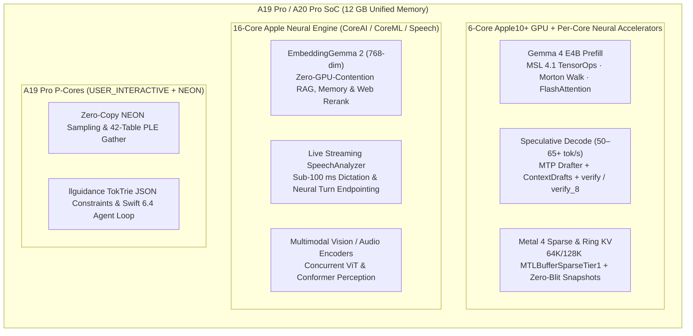

# Roadmap

Engineering Agello into the definitive local AI assistant and multi-step agent for **iPhone 17 Pro and newer** — purpose-built around **Gemma 4 E4B** and the **A19 Pro+ heterogeneous silicon architecture** (6-core Apple10+ GPU with per-core Neural Accelerators, Metal 4 / MSL 4.1, 16-core Apple Neural Engine, and 12 GB unified memory on iOS 27.0+).

Updated 2026-11-21.

## Current status

The handoff between work sessions (injected automatically at startup by `.agents/hooks/session-start.sh`).

- **Baseline (2026-11-21):**
  - **Runtime (`../LiteRT-LM`):** `main` at `4318c4a1`; app vendors `agello-one-20261115` (`0c749789100a`) with 5 Swift 6 wrapper patches. Sparse Metal 4 KV caches (`MTLBufferSparseTier1`), per-prefill transient pool release, D8 system prompt (`141/142`), and `EmbeddingGemma 2` at 768 dims are in place.
  - **App (`iRT`):** `main` clean (local tooling & storage hygiene committed; push only when asked). Storage at `27.7 / 40.0 GB` budget.
  - **Resolved:** Deep-dive runtime + iOS 27.2 SDK + WWDC26 audit completed (2026-11-21). Proved why `AGELLO_MTP_REPLAY=1` (`+13–17%`) did not carry over to GPU-Resident Round Stage 3 (artificial cross-CB GPU overlap in replay + 837 MB PLE `mmap` page wiring slowing prefill `−3.8%`; Stage 3 `=1` closed, drafter chain `=2` kept). Uncovered `3.5–4.0 MiB/round` CPU logits `memcpy` in `TopPSampler`, 32 KiB `ConvAppleMPP` occupancy cap (`1 TG/core`), linear raster vs. Morton Z-order walk, 302 unfused `RMSNorm + Mul` pairs, `llguidance` `TokTrie` byte bugs, and iOS background GPU / Swift 6 XPC isolation hazards.
- **Active focus — Phase 1 (`P1` Foundation, Mac-verifiable while iPhone is away):**
  1. **P1.1 Background GPU & Swift 6.4 XPC Safety (`P0`):** `nonisolated` `BGContinuedProcessingTask` handlers in `BackgroundWork.swift`, synchronous `beginBackgroundTask` + C++ `wait_until_done` drain, intra-MTP & post-Think rewind cancel checks, `keep && GPUGate.isOpen` helper guard, and inter-tool stream cancellation.
  2. **P1.2 Zero-Copy Unified-Memory Sampling & Bandit Reset (`P0`):** Replace `TopPSampler` `3.5–4.0 MiB/round` CPU `memcpy` with in-place `TensorBufferScopedLock` + NEON `vmaxq_f16` (plus fused `PostConvert` `simd_max` argmax for `verify`/`verify_8`); reset `ContextDrafts` bandit rates per turn; fix `agello_context_drafts.cc` `size - 1` off-by-one and `telemetry.py` `max_us`.
  3. **P1.3 Metal Pipeline & Cache Hygiene (`P1`):** Deduplicate ~6,910 shader compiles to ~250 PSOs + `MTLBinaryArchive`, adopt `MTLComputePipelineDescriptor` (`requiredThreadsPerThreadgroup`, `MTLMutabilityImmutable`), align `CacheBuilder` to 16 KB over one file-wide `mmap`, delegate `verify_8` before `verify` (`−25–35 MB`), and trim `SparseKvMapper` on `Reset()` / rewind.
- **Next physical iPhone 17 Pro gate (once connected):**
  - Verify Phase 1 runtime candidate via `scripts/phone-bench.sh`, full device suites (`unit`, `inference`, `files`, `web`, `thinking`, `memory`), D8 `bench` baseline refresh, and background-interruption checks.

---

## North Star & A19 Pro+ Silicon Architecture

Agello targets **iOS 27.0+ on 12 GB iPhones starting with iPhone 17 Pro / Pro Max and iPhone Air (A19 Pro / A20 Pro+)** — zero legacy OS shims, zero 8 GB compromises, zero cloud dependencies. Every workload is assigned to the A19 Pro+ compute unit engineered for its arithmetic intensity, memory access pattern, and power envelope:

| Compute Unit | Workloads Owned | Why This Unit Wins on A19 Pro+ |
| --- | --- | --- |
| **6-Core GPU + Neural Accelerators** (`Apple10`+, Metal 4, MSL 4.1 `mpp::tensor_ops`) | Gemma 4 E4B INT4/INT2 prefill & decode, 1-layer Medusa `mtp_drafter`, `verify` (4-tok) & `verify_8` (8-tok), Metal 4 sparse/ring KV caches | Asymmetric INT4/INT2 weights (`3.66 GB`), dynamic speculative verify trees, KV rewinds, and 64K sparse page mappings execute directly against unified L2/SLC + in-core matrix engines with zero cross-processor copies |
| **16-Core Neural Engine (ANE)** (`CoreAI` `.aimodel`, `CoreML` `.cpuAndNeuralEngine`, `SpeechAnalyzer`, `Vision`) | `EmbeddingGemma 2` batch/query vectors, live `SpeechAnalyzer` dictation & endpointing, OCR, and evaluated ViT/Conformer encoder offload | Fixed-shape dense encoders run on ANE at a fraction of GPU wattage without evicting E4B Metal residency sets, blocking the GPU command queue, or heating the phone before decode |
| **P-Cores + ARM NEON** (`QOS_CLASS_USER_INTERACTIVE`) | `LiteRTChatEngine` actor orchestration, `llguidance` `TokTrie` grammar masks, 42-table INT4 PLE row gathers, zero-copy `LocksInPlace` reads | Sub-millisecond control-plane latency (`~1.6 ms` host overhead/round) over unified memory without extra `MTLCommandBuffer` round-trips |

---

## Next

Work proceeds through six sequential-yet-modular engineering phases. Pure logic and C++/Metal prototypes iterate fast on the Mac CLI (`agello`, `scripts/cli-test.sh`, `scripts/cli-bench.sh` — ask before real-model Mac GPU runs); **every shipping milestone is gated on the physical iPhone 17 Pro** (`scripts/phone-bench.sh`, `scripts/device-harness.sh bench`, and hardware suites).

### Phase 1 — Lifecycle Bulletproofing, Zero-Copy Speculation & Runtime Hygiene (`P0`)

Eliminate every crash/kill hazard, reclaim wasted CPU/DRAM copies, and make model startup near-instant.

- **1.1 Zero Background-GPU Kills (`gpus_ReturnNotPermittedKillClient`) & Swift 6.4 Isolation Safety:**
  - Build `BGTaskScheduler.register` and `task.expirationHandler` inside a `nonisolated static` factory in `BackgroundWork.swift` so Swift 6 never injects a `@MainActor` trap when `BackgroundTasks` calls `expirationHandler` on a background XPC queue.
  - Acquire `UIApplication.shared.beginBackgroundTask` synchronously in `AppState.enterBackground()` (and defer `task.setTaskCompleted` on expiration/`stop()`) until a new `engine.cancelAndDrain()` awaits C++ `litert_lm_conversation_wait_until_done` + the actor's `serialized` queue.
  - Check `cancelled->load()` between `drafter[0..2]` and `Verify` inside `LlmLiteRtMtpDrafter::Draft`, thread the active `cancelled` token into `conversation.cc`'s post-Think `<thought>` rewind prefill, gate `ChatEngine.endHelperAfterFailure` with `keep: keep && GPUGate.isOpen` (stopping background Metal KV restore blits), check `GPUGate.isOpen` on every `LiteRTEmbedder.embed` call, and keep `StreamTable` cancellation active across async tool rounds (`ConversationStream.swift`).
- **1.2 Zero-Copy Unified-Memory Greedy Sampling & Speculative Bandit Fixes:**
  - Replace `TopPSampler`'s `mutable_logits_tensor.Read` (`3.5 MiB/round` standard, `4.0 MiB/round` `verify_8` `std::memcpy`) with zero-copy `TensorBufferScopedLock` (`LockMode::kRead`) + ARM NEON `vmaxq_f16` (and benchmark appending a multi-threadgroup `simd_max` argmax onto `PostConvert`'s existing CB for `verify` / `verify_8`).
  - Reset `LlmLiteRtMtpDrafter` bandit state (`context_rate_`, `drafter_rate_`, `offered_rounds_`) at turn start / `ContextDrafts` rebuild so Q&A turns never poison `verify_8` on subsequent copy/edit turns; fix `agello_context_drafts.cc` `<= size` boundary; fix `tools/agello-bench/telemetry.py` `max_us` handling on `.jsonl` runs.
- **1.3 Metal Pipeline Compilation, Weight Cache Alignment & Sparse Pool Hygiene:**
  - Deduplicate `(msl_source, defines) -> id<MTLComputePipelineState>` across all 12 subgraphs (`~6,910` serial compiles → `~250` unique kernels) and persist an `MTLBinaryArchive` beside the weight cache (`~8 s → ~1.5 s` cold load, `~1.2 s → ~0.3 s` warm load, `−25 MB` PSO memory).
  - Switch `ComputeTask` to `MTLComputePipelineDescriptor` with `requiredThreadsPerThreadgroup`, `threadGroupSizeIsMultipleOfThreadExecutionWidth = YES`, and `MTLMutabilityImmutable` on static weight/scale/RoPE buffer bindings.
  - Raise `CacheBuilder::kMinAlignment` from `4096` to `16384` (`vm_page_size`) over a single file-wide `mmap` so `newBufferWithBytesNoCopy:` is 16 KB page-clean at both offset and length; add RAII `EndComputeEncoding()` cleanup in `DelegateKernelLiteRt`; add `"apple m4 ultra"` and `"apple m6 pro/max/ultra"` entries to `gpu_info.cc`.

### Phase 2 — A19 Pro GPU & Neural Accelerator Kernel Overhaul

Push A19 Pro's 6 shader cores and 6 in-core Neural Accelerators to hardware roofline on both prefill and speculative decode.

- **2.1 ML Drift Decode Overhaul (`FullyConnected` & Fused `RMSNorm`):**
  - Replace shared-memory `threadgroup_barrier` reduction trees in `FullyConnected` with hardware `simd_sum` (+ at most 1 cross-SIMD pass) and fix `GetLocalBatchSize` dropping to `1` when `block_spatial == 16` (`verify` and `verify_8`), collapsing **32–48 barriers/threadgroup → 0–1**.
  - Add a dedicated fused `RMSNorm + gamma` (`simd_sum`) kernel in `gpu_model_builder.cc` / `mean_stddev_normalization.cc`, deleting **302 standalone `Mul` dispatches (18% of all 1,726 graph nodes)**, unused `mean` math, and 302 activation round-trips.
  - Pass `MTLResourceUsageRead` (without `Write`) on read-only buffers in `MetalArguments`, upgrade 1D `{8,1,1}` Apple workgroups to `{32,1,1}`, and benchmark integer bit-mask weight unpacking vs. FP16 `floor()` on A19 Pro ALUs.
- **2.2 `ConvAppleMPP` Occupancy & Cache Locality (WWDC26-330 & Tech Talk 111432):**
  - Delete the **32,768-byte** `__local int tmp[128 * 64]` staging array in `ConvAppleMPP` (`100%` of per-core threadgroup RAM) by executing INT8 scale/zero-point/bias/activation epilogues directly in `cooperative_tensor` registers (`c_tile.get_multidimensional_index`), unlocking **2–3× threadgroup occupancy per GPU core**.
  - Replace linear raster tile traversal with **Morton Z-order threadgroup swizzling** to maximize LLC data reuse and drive Neural Accelerator utilization toward 100%.
  - Add coarse K-chunk synchronization barriers (`mem_none`, zero `a_loc` threadgroup RAM) to prevent 4-SIMD-group K-drift and restore sliding-window QK tile skipping on Apple10; include the 47 `kUint8` PLE linear weights in `M <= 128` in-place INT4 (`gpu_model_builder.cc`).
- **2.3 MSL 4.1 (`ios(27.0)`) Cooperative-Tensor FlashAttention & Native `int2b_format`:**
  - Implement fused prefill FlashAttention on Neural Accelerators using `execution_simdgroup` + `reduce_rows` + `map_iterator` + `get_left_input_cooperative_tensor` (eliminating the **128 MB** `[1024, 65536]` intermediate attention score matrix in DRAM).
  - Adopt MSL 4.1 `int2b_format` TensorOps for the **168 MB INT2 LM head** in `prefill_*` and `verify_8` without global weight expansion.

### Phase 3 — Exact 64K/128K Context, Surgical Model v2 & Sparse Memory Mastery

Deliver a single, bit-accurate, memory-frugal 64K+ context window to every user download.

- **3.1 Surgical Model Artifact v2 (`window_128k` Dual-`GATHER` + `ring_kv` + `verify_8`):**
  - Upgrade `tools/model-surgery/window_128k.py` to unshifted **Dual-`GATHER` `[256, F] + [512, F]` FP64→FP16 RoPE tables** (+256 KiB total, −6 ops/signature), cutting worst-case binary16 RoPE phase error **300×** from `0.239 rad` to **`< 0.00078 rad`** across all positions `0..131,071`.
  - Bundle Dual-`GATHER` 128K RoPE + local attention `ring_kv` (`8,192 B/tok` global KV + `31.5 MB` fixed rings) + `verify_8` (`verify_n.py`, turning `ContextDrafts` 7-token rounds on by default after iPhone `phone-bench.sh` confirmation) into one reproducible v2 `.litertlm` release on Hugging Face (published only on maintainer go-ahead).
- **3.2 Kernel Numerical Tightening:**
  - Compute `(float4(clamped) - min_f32) * inv_scale_f32` in FP32 inside `AddValuesToCacheKernel` (eliminating ±1 INT8 KV bin boundary jitter), guard padded-row `Softmax` (`sum > 0.0f ? 1.0f / sum : 0.0f`), and evaluate `float` `c_tile` accumulation on 64K PV attention.
- **3.3 Zero-Waste Sparse KV Lifecycle & Token-Accurate Context Budgets:**
  - Delegate `verify_8` *before* `verify` so `SharedBuffersPool` shares 100% of intermediate buffers (`−25–35 MB`); call `TrimKvMapping` in `Executor::Reset()` and `SetCurrentStep` rewinds; adopt `MTL4CommandQueue.copyMappings` for microsecond zero-blit helper KV snapshots.
  - Recalibrate `DeviceProfile` (`kvBytesPerToken` aware of ring-KV `8,192 B/tok + 31.5 MB`, sparse-64K `roomForLargeContextBytes`), cap `ContextBudget.replyReserve` at `4,096 + thinkingBudget` (unlocking **~56–60K usable single-prompt tokens** in a 64K window), and upgrade chat trimming to exact token budgets + semantic recall of evicted turns.

### Phase 4 — Heterogeneous A19 Pro ANE + GPU Co-Execution (Multimodal, Retrieval & Voice)

Move fixed-shape perception and retrieval onto the 16-core Neural Engine so the GPU stays cool, uncontended, and dedicated to E4B generation.

- **4.1 ANE-Resident Semantic Retrieval (`EmbeddingGemma 2` on 16-Core ANE):**
  - Convert and specialize `EmbeddingGemma 2` (768-dim, cosine parity `>= 0.995` verified against current float16 baseline) via `CoreAI` (`.aimodel` with `AIModelCache` & `preferredComputeUnitKind: .neuralEngine`) or `CoreML` (`.cpuAndNeuralEngine`), paired with `com.apple.developer.background-tasks.continued-processing.inference`.
  - Run PDF indexing, chat search, memory matching, and web-passage reranking **concurrently on ANE** at low power with **zero Metal GPU queue contention or residency pressure**.
- **4.2 Accelerated Vision & Audio Perception:**
  - **Runtime GPU path:** Fix `VisionAdapter` (`SetHardwareAccelerators(kGpu)`), fix `OneHotOperationParser::IsSupported` (`axis < num_dims`), and partition/support the 6 patch-preamble ops so E4B's 16-block ViT runs on A19 Pro GPU Neural Accelerators instead of CPU XNNPACK; add lazy load/unload + `USER_INTERACTIVE` QoS to the Conformer audio encoder; test Gemma 4's canonical image-before-text ordering (`ChatEngine.runSend`).
  - **Heterogeneous ANE path:** Evaluate `CoreAI` ANE specialization for the ViT and Conformer encoders so live Camera + Voice sessions overlap ANE frame/audio encoding with GPU reply streaming.
- **4.3 Instant ANE Streaming Dictation & Neural Voice Turn-Taking (`SpeechAnalyzer`):**
  - Integrate iOS 27 `SpeechAnalyzer` / `SpeechTranscriber` on ANE for live streaming composer dictation (`<100 ms` partial words, zero E4B engine lock or KV eviction) and neural end-of-utterance detection in `VoiceSession`, while keeping Gemma 4's native audio token path for expressive multimodal voice mode and barge-in.

### Phase 5 — True On-Device Agentic Architecture (Tools, Multi-Step Reasoning & Security)

Evolve Agello from a 3-tool chat assistant into a deeply capable, trustworthy, multi-step local iOS agent engineered for E4B's reasoning profile.

- **5.1 Rock-Solid Constrained Decoding & Multi-Turn Thought Continuity:**
  - Fix `LlgConstraintProvider` (`llg_constraint_provider.cc`) per `llguidance`'s `TokTrie` contract: decode SentencePiece `▁` → `0x20` and `<0xXX>` → raw byte `0xXX`, and prefix special tokens (`<|turn>`, `<turn|>`, `<|thought>`, `<thought|>`, `<|tool_call>`) with `0xFF` (`SPECIAL_TOKEN_MARKER`) — unlocking multi-word JSON schema enums and complex tool schemas.
  - Enable `AGELLO_JSON_MTP` by default (`1.4×+` faster structured helpers); wrap `SuppressTokensConstraint` *inside* `ThinkingBudgetConstraint`; preserve `<thought>` traces *across* intermediate tool-call steps within a turn (stripping them from KV only after the final user-visible answer completes); mark required Swift `@ToolParam` arguments non-optional.
- **5.2 Autonomous Workspace & Structured-Data Agent Tools:**
  - Add active on-device research tools (`search_files`, `read_document_pages`, `search_past_chats`, `query_table_or_json`, `convert_units`) so E4B can iteratively inspect specific pages, cross-reference project documents, and compute exact CSV/JSON aggregations across multi-step Think loops.
  - Support parallel execution of read-only tool calls within a single round (`withTaskGroup`), feeding combined results back in one batched prefill.
- **5.3 Native iOS Personal Context Tools + Deterministic Agentic Security Gate:**
  - Add opt-in, permission-scoped iOS tools: **Calendar & Reminders (`EventKit`)** (check schedule, find free slots, draft events/reminders), **Contacts (`Contacts`)** (resolve names/details locally), and **Maps/Places (`MapKit`)** (local POIs, travel times, coordinates).
  - Enforce **deterministic agentic security** (`Lethal Trifecta` defense):
    1. Spotlight/delimit all untrusted external context (web pages, shared files, tool outputs) on every turn and never extract persistent memories from untrusted material.
    2. Gate every mutating/side-effectful tool (creating/editing Calendar events or Reminders, sharing externally) behind a **deterministic pre-execution confirmation card** in the chat stream showing exact tool name and parameters before execution.
    3. Gate lock-screen Siri/Shortcuts intents via `IntentAuthenticationPolicy.requiresAuthentication` where personal data or mutations are involved.
    4. Maintain an automated adversarial prompt-injection evaluation suite in `AgelloDeviceTests` gated at **100% zero unauthorized tool invocations**.

### Phase 6 — Native iOS 27 System Surface, Thermal Mastery & Polish

Make Agello feel indistinguishable from a first-party iOS 27 system intelligence layer, sustained under real thermal and battery budgets.

- **6.1 Deep iOS 27 System Integration & UI Responsiveness:**
  - Expose Chats, Projects, and Documents as `AppEntity` / `IndexedEntity` types across Siri, Shortcuts, and Spotlight; add multimodal Action Button / Control Center quick-actions ("Snap & Ask Agello", "Voice with Camera").
  - Upgrade `BackgroundWork` Live Activities (`.gpu` + `.inference`) to cover multi-step agentic research and 64K multi-document synthesis with granular step progress.
  - Isolate `ComposerView` state so keystrokes never trigger layout/diffing in `ChatView`'s message list.
- **6.2 Hardware Soak, Thermal Envelopes & Telemetry Gates:**
  - Upgrade `scripts/phone-bench.sh` with case-alternating thermal rest rules validated against `release again=release` noise bands.
  - Wire iOS 27 `MetricKit` `.memoryException` diagnostics, `ledger_phys_footprint_peak` deltas, and GPU/ANE power telemetry into `MetricsReporter` / `Diagnostics`.

---

## Hardware Targets & Verification Gates

Every phase is measured on **iPhone 17 Pro (A19 Pro, 12 GB, Release/Bench configuration, nominal thermal start)** against explicit engineering targets:

| Metric | Current (`agello-one-20261115`) | Target (Phases 1–4 Complete) | Gate Suite / Tool |
| --- | --- | --- | --- |
| **Time to First Token (short chat)** | `~0.42 s` | **`<= 0.30 s`** | `bench-direct.sh` / `bench` |
| **Prefill Throughput (1,024-tok chunks)** | `~1,900 tok/s` (`539 ms`/1K) | **`>= 2,500 tok/s` (`<= 410 ms`/1K)** | `phone-bench.sh` (`file-report`) |
| **Sustained Decode (chat / Think)** | `46 tok/s` / `38 tok/s` | **`53–60 tok/s` / `44–50 tok/s`** | `phone-bench.sh` + `bench` |
| **Copy / Rewrite Decode (`verify_8`)** | `46–60 tok/s` (`verify_4`) | **`65–85+ tok/s`** | `phone-bench.sh` (code/doc edit) |
| **Model Load (cold / warm)** | `~8–9 s` / `~1.2–3 s` | **`<= 2.0 s` / `<= 0.4 s`** | `calibrate` + `telemetry.py` |
| **40-Page PDF Index (768-dim)** | `1.9 s` on GPU (blocks E4B) | **`<= 1.2 s` on ANE (0% GPU block)** | `files` suite |
| **64K Window Peak Footprint (45K + image + helper)** | `2.49 GB` (lab 128K file) | **`<= 2.25 GB` (shipped v2 file)** | `memory` + `WindowQualityProbes` |
| **128K RoPE Max Phase Error (`0..131,071`)** | `0.239 rad` (`window_128k.py`) | **`< 0.0008 rad` (Dual-`GATHER`)** | `probes` (exact digit copy to 64K+) |
| **Background GPU / Adversarial Tool Kills** | Unprotected race paths | **`0` kills / `100%` injection block** | `ui` + adversarial agent suite |

### Manual checks

Physical-device checks queued for the next interactive iPhone session:
- AirPods routing in hands-free voice mode, barge-in, and ANE streaming dictation;
- Incoming phone call interruption and recovery during voice mode;
- Voice mode live camera in portrait and landscape;
- Cellular model download confirmation, pause/resume staging, and SHA-256 verification;
- Backgrounding mid-prefill, mid-MTP-decode, mid-helper, and during a `BGContinuedProcessingTask` Live Activity cancellation (verifying zero `gpus_ReturnNotPermittedKillClient` or XPC isolation traps).
