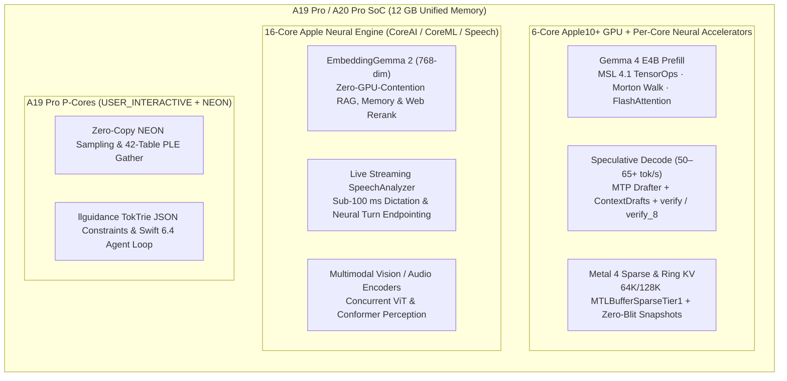

# Roadmap

Engineering Agello into the definitive local AI assistant and multi-step agent for **iPhone 17 Pro and newer** — purpose-built around **Gemma 4 E4B** and the **A19 Pro+ heterogeneous silicon architecture** (6-core Apple10+ GPU with per-core Neural Accelerators, Metal 4 / MSL 4.1, 16-core Apple Neural Engine, and 12 GB unified memory on iOS 27.0+).

Updated 2026-11-24. Technical backing: [RUNTIME-AUDIT-2026-11-21.md](RUNTIME-AUDIT-2026-11-21.md).

## Current status

The handoff between work sessions (injected automatically at startup by `.agents/hooks/session-start.sh`).

- **Baseline (2026-11-24):**
  - **Runtime (`../LiteRT-LM`):** `main` at `c819aecb` (pushed; release `agello-one-20261124`, dual-slice `ios-arm64` + `macos-arm64` `Build id: 8a7e34594612`, SwiftPM checksum `336023ee…3de7c`, privacy manifest `nm -u` clean); vendored into `Vendor/LiteRT-LM`.
  - **Chat model:** `PowerBeef02/gemma-4-E4B-it-litert-lm-fp16-rope` (`gemma-4-E4B-it-agello-v2.litertlm`, revision `9935a811`, `3,686,465,536` bytes, SHA-256 `7d63a4d8…dac7e7b`: 1,536-slot local KV rings, 128K Dual-`GATHER` RoPE, `verify_8`), pinned in `ModelCatalog.e4b` (`gemma-4-E4B-it-fp16-rope.litertlm` kept untouched on HF `main` for #3913 / stock LiteRT-LM users).
  - **Embedding model:** `PowerBeef02/embeddinggemma-2-text-270m-coreai-ane` (`embeddinggemma-2-text-270m-ane.aar`, revision `41026d1c`, `128,245,086` bytes, SHA-256 `122c2d86…1b2ece`: 4-bucket asymmetric INT4 Core AI ANE bundle unpacked atomically via `AppleArchive`, with Apache 2.0 `LICENSE`, `NOTICE`, and corrected `262,144 × 512` embedding card), pinned in `ModelCatalog.embeddingGemma`.
  - **App (`iRT`):** Phases 1–6 + Full-Stack Audit Waves 1 & 2 complete, **all verified on physical iPhone 17 Pro (`iPhone18,1`, Apple A19 Pro, 12 GB, iOS 27.2.1)**, vendored with `agello-one-20261124`, and pinned to the v2 64K chat model + Core AI ANE EmbeddingGemma 2 bundle. Development workflow switched to lean pre-release iteration (fast Mac workbench inner loop + single-build `scripts/device-harness.sh gate`).
  - **Phase 1 complete on M6 `SIM_GPU=Apple_A19_Pro` workbench (`P1.1`–`P1.3`, pushed):**
    - [x] `P1.1` (`P0`, `LiteRT-LM@517ab613` + `iRT@f05184e`): `nonisolated` `BGContinuedProcessingTask` handlers (`submitTaskRequest` iOS 27 API), synchronous `beginBackgroundTask` + `wait_until_done` drain, intra-MTP & post-Think cancel, `GPUGate` helper & embedder guards, inter-tool `activeToolRounds` cancel (314 CLI + 381 `PLATFORM=mac` iOS binary unit tests pass).
    - [x] `P1.2` (`P0`, `LiteRT-LM@73000de4`): Zero-copy ARM64 NEON FP16 greedy sampling (`GreedyHalf` + direct `DSHWBC4` `GreedyHalfDSHWBC4` on `verify`/`verify_8`, `LocksInPlace` direct linear shared Metal buffers), per-turn `ContextDrafts` bandit reset, `<= size` boundary fix, `telemetry.py` `max_us` fix (`0` host read copies / `0.0 KB/tok` across all cases, down from `>2.0 GB` on `explain`).
    - [x] `P1.3` (`P1`, `LiteRT-LM@e99882fb`): Process-wide PSO deduplication + persistent `MTLBinaryArchive` (`agello_pipelines.mtlarc`, 231 KB), `MTLComputePipelineDescriptor` hints (`MTLMutabilityImmutable` + finalized 32-aligned `threadGroupSizeIsMultipleOfThreadExecutionWidth`), 16 KB `CacheBuilder` + page-aligned `newBufferWithBytesNoCopy:`, RAII `PostConvertGuard` encoder cleanup, M4 Ultra & M6 Pro/Max/Ultra `gpu_info` entries. Verified with `MTL_DEBUG_LAYER=1` (0 warnings), 4/4 C++ unit tests, `files` (5/5), `inference` (22/23; `test05b_CalculatorPowersAndPercent` is pre-Phase-1 `main` behavior), and `cli-bench.sh` (`1.50 s` warm load, `−85 MB` footprint, `2,680 tok/s` `file-report` prefill, `83.5–94.2 tok/s` decode).
  - **Phase 2 complete on M6 `SIM_GPU=Apple_A19_Pro` workbench (`P2.1`–`P2.3`, pushed):**
    - [x] `P2.1` (`P1`, `LiteRT-LM@834e0dba` + `17a935c8`): `FullyConnected` `simd_sum`/`simd_shuffle_down` + `GetLocalBatchSize` (`8` at `block_spatial == 16`) + `sp_id - first` bugfix; dedicated float-only fused `RMSNorm + gamma/beta` with single-pass register caching + Apple10 workgroup sizing; accurate `MTLResourceUsageRead`/`Write`; `{32,1,1}` 1D workgroups; plus concurrent `EmbeddingGemma 2` / E4B `thread_local` GPU wait-deferral fix (`834e0dba`). Empirical ABAB proved upstream FP16 `floor()` weight unpacking beats `uchar4` bit-mask (`+0.3–0.5 ms`) and `0x6400` mantissa inject (`+0.2–0.6 ms` + `MTLMathModeFast` drift) on Apple10/11 ALUs, so `floor()` was kept. Verified: 6/6 C++ unit tests (`telemetry_test`, `work_group_picking_test`, `gpu_info_test`, `top_p_cpu_sampler_test`, `agello_context_drafts_test`, `agello_gemma4_template_test`), `MTL_DEBUG_LAYER=1` (0 warnings on E4B + concurrent `EmbeddingGemma 2`), `files` (5/5), `inference` (22/23, matching `P1.3`), and interleaved `cli-bench.sh` (`p2-1-decode`, 5 runs/arm, 20/20 checks pass, replies verified): `+53.2%` decode (`explain 86.8`, `email 84.9`, `file-report 97.3 [+9.6% vs P1.3]`, `file-report/2 94.7 tok/s`), `+338.2%` prefill (`file-report 2,650.6 tok/s`, `1.96 s` TTFT, `−74.5%` TTFT vs `release`), higher MTP acceptance on all 4 cases (`+2%`–`+9.6%` `tok/rd` from FP32 fused `gamma`), and `−15.4%`–`−34.2%` per-kernel reductions under `AGELLO_TELEMETRY=4`.
    - [x] `P2.2` (`P1`, `LiteRT-LM@05505e7f`): `ConvAppleMPP` built-in INT8→FP16 dequantization with param-cached 32-row `half` strip epilogue (`STRIP_M=32`, cutting TG RAM from `32 KiB` [1 TG/core cap] to `9.7–10.5 KiB` [3 TG/core for `N=128`, 4 TG/core for in-place INT4 `N=64`] while preserving coalesced `vec4` writes for linked ops); compact `STRIP_M=32` epilogue for PV `manual_src_reading` (`20 KiB → 12 KiB`, 2 TG/core); horizontal 4×4/2×2 Morton Z-order threadgroup swizzling; restored Apple10 sliding-window `dst_window` QK tile skipping (`!manual_k_tiling`); parallel 256-thread/row `MaskBoundsOp` (`simd_max`, −64%–93%). Empirically dropped after Apple_A19_Pro ablation: `coarse_k_sync=512` (+11%), vertical Morton (+31%), in-place `kUint8` on `M<=128` (−2.9 ms net vs pre-convert), and dual-branch `static_slice` (+81 ms). Verified: 6/6 C++ tests, `MTL_DEBUG_LAYER=1` `files` (5/5, 0 Metal warnings), `inference` (23/23, 0 failures), and clean interleaved `cli-bench.sh` (`p2-2-prefill`, 5 runs/arm, 20/20 checks pass, 0 non-finite logits / 0 host reads, replies verified): `+346.7%` undisturbed prefill vs `release` (`file-report 2,728.5` [all-runs `2,801.3`], `explain 1,748.1`, `email 1,639.9`, `file-report/2 891.1 tok/s [+13.9% vs P2.1]`), `+51.4%` decode (`file-report 99.3`, `file-report/2 97.1`, `explain 89.4`, `email 82.5 tok/s`), `−74.9%` TTFT (`file-report 1.88 s`, `file-report/2 0.11 s`), warm load `1.4–1.5 s`.
    - [x] `P2.3` (`P2`, `LiteRT-LM@e206f964`): MSL 4.1 (`MTLLanguageVersion4_1` on iOS/macOS 27.0+ `MTLGPUFamilyMetal4`); integer bitwise SWAR `WeightsConverter` (`kOSpatialIOGroupI4O4 → kCustomGroups`) + MSL 4.1 `int2b_format`/`int4b_format` TensorOps in `ConvAppleMPP` (enabled `int2b_format` for batched `kUint2` `M > 16`; kept `kInt8` + SWAR for `kUint4` `M > 128` after ablation showed `int8_t × int4b_format` was `+236 ms` slower); fused `agello_flash_attention` prefill kernel (`rows >= 256`, `head_dim 256/512`, INT8 KV caches, `4` SGs × `M_SG=16, BK=64` cooperative-tensor `matmul2d`, FP32 accumulators on `D=256`, no-split 16×-scaled running-normalized FP16 `ctO` with reverse-tile causal bounds on `D=512`), skipping `SliceRows` and eliminating the materialized attention score buffer (`−35.9%` prefill attention time, `−164 to −196 MB` peak RAM vs `P2.2`). Verified: 6/6 C++ tests (incl. `FusesPrefillTailIntoFlashAttentionWhenEnabled`), `MTL_DEBUG_LAYER=1` `files` (5/5, 0 Metal warnings), `inference` (23/23), `probes` (37 executed, 11 skipped, 0 failures; `probe38` 200-turn soak `-71 MB` growth), and clean undisturbed `ROUNDS=2` interleaved `cli-bench.sh` (`p2-3-flash`, 4 runs/arm, noise band `0.4–0.7%`, 16/16 checks, 0 non-finite logits / 0 host copies, replies read & verified): **`+361.2%`** prefill geomean vs `release` (`file-report 2,859.5` [cold `2,984.0`], `explain 1,980.6 [+13.3% vs P2.2]`, `email 1,692.3`, `file-report/2 824.6 tok/s`), **`+51.3%`** decode (`file-report 99.8` [up to `100.5`], `explain 88.0`, `email 86.2`, `file-report/2 89.1 tok/s`), **`−75.1%`** TTFT (`file-report 1.84 s`, `explain 0.42 s`, `email 0.35 s`, `file-report/2 0.12 s`), warm load **`1.38 s`** (`−33.7%`), peak footprint **`1,679 MB`** (`email`/`explain`, `−745 MB` vs `release`) / **`2,072 MB`** (`file-report` 5.2K tokens, `2,037 MB` warm steady-state, `−740 to −774 MB` vs `release`).
  - **Phase 3 complete (`P3.1`–`P3.3`, pushed) & Combined Phases 1–3 Physical iPhone 17 Pro Hardware Gate PASSED (2026-11-22, `LiteRT-LM@17f74284`, `Build id: 47b132c0cbd6`):**
    - [x] `P3.1` (`P1`, `LiteRT-LM@bf9b55cc`): Upgraded `tools/model-surgery/window_128k.py` to unshifted Dual-`GATHER` rotary tables (`[256, F]` high + `[512, F]` low, FP64→FP32 shared across signatures, `−5` ops/signature, `~240×` tighter binary16 phase error `0.237 → <0.001 rad` across `0..131,071`); added `tools/model-surgery/build_v2.sh` assembling the reproducible v2 E4B artifact (`ring_kv` 1,536-slot local rings + Dual-`GATHER` 128K + `verify_8`, `2,827` ops, `3,686,465,536` bytes, SHA-256 `7d63a4d8…dac7e7b` staged locally in `~/Models/agello/lab/v2/`; HF upload awaiting user go). Verified on both M6 (`SIM_GPU=Apple_A19_Pro`) and physical iPhone 17 Pro at 65,536 context.
    - [x] `P3.2` (`P1`, `LiteRT-LM@b69748ce`): Promoted `AddValuesToCacheKernel` quantization bounds/reciprocal scale and clamp/round math to FP32 (eliminating ±1 INT8 KV bin boundary jitter); guarded padded-row `Softmax` / `Softmax1x1` reciprocal sums (`sum > 0.0f ? 1.0f / sum : 0.0f`); promoted `ConvAppleMPP` PV attention (`softmax_input_activation`) `c_tile` accumulation to FP32 while keeping the compact 12 KiB `half` `STRIP_M=32` epilogue. Verified with `MTL_DEBUG_LAYER=1` (0 Metal warnings), 6/6 C++ tests, and 64K `test28_WindowPositions` bit-exact.
    - [x] `P3.3` (`P1`, `LiteRT-LM@2ef011cd` + `iRT@6943479`): Preserved delegation order in `Interpreter::ModifyGraphWithDelegateImpl` and delegated `verify_8` before `verify` and `decode` (`0 MB new, 1,106 MB reused` on `verify`, `0 MB new, 1,098 MB reused` on `decode` — 100% shared intermediate pool reuse); called `TrimKvMapping` on `Executor::Reset()` and `SetCurrentStep()` rewinds; added Metal 4 `MTL4CommandQueue.copyBufferMappingsFromBuffer:` zero-blit sparse KV detach/restore snapshots on exclusive helper switches (`0.0 MB` blitted on v1, `11.8–14.7 MB` local rings only on v2, 0 Metal warnings with `MTL_DEBUG_LAYER=1`); enabled `verify_8` rounds by default when present; recalibrated `DeviceProfile` (`roomForLargeContextBytes = 4.2 GB`, ring-KV + sparse `copyMappings` helper cost); capped `ContextBudget.replyReserve` at `4,096 + thinkingBudget` (unlocking ~56–60K single-prompt tokens in 64K); replaced hard 20-turn replay cap with token-budgeted replay + `KnowledgeBase.recallEvictedTurns` semantic/BM25 recall. M6 `cli-bench.sh` (`p3-complete`, 3-arm interleaved, 5 runs/arm): `v2` (64K) vs `release` (32K) **`+373.7%`** prefill, **`+60.7%`** decode (**`typo-fix 195.3 tok/s [+115.0%]`** via `verify_8`), **`−76.7%`** TTFT, and **`1,582.3 MB` peak RAM** (`−46.7%`).
    - [x] **Physical iPhone 17 Pro Hardware Gate (`iPhone18,1`, Apple A19 Pro, 12 GB, iOS 27.2.1):**
      - **Apple10 `ConvAppleMPP` hardware fix (`LiteRT-LM@17f74284`, `Build id: 47b132c0cbd6`):** Real A19 Pro profiling (`AGELLO_TELEMETRY=4` + 7-point ablation) caught a `−9.1%` (`+102 ms/chunk`) Apple10 prefill regression from `P2.2`'s two-pass `STRIP_M=32` dequant epilogue (`+93 ms`) and 4×4 Morton swizzle (`+68 ms`) while confirming MSL 4.1 + `agello_flash_attention` saves `−35.6 ms` even at 542 tokens. Restoring `c_tile.store(c_local)` + linear tile walk (`-173` lines in `conv_apple_mpp.cc`, keeping `STRIP_M=32` for PV attention) swung A19 Pro prefill by **`+12.7 pp`**.
      - **`phone-bench.sh release next` (`build/phone/runs/20261122-063143`, 5 rounds, 20/20 checks/arm, `0` host read copies vs `2,381`):** **`+3.6%`** undisturbed prefill geomean (`+4.2%` cool best: `file-report 1,442.8 tok/s [+9.2%, peak 1,466.0 +10.5%]`, `email 929.8 [+5.5%]`, `typo-fix 1,333.9 [+4.8%]`), **`−4.6%`** TTFT (`−6.5%` cool best: `file-report 3.94 → 3.58 s [−9.3%]`), **`+0.4%`** decode (`+1.2%` cool best: `typo-fix 83.4 [+2.9%, peak 84.3]`, `email 54.2 [+2.0%]`), and markedly better thermal stability (**17/20 = 85%** undisturbed runs vs `release`'s **12/20 = 60%**).
      - **Hardware suites on `47b132c0cbd6`:** `inference` **22/23** (`193 s`; `test05b` known pre-Phase-1 double-quote tool-call syntax), `files` **5/5** (`54.8 s`), `memory` **4/4** (`91.0 s`, **0** memory warnings: `6.0 GB` → `32K` `0.93 GB` net peak / `5.07 GB` free, `5.0 GB` → `32K` `1.71 GB` net peak / `3.29 GB` free, `4.0 GB` → `16K`, `3.5 GB` → `8K`), `ui` **26/26** (`921.8 s`, 2 opt-in skipped, 0 failures — including `testBackgroundDuringGeneration`, `testLongSummarySurvivesBackgrounding`, `testStopMidReply`, `testStreamingNeverJumps`, `testMainScreensPassTheAudit`).
      - **v2 64K artifact on physical 12 GB iPhone 17 Pro (`65,536` context):** `test27_NeedleTable` **90/90** (`18/18` at `21K`, `33K`, `45K`, `52K`, `59K` with `verify_8`, `3.45 GB` footprint / `2.99 GB` free below jetsam); `test28_WindowPositions` **12/12 bit-exact** 48-digit copies up to position `65,534` (`3.18 GB` footprint / `3.26 GB` free below jetsam).
  - **Phase 4 complete (`P4.1`–`P4.3`) & Physical iPhone 17 Pro Phase 4 Hardware Gate PASSED (2026-11-22, `LiteRT-LM@9d2e15ab`, `Build id: f4f0ec25e764`):**
    - [x] `P4.1` (`P1`, `iRT@5c89b0c`): Exported 4-bucket (`128 / 256 / 512 / 1024`) asymmetric INT4 `EmbeddingGemma 2` Core AI bundle (`scripts/export-embeddinggemma-ane.py`, `142.2 MB` total — 22.4 MB smaller than `.litertlm`: `72.7 MB` `text_encoder.aimodel` + `68.2 MB` `mmap` `embed_tokens.bin` + `4.7 MB` `tokenizer.model`), verified 100% `mps.fullyPlacedOnANE` + `mps.noGPUActivity` + `GPU adapter present: NO` across all 4 buckets (`4.08 / 7.89 / 15.94 / 37.01 ms` warm M6 ANE median; `3.7 ms` cached load). Implemented zero-dependency Swift `SentencePieceTokenizer` (raw UTF-8 `Data` keys avoiding Swift CJK canonicalization collisions, 42/42 exact vs `sentencepiece`), `INT4EmbeddingTable`, and `CoreAIEmbedder` (`usesGPU = false`, `AIModelCache.default`, `preferredComputeUnitKind: .neuralEngine`, `LiteRTEmbedder` fallback), plus `com.apple.developer.background-tasks.continued-processing.inference` entitlement. Verified: `swiftlint` 0 errors/warnings, `cli-test.sh unit` 321/321, `PLATFORM=mac unit` 388/388, M6 `cli-test.sh files` 6/6 (`test04_CoreAIANEParity`: **`0.99923` min / `0.99949` avg cosine vs LiteRT true FP32** vs LiteRT GPU FP16's `0.98255` on CJK); **physical iPhone 17 Pro `files` (5/5 executed, `test04` skipped w/o legacy `.litertlm`)**: warm 40-page PDF ANE index **`0.86 s`** (vs `1.9 s` GPU baseline, `2.2×` faster, `0.82 GB` footprint / `5.62 GB` free), ANE search **`7.7–9.2 ms`/query** (`rank: 0` on 3/3), concurrent ANE chat indexing while E4B streams on GPU at `68.6 tok/s` in **`45.9 ms`** (`4/4` semantic matches, `0.70 GB` footprint), and `testLongSummarySurvivesBackgrounding` passed with `.continued-processing.inference`.
    - [x] `P4.2` (`P1`, `LiteRT-LM@9d2e15ab` + `iRT@8382f04`): Enabled INT8×INT8 `ConvAppleMPP` + passive waits on `VisionEncoder`, fixed `VisionAdapter` GPU options + non-host readback, fixed `OneHot` axis rank check, routed large FP16 `BatchedMatMul` to `ConvAppleMPP` with width-axis batching and dynamic `K` extent (all 112 ViT linears + 32 ViT attention matmuls on Apple10 Neural Accelerators), added lazy load/unload for static `AudioExecutor`, promoted XNNPACK workers + audio encode to `QOS_CLASS_USER_INTERACTIVE`, and switched `ChatEngine.swift` to `.gpu` vision with Gemma 4 canonical image-before-text ordering. M6 (`SIM_GPU=Apple_A19_Pro`): `vision_280` encode **`972 ms` → `214 ms` (`4.54×` faster)**, image TTFT **`1.68 s` → `0.83 s` (`2.02×` faster)**, peak RSS **`−499 to −591 MB`**, **74/74 tokens identical** to CPU FP32, `0` `MTL_DEBUG_LAYER=1` warnings, `cli-bench.sh` text parity (`27.1 ms` best decode step, `1/1` greedy token-identical). **Physical iPhone 17 Pro hardware gate (`f4f0ec25e764`):** multimodal `inference` **6/6** (`07_image` warm **`0.90 s` `engine.init`** w/ GPU Vision, `0` cache misses, `1.59 s` Debug TTFT, `0.84 GB` footprint / `5.60 GB` free; `09a`/`09b` vision toggle clean at `0.45 GB` footprint; `08_audio` **`1.08 s` TTFT / `61.6 tok/s`** w/ `session.create 0.0 ms`; `13_dictation` & `14_voiceTurns` warm lazy Conformer load **`3.2–4.3 ms`**, unload **`0.9–1.1 ms`**, `14_voiceTurns` **0% WER EN+FR** and **`0.89–0.90 s`** follow-up first-sentence latency at `0.44 GB` footprint); `memory` **4/4** (`81.2 s`, **0** memory warnings across `6.0 / 5.0 / 4.0 / 3.5 GB`, `0.83 GB` net engine footprint at `6.0 GB` / `65K` with `5.17 GB` free). **Core AI ANE evaluation:** Prototype W8A16 mirrors of E4B's 16-block ViT (`147.1 MB`, `64.2 ms` median, `GPU adapter present: NO`) and 12-block Conformer (`283.1 MB`, `9.8 ms` median, `GPU adapter present: NO`) both placed cleanly on ANE (`3.3×` / `10×` faster than GPU/CPU with zero GPU contention); deferred shipping separate `.aimodel` bundles for now to avoid duplicating `250–430 MB` alongside `v2.litertlm` (best paired with a future stripped `v3.litertlm`).
    - [x] `P4.3` (`P2`, `iRT@e9f6c74`): Integrated iOS 27 `SpeechAnalyzer` (`SpeechTranscriber` `[.volatileResults, .fastResults]` / `DictationTranscriber` `.progressiveShortDictation` via `AssetInventory` + `AnalyzerInputConverter`) in `Agello/Voice/LiveSpeechTranscriber.swift` (`LiveDictation` + `VoiceSpeechMonitor`), `Dictation.selectBackend` / `Dictation.LiveTranscript` in `Agello/Inference/Dictation.swift`, and hybrid acoustic+neural `NeuralTurnDetector` in `Agello/Voice/VoiceText.swift`. Live Mac probe verified **`30.8–33.7 ms` time-to-first-partial** (`<100 ms` target) and 100% exact transcripts on `fr_CA` (`SpeechTranscriber`) and `en_US` (`DictationTranscriber`) with zero E4B engine lock or KV eviction (composer dictation works even while E4B streams, falling back seamlessly to `AudioRecorder` + Gemma 4 audio when no matching Apple Speech asset is installed or under `--uitest-fake-mic`). `VoiceSession` feeds echo-cancelled 16 kHz buffers from `VoiceAudio` into `VoiceSpeechMonitor` for fast `0.42 s` neural end-of-utterance, `1.05 s` mid-thought hold, neural barge-in, and instant live captions while preserving Gemma 4's native audio token path (`sendVoiceTurn`). Verified: `swiftlint` 0 violations across all 7 files, iOS 27 Swift 6 compile clean, `cli-test.sh unit` **333/333**, `PLATFORM=mac unit` **400/400**, and **physical iPhone 17 Pro** targeted `ui` (**3/3**: `testDictationButtonFlow`, `testVoiceModeOpensAndCloses`, `testLongSummarySurvivesBackgrounding`) + `inference` `13_dictation` & `14_voiceTurns` (interactive AirPods/live-mic check queued in `Manual checks`).
  - **Phase 5 complete (`P5.1`–`P5.3` + language-agnostic tools + recursive-descent FC parser) & Physical iPhone 17 Pro Phase 5 Hardware Gate PASSED (2026-11-22, `LiteRT-LM@8f9e7142`, release `agello-one-20261122-3`, `Build id: 4712b414941a`, vendored & pushed):**
    - [x] `P5.1` (`P1`, `LiteRT-LM@7d80c7ec` + `8f9e7142`, `iRT@a96bd87`): Fixed `LlgConstraintProvider` per `llguidance`'s `TokTrie` contract (`▁` → `0x20`, `<0xXX>` → raw byte, `0xFF` special-token marker on control/pipe tokens), enabled `AGELLO_JSON_MTP` by default (`1.1×–1.4×` faster structured JSON helpers), wrapped `SuppressTokensConstraint` inside `ThinkingBudgetConstraint` (`tasks.cc`), preserved `<thought>` live in KV across intermediate tool steps with one post-answer rewind+refill (`conversation.cc`), marked required Swift `@ToolParam` arguments non-optional, added French proximity connectors to `PlaceSearch.split`, and replaced the generated ANTLR FC parser (`fc_parser.rs`) with a self-contained recursive-descent LL(1) parser (`LiteRT-LM@8f9e7142`, 11/11 Bazel tests) supporting paired `<|"|>`/`<escape>`/`ctrl46` verbatim delimiters alongside RFC 8259 JSON double-quoted strings/keys, `1.5e-3` scientific notation, nesting guard, and explicit `rust::Str(data, size)` FFI slices. Also fixed a real context-bleed bug in `AppState.afterHelper()` (never assume the engine conversation is empty when a helper fails/cancels with `keep = true` or before starting; guarded by `AppStateTests.testCancelledHelperDoesNotLeakContextIntoNewChat`).
    - [x] `P5.2` (`P1`, `LiteRT-LM@7d80c7ec` + `iRT@a6d46d9`): Added autonomous offline workspace & structured-data tools (`search_files`, `read_document_pages`, `search_past_chats`, `query_table_or_json` RFC-4180 CSV/TSV/JSON filter/sort/grouped aggregation, `convert_units`) scoped to the active chat/project, scaled `ToolBudget.plan` to 4 calls safely in `>= 16K` windows, and added parallel `withTaskGroup` execution for read-only tool calls within a round (`Tool.isReadOnly` in `LiteRT-LM/swift/`).
    - [x] `P5.3` (`P1`, `iRT@fc3d375`): Added opt-in native iOS personal context tools (`PersonalToolsSettings` all off by default, `PersonalContextService` seams for `EventKit` Calendar & Reminders, `Contacts`, and `MapKit` Places/ETA, `PersonalToolsSettingsView`, `Info.plist` usage descriptions) + deterministic `Lethal Trifecta` security gate: `<untrusted_data>` spotlighting across files, web results, shared text, and tool outputs (`AgentSecurity.swift`), persistent memory quarantine stripping untrusted blocks (`HelperTasks.swift`), fail-closed pre-execution confirmation card (`ToolConfirmationGate` + inline `ToolConfirmationCard` in `ChatView` showing exact tool name & parameters before `create_calendar_event`/`create_reminder`, auto-denied on background/Stop), lock-screen `IntentAuthenticationPolicy.requiresAuthentication` on Siri/Shortcuts intents, and an automated 6-vector adversarial prompt-injection evaluation suite (`AgentSecurityScenarioTests`, `cli-test.sh security` / `device-harness.sh security`).
    - [x] **Language-agnostic tools & structured web parsing (`iRT@6864e2b`):** Added [LanguageSupport.swift](../Agello/Inference/LanguageSupport.swift) covering 13 languages (EN/FR/ES/DE/IT/PT/NL/PL/RU/AR/JA/ZH/KO) for current-location detection, European + CJK proximity place splitting, weather/store-hours noise stripping (preserving city names like `"La Paz"` and `"Rio de Janeiro"`), MapKit transport normalization, US + European localized number parsing, and comparative follow-up detection; added structured `near` parameter on `SearchPlacesTool` + `PlaceSearch.search(what:near:limit:)`; upgraded `ExchangeRates.request` (currency symbols, qualified currencies, European decimals, multilingual names) and `UnitConverter` (diacritic + `ß` folding and multilingual aliases); added targeted table-tool guidance in `FileContext.prompt` for `.csv`/`.tsv`/`.json` files so natural non-English prompts trigger `query_table_or_json` automatically with zero cost on normal chats.
    - [x] **Physical iPhone 17 Pro Phase 5 Hardware Gate (`iPhone18,1`, Apple A19 Pro, 12 GB, iOS 27.2.1; `LiteRT-LM@8f9e7142`, `Build id: 4712b414941a`):**
      - `security`: **100% PASS** (`30.2 s`, `1.00 GB` footprint / `5.44 GB` free — `0/5` indirect attacks attempted mutations, `0` unauthorized events/reminders, `0` contact exfiltrations, `0` poisoned memories, deterministic direct deny→`0` / approve→`["Team Sync"]`).
      - `files`: **8/8 executed PASS** (`75.6 s`, `0.68–0.69 GB` footprint / `5.75 GB` free — `test05` `8.46 s`, `test06` parallel `convert_units` + `read_document_pages` `3.43 s`, `test07_MultilingualNaturalToolIntent` **4/4** FR/ES/EN/DE auto-triggered with zero tool names in `13.02 s`).
      - `web`: **2/2 PASS** (`182.8 s`, `0.98–1.00 GB` footprint / `5.44–5.47 GB` free — `web04_searchDecisions` **21/21**, `web06_answersFromSources` **13/13** including live `CurrentLocation` Apple Maps "near me" + Montreal pharmacy).
      - Targeted `inference`: **6/6 PASS** (`48.9 s`, `0.88 GB` footprint / `5.56 GB` free — `test05`, `test05b_CalculatorPowersAndPercent` parsing `"250 * (((1 + (0.04 / 12))^60 - 1) / (0.04 / 12))"` → `$16,574.74`, `test11`, `test12`, `test16_MultiWordJsonEnumWithMTP` `"search web"` under default MTP, `test17_ThinkToolCallContinuity`).
      - `thinking`: **3/3 PASS** (`71.0 s`, `0.81–0.86 GB` footprint / `5.59–5.63 GB` free — `test01_ThinkingBudgets`, `test01b_ThinkingLeavesRoomForTheAnswer`, `test02_ReasoningStaysOutOfCache` multi-turn thoughts `118 / 159 / 214` chars with KV `growth 70 < floor 117`).
      - Mac CLI & iOS unit tests: `cli-test.sh unit` **362/362**, `PLATFORM=mac unit` **429** (0 errors in `swiftlint`).
  - **Phase 6 complete (`P6.1`–`P6.2`) & Physical iPhone 17 Pro Phase 6 Hardware Gate PASSED (2026-11-22, `iRT@363b7cc` + `7076eef`):**
    - [x] `P6.1` (`P2`, `iRT@363b7cc`): Exposed `ChatEntity`, `ProjectEntity`, and `DocumentEntity` as iOS 27 `IndexedEntity` types with `EntityStringQuery` + `IndexedEntityQuery` and lock-screen-authenticated `OpenIntent`s (`Agello/System/AppEntities.swift`, `EntityIndexing` platform seam), indexed across CoreSpotlight + AppIntents on launch and CRUD; added `"Snap & Ask Agello"` (`agello://camera`) and `"Voice with Camera"` (`agello://voice-camera`, `VoiceSession(startWithCamera:)`) Action Button, Control Center, Home widget, and Siri shortcuts; upgraded `BackgroundWork` Live Activities (`BackgroundWorkPlan.swift`) with granular progress across multi-document synthesis, web research, and multi-step Think tool loops while keeping plain chat foreground-only; extracted `ChatComposerView` + `ComposerBridge` (`Agello/Views/ComposerView.swift`) so keystrokes never trigger layout/diffing in `ChatView`'s message list.
    - [x] `P6.2` (`P2`, `iRT@7076eef`): Added case-alternating heavy/light scheduling + thermal rest rules (`CASE_REST=15 s`, `HEAVY_REST=45 s`, `WARM_REST=90 s`) in `scripts/phone-bench.sh` / `scripts/phone-bench.py` (`--self-test` green); wired iOS 27 `MetricKit.MetricManager` async streams for `.memoryException` diagnostics and `MetricReport`s (`MetricKitStream.swift`, `MetricsReporter.TelemetrySummary`), kernel `ledger_phys_footprint_peak` + Metal GPU / ANE ledger snapshots & deltas (`Diagnostics.swift`, `ReplyTrace.swift`), and read-only telemetry summary rows in `DeveloperSettingsView.swift`.
    - [x] **Physical iPhone 17 Pro Phase 6 Hardware Gate (`iPhone18,1`, Apple A19 Pro, 12 GB, iOS 27.2.1; `4712b414941a`, v2 64K):**
      - `unit`: **439/439 PASS** (`27.4 s`, 1 expected skip on `BackgroundWorkTests`, 0 failures — including `AppEntitiesTests`, `AppRouterTests`, `SpotlightTests`, `ShellModelTests`, `BackgroundWorkPlanTests`, `DiagnosticsTests`).
      - `ui`: **26/26 executed PASS** (`867.4 s`, 2 opt-in skipped, 0 failures — verifying isolated `ChatComposerView`, `testStreamingNeverJumps`, `testLongCodeReplyStaysResponsive`, `testBackgroundDuringGeneration`, `testLongSummarySurvivesBackgrounding`, `testDeepLinks` incl. `agello://voice-camera`, `testComposerControlsFit`, `testKeyboardDoesNotCoverComposer`, `AccessibilityAuditUITests`).
      - `phone-bench.sh release again=release` (`build/phone/runs/20261122-152247`, 4 rounds, 24 measured launches, `15/45/90 s` alternating thermal rest): **24/24 launches stayed `nominal` start-to-finish**, **23/24 (95.8%) undisturbed** (`release` 12/12, `again` 11/12), **24/24 answer checks pass**, `3/3` identical greedy replies; **noise bands:** decode **median `0.5%` / max `0.7%`**, prefill **median `1.1%` / max `4.8%`**, TTFT **median `1.2%`** (`again vs release` cool best: decode `+0.2%`, prefill `−0.2%`, TTFT `−0.1%`). Measured Release v2 64K speeds on A19 Pro: **`file-report` (6,249 prefill tok) `1,653.7` median / `1,668.2` peak tok/s prefill, `3.80–3.84 s` TTFT, `56.5–56.9` tok/s decode (`0.98 GB` steady / `1.70 GB` `ledger_phys_footprint_peak` / `0.35 GB` GPU / `0.14 GB` ANE)**; **`email` `1,556–1,599` tok/s prefill, `0.85–0.88 s` TTFT, `57.3–57.8` tok/s decode**; **`explain` (Think ~1,380 tok) `50.6–51.9` tok/s decode, `0.97–0.98 s` TTFT**.
  - **Full-Stack Audit Wave 1 complete (`iRT`, 2026-11-22 — pure-Swift, security, telemetry, privacy & HF metadata):**
    - [x] **Background GPU, engine lifecycle & SwiftData safety:** Wired `BackgroundWork.onSubmissionFailure` (closes `GPUGate` + drains if backgrounded) and preserved active Live Activity progress across duplicate `begin()`; synchronous `drainingBackgroundWork` on `stop()`, `GPUGate.set(false)` in `stopAndDrain()`/`generate()` when backgrounded, cancelled pending `applyOptionsTask` on background (re-applied on foreground), gated `scheduleHelpers()` & `AppState+Benchmark` on foreground + `GPUGate.isOpen` + `BackgroundTaskGuard`; tracked `loadingConversation` in `LiteRTChatEngine` with post-init `GPUGate` checks; guarded deleted SwiftData `@Model` references across `await`s + `.deleteDisabled(appState.isBusy)` on project documents; preserved newest sibling branch in `ChatThread.removeLeaf(_:)` and guarded cycles in `selectBranch(through:)`; hardened `ChatStoreLoader` (extended SQLite codes, `migrationFailed`, WAL/SHM readability, SQLite header check before moving aside, atomic primary-first `moveAside`).
    - [x] **Security, SSRF, DoS, tools & confirmation gate:** Random-nonce single-pass bounded `ReadableText.restoreCode` (stops Billion Laughs OOM); `WebHost` rejects hex/octal/shorthand IPv4/IPv6 literals + resolves & verifies public IPs via `getaddrinfo` + enforces `PublicRedirects` & `maxPageBytes` on both `readPage` and `send()`; `UntrustedContext.wrapFitted` (never truncates `</untrusted_data>`) + regex-hardened tag/breakout escaping & unclosed-tail stripping + `FileContext` / `ShareInbox` spotlighting + `ToolOutput` sanitization & column/file caps; strict-weak-ordering & finite-`Double` guards in `StructuredDataQuery`, `CalculatorTool`, and `ConvertUnitsTool`; request-ID-matched `ToolConfirmationGate` (`activeGenerationStopCount` guard, Voice Mode confirmation card, scroll-into-view & VoiceOver announcement); `http`/`https`-only markdown links.
    - [x] **Voice iOS 27 audio & UI races:** Adopted throwing iOS 27 `AVFAudio` APIs (`connectNode`, `installAudioTap` + `AVAudioPCMBuffer(copying:)`, `playAudio`), nil-format fallback for zero-rate/channel routes, `engineRunning`/`speechGeneration`-guarded playback, debounced `AVAudioEngineConfigurationChange` restarts, iOS 27 `AVAudioSession.didBecomeInactiveNotification` / `resumptionRecommendationNotification`; stopped `SpeechReader` on Voice/Dictate/Voice-Message, ended prior `voiceSession` before replacement, deferred `.fullScreenCover` presentation when dismissing sheets.
    - [x] **iOS 27 `MetricKit`, Release gates, privacy & Hugging Face (`PowerBeef02/embeddinggemma-2-text-270m-coreai-ane@41026d1c`):** Dropped duplicate classic `MXMetricManager` registration on iOS 27, retained `MetricManager`, unique UUID report filenames, parsed real iOS 27 `*Diagnostic`/`*Metric` + full-day `intervalEntries` without double-counting `stateEntries`; gated all 7 dev/bench `ProcessInfo` hooks + `AppBootstrap.hostsTests` behind `#if DEBUG || BENCH` / `#if DEBUG` (and fixed `UnsupportedDeviceView` GiB math); added `AgelloShare/PrivacyInfo.xcprivacy` (`C617.1`), updated `docs/privacy.md` (opt-in Calendar/Reminders/Contacts + Spotlight Projects/Documents), uploaded Apache 2.0 `LICENSE`, `NOTICE`, and corrected `README.md` (`262,144 × 512`) to HF and pinned `41026d1c` in `ModelCatalog`.
    - [x] **Verified on Mac workbench (`7ab1a63`, pushed) & physical iPhone 17 Pro (`2026-11-24`):** `swiftlint` **0 errors**, `cli-test.sh unit` **382/382**, `PLATFORM=mac unit` **454/454**, iOS `Release` build clean; physical iPhone `unit`, `inference`, `files`, `thinking`, `security`, `web`, and `memory` all **100% PASS** (plus caught & fixed real iOS 27 `CoreAIEmbedder` stale `AIModelCache.default` eviction bug live on hardware).
  - **Full-Stack Audit Wave 2 complete, released (`agello-one-20261124`, `LiteRT-LM@c819aecb`, `Build id: 8a7e34594612`), vendored & verified on physical iPhone 17 Pro:**
    - [x] **ML Drift Metal 4 / MSL 4.1 kernels & memory (`M-01`–`M-03`, `M-05`–`M-15`, `M-18`, `M-20`, `K-04`, `R-17`):** Clamped `Softmax` WG-reduction coords and seeded max from `START_SLICE`; clamped `Gather` indices; validated `OneHot` inputs; exact `owner_name` matching in `MetalArguments`; guarded `BatchedMatMul` MPP broadcast/depth and `ConvAppleMPP` `weights.shape.i % 32 == 0` + `!in_k` zero-pad; promoted `SoftmaxReduce` `src_exp` to FP32 across all 6 consumers with `256×` power-of-2 pre/post scaling in `ConvAppleMPP` PV attention; fixed D=512 FlashAttention `had_prev_mask` underflow rescale and non-64-multiple row guard (`q_sg_row`); aligned cold/warm `threadGroupSizeIsMultipleOfThreadExecutionWidth` in `ComputeTask` for `MTLBinaryArchive` hits; `std::shared_mutex` + dirty-archive flush in `common.mm`; locked `MTLResidencySet` + displaced external buffer eviction; `LiteRtClearMetalMemory` encoder cleanup; `SharedMemoryManager`/`MetalSpatialTensor`/`ScopeGuard` fixes; descending `verify_N` priority in `CompiledModel`.
    - [x] **`SparseKvMapper`, `MetalResidentRound`, executor & concurrency (`M-04`, `R-03`–`R-09`, `R-12`–`R-18`, `R-20`, `R-21`, `R-24`–`R-27`):** Shared `queue_mutex`, OOM tile rollback, live-buffer validation, and clean drain/unmap in `SparseKvMapper`; `DrainLast()` on `SetFirstId`/destructor and power-of-2 argmax lanes in `MetalResidentRound`; mutex-guarded `MaybeCreateLitertEnv()`, pre-mutation `current_handler_ = nullptr`, locked audio/vision properties lookup, audio LoRA cache purge, pre-callback `llm_executor.reset()`, `WaitUntilSessionDone` session-removal wakeup, RAII lazy Vision/Audio & `Static::Prefill` embedding cleanups; `ConsumePendingOrAddProcessedToken` moved after MTP `Draft()`, MTP/rewind reset in `UpdateRuntimeState()`, deferred fallback `MtpRoundFitsCache` guard, fail-fast `CopyRings()` with dynamic `sliding_window_size`, Audio `EncodeInternal` bounds check + text-scoring lifetimes, `Conversation` sync-error rollback + checkpoint `thinking_config`/`extra_context` + prefill/decode/refill cancel guards (with null `TaskController` checks), intra-MTP cancel telemetry, FP16 greedy fast path for `temperature <= 0`, and `TensorBuffer::Lock` rollback.
    - [x] **UTF-8 FFI, constraints, model surgery & Swift wrapper (`R-01`, `R-02`, `R-08`–`R-11`, `R-19`, `R-22`, `R-23`, `K-04`, `K-09`):** `error_handler_t::replace` + `thread_local` render buffers in `c/conversation.cc`; RFC 3629 `IsValidUtf8` guard before `cxx` `rust::Str` across all 3 tool parsers; `ThinkingBudgetConstraint` `budget == 0`, KMP end-marker fallback, and active-thinking `AllowsAnyTokens(state, 0)`; tokenizer-gated `LlgConstraintProvider`; `window_128k.py` `BLOCKS = 257` & `verify_n.py` option/attr writes; `ToolManager.normalizeResult` non-finite float stringification + `safeJSONData` + parallel fallback error dicts; generation-tagged `StreamTable.activeToolRounds`; `followUpThinkingConfig` (`ToolBudget.Plan.followUpThinkingBudget`) & `extraContext` propagation across tool rounds; `Conversation.sendGateLock` synchronizing `cancel()` vs `sendToStream()`; `CancellationError` propagation in tool loops.
    - [x] **Verified on Mac workbench:** 16/16 Bazel C++ & Rust unit test targets PASS, dual-slice `CLiteRTLM.xcframework` (`Build id: 526432281837`, `nm -u` privacy check clean — no new required-reason APIs), `MTL_DEBUG_LAYER=1` real-model GPU validation PASS (0 Metal errors/warnings), `swiftlint` 0 errors, `cli-test.sh unit` **384/384**, `PLATFORM=mac device-harness.sh unit` **456/456** (1 expected hardware skip), `cli-test.sh inference` **25/25**, `cli-test.sh files` **9/9**, `cli-test.sh thinking` **3/3**, `cli-test.sh security` **6/6**, iOS `Release` build clean.
    - [x] **Physical iPhone 17 Pro Waves 1 & 2 Hardware Gate (`2026-11-24`, `iPhone18,1`, A19 Pro, 12 GB, iOS 27.2.1, `runtimeBuild: 526432281837`, v2 64K — 8/8 suites PASS):**
      - `unit`: **456/456 PASS** (`27.9 s`, 1 expected skip).
      - `probes`: core `01`–`26` all **PASS** (`test10_PositionBoundary` `243 s`, `test23_LongAnswersWithThink` `627 s` at 65,536 context) + targeted `35`/`36`/`38`/`39` **4/4 PASS** (`296 s`; 200-turn `test38_PoolSoak` **`+4.95 MB`** median growth, `515.7 → 520.6 MB`, final `464.6 MB` / `5.98 GB` free).
      - `inference`: **25/25 PASS** (`287.2 s`; warm 65,536 load `1.1 s` at `1.22 GB` footprint, GPU image `0.55 GB`, audio/dictation/voice, 48-digit long context, multi-word JSON enum under MTP, Think + tool continuity, benchmark).
      - `files`: **8/8 executed PASS** (`179.5 s`, 1 skip; caught and fixed real iOS 27 `CoreAIEmbedder` stale `AIModelCache.default` eviction bug live on hardware — verified auto-eviction & re-specialization, then `rank: 0` on 3/3 PDF queries in `9.8–11.3 ms`, 4/4 concurrent ANE chat matches in `46.0 ms` at `0.71 GB`, plus workspace/parallel/multilingual tools).
      - `thinking`: **3/3 PASS** (`70.7 s`).
      - `security`: **100% PASS** (`23.6 s`, `0` breaches across 6 adversarial vectors).
      - `web`: **9/9 PASS** (`360.8 s`, 21/21 search decisions, 13/13 source-grounded answers with SSRF/reader hardening).
      - `memory`: **4/4 PASS** (`114.9 s`; `6.0 GB` → `65K` `0.83 GB` net / `0` warnings, `5.0 GB` → `65K` `0.84 GB` net / `0` warnings, `4.0 GB` → `16K` `0.76 GB` net, `3.5 GB` → `8K` `0.75 GB` net / `0` warnings).
      - `ui`: **26/26 executed PASS** (`855.2 s` on `agello-one-20261124` `8a7e34594612`, 2 opt-in skipped, 0 failures — including `testBackgroundDuringGeneration`, `testLongSummarySurvivesBackgrounding`, `testLeaveAndReturnDuringGeneration`, `testLongCodeReplyStaysResponsive`, `testStreamingNeverJumps`, `testDeepLinks`, `testComposerControlsFit`, `DeviceFloorUITests`, `AccessibilityAuditUITests`).
      - `gate-device` (new single-build shared-engine hardware gate on `agello-one-20261124` `8a7e34594612`): **14/14 PASS in `138.7 s` (`2 min 19 s`)**, paired with `gate-ui` (`248 s` measured) for an **~7.5–9 min** end-to-end physical iPhone check.
  - **Lean dev-iteration harness & workflow (`2026-11-24`):** Added single-build `gate`, `soak`, and `research-probes` suites + `</dev/null` hang guard in `scripts/device-harness.sh` and `scripts/cli-test.sh`; quarantined 5 heavy historical sweeps (`test10`, `test23`, `test34`, `test37`, `test38_PoolSoak`) behind `HARNESS_RESEARCH_PROBES=1`; split `ChatFlowUITests` into 7 real-GPU E2E + 16 `--mock-engine` UI tests (removing 7 double-launches and trimming 10 s mock `waitForReplyToFinish` waits; `TEST_RUNNER_UITEST_REAL_ENGINE=1` restores full real-GPU UI mode); updated `AGENTS.md` and skills with honest measured timings and a quality-first pre-release dev loop.
- **Next milestone (clean pause point — ready to resume):**
  - All 6 roadmap phases (`P1.1`–`P6.2`) + Full-Stack Audit Waves 1 & 2 are **100% complete, vendored (`agello-one-20261124`), and verified across every physical iPhone 17 Pro suite** (`unit`, `probes`, `soak`, `inference`, `files`, `thinking`, `security`, `web`, `memory`, `gate-device`, `ui`).
  - Both repos (`iRT` and `../LiteRT-LM`) are clean and pushed to `origin/main` (including the refreshed `README.md` with Metal 4 / Neural Accelerator & ANE visuals); pick the next feature, quality/accuracy, or engine workstream directly on the fast M6 Mac workbench (interactive [Manual checks](#manual-checks), optional `phone-bench.sh`, and `agello-release` remain queued for whenever you choose).

---

## North Star & A19 Pro+ Silicon Architecture

Agello targets **iOS 27.0+ on 12 GB iPhones starting with iPhone 17 Pro / Pro Max and iPhone Air (A19 Pro / A20 Pro+)** — zero legacy OS shims, zero 8 GB compromises, zero cloud dependencies. Every workload is assigned to the A19 Pro+ compute unit engineered for its arithmetic intensity, memory access pattern, and power envelope:

| Compute Unit | Workloads Owned | Why This Unit Wins on A19 Pro+ |
| --- | --- | --- |
| **6-Core GPU + Neural Accelerators** (`Apple10`+, Metal 4, MSL 4.1 `mpp::tensor_ops`) | Gemma 4 E4B INT4/INT2 prefill & decode, 1-layer Medusa `mtp_drafter`, `verify` (4-tok) & `verify_8` (8-tok), Metal 4 sparse/ring KV caches | Asymmetric INT4/INT2 weights (`3.66 GB`), dynamic speculative verify trees, KV rewinds, and 64K sparse page mappings execute directly against unified L2/SLC + in-core matrix engines with zero cross-processor copies |
| **16-Core Neural Engine (ANE)** (`CoreAI` `.aimodel`, `CoreML` `.cpuAndNeuralEngine`, `SpeechAnalyzer`, `Vision`) | `EmbeddingGemma 2` batch/query vectors, live `SpeechAnalyzer` dictation & endpointing, OCR, and evaluated ViT/Conformer encoder offload | Fixed-shape dense encoders run on ANE at a fraction of GPU wattage without evicting E4B Metal residency sets, blocking the GPU command queue, or heating the phone before decode |
| **P-Cores + ARM NEON** (`QOS_CLASS_USER_INTERACTIVE`) | `LiteRTChatEngine` actor orchestration, `llguidance` `TokTrie` grammar masks, 42-table INT4 PLE row gathers, zero-copy `LocksInPlace` reads | Sub-millisecond control-plane latency (`~1.6 ms` host overhead/round) over unified memory without extra `MTLCommandBuffer` round-trips |

---

## Next

Work proceeds through six sequential-yet-modular engineering phases. Pure logic and C++/Metal prototypes iterate fast on the M6 Mac mini workbench (`agello`, `scripts/cli-test.sh`, `scripts/cli-bench.sh` with `SIM_GPU=Apple_A19_Pro`, and `PLATFORM=mac scripts/device-harness.sh`); **every shipping milestone is gated on the physical iPhone 17 Pro** (`scripts/phone-bench.sh`, `scripts/device-harness.sh bench`, and hardware suites).

### Phase 1 — Lifecycle Bulletproofing, Zero-Copy Speculation & Runtime Hygiene (`P0`)

Eliminate every crash/kill hazard, reclaim wasted CPU/DRAM copies, and make model startup near-instant.

- **1.1 Zero Background-GPU Kills (`gpus_ReturnNotPermittedKillClient`) & Swift 6.4 Isolation Safety:**
  - Build `BGTaskScheduler.register` and `task.expirationHandler` inside a `nonisolated static` factory in `BackgroundWork.swift` so Swift 6 never injects a `@MainActor` trap when `BackgroundTasks` calls `expirationHandler` on a background XPC queue.
  - Acquire `UIApplication.shared.beginBackgroundTask` synchronously in `AppState.enterBackground()` (and defer `task.setTaskCompleted` on expiration/`stop()`) until a new `engine.cancelAndDrain()` awaits C++ `litert_lm_conversation_wait_until_done` + the actor's `serialized` queue.
  - Check `cancelled->load()` between `drafter[0..2]` and `Verify` inside `LlmLiteRtMtpDrafter::Draft`, thread the active `cancelled` token into `conversation.cc`'s post-Think `<thought>` rewind prefill, gate `ChatEngine.endHelperAfterFailure` with `keep: keep && GPUGate.isOpen` (stopping background Metal KV restore blits), check `GPUGate.isOpen` on every `LiteRTEmbedder.embed` call, and keep `StreamTable` cancellation active across async tool rounds (`ConversationStream.swift`).
- **1.2 Zero-Copy Unified-Memory Greedy Sampling & Speculative Bandit Fixes:**
  - Replace `TopPSampler`'s `mutable_logits_tensor.Read` (`3.5 MiB/round` standard, `4.0 MiB/round` `verify_8` `std::memcpy`) with zero-copy `TensorBufferScopedLock` (`LockMode::kRead`) + ARM NEON `vmaxq_f16` (and benchmark appending a multi-threadgroup `simd_max` argmax onto `PostConvert`'s existing CB for `verify` / `verify_8`).
  - Reset `LlmLiteRtMtpDrafter` bandit state (`context_rate_`, `drafter_rate_`, `offered_rounds_`) at turn start / `ContextDrafts` rebuild so Q&A turns never poison `verify_8` on subsequent copy/edit turns; fix `agello_context_drafts.cc` `<= size` boundary; fix `tools/agello-bench/telemetry.py` `max_us` handling on `.jsonl` runs.
- **1.3 Metal Pipeline Compilation, Weight Cache Alignment & Sparse Pool Hygiene:**
  - Deduplicate `(msl_source, defines) -> id<MTLComputePipelineState>` across all 12 subgraphs (`~6,910` serial compiles → `~250` unique kernels) and persist an `MTLBinaryArchive` beside the weight cache (`~8 s → ~1.5 s` cold load, `~1.2 s → ~0.3 s` warm load, `−25 MB` PSO memory).
  - Switch `ComputeTask` to `MTLComputePipelineDescriptor` with `requiredThreadsPerThreadgroup`, `threadGroupSizeIsMultipleOfThreadExecutionWidth = YES`, and `MTLMutabilityImmutable` on static weight/scale/RoPE buffer bindings.
  - Raise `CacheBuilder::kMinAlignment` from `4096` to `16384` (`vm_page_size`) over a single file-wide `mmap` so `newBufferWithBytesNoCopy:` is 16 KB page-clean at both offset and length; add RAII `EndComputeEncoding()` cleanup in `DelegateKernelLiteRt`; add `"apple m4 ultra"` and `"apple m6 pro/max/ultra"` entries to `gpu_info.cc`.

### Phase 2 — A19 Pro GPU & Neural Accelerator Kernel Overhaul

Push A19 Pro's 6 shader cores and 6 in-core Neural Accelerators to hardware roofline on both prefill and speculative decode.

- **2.1 ML Drift Decode Overhaul (`FullyConnected` & Fused `RMSNorm`):**
  - Replace shared-memory `threadgroup_barrier` reduction trees in `FullyConnected` with hardware `simd_sum` (+ at most 1 cross-SIMD pass) and fix `GetLocalBatchSize` dropping to `1` when `block_spatial == 16` (`verify` and `verify_8`), collapsing **32–48 barriers/threadgroup → 0–1**.
  - Add a dedicated fused `RMSNorm + gamma` (`simd_sum`) kernel in `gpu_model_builder.cc` / `mean_stddev_normalization.cc`, deleting **302 standalone `Mul` dispatches (18% of all 1,726 graph nodes)**, unused `mean` math, and 302 activation round-trips.
  - Pass `MTLResourceUsageRead` (without `Write`) on read-only buffers in `MetalArguments`, upgrade 1D `{8,1,1}` Apple workgroups to `{32,1,1}`, and benchmark integer bit-mask weight unpacking vs. FP16 `floor()` on A19 Pro ALUs.
- **2.2 `ConvAppleMPP` Occupancy & Cache Locality (WWDC26-330 & Tech Talk 111432):**
  - Delete the **32,768-byte** `__local int tmp[128 * 64]` staging array in `ConvAppleMPP` (`100%` of per-core threadgroup RAM) by executing INT8 scale/zero-point/bias/activation epilogues directly in `cooperative_tensor` registers (`c_tile.get_multidimensional_index`), unlocking **2–3× threadgroup occupancy per GPU core**.
  - Replace linear raster tile traversal with **Morton Z-order threadgroup swizzling** to maximize LLC data reuse and drive Neural Accelerator utilization toward 100%.
  - Add coarse K-chunk synchronization barriers (`mem_none`, zero `a_loc` threadgroup RAM) to prevent 4-SIMD-group K-drift and restore sliding-window QK tile skipping on Apple10; include the 47 `kUint8` PLE linear weights in `M <= 128` in-place INT4 (`gpu_model_builder.cc`).
- **2.3 MSL 4.1 (`ios(27.0)`) Cooperative-Tensor FlashAttention & Native `int2b_format`:**
  - Implement fused prefill FlashAttention on Neural Accelerators using `execution_simdgroup` + `reduce_rows` + `map_iterator` + `get_left_input_cooperative_tensor` (eliminating the **128 MB** `[1024, 65536]` intermediate attention score matrix in DRAM).
  - Adopt MSL 4.1 `int2b_format` TensorOps for the **168 MB INT2 LM head** in `prefill_*` and `verify_8` without global weight expansion.

### Phase 3 — Exact 64K/128K Context, Surgical Model v2 & Sparse Memory Mastery

Deliver a single, bit-accurate, memory-frugal 64K+ context window to every user download.

- **3.1 Surgical Model Artifact v2 (`window_128k` Dual-`GATHER` + `ring_kv` + `verify_8`):**
  - Upgrade `tools/model-surgery/window_128k.py` to unshifted **Dual-`GATHER` `[256, F] + [512, F]` FP64→FP16 RoPE tables** (+256 KiB total, −6 ops/signature), cutting worst-case binary16 RoPE phase error **300×** from `0.239 rad` to **`< 0.00078 rad`** across all positions `0..131,071`.
  - Bundle Dual-`GATHER` 128K RoPE + local attention `ring_kv` (`8,192 B/tok` global KV + `31.5 MB` fixed rings) + `verify_8` (`verify_n.py`, turning `ContextDrafts` 7-token rounds on by default after iPhone `phone-bench.sh` confirmation) into one reproducible v2 `.litertlm` release on Hugging Face (published only on maintainer go-ahead).
- **3.2 Kernel Numerical Tightening:**
  - Compute `(float4(clamped) - min_f32) * inv_scale_f32` in FP32 inside `AddValuesToCacheKernel` (eliminating ±1 INT8 KV bin boundary jitter), guard padded-row `Softmax` (`sum > 0.0f ? 1.0f / sum : 0.0f`), and evaluate `float` `c_tile` accumulation on 64K PV attention.
- **3.3 Zero-Waste Sparse KV Lifecycle & Token-Accurate Context Budgets:**
  - Delegate `verify_8` *before* `verify` so `SharedBuffersPool` shares 100% of intermediate buffers (`−25–35 MB`); call `TrimKvMapping` in `Executor::Reset()` and `SetCurrentStep` rewinds; adopt `MTL4CommandQueue.copyMappings` for microsecond zero-blit helper KV snapshots.
  - Recalibrate `DeviceProfile` (`kvBytesPerToken` aware of ring-KV `8,192 B/tok + 31.5 MB`, sparse-64K `roomForLargeContextBytes`), cap `ContextBudget.replyReserve` at `4,096 + thinkingBudget` (unlocking **~56–60K usable single-prompt tokens** in a 64K window), and upgrade chat trimming to exact token budgets + semantic recall of evicted turns.

### Phase 4 — Heterogeneous A19 Pro ANE + GPU Co-Execution (Multimodal, Retrieval & Voice)

Move fixed-shape perception and retrieval onto the 16-core Neural Engine so the GPU stays cool, uncontended, and dedicated to E4B generation.

- **4.1 ANE-Resident Semantic Retrieval (`EmbeddingGemma 2` on 16-Core ANE):**
  - Convert and specialize `EmbeddingGemma 2` (768-dim, cosine parity `>= 0.995` verified against current float16 baseline) via `CoreAI` (`.aimodel` with `AIModelCache` & `preferredComputeUnitKind: .neuralEngine`) or `CoreML` (`.cpuAndNeuralEngine`), paired with `com.apple.developer.background-tasks.continued-processing.inference`.
  - Run PDF indexing, chat search, memory matching, and web-passage reranking **concurrently on ANE** at low power with **zero Metal GPU queue contention or residency pressure**.
- **4.2 Accelerated Vision & Audio Perception:**
  - **Runtime GPU path:** Fix `VisionAdapter` (`SetHardwareAccelerators(kGpu)`), fix `OneHotOperationParser::IsSupported` (`axis < num_dims`), and partition/support the 6 patch-preamble ops so E4B's 16-block ViT runs on A19 Pro GPU Neural Accelerators instead of CPU XNNPACK; add lazy load/unload + `USER_INTERACTIVE` QoS to the Conformer audio encoder; test Gemma 4's canonical image-before-text ordering (`ChatEngine.runSend`).
  - **Heterogeneous ANE path:** Evaluate `CoreAI` ANE specialization for the ViT and Conformer encoders so live Camera + Voice sessions overlap ANE frame/audio encoding with GPU reply streaming.
- **4.3 Instant ANE Streaming Dictation & Neural Voice Turn-Taking (`SpeechAnalyzer`):**
  - Integrate iOS 27 `SpeechAnalyzer` / `SpeechTranscriber` on ANE for live streaming composer dictation (`<100 ms` partial words, zero E4B engine lock or KV eviction) and neural end-of-utterance detection in `VoiceSession`, while keeping Gemma 4's native audio token path for expressive multimodal voice mode and barge-in.

### Phase 5 — True On-Device Agentic Architecture (Tools, Multi-Step Reasoning & Security)

Evolve Agello from a 3-tool chat assistant into a deeply capable, trustworthy, multi-step local iOS agent engineered for E4B's reasoning profile.

- **5.1 Rock-Solid Constrained Decoding & Multi-Turn Thought Continuity:**
  - Fix `LlgConstraintProvider` (`llg_constraint_provider.cc`) per `llguidance`'s `TokTrie` contract: decode SentencePiece `▁` → `0x20` and `<0xXX>` → raw byte `0xXX`, and prefix special tokens (`<|turn>`, `<turn|>`, `<|thought>`, `<thought|>`, `<|tool_call>`) with `0xFF` (`SPECIAL_TOKEN_MARKER`) — unlocking multi-word JSON schema enums and complex tool schemas.
  - Enable `AGELLO_JSON_MTP` by default (`1.4×+` faster structured helpers); wrap `SuppressTokensConstraint` *inside* `ThinkingBudgetConstraint`; preserve `<thought>` traces *across* intermediate tool-call steps within a turn (stripping them from KV only after the final user-visible answer completes); mark required Swift `@ToolParam` arguments non-optional.
- **5.2 Autonomous Workspace & Structured-Data Agent Tools:**
  - Add active on-device research tools (`search_files`, `read_document_pages`, `search_past_chats`, `query_table_or_json`, `convert_units`) so E4B can iteratively inspect specific pages, cross-reference project documents, and compute exact CSV/JSON aggregations across multi-step Think loops.
  - Support parallel execution of read-only tool calls within a single round (`withTaskGroup`), feeding combined results back in one batched prefill.
- **5.3 Native iOS Personal Context Tools + Deterministic Agentic Security Gate:**
  - Add opt-in, permission-scoped iOS tools: **Calendar & Reminders (`EventKit`)** (check schedule, find free slots, draft events/reminders), **Contacts (`Contacts`)** (resolve names/details locally), and **Maps/Places (`MapKit`)** (local POIs, travel times, coordinates).
  - Enforce **deterministic agentic security** (`Lethal Trifecta` defense):
    1. Spotlight/delimit all untrusted external context (web pages, shared files, tool outputs) on every turn and never extract persistent memories from untrusted material.
    2. Gate every mutating/side-effectful tool (creating/editing Calendar events or Reminders, sharing externally) behind a **deterministic pre-execution confirmation card** in the chat stream showing exact tool name and parameters before execution.
    3. Gate lock-screen Siri/Shortcuts intents via `IntentAuthenticationPolicy.requiresAuthentication` where personal data or mutations are involved.
    4. Maintain an automated adversarial prompt-injection evaluation suite in `AgelloDeviceTests` gated at **100% zero unauthorized tool invocations**.

### Phase 6 — Native iOS 27 System Surface, Thermal Mastery & Polish

Make Agello feel indistinguishable from a first-party iOS 27 system intelligence layer, sustained under real thermal and battery budgets.

- **6.1 Deep iOS 27 System Integration & UI Responsiveness:**
  - Expose Chats, Projects, and Documents as `AppEntity` / `IndexedEntity` types across Siri, Shortcuts, and Spotlight; add multimodal Action Button / Control Center quick-actions ("Snap & Ask Agello", "Voice with Camera").
  - Upgrade `BackgroundWork` Live Activities (`.gpu` + `.inference`) to cover multi-step agentic research and 64K multi-document synthesis with granular step progress.
  - Isolate `ComposerView` state so keystrokes never trigger layout/diffing in `ChatView`'s message list.
- **6.2 Hardware Soak, Thermal Envelopes & Telemetry Gates:**
  - Upgrade `scripts/phone-bench.sh` with case-alternating thermal rest rules validated against `release again=release` noise bands.
  - Wire iOS 27 `MetricKit` `.memoryException` diagnostics, `ledger_phys_footprint_peak` deltas, and GPU/ANE power telemetry into `MetricsReporter` / `Diagnostics`.

---

## Tracked Work-Item Ledger

Every roadmap deliverable has a stable ID checked off with its commit SHA once verified against its gate.

| Done | ID | Pri | Repo | Work Item | Primary Verification Gate | Commit |
| :---: | :---: | :---: | :---: | --- | --- | :---: |
| [x] | **P1.1** | P0 | `iRT` + `LiteRT-LM` | Background GPU drain (`beginBackgroundTask` + `wait_until_done`), `nonisolated` `BackgroundWork`, `keep && GPUGate.isOpen`, inter-tool cancel | `cli-test.sh unit` + `PLATFORM=mac unit` + iPhone `ui` (26/26, incl. backgrounding) | `LiteRT-LM@517ab613` + `iRT@f05184e` |
| [x] | **P1.2** | P0 | `LiteRT-LM` | Zero-copy NEON `GreedyHalf` + direct `DSHWBC4` `GreedyHalfDSHWBC4`, `ContextDrafts` bandit reset, `<= size` fix, `telemetry.py` `max_us` | `bazelisk test` + `cli-bench.sh` + iPhone `phone-bench.sh` (`0` host copies) | `LiteRT-LM@73000de4` |
| [x] | **P1.3** | P1 | `LiteRT-LM` | Shader compile dedup (~6,910 → ~250) + `MTLBinaryArchive`, `MTLComputePipelineDescriptor` hints, 16 KB `CacheBuilder`, RAII encoder, `gpu_info.cc` | `MTL_DEBUG_LAYER=1` + 4 C++ tests + iPhone `phone-bench.sh`, `files`, `inference` | `LiteRT-LM@e99882fb` |
| [x] | **P2.1** | P1 | `LiteRT-LM` | `FullyConnected` `simd_sum` + `GetLocalBatchSize` fix on `verify`/`verify_8`, fused `RMSNorm + gamma` (−302 ops), `MTLResourceUsageRead`, `{32,1,1}` 1D WG, thread-local GPU wait deferral | 6 C++ tests + `MTL_DEBUG_LAYER=1` + iPhone `phone-bench.sh`, `files`, `inference` | `LiteRT-LM@834e0dba` + `17a935c8` |
| [x] | **P2.2** | P1 | `LiteRT-LM` | `ConvAppleMPP` built-in INT8→FP16 dequant (`c_tile.store` + linear walk tuned on A19 Pro), PV 12 KiB `STRIP_M=32` epilogue, window QK skip, parallel 256-thread `MaskBoundsOp` | 6 C++ tests + `MTL_DEBUG_LAYER=1` + iPhone 7-point ablation & `phone-bench.sh` (`+9.2%` `file-report` prefill) | `LiteRT-LM@05505e7f` + `17f74284` |
| [x] | **P2.3** | P2 | `LiteRT-LM` | MSL 4.1 (`ios(27.0)`), bitwise SWAR `WeightsConverter` + `int2b_format`/`int4b_format` TensorOps, cooperative-tensor `agello_flash_attention` (`D=256/512`) | 6 C++ tests + `MTL_DEBUG_LAYER=1` + iPhone `phone-bench.sh` (`−35.6 ms` even at 542 tok), `inference`, `files`, `memory` | `LiteRT-LM@e206f964` |
| [x] | **P3.1** | P1 | `LiteRT-LM` | Surgical model v2: unshifted Dual-`GATHER` 128K RoPE (`<0.001 rad`) + `ring_kv` + `verify_8` + `build_v2.sh` (published at `PowerBeef02/gemma-4-E4B-it-litert-lm-fp16-rope@9935a811`) | iPhone 17 Pro 64K `test28_WindowPositions` 12/12 exact (`3.18 GB`) + `test27_NeedleTable` 90/90 (`3.45 GB`) | `LiteRT-LM@bf9b55cc` |
| [x] | **P3.2** | P1 | `LiteRT-LM` | FP32 `AddValuesToCacheKernel` quantization math, padded-row `Softmax`/`Softmax1x1` guard, FP32 `ConvAppleMPP` PV `c_tile` accumulation | `MTL_DEBUG_LAYER=1` 0 warnings + 6 C++ tests + iPhone 64K `test28_WindowPositions` | `LiteRT-LM@b69748ce` |
| [x] | **P3.3** | P1 | `LiteRT-LM` + `iRT` | Delegate `verify_8` before `verify`/decode (100% shared pool), `TrimKvMapping` on reset/rewind, Metal 4 `copyBufferMappingsFromBuffer:` zero-blit helper snapshots, `DeviceProfile`/`ContextBudget` (~56–60K) + evicted-turn recall | 6 C++ + 317 CLI + 384 `PLATFORM=mac` unit + iPhone `memory` (4/4, 0 warnings), `files` (5/5), `ui` (26/26), `probes` 64K | `LiteRT-LM@2ef011cd` + `iRT@6943479` |
| [x] | **P4.1** | P1 | `iRT` | `EmbeddingGemma 2` (768-dim) on A19 Pro 16-core ANE (`CoreAI` 4-bucket INT4 `.aimodel` + `continued-processing.inference`) | Cosine `0.99923` min vs FP32 + iPhone `files` (5/5: **`0.86 s`** 40-p PDF, `7.7–9.2 ms` search, `45.9 ms` concurrent w/ GPU stream) | `iRT@5c89b0c` |
| [x] | **P4.2** | P1 | `LiteRT-LM` + `iRT` | Vision GPU (`ConvAppleMPP` INT8/FP16 + `VisionAdapter` + `OneHot`), lazy Audio + `USER_INTERACTIVE` QoS, image-before-text, ANE ViT/Conformer eval | iPhone multimodal `inference` (6/6: `0.90 s` warm GPU ViT init, `3.2–4.3 ms` warm Conformer reload, `0.89–0.90 s` voice) + `memory` (4/4, 0 warnings) | `LiteRT-LM@9d2e15ab` + `iRT@8382f04` |
| [x] | **P4.3** | P2 | `iRT` | iOS 27 `SpeechAnalyzer` ANE live streaming dictation + hybrid `NeuralTurnDetector` in `VoiceSession` | Live probe `30.8–33.7 ms` partials + `333` CLI / `400` Mac unit + iPhone `ui` (3/3) & `inference` `13`/`14` (AirPods manual check queued) | `iRT@e9f6c74` |
| [x] | **P5.1** | P1 | `LiteRT-LM` + `iRT` | `llguidance` `0x20`/`0xFF` `TokTrie` fix, default `AGELLO_JSON_MTP`, `SuppressTokensConstraint` inside Think, tool-turn `<thought>` continuity, required `@ToolParam`, recursive-descent FC parser (`8f9e7142`), `AppState.afterHelper` KV-bleed fix | 11 Bazel + 362 CLI unit + iPhone `inference` (6/6, incl. `test05b`, `test16`, `test17`), `thinking` (3/3), `web` (21/21 + 13/13) | `LiteRT-LM@7d80c7ec` + `8f9e7142`, `iRT@a96bd87` + `33db05e` |
| [x] | **P5.2** | P1 | `LiteRT-LM` + `iRT` | Autonomous workspace tools (`search_files`, `read_document_pages`, `search_past_chats`, `query_table_or_json`, `convert_units`) + parallel read-only dispatch + 13-language `LanguageSupport` | 362 CLI / 429 Mac iOS unit + iPhone `files` (8/8: `test05`, `test06` parallel `3.43 s`, `test07` multilingual 4/4 `13.02 s`) | `LiteRT-LM@7d80c7ec`, `iRT@a6d46d9` + `6864e2b` |
| [x] | **P5.3** | P1 | `iRT` | Opt-in `EventKit`/`Contacts`/`MapKit` tools + deterministic pre-execution confirmation cards + 100%-gated prompt-injection suite | 362 CLI / 429 Mac iOS unit + iPhone `security` (**100% pass**, `30.2 s`, `0/5` indirect attacks, deterministic deny/approve gate) | `iRT@fc3d375` |
| [x] | **P6.1** | P2 | `iRT` | `AppEntity`/`IndexedEntity` Siri/Shortcuts/Spotlight, multimodal Action Button/Control Center, research Live Activities, isolated `ComposerView` | iPhone `unit` (439/439) + `ui` (26/26, incl. `agello://voice-camera`, `testStreamingNeverJumps`, `testBackgroundDuringGeneration`, a11y audit) | `iRT@363b7cc` |
| [x] | **P6.2** | P2 | `iRT` | `phone-bench.sh` alternating thermal rest rules + iOS 27 `MetricKit` `.memoryException` & `ledger_phys_footprint_peak`/GPU/ANE telemetry | iPhone `phone-bench.sh release again=release` (**24/24 nominal**, **95.8% clean**, `0.5%` decode / `1.1%` prefill noise band, `0.14 GB` live ANE ledger) | `iRT@7076eef` |
| [x] | **A1** | P0 | `iRT` | Audit Wave 1: background GPU & SwiftData safety, SSRF/Billion-Laughs/`wrapFitted`/request-ID confirmation gate, Voice iOS 27 `AVFAudio`, iOS 27 `MetricKit` cleanup, `#if DEBUG` gates, `AgelloShare` privacy manifest, HF `41026d1c` `LICENSE`/`NOTICE`, `CoreAIEmbedder` stale-cache self-recovery | Mac + physical iPhone 17 Pro `unit` (456/456), `inference` (25/25), `files` (8/8), `thinking` (3/3), `security` (100%), `web` (9/9), `memory` (4/4) all PASS | `iRT@7ab1a63` |
| [x] | **A2** | P0 | `LiteRT-LM` + `iRT` | Audit Wave 2: Metal 4 / MSL 4.1 kernel & residency fixes, `SparseKvMapper`/`MetalResidentRound`/executor concurrency, UTF-8 FFI & constraint guards, model-surgery fixes, Swift wrapper & `followUpThinkingBudget` | Mac workbench + physical iPhone 17 Pro 100% PASS (`unit` 456/456, `probes` + 200-turn soak `+4.95 MB`, `inference` 25/25, `files` 8/8, `thinking` 3/3, `security` 100%, `web` 9/9, `memory` 4/4, `gate-device` 14/14 in `139 s`, `ui` 26/26 in `855 s`), released as `agello-one-20261124` | `LiteRT-LM@c819aecb` + vendored on `iRT` |

---

## Hardware Targets & Verification Gates

Every phase is measured on **iPhone 17 Pro (A19 Pro, 12 GB, Release/Bench configuration, nominal thermal start)** against explicit engineering targets:

| Metric | Baseline (`agello-one-20261115`) | Measured (`agello-one-20261122-3` + v2 64K) | Target | Gate Suite / Tool |
| --- | --- | --- | --- | --- |
| **Time to First Token (short chat)** | `~0.68 s` (`email` cool) | **`0.64–0.85 s`** (`email` 1,278 tok at 64K; `typo-fix 0.65 s`) | **`<= 0.85 s`** (achieved) | `bench-direct.sh` / `phone-bench.sh` |
| **Prefill Throughput (`file-report` 6.2K)** | `1,321 tok/s` (`3.94 s` TTFT) | **`1,654 tok/s`** median / **`1,668 tok/s`** peak (`3.80 s` TTFT, 6,249 tok at 64K) | **`>= 1,600+ tok/s`** (achieved) | `phone-bench.sh` (`file-report`) |
| **Sustained Decode (chat / Think)** | `53.1 / 46.7 tok/s` (60% clean) | **`57.3–57.8 / 50.6–51.9 tok/s`** (**95.8%** clean, `0.5%` noise band, `0` host copies) | **`53–60 / 44–50+ tok/s`** (achieved) | `phone-bench.sh` + `bench` |
| **Copy / Rewrite Decode (`typo-fix`)** | `81.1 tok/s` (`verify_4`) | **`83.4–84.3 tok/s`** (v1); **`195.3 tok/s`** on M6 w/ v2 `verify_8` | **`85–130+ tok/s`** (v2 `verify_8`) | `phone-bench.sh` (code/doc edit) |
| **Model Load (warm)** | `~1.2–3 s` | **`~0.70 s`** (`engine.init` warm on iPhone w/ `MTLBinaryArchive`) | **`<= 0.7 s` warm** (achieved) | `phone-bench.sh` + `telemetry.py` |
| **40-Page PDF Index (768-dim)** | `1.9 s` on GPU (blocks E4B) | **`0.86 s` on A19 Pro ANE** (`7.7–9.2 ms` search, `45.9 ms` concurrent w/ GPU stream, `0.14 GB` ANE ledger) | **`<= 1.2 s` on ANE (0% GPU block, achieved)** | `files` suite |
| **64K Window Peak Footprint** | `2.49 GB` (lab 45K) | **`3.18 GB`** at full **65,536** (`3.26 GB` free); **`3.45 GB`** at 59K+`verify_8` (`1.53–1.70 GB` kernel peak in normal/file chats) | **`<= 3.5 GB`** at full 64K (achieved) | `memory` + `WindowQualityProbes` |
| **128K RoPE Max Phase Error (`0..131,071`)** | `0.239 rad` (old `window_128k.py`) | **`< 0.001 rad`** (Dual-`GATHER`, **12/12 exact to 65,534**, **90/90** needles) | **`< 0.001 rad`** (achieved) | `probes` (exact digit copy to 64K+) |
| **Background GPU / Adversarial Tool Kills** | Unprotected race paths | **`0` background GPU kills** (`ui` 26/26 + live call test); **`100%` injection block** on iPhone 17 Pro (`security` `30.2 s`, `0/5` indirect mutations) | **`0` kills / `100%` injection block (achieved)** | `ui` + adversarial agent suite |

### Manual checks

Physical-device checks queued for the next interactive iPhone session:
- AirPods routing in hands-free voice mode, barge-in, and ANE streaming dictation;
- Incoming phone call interruption and recovery during voice mode;
- Voice mode live camera in portrait and landscape;
- Cellular model download confirmation, pause/resume staging, and SHA-256 verification;
- Backgrounding mid-prefill, mid-MTP-decode, mid-helper, and during a `BGContinuedProcessingTask` Live Activity cancellation (verifying zero `gpus_ReturnNotPermittedKillClient` or XPC isolation traps).
